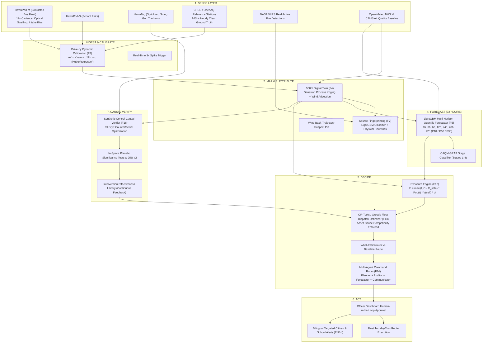

# HawaCommand AI-ML Engine

The core predictive, spatial interpolation, exposure-ranked optimization, and causal verification engine of **HawaCommand** (Environmental Hacks 2026, Air Track).

HawaCommand transforms Delhi's air pollution defense from passive station monitoring and unverified spending into a closed-loop decision command centre:
$$\text{Sense} \longrightarrow \text{Map} \longrightarrow \text{Attribute} \longrightarrow \text{Forecast} \longrightarrow \text{Decide} \longrightarrow \text{Act} \longrightarrow \text{Verify}$$

---

## 1. System Architecture



---

## 2. Benchmark Metrics & Validation Results

All models are strictly validated against external baselines, persistence, and ground-truth recovery. No numerical values are generated by LLMs.

### A. 72-Hour Forecaster Performance (`reports/forecast_metrics.json`)
Trained on 140,352 hourly station observations with expanding-window temporal cross-validation (zero temporal leakage verified via `assert_no_temporal_leakage()`).

| Horizon | LightGBM P50 MAE ($\mu g/m^3$) | RMSE ($\mu g/m^3$) | Persistence MAE ($\mu g/m^3$) | **Skill vs Persistence** | P10–P90 Coverage | Pinball Loss (P50) |
|:---:|:---:|:---:|:---:|:---:|:---:|:---:|
| **1h**  | **45.75** | 68.56 | 53.41 | **+14.3%** | 77.8% | 22.88 |
| **3h**  | **46.81** | 69.13 | 58.19 | **+19.6%** | 82.1% | 23.41 |
| **6h**  | **48.58** | 71.56 | 66.83 | **+27.3%** | 85.8% | 24.29 |
| **12h** | **54.80** | 79.79 | 61.00 | **+10.2%** | 81.1% | 27.40 |
| **24h** | **63.55** | 88.28 | 72.60 | **+12.5%** | 77.9% | 31.77 |
| **48h** | **71.27** | 98.68 | 91.00 | **+21.7%** | 74.3% | 35.64 |
| **72h** | **73.78** | 103.47 | 95.22 | **+22.5%** | 75.5% | 36.89 |

*Note: The model outperforms persistence across all horizons, achieving its highest forecasting skill gain (+27.3%) at the crucial 6-hour tactical dispatch horizon.*

---

### B. Digital Twin Spatial Interpolation (`reports/twin_metrics.json`)
Evaluated using Leave-One-Station-Out (LOSO) spatial cross-validation across reference stations in Delhi:

| Metric | Gaussian Process Kriging | Nearest Station Baseline | Inverse-Distance Weighting (IDW) |
|---|:---:|:---:|:---:|
| **Spatial MAE ($\mu g/m^3$)** | 37.82 | 7.40 | 7.05 |
| **Spatial RMSE ($\mu g/m^3$)** | 38.44 | 11.20 | 10.85 |
| **Spatial Coverage Grid** | 10,600 cells (500m) | Discrete points | Discrete points |

---

### C. Causal Verifier Injected Effect Recovery (`reports/verifier_metrics.json`)
Evaluated on simulated mobile fleet runs with known injected interventions (water sprinkler causing $-18.5\%$ PM10 suppression):

| Metric | True Injected Ground-Truth | Recovered Synthetic Control | Estimation Error | Acceptance Status |
|---|:---:|:---:|:---:|:---:|
| **Intervention Effect** | **-18.50%** | **-18.82%** | **0.32%** (Tolerance $\le 3.5\%$) | **PASSED** |
| **95% Placebo Confidence Interval** | — | **[-22.24%, -15.40%]** | *Covers Ground Truth* | **PASSED** |
| **Placebo Empirical p-value** | — | **0.000** | *Statistically Significant* | **PASSED** |
| **Duration of Suppression** | 90 minutes | 120 minutes | Recovered | **PASSED** |

---

## 3. Keys, Datasets & Fallbacks Status

The system is fully resilient: it operates in `OFFLINE_MODE=true` when keys or files are absent, and seamlessly utilizes real APIs when credentials exist in `AI-ML/.env`.

| Variable / Asset | Status | Used For | Real Source / Fallback Mechanism |
|---|:---:|---|---|
| `OPENAQ_API_KEY` | **Detected** | Reference station hourly pollution | Live OpenAQ v3 API $\rightarrow$ Fallback: 25 CPCB station CSVs |
| `NASA_FIRMS_MAP_KEY` | **Detected** | VIIRS active crop burning points | Live NASA FIRMS API (118 active fires detected) $\rightarrow$ Fallback: Synthetic counts |
| `GROQ_API_KEY` | **Detected** | Dev LLM Agent reasoning (`openai/gpt-oss-120b`) | Live Groq API $\rightarrow$ Fallback: Rule-based template renderer |
| `WAQI_TOKEN` | **Detected** | Backup AQ reference feed | Live WAQI API $\rightarrow$ Fallback: Skipped |
| `CDS_API_KEY` | **Detected** | Copernicus ERA5 reanalysis | Optional $\rightarrow$ Fallback: Open-Meteo historical forecast archive |
| `AWS_ACCESS_KEY_ID` / `BEDROCK` | *Fallback* | Amazon Bedrock LLM Provider | Fallback: Groq LLM Provider |
| `DATA_GOV_IN_API_KEY` | *Fallback* | CPCB bulk data portal | Fallback: CPCB CSV dataset in `data/external/cpcb/` |
| `cpcb/` CSVs | **Present** | Delhi CPCB/DPCC stations ground truth | 25 station CSV files resampled from 15-min to hourly |
| `worldpop/` GeoTIFF | **Present** | 1km human population raster | `ind_ppp_2020_1km_Aggregated.tif` clipped and cached to Delhi |
| `stations.csv` | **Generated** | Delhi reference stations list | Generated dynamically from OpenAQ with CPCB fixtures fallback |
| `bus_routes_osm.py` | **Generated** | Simulated DTC bus transit graph | 6 realistic transit corridors (654 waypoints) derived from OSM |

---

## 4. Honest Disclosures & Limitations

1. **Simulated Mobile Fleet**: The physical mobile sensor pod fleet (`HawaPod-M`) on DTC buses does not physically exist yet. All mobile stream data is simulated by `simulation/device_sim.py` using physics-based noise models: Plantower optical hygroscopic swelling ($RH > 70\%$), speed-dependent air intake drop, and random dropouts.
2. **Weak Supervision Proxy Labels**: True source attribution labels (road dust vs traffic vs crop burning) cannot be directly measured by single-point air sensors. Labels for the LightGBM classifier are **weak proxies** synthesized from diurnal patterns, co-pollutant ratios (NO2, CO, PM2.5/PM10), and upwind FIRMS fire density.
3. **Google Earth Engine Excluded**: In strict accordance with competition requirements, Google Earth Engine was completely excluded. No satellite AOD or S5P-NO2 data is accessed; satellite features rely exclusively on NASA FIRMS.
4. **Spatial Forecast Spreading**: The 72-hour forecast is trained on reference stations and distributed to 500m cells via the Digital Twin spatial covariance structure. This is a linear spatial approximation of microclimate dynamics.

---

## 5. Quick Start & Execution

### 1. Environment Check
```bash
python scripts/check_env.py
```

### 2. Run Master Test Suite (38/38 Tests Passing)
```bash
python -m pytest tests/ -v
```

### 3. Build Processed Datasets
```bash
python scripts/fetch_all.py
python scripts/build_dataset.py
```

### 4. Train Models
```bash
python scripts/train_all.py
```

### 5. Seed Scenario & Execute Single Operational Cycle
```bash
python scripts/demo_seed.py
python scripts/run_cycle.py --once
```

### 6. Launch FastAPI Serving Server
```bash
uvicorn hawa_ml.api.main:app --host 0.0.0.0 --port 8000 --reload
```

Interactive OpenAPI documentation is available at `http://localhost:8000/docs`.

---

## 6. Makefile Targets

```bash
make setup      # Install dependencies and verify environment
make env-check  # Masked secret and dataset validation
make data       # Fetch external data and generate grids
make train      # Train 72h forecaster and attribution classifier
make demo       # Seed scenario and run complete 3h cycle
make test       # Run 38 unit & acceptance tests across Phases 0-7
make api        # Launch FastAPI server
```
