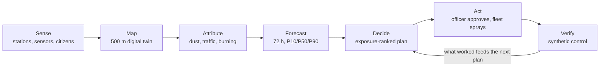
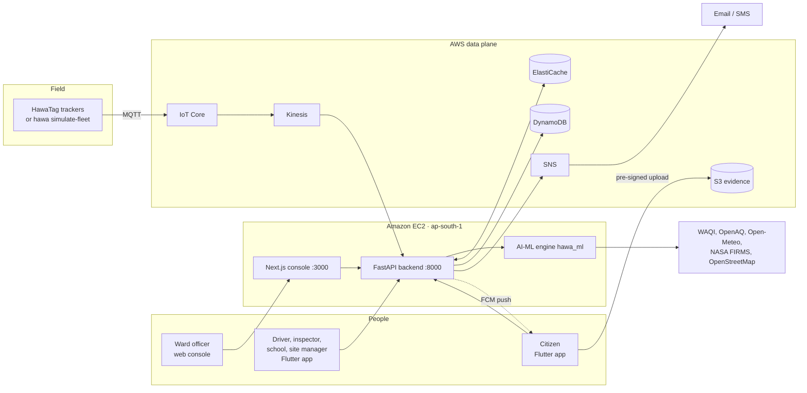

<div align="center">

# HawaCommand

**Delhi already owns the machines. We give them a brain.**

An AI command centre for Delhi's air: it maps pollution street by street, forecasts it 72 hours ahead, dispatches the city's anti-smog fleet, and proves whether each intervention worked.

A fully developed prototype, deployed on AWS: every flow runs end to end, from a vehicle ping to a verified impact.

<a href="http://ec2-13-207-49-123.ap-south-1.compute.amazonaws.com:3000/"></a>

<a href="https://www.wemakedevs.org/aws/env"></a>

<a href="#built-on-aws"></a>
<a href="docs/backend/API.md"></a>
<a href="#testing"></a>
<a href="docs/README.md"></a>
<a href="LICENSE"></a>


[Live demo](#live-demo) · [Problem](#the-problem) · [Solution](#the-solution) · [Built on AWS](#built-on-aws) · [Architecture](#architecture) · [Features](#features) · [For judges](#for-the-judges) · [Quick start](#quick-start) · [Docs](#documentation) · [Team](#team)

Made with ❤️ by **Team Straw Hat Pirates** for the [WeMakeDevs AWS Environment Hackathon](https://www.wemakedevs.org/aws/env)

</div>

---

## Live demo

Deployed on **Amazon EC2 in ap-south-1 (Mumbai)**, next to its AWS data plane.

| What | Link |
|---|---|
| Officer web console (landing page) | [ec2-13-207-49-123.ap-south-1.compute.amazonaws.com:3000](http://ec2-13-207-49-123.ap-south-1.compute.amazonaws.com:3000/) |
| Live hotspot map | [/map](http://ec2-13-207-49-123.ap-south-1.compute.amazonaws.com:3000/map) |
| 72-hour forecast and GRAP | [/forecast](http://ec2-13-207-49-123.ap-south-1.compute.amazonaws.com:3000/forecast) |
| Plan review and approval | [/plans](http://ec2-13-207-49-123.ap-south-1.compute.amazonaws.com:3000/plans) |
| What-If vs usual routes | [/what-if](http://ec2-13-207-49-123.ap-south-1.compute.amazonaws.com:3000/what-if) |
| Verified impact | [/impact](http://ec2-13-207-49-123.ap-south-1.compute.amazonaws.com:3000/impact) |
| Fleet and HawaTag state | [/fleet](http://ec2-13-207-49-123.ap-south-1.compute.amazonaws.com:3000/fleet) |
| Alerts | [/alerts](http://ec2-13-207-49-123.ap-south-1.compute.amazonaws.com:3000/alerts) |
| Hindi-first driver view | [/route](http://ec2-13-207-49-123.ap-south-1.compute.amazonaws.com:3000/route) |
| Backend API (Swagger UI) | [:8000/docs](http://ec2-13-207-49-123.ap-south-1.compute.amazonaws.com:8000/docs) |
| Which AWS services are live | [:8000/readyz](http://ec2-13-207-49-123.ap-south-1.compute.amazonaws.com:8000/readyz) |

- Demo video: **3 minutes**, see the submission page.
- Android app: build the APK with `make app-apk` ([guide](app_frontend/README.md)).

---

## The problem

- Delhi runs **376 anti-smog guns, 266 water sprinklers and 91 mechanised road sweepers**.
- They follow **static schedules**, not where the pollution or the people are.
- Nobody can tell whether a spray run **lowered PM2.5** or whether the wind did it.
- Citizens see smoke and dust but have **no channel that leads to action**.
- Contractors can skip routes; there is **no proof a machine actually worked**.

## The solution

HawaCommand is the decision layer for that fleet: a closed loop that learns which interventions work.



| Stage | What it does | Where |
|---|---|---|
| Sense | Live WAQI / OpenAQ stations, HawaTag vehicle telemetry over **IoT Core + Kinesis**, citizen photo reports to **S3** | [backend](backend/README.md), [AWS architecture](docs/AWS_ARCHITECTURE.md) |
| Map | Gaussian-process kriging over **10,600 cells** of 500 m, each with PM2.5, PM10 and confidence | [AI-ML architecture](docs/aiml/ARCHITECTURE.md) |
| Attribute | Fingerprint rules label each hotspot: road dust, traffic, burning, regional smoke, industrial | [AI-ML README](AI-ML/README.md) |
| Forecast | **21 LightGBM quantile models**, 1 to 72 h, with CPCB AQI and the CAQM GRAP stage | [forecaster card](AI-ML/models/forecaster_model_card.md) |
| Decide | Ranks hotspots by **people exposed** (population, schools, hospitals), not raw AQI; drafts a cause-matched dispatch plan | [AI-ML architecture](docs/aiml/ARCHITECTURE.md) |
| Act | Officer approves in the console; drivers get Hindi-first routes; **SNS** alerts and push go out | [web](frontend/README.md), [app](app_frontend/README.md) |
| Verify | Synthetic control with placebo tests: effect size with a 95 % interval | [AI-ML runbook](AI-ML/README.md) |

---

## Built on AWS

**22 AWS services integrated: 9 live on the deployment, 4 more wired in code, 9 in the infrastructure-as-code path.**
Every service is optional and falls back to process memory, so the demo survives any single outage. Deep dive: [AWS architecture](docs/AWS_ARCHITECTURE.md) · Setup: [AWS integration guide](docs/AWS_SETUP_GUIDE.md).

Legend:  running on the deployment (see [/readyz](http://ec2-13-207-49-123.ap-south-1.compute.amazonaws.com:8000/readyz)) ·  in code, switched on by one variable ·  template or workflow in the repo

| # | Service | How HawaCommand uses it | Resource / code | Status |
|---|---|---|---|---|
| 1 |  | Hosts the backend, AI-ML engine and web console under PM2 | `infrastructure/ec2/` |  |
| 2 |  | Instance role with a least-privilege policy; no access keys on the server | `hawa-backend-ec2-role`, policy `hawa-backend-access` |  |
| 3 |  | Citizen photo evidence: pre-signed POST (type, size, SHA-256 pinned), pre-signed GET, upload check | `hawa-citizen-evidence-prod`, [`aws/uploads.py`](backend/src/hawa_backend/aws/uploads.py) |  |
| 4 |  | Citizen grievances (2 GSIs, PITR) and fleet telemetry (7-day TTL) | `hawa-citizen-grievances`, `hawa-fleet-telemetry`, [`services/`](backend/src/hawa_backend/services/) |  |
| 5 |  | Telemetry bus: API producer, in-process consumer with Redis checkpoints | `hawa-sensor-data`, [`kinesis_consumer.py`](backend/src/hawa_backend/aws/kinesis_consumer.py) |  |
| 6 |  | MQTT topic for HawaTag trackers; rule forwards to Kinesis | `hawa/vehicles/+/telemetry`, rule `hawa_vehicle_telemetry` |  |
| 7 |  | Live fleet geo index, twin snapshot (15 min TTL), plans, alerts, WebSocket fan-out | `geo:fleet:active`, `grid:pm25:500m:*`, [`redis_store.py`](backend/src/hawa_backend/core/redis_store.py) |  |
| 8 |  | Alert broadcasts with ward filter policies; email/SMS subscribers; plan-approval notices | `hawa-citizen-push-alerts`, [`services/alerts.py`](backend/src/hawa_backend/services/alerts.py) |  |
| 9 |  | Server-side encryption of the Kinesis stream and the cache at rest | `aws/kinesis` managed key |  |
| 10 |  | Backend secrets loaded at startup; Firebase service-account key for push | `hawa/backend`, `hawa/firebase/service-account` |  |
| 11 |  | LLM provider for the Planner, Auditor, Forecaster and Communicator agents | `LLM_PROVIDER=bedrock`, [`llm_provider.py`](AI-ML/src/hawa_ml/agents/llm_provider.py) |  |
| 12 |  | Forecast workflow (sync) and dispatch workflow started on plan approval | [`aws/forecast.py`](backend/src/hawa_backend/aws/forecast.py), [`aws/dispatch.py`](backend/src/hawa_backend/aws/dispatch.py) |  |
| 13 |  | Forecast endpoint, results cached in DynamoDB | `HAWA_AWS_FORECAST_ENDPOINT` |  |
| 14 |  | Three templates: data plane, cache, container service | [`infrastructure/cloudformation/`](infrastructure/cloudformation/) |  |
| 15 |  | Backend image registry, pushed by GitHub Actions | [`backend-image.yml`](.github/workflows/backend-image.yml) |  |
| 16 |  | Backend service, 1 vCPU / 2 GB, deployment circuit breaker | [`hawa-ecs.yaml`](infrastructure/cloudformation/hawa-ecs.yaml) |  |
| 17 |  | Health check `/health`, WebSocket-friendly idle timeout, HTTPS listener | `hawa-ecs.yaml` |  |
| 18 |  | CPU target tracking at 70 %, up to 6 tasks | `hawa-ecs.yaml` |  |
| 19 |  | Container logs and Container Insights | `/ecs/hawa-command-backend` |  |
| 20 |  | TLS 1.3 certificate for the load balancer | `CertificateArn` parameter |  |
| 21 |  | `api.<domain>` record for the API | [AWS guide §11](docs/AWS_SETUP_GUIDE.md#11-optional-domain-and-https) |  |
| 22 |  | Build spec for hosting the web console | [`frontend/amplify.yml`](frontend/amplify.yml) |  |

- One command checks every configured service: `uv run hawa aws-check` ([CLI](backend/README.md#5-cli)).
- Every call has a fallback: a failing AWS service degrades one feature, never the whole app.

---

## Architecture



- **One Python environment** runs the backend and the AI-ML engine (`backend/.venv`, locked by uv).
- **Fallbacks everywhere:** AI-ML over HTTP, then in-process, then fixtures; AWS and Redis, then memory.
- **Honest data:** anything simulated carries `simulated: true` and a badge in the UI.
- More: [system overview](docs/SYSTEM_OVERVIEW.md) · [backend architecture](docs/backend/ARCHITECTURE.md) · [AWS architecture](docs/AWS_ARCHITECTURE.md)

---

## Features

### Officer web console

- **Live hotspot map** of 500 m cells with likely cause, exposure and a suspect upwind pin.
- **72-hour forecast** with P10/P50/P90 bands and the GRAP stage checklist.
- **AI dispatch plans**: Planner drafts, Auditor objects (for example "sprinkler near a CPCB station"), officer approves in one click.
- **What-If**: usual routes vs the AI plan in people-hours of exposure avoided.
- **Verified impact**: each intervention's effect with a 95 % interval from synthetic control.
- **Fleet** with HawaTag pump flow, litres and status; **alerts** with WhatsApp-style preview.

### Field and citizen app (Flutter, English and Hindi)

| Role | What they get |
|---|---|
| Driver | Hindi-first route, stop-by-stop, HawaTag auto-done, shift tracking |
| Inspector | Targets with evidence, on-site check, outcome with photos |
| School | Safe outdoor windows, indoor vs outdoor, 72 h forecast |
| Citizen | AI air map with clean-air routes, air near me, alerts, **Citizen Eyes** photo reports, live **Govt in Action** radar |
| Site manager | Site compliance score |

- **Offline-first**: every action goes through an outbox and syncs when the network returns.
- **Built for the street**: outdoor high-contrast theme, large buttons, 638 strings in each language.

### Accountability

- **Citizen Eyes**: photo report, automated verification (S3 check, location, cause rules), officer ticket and close, push at every step.
- **No ghost workers**: a "missed machine" flag is checked against the vehicle's real GPS and pump telemetry; no work on site means an SLA breach.
- **Live radar**: vehicle positions reach the app over a WebSocket within milliseconds of the ping.

---

## For the judges

| Criterion | Where to look |
|---|---|
| **Idea and impact** | Real fleet, real gap: 733 machines on static schedules. We rank by people exposed and prove what worked ([problem](#the-problem), [system overview](docs/SYSTEM_OVERVIEW.md)) |
| **Built on AWS** | 22 services integrated, 9 live: EC2, IAM, S3, DynamoDB, Kinesis, IoT Core, ElastiCache, SNS, KMS ([table](#built-on-aws), [deep dive](docs/AWS_ARCHITECTURE.md)) |
| **Design and usability** | One-click plan approval, Hindi-first driver view, bilingual offline-first app, outdoor theme ([web architecture](docs/frontend/ARCHITECTURE.md), [app architecture](docs/app/ARCHITECTURE.md)) |
| **Execution** | A fully developed prototype, deployed and live ([demo](#live-demo)); 135 automated tests; `hawa aws-check` verifies the cloud wiring ([testing](#testing)) |
| **Demo video** | 3 minutes: the problem, the officer loop, the field app, and where AWS fits |

---

## Tech stack

| Layer | Technology |
|---|---|
| AI / ML | Python 3.11, scikit-learn Gaussian process, LightGBM quantile models, SciPy synthetic control, Groq or Bedrock LLM agents |
| Backend | FastAPI, Pydantic v2, boto3, redis-py, httpx, SQLAlchemy 2 + Alembic (schema ready), uv |
| Web console | Next.js 15, React 19, TypeScript, Tailwind CSS, MapLibre GL, zod contracts |
| Mobile | Flutter 3.44, Riverpod 3, go_router, drift (SQLite), Dio, flutter_map, Firebase Cloud Messaging |
| Cloud | EC2, S3, DynamoDB, Kinesis, IoT Core, ElastiCache, SNS, IAM, KMS, Secrets Manager, CloudFormation, ECS Fargate |
| Data | WAQI, OpenAQ, CPCB, Open-Meteo, NASA FIRMS, OpenStreetMap, WorldPop |

---

## Repository layout

```
HawaCommand/
├── AI-ML/              hawa_ml: twin, forecaster, attribution, exposure, optimiser, causal verifier, agents
├── backend/            FastAPI API, AWS layer, services (reports, fleet, alerts, push), CLI, contracts package
├── frontend/           Next.js officer console, landing page, driver view
├── app_frontend/       Flutter app for drivers, inspectors, schools, citizens, site managers
├── infrastructure/     CloudFormation (data plane, cache, ECS), EC2 PM2 file and Caddyfile
├── docs/               System, AWS, contracts and per-discipline documentation
├── .github/workflows/  Build the backend image and push it to ECR
└── Makefile            install, run and build targets
```

Module docs (architecture, API, deployment): [backend](docs/backend/README.md) · [AI-ML](docs/aiml/README.md) · [web](docs/frontend/README.md) · [app](docs/app/README.md)

---

## Quick start

**Prerequisites:** [uv](https://docs.astral.sh/uv/), Node.js 20+ with pnpm, Flutter 3.44 via fvm (app only). Docker is optional.

```bash
make install                                   # backend + AI-ML env (uv), web console deps (pnpm)
source backend/.venv/bin/activate && make aiml-api   # AI-ML engine on :8100
make backend                                   # API on :8000, Swagger at /docs
make frontend API_URL=http://localhost:8000    # web console on :3000
make app-apk                                   # Android APK (staging flavor)
```

- Nothing is required to start: without keys, AWS or Redis, everything runs on fixtures and memory.
- Settings: [environment variables](docs/ENVIRONMENT_VARIABLES.md) · AWS: [integration guide](docs/AWS_SETUP_GUIDE.md).
- Component runbooks: [backend](backend/README.md) · [AI-ML](AI-ML/README.md) · [web](frontend/README.md) · [app](app_frontend/README.md).

### Commands

| Command | Does |
|---|---|
| `make install` | Sync the Python env and install web dependencies |
| `make aiml-api` / `make backend` / `make frontend` | Run the engine (:8100), API (:8000), console (:3000) |
| `make db-update db-seed` | Create and seed the 23-table schema (Postgres or SQLite) |
| `make app-apk` | Build the shareable Android APK |
| `uv run hawa aws-check` | Check every configured AWS service, Redis and FCM |
| `uv run hawa simulate-fleet --target iot` | Drive a demo fleet through IoT Core, Kinesis or the API |
| `uv run hawa consume-telemetry` | Run the Kinesis consumer as its own process |

---

## API at a glance

| Area | Endpoints |
|---|---|
| Air intelligence | `/v1/twin`, `/v1/hotspots`, `/v1/forecast`, `/open/v1/air` |
| Plans | `/v1/plans`, `/v1/plans/draft`, `/v1/plans/{id}/approve`, `/v1/plans/{id}/compare` |
| Impact | `/v1/impact`, `/v1/impact/library`, `/v1/interventions/{id}/verify` |
| Citizen reports | `/v1/uploads/presign`, `/v1/reports`, `/v1/reports/mine`, `/v1/reports/{id}` |
| Fleet | `/v1/telemetry/vehicles`, `/v1/fleet/live`, `/v1/fleet/nearby`, `/v1/fleet/{id}/track`, `WS /v1/ws/fleet` |
| Alerts | `/v1/alerts`, `/v1/alerts/broadcast`, `/v1/alerts/subscribers`, `/v1/me/push-token` |
| Citizen tools | `/v1/citizen/safe-route`, `/v1/citizen/safe-window`, `/v1/citizen/live-operations`, `/v1/citizen/reports/missed-machine` |
| Ops | `/healthz`, `/readyz` |

Every route, field and status code: [API reference](docs/backend/API.md).

---

## Testing

| Suite | Command | Result |
|---|---|---|
| Backend | `cd backend && uv run pytest -q` | **97 passed** (AWS with moto, Redis with fakeredis) |
| AI-ML | `cd AI-ML && python -m pytest -q` | **38 passed** after `make data && make train` |
| Web | `cd frontend && pnpm typecheck && pnpm build` | Pass |
| Cloud wiring | `cd backend && uv run hawa aws-check` | One live call per configured service |

---

## Prototype scope

HawaCommand is a **fully developed prototype**: every module is built, connected and deployed, and every user flow works end to end.

| Area | In the prototype |
|---|---|
| AWS data plane, citizen reports, live fleet, alerts, WebSocket | Running on live AWS services |
| Digital twin, source attribution, exposure ranking, GRAP | Running on live station data |
| 72 h forecaster | 21 trained quantile models, driven by the latest reading |
| Dispatch planner and agents | Cause-matched greedy dispatch, explained by LLM or template agents |
| Causal verification | Synthetic control, validated on a seeded panel (-18.5 % injected, -18.82 % recovered) |
| What-If, safe route, ward scorecards | Working on demo data |
| Field sensors | The HawaTag simulator drives the real IoT Core and Kinesis path |

**Next for a city rollout**

- Officer and citizen sign-in (Amazon Cognito) in place of the shared API key.
- OR-Tools route optimisation on top of the greedy dispatcher.
- Physical HawaTag trackers on the fleet, using the same IoT Core topic.

Component-level detail: [system overview](docs/SYSTEM_OVERVIEW.md#0-the-system-as-built-today).

---

## Documentation

| Start here | |
|---|---|
| [Docs hub](docs/README.md) | Every doc, grouped by reader |
| [System overview](docs/SYSTEM_OVERVIEW.md) | Product, users, architecture, status |
| [AWS architecture](docs/AWS_ARCHITECTURE.md) | Each AWS service: why, how, resources, IAM, fallback |
| [AWS integration guide](docs/AWS_SETUP_GUIDE.md) | Why AWS, integration checklist, console steps for every service |
| [Environment variables](docs/ENVIRONMENT_VARIABLES.md) | Every setting in every component |
| [API reference](docs/backend/API.md) | Every route |
| [Contracts](docs/CONTRACTS.md) | IDs, enums, units, packets shared by all teams |

| Discipline | Runbook | Deep docs |
|---|---|---|
| AI / ML | [AI-ML/README.md](AI-ML/README.md) | [docs/aiml](docs/aiml/README.md) |
| Backend | [backend/README.md](backend/README.md) | [docs/backend](docs/backend/README.md) |
| Web | [frontend/README.md](frontend/README.md) | [docs/frontend](docs/frontend/README.md) |
| Mobile | [app_frontend/README.md](app_frontend/README.md) | [docs/app](docs/app/README.md) |

---

## Team

**Team Straw Hat Pirates**

| Member | Role |
|---|---|
| Shankar | Team lead |
| Madhur Prakash Mangal | Member |
| Akshat Arya | Member |
| Mayank | Member |

---

## Acknowledgements

- Air data: [WAQI](https://aqicn.org), [OpenAQ](https://openaq.org), CPCB / DPCC, [Open-Meteo](https://open-meteo.com), NASA FIRMS.
- Maps and population: [OpenStreetMap](https://www.openstreetmap.org) contributors, WorldPop, OpenFreeMap, Esri.
- Built on [AWS](https://aws.amazon.com) for the [WeMakeDevs AWS Environment Hackathon](https://www.wemakedevs.org/aws/env).

## Licence

[MIT](LICENSE)

<div align="center">

Made with ❤️ by Team Straw Hat Pirates

</div>
