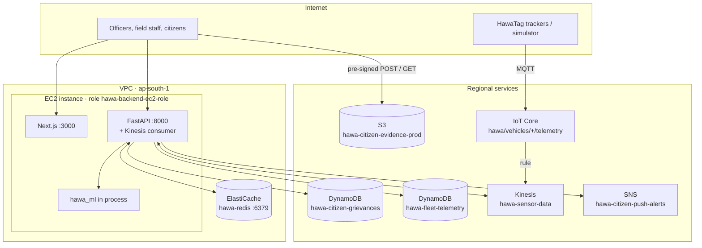
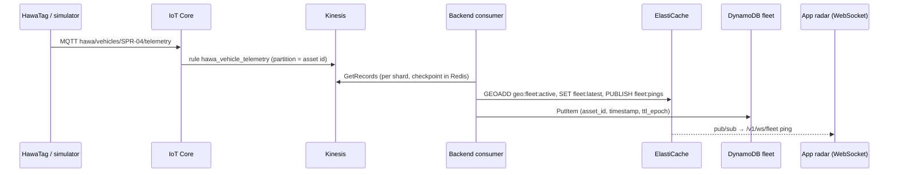
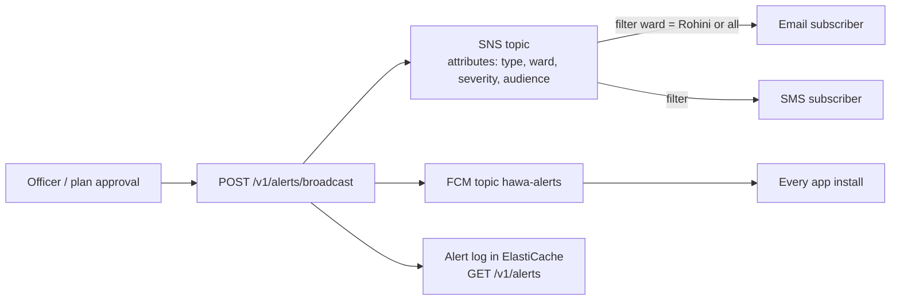

# AWS architecture

<!-- nav:start -->

**Navigate:** [Project](../README.md) · [Docs hub](README.md) · [Overview](SYSTEM_OVERVIEW.md) · **AWS architecture** · [AWS setup](AWS_SETUP_GUIDE.md) · [API](backend/API.md) · [Environment](ENVIRONMENT_VARIABLES.md) · [Contracts](CONTRACTS.md)

**Cloud docs:** **AWS architecture** · [AWS setup guide](AWS_SETUP_GUIDE.md) · [AWS integration](AWS_INTEGRATION.md) · [Cloud checklist](CLOUD_ENGINEER_INTEGRATION_CHECKLIST.md) · [Environment variables](ENVIRONMENT_VARIABLES.md)

<!-- nav:end -->

<div align="center">


</div>

How HawaCommand uses each AWS service, which resource it touches, which code calls it, and what happens when it is down.

- Setup steps: [AWS setup guide](AWS_SETUP_GUIDE.md)
- Every variable: [environment variables](ENVIRONMENT_VARIABLES.md#optional-aws-layer)
- Checklist status: [cloud checklist](CLOUD_ENGINEER_INTEGRATION_CHECKLIST.md)
- Older engineering runbook: [AWS integration](AWS_INTEGRATION.md)

---

## Contents

1. [At a glance](#1-at-a-glance)
2. [Deployment topology](#2-deployment-topology)
3. [Data flows](#3-data-flows)
4. [Service by service](#4-service-by-service)
5. [Security and IAM](#5-security-and-iam)
6. [Resilience: fallbacks](#6-resilience-fallbacks)
7. [Verify a deployment](#7-verify-a-deployment)
8. [Infrastructure as code](#8-infrastructure-as-code)

---

## 1. At a glance

| Group | Services | Status |
|---|---|---|
| Compute and identity | EC2, IAM |  |
| Storage | S3, DynamoDB (2 tables) |  |
| Streaming and IoT | IoT Core, Kinesis Data Streams |  |
| Cache and realtime | ElastiCache (Valkey / Redis) |  |
| Messaging | SNS |  |
| Encryption | KMS (AWS managed keys) |  |
| Secrets | Secrets Manager |  |
| AI and workflows | Bedrock, Step Functions, SageMaker |  |
| Containers and edge | CloudFormation, ECR, ECS Fargate, ALB, Auto Scaling, CloudWatch, ACM, Route 53, Amplify |  |

- **Live:** running on the deployment; [`/readyz`](http://ec2-13-207-49-123.ap-south-1.compute.amazonaws.com:8000/readyz) lists them.
- **Wired:** in code and tested with mocks; one variable switches it on.
- **IaC:** a template or workflow in the repo, for the container path.

---

## 2. Deployment topology



- The instance has **no access keys**: boto3 takes credentials from the instance role.
- ElastiCache accepts **port 6379 only from the instance's security group** (`hawa-redis-sg`).
- The S3 bucket stays **private**; clients only get time-limited pre-signed URLs.

---

## 3. Data flows

### 3.1 Vehicle telemetry (IoT Core → Kinesis → live radar)



- HTTP pings (`POST /v1/telemetry/vehicles`) are stored at once and copied to Kinesis with `via=api`; the consumer skips them.
- Ping to WebSocket in about **25 ms** in local measurement.
- Code: [`services/fleet.py`](../backend/src/hawa_backend/services/fleet.py), [`aws/kinesis_consumer.py`](../backend/src/hawa_backend/aws/kinesis_consumer.py), [`api/routes/fleet.py`](../backend/src/hawa_backend/api/routes/fleet.py)

### 3.2 Citizen Eyes report (S3 → DynamoDB → officer → push)

```mermaid
sequenceDiagram
  participant App as Citizen app
  participant API as Backend
  participant S3 as S3 evidence
  participant Ddb as DynamoDB grievances
  participant Off as Officer
  App->>API: POST /v1/uploads/presign
  API-->>App: pre-signed POST (type, size, SHA-256 pinned)
  App->>S3: upload photo
  App->>API: POST /v1/reports (photo_key, location)
  API->>Ddb: PutItem status=submitted
  API->>S3: HeadObject (photo exists?)
  API->>Ddb: status=verified (ward, cell, cause)
  API-->>App: push "Report verified"
  Off->>API: PATCH /v1/reports/{id} ticketed → closed
  API->>Ddb: update + timeline
  API-->>App: push at each step
```

- Verification = photo in S3 + location inside Delhi + the twin cell's fingerprint rules vs the citizen's category.
- Officers query by ward and status through the `WardStatusIndex` GSI; open reports past 3 h are flagged as SLA breaches.
- Code: [`services/reports.py`](../backend/src/hawa_backend/services/reports.py), [`api/routes/reports.py`](../backend/src/hawa_backend/api/routes/reports.py)

### 3.3 Alerts (SNS fan-out)



- Subscribers join with a ward filter policy: `{"ward": ["Rohini", "all"]}`.
- Code: [`services/alerts.py`](../backend/src/hawa_backend/services/alerts.py), [`aws/events.py`](../backend/src/hawa_backend/aws/events.py)

---

## 4. Service by service

### 4.1 Amazon EC2

| | |
|---|---|
| Why | One instance runs the backend, the AI-ML engine and the web console next to the data plane |
| Setup | Amazon Linux, PM2 ([`ecosystem.config.cjs`](../infrastructure/ec2/ecosystem.config.cjs)), optional Caddy for HTTPS ([`Caddyfile`](../infrastructure/ec2/Caddyfile)) |
| Ports | 3000 (console), 8000 (API + WebSocket); 8100 (AI-ML) stays closed |

### 4.2 AWS IAM

| | |
|---|---|
| Why | Least privilege; no long-lived keys on the server |
| Resources | Role `hawa-backend-ec2-role`, managed policy `hawa-backend-access`, IoT rule role `hawa-iot-to-kinesis` |
| Policy | [setup guide §1](AWS_SETUP_GUIDE.md#1-iam-give-the-ec2-role-the-new-permissions) and [`hawa-integration.yaml`](../infrastructure/cloudformation/hawa-integration.yaml) |

### 4.3 Amazon S3

| | |
|---|---|
| Why | Citizens and inspectors upload photo evidence without the backend handling bytes |
| Resource | `hawa-citizen-evidence-prod`, keys `{purpose}/YYYY/MM/DD/{uuid}.{ext}` |
| Calls | `generate_presigned_post` (upload), `generate_presigned_url` (read), `HeadObject` (verification), `PutObject` (health check) |
| Code | [`aws/uploads.py`](../backend/src/hawa_backend/aws/uploads.py) |
| Config | `HAWA_AWS_EVIDENCE_BUCKET`, `HAWA_AWS_UPLOAD_MAX_BYTES` (5 MB), `HAWA_AWS_PRESIGN_TTL_SECONDS` (900), `HAWA_AWS_EVIDENCE_READ_TTL_SECONDS` (3600) |
| Guard rails | Upload policy pins content type, SHA-256 metadata and size; bucket is private |
| Fallback | `503` from presign; reports keep working without photo URLs |

### 4.4 Amazon DynamoDB

| Table | Keys | Indexes / TTL | Used by |
|---|---|---|---|
| `hawa-citizen-grievances` | `report_id` + `created_at` | GSI `WardStatusIndex` (`ward_id` + `status`), GSI `OwnerIndex` (`owner_id` + `created_at`), PITR | `/v1/reports*` |
| `hawa-fleet-telemetry` | `asset_id` + `timestamp` | TTL on `ttl_epoch` (7 days) | ingest, `/v1/fleet/{id}/track`, missed-machine audit |
| `hawa-cache` | `pk` | TTL on `ttl` | remote forecast cache (optional) |

- On-demand capacity: no capacity planning, pennies at demo traffic.
- Code: [`services/reports.py`](../backend/src/hawa_backend/services/reports.py), [`services/fleet.py`](../backend/src/hawa_backend/services/fleet.py), [`aws/cache.py`](../backend/src/hawa_backend/aws/cache.py)
- Fallback: process memory; a configured but failing grievances table returns `503` so the app's outbox retries.

### 4.5 Amazon Kinesis Data Streams

| | |
|---|---|
| Why | Durable, ordered telemetry bus between devices and the backend |
| Resource | `hawa-sensor-data`, 24 h retention, server-side encryption |
| Producer | Backend forwards HTTP pings (`PutRecord`, `via=api`); simulator can `PutRecords` |
| Consumer | Per-shard polling loop, shard list refreshed every 60 s, checkpoint per shard in Redis |
| Code | [`aws/events.py`](../backend/src/hawa_backend/aws/events.py), [`aws/kinesis_consumer.py`](../backend/src/hawa_backend/aws/kinesis_consumer.py) |
| Config | `HAWA_AWS_SENSOR_STREAM`, `HAWA_AWS_KINESIS_CONSUMER`, `HAWA_AWS_KINESIS_START` |

### 4.6 AWS IoT Core

| | |
|---|---|
| Why | The managed MQTT entry point a real HawaTag would use |
| Topic | `hawa/vehicles/<asset_id>/telemetry` |
| Rule | `SELECT *, topic(3) AS asset_id, 'iot' AS source FROM 'hawa/vehicles/+/telemetry'` → Kinesis, partition key `${topic(3)}` |
| Simulator | `uv run hawa simulate-fleet --target iot` publishes through the data endpoint (`HAWA_AWS_IOT_ENDPOINT`) |

### 4.7 Amazon ElastiCache (Valkey / Redis)

| Key | Purpose | TTL |
|---|---|---|
| `geo:fleet:active` | `GEOADD` / `GEOSEARCH` for nearby vehicles | pruned after 15 min idle |
| `fleet:lastseen`, `fleet:latest:<id>` | live fleet list and last ping | 24 h |
| `fleet:pings` (channel) | WebSocket fan-out across processes | — |
| `grid:pm25:500m:<YYYYMMDDHH>` | 500 m twin snapshot shared by processes | 900 s |
| `plans:active` | plan state shared by processes | — |
| `push:tokens:<user>`, `alerts:sent`, `alerts:subscription:<user>` | push, alert log, alert areas | 60 d / last 200 |
| `kinesis:checkpoint:<stream>:<shard>` | consumer resume point | 7 d |

- Code: [`core/redis_store.py`](../backend/src/hawa_backend/core/redis_store.py), [`services/twin_cache.py`](../backend/src/hawa_backend/services/twin_cache.py)
- Config: `HAWA_REDIS_URL` (`redis://` or `rediss://` for TLS)
- Fallback: process memory, reconnect attempted every 30 s.

### 4.8 Amazon SNS

| | |
|---|---|
| Why | Reach people by email and SMS, filtered by ward, without running a mail server |
| Resource | `hawa-citizen-push-alerts` |
| Calls | `Publish` with message attributes; `Subscribe` with a `FilterPolicy`; `GetTopicAttributes` (health check) |
| Triggers | `POST /v1/alerts/broadcast`, plan approval (`HAWA_AWS_ALERT_ON_PLAN_APPROVAL`) |
| Config | `HAWA_AWS_ALERTS_TOPIC_ARN` |

### 4.9 AWS KMS

- Kinesis stream encrypted with the AWS managed key `aws/kinesis`.
- ElastiCache encryption at rest; Secrets Manager secrets encrypted with `aws/secretsmanager`.
- No key material in the repo or on the instance.

### 4.10 AWS Secrets Manager 

| Secret | Holds | Variable |
|---|---|---|
| `hawa/backend` | JSON of backend settings (JWT secret, API keys, tokens) loaded before startup | `HAWA_AWS_SECRETS_ID` |
| `hawa/firebase/service-account` | Firebase key for FCM HTTP v1 | `HAWA_AWS_FCM_SECRET_ID` |

- Precedence: exported variables, then the secret, then `backend/.env`.
- Code: [`aws/secrets.py`](../backend/src/hawa_backend/aws/secrets.py), [`core/config.py`](../backend/src/hawa_backend/core/config.py), [`services/push.py`](../backend/src/hawa_backend/services/push.py)

### 4.11 Amazon Bedrock 

- LLM provider for the Planner, Auditor, Forecaster and Communicator agents.
- Switch: `LLM_PROVIDER=bedrock`, `BEDROCK_MODEL_ID` in `AI-ML/.env`; uses the instance role.
- Fallback: deterministic template text. Code: [`agents/llm_provider.py`](../AI-ML/src/hawa_ml/agents/llm_provider.py), docs: [agents](aiml/AGENTS.md).

### 4.12 AWS Step Functions and Amazon SageMaker 

| Hook | Call | Variable |
|---|---|---|
| Forecast for a cell | `StartSyncExecution` (Express) or SageMaker `InvokeEndpoint`, cached in DynamoDB | `HAWA_AWS_FORECAST_STATE_MACHINE_ARN`, `HAWA_AWS_FORECAST_ENDPOINT` |
| Dispatch on plan approval | `StartExecution` (Standard), execution ARN returned in the plan | `HAWA_AWS_DISPATCH_STATE_MACHINE_ARN` |

- Code: [`aws/forecast.py`](../backend/src/hawa_backend/aws/forecast.py), [`aws/dispatch.py`](../backend/src/hawa_backend/aws/dispatch.py). Contracts: [AWS integration tasks 2–3](AWS_INTEGRATION.md#task-2-sagemaker-forecast-endpoint).

### 4.13 Container path 

| Service | Role |
|---|---|
| CloudFormation | Three templates, see [§8](#8-infrastructure-as-code) |
| ECR | `hawa-command-backend` image, built by [`backend-image.yml`](../.github/workflows/backend-image.yml) from [`backend/Dockerfile`](../backend/Dockerfile) |
| ECS on Fargate | Service `hawa-command-backend`, 1 vCPU / 2 GB, circuit breaker with rollback |
| Application Load Balancer | Health check `/health`, idle timeout 120 s for WebSockets, HTTP → HTTPS redirect |
| Application Auto Scaling | CPU target 70 %, up to 6 tasks once Redis is configured |
| CloudWatch | Log group `/ecs/hawa-command-backend`, Container Insights |
| Certificate Manager + Route 53 | TLS 1.3 certificate and `api.<domain>` alias |
| Amplify Hosting | [`frontend/amplify.yml`](../frontend/amplify.yml) for the web console |

---

## 5. Security and IAM

- **No static credentials:** the instance role (EC2) or task role (ECS) signs every AWS call.
- **Least privilege:** each statement names its resource (bucket, table and indexes, stream, topic, `hawa/*` secrets).
- **Private evidence:** bucket blocks public access; uploads and reads use short-lived pre-signed URLs.
- **Shared keys for writes:** `X-Api-Key` (`HAWA_ADMIN_API_KEY`, `HAWA_INGEST_API_KEY`) on officer and ingest routes.
- **Network:** Redis only from the app security group; the AI-ML port is never exposed.

---

## 6. Resilience: fallbacks

| If this fails | What still works |
|---|---|
| S3 | Reports and map; photo upload returns `503` and the app retries |
| DynamoDB grievances | Everything except reports (`503`, outbox retries) |
| DynamoDB fleet | Live fleet from Redis / memory; tracks come from memory |
| Kinesis / IoT Core | HTTP telemetry ingest |
| ElastiCache | Single-process memory for every Redis key |
| SNS / FCM | Alert is logged and shown in the console; delivery says "not configured" |
| Secrets Manager | `backend/.env` |
| Bedrock | Template text |
| Step Functions / SageMaker | In-process forecaster; plan approval still succeeds |

---

## 7. Verify a deployment

```bash
cd backend && uv run hawa aws-check
```

Example output:

```
[OK  ] credentials (STS)            arn:aws:sts::<account>:assumed-role/hawa-backend-ec2-role/...
[OK  ] S3 hawa-citizen-evidence-prod PutObject + HeadObject on s3://.../healthcheck/aws-check.txt
[OK  ] DynamoDB hawa-citizen-grievances table + WardStatusIndex + OwnerIndex
[OK  ] DynamoDB hawa-fleet-telemetry Query OK
[OK  ] Kinesis hawa-sensor-data     ACTIVE, ON_DEMAND, 4 shards
[OK  ] SNS alerts topic             1 confirmed, 0 pending subscriptions
[OK  ] Redis                        8.x; GEOADD/GEOSEARCH ok (1 hit)
```

- `GET /readyz` shows the same picture from the running process.
- End-to-end smoke tests: [setup guide §12](AWS_SETUP_GUIDE.md#12-smoke-tests).

---

## 8. Infrastructure as code

| Template | Creates |
|---|---|
| [`hawa-integration.yaml`](../infrastructure/cloudformation/hawa-integration.yaml) | Both DynamoDB tables + cache table, Kinesis stream (encrypted), IoT rule + role, SNS topic, backend policy (optionally attached to the EC2 role) |
| [`hawa-redis.yaml`](../infrastructure/cloudformation/hawa-redis.yaml) | ElastiCache for Valkey node, subnet group, security group |
| [`hawa-ecs.yaml`](../infrastructure/cloudformation/hawa-ecs.yaml) | ECS cluster, Fargate service, ALB, target group, HTTPS listener, autoscaling, log group, roles |

- All three pass `cfn-lint`.
- Costs and clean-up: [setup guide §14](AWS_SETUP_GUIDE.md#14-costs-and-clean-up).


<!-- footer:start -->

---

[Back to top](#aws-architecture) · [Docs hub](README.md) · [Project README](../README.md)

<!-- footer:end -->
