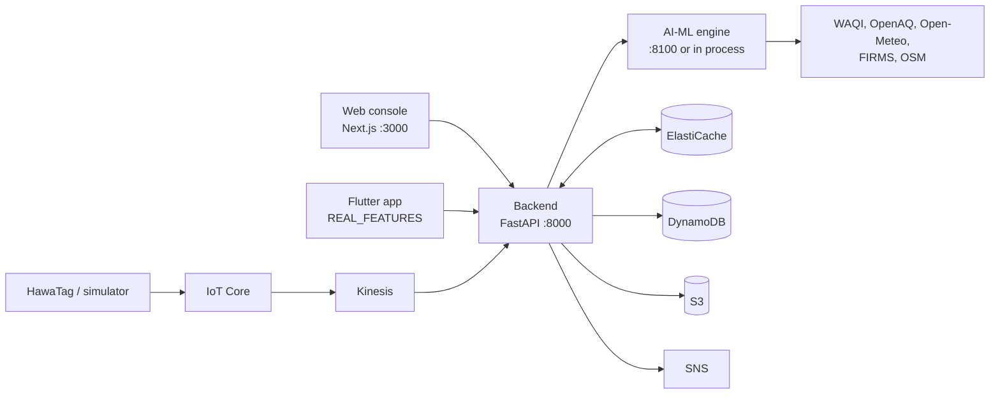
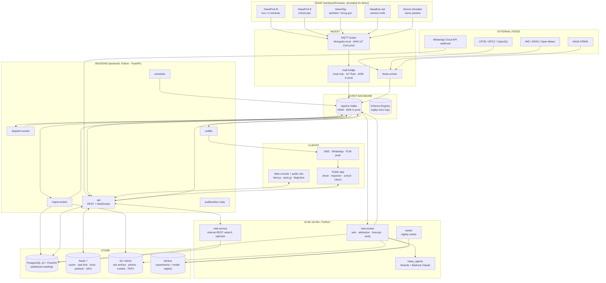

# HawaCommand — System Overview

<!-- nav:start -->

**Navigate:** [Project](../README.md) · [Docs hub](README.md) · **Overview** · [AWS architecture](AWS_ARCHITECTURE.md) · [AWS guide](AWS_SETUP_GUIDE.md) · [API](backend/API.md) · [Environment](ENVIRONMENT_VARIABLES.md) · [Contracts](CONTRACTS.md)

<!-- nav:end -->

> Source of truth: the original HawaCommand proposal (v3, 27 Sep 2026, Environmental Hacks 2026 · Bharat Builds Tour · Track 01: Air), no longer kept in the repository.
> Section references such as **§9.4** point to that proposal. Where this document changes the proposal's stack (for example Kafka replacing SQS/Kinesis, or FastAPI replacing Node Lambdas), the change is listed in [§8 Deviations from the proposal](#8-deviations-from-the-proposal).

> **Reconciled with the code on 2026-10-11.** Sections 5-11 describe the target design from the proposal. Section 0 below describes what actually runs today; every feature in §4 carries its real status. Status words: **Implemented**, **Partial**, **Stub/Mock**, **Planned**.

---

## 0. The system as built today

A fully developed prototype, deployed on Amazon EC2 in ap-south-1 ([live demo](http://ec2-13-207-49-123.ap-south-1.compute.amazonaws.com:3000/)). Three processes, two clients, and an AWS data plane. Every AWS and Redis piece falls back to process memory.



| Piece | Folder | Status | What it really does |
|---|---|---|---|
| AI-ML engine | `AI-ML/` | Partial | GP twin over 10,600 cells, 21 LightGBM quantile forecasters, rule attribution, exposure ranking, greedy dispatcher, synthetic-control verifier, 4 template/LLM agents ([AI-ML/README.md](../AI-ML/README.md)) |
| Backend API | `backend/` | Partial | 50 operations + WebSocket; AI-ML bridge with circuit breaker; live stations; citizen reports, live fleet, alerts, push; plans in Redis or memory; driver route is a fixture ([backend/README.md](../backend/README.md)) |
| AWS data plane | `backend/src/hawa_backend/aws/`, `services/` | Implemented | S3 evidence, DynamoDB grievances and fleet telemetry, Kinesis producer and consumer, IoT Core rule, SNS, KMS; Secrets Manager, Bedrock, Step Functions, SageMaker wired ([AWS_ARCHITECTURE.md](AWS_ARCHITECTURE.md)) |
| Redis and WebSocket | `core/redis_store.py`, `/v1/ws/fleet` | Implemented | ElastiCache: fleet geo index, twin snapshot, plans, alert log, pub/sub for live pings |
| Contracts package | `backend/contracts/` | Implemented (declared) | Enums, ids, packets, envelope, topics, events, Redis keys. Few are used by running code |
| Web console | `frontend/` | Partial | Landing page, 8 console pages, driver view; mock API when no backend URL ([frontend/README.md](../frontend/README.md)) |
| Flutter app | `app_frontend/` | Partial | 5 role shells; air map, air near me, alerts, school forecast, Citizen Eyes reports and the live radar use the backend; sign-in, tasks and inspections run on the in-app fake backend ([app_frontend/README.md](../app_frontend/README.md)) |
| Device fleet | `hawa simulate-fleet` | Stub/Mock | No physical HawaTags; the simulator sends pings through the real HTTP, IoT Core or Kinesis path |
| Database schema + seed | `backend/migrations/`, `db/seed.py` | Partial | 23 tables on Postgres or SQLite; the API does not use them yet |
| Kafka, scheduler, MLflow, Strands | — | Planned | Designed in §5-§11 |
| Containers and IaC | `backend/Dockerfile`, `infrastructure/` | Implemented | Dockerfile, 3 CloudFormation templates (data plane, cache, ECS Fargate + ALB), ECR push workflow |

---

## 1. The product in one page

**HawaCommand is an AI command centre that finds, forecasts and fixes Delhi's pollution hotspots, and proves every fix worked.**

Delhi does not lack anti-pollution machines. It has 376 anti-smog guns, 266 water sprinklers, 91 mechanised sweepers and about 2,000 enforcement teams (§2.3). What it lacks is a brain to direct them and a way to prove they work. HawaCommand is that brain.

### 1.1 The five failures it addresses (§2)

| # | Failure | Evidence in the proposal | HawaCommand answer |
|---|---|---|---|
| 1 | The city is half-blind | 47 CAAQMS stations for ~1,484 km² (1 per 31 km², target 1 per 25 km²); CAG found poorly sited stations | Low-cost sensors on buses, e-rickshaws and bikes + a 500 m digital twin with a confidence value per cell |
| 2 | Everyone reacts after the damage | Beijing red alerts: acting 1–2 days early lowered peaks | 72 h forecast per 1 km cell; GRAP outlook 24–48 h ahead |
| 3 | A large fleet works on guesswork | GPS proves where a machine went, not that the air got cleaner; routes are fixed | Exposure-first dispatch optimiser + multi-agent planning |
| 4 | Nobody checks whether it worked | Road dust ≈ 15 % of winter PM2.5 but ≈ 64 % of NCAP funds go to road dust; IIT Delhi: spraying effect tiny, ~200 m | HawaTag on every machine + causal (synthetic-control) verification of every intervention |
| 5 | "Worst AQI" ≠ "most people hurt" | AQI 450 over an empty yard vs AQI 350 near three schools at 8 AM | Rank by person-hours of harmful exposure × vulnerability |

### 1.2 The closed loop (§5)

```
 1 SENSE → 2 MAP → 3 ATTRIBUTE → 4 FORECAST → 5 DECIDE → 6 ACT → 7 VERIFY ─┐
    ▲                                                                       │
    └──────── Intervention Effectiveness Library (learn, re-plan) ◄─────────┘
```

Runs **every 3 hours**, plus an **evening master plan** for the next morning.

| Step | What happens | Owner(s) |
|---|---|---|
| 1 Sense | HawaPod-M on vehicles, HawaPod-S at schools, HawaTag on cleaning machines, CPCB/OpenAQ stations, IMD/ERA5 weather, NASA FIRMS fires stream in | Backend (ingest), AI-ML (calibration) |
| 2 Map | 500 m cells; Gaussian-process interpolation + wind advection → value + confidence per cell | AI-ML |
| 3 Attribute | Source fingerprint (dust / traffic / burning / regional smoke) + back-trajectory suspect pin | AI-ML |
| 4 Forecast | LightGBM per horizon 1–72 h, P10/P50/P90, GRAP stage | AI-ML |
| 5 Decide | Exposure engine → OR-Tools optimiser → Planner & Auditor agents → officer approves | AI-ML (engine, agents), Backend (API), Frontend (approval UI) |
| 6 Act | Routes to drivers, targets to inspectors, alerts to schools & citizens | Backend (dispatch, notifier), App (field + community), Frontend |
| 7 Verify | HawaTag logs the spray; synthetic control against untreated donor cells → effect ± CI | AI-ML (verifier), Backend (orchestration), Frontend (impact view) |

### 1.3 Goals (§5.2)

- **See**: street-level, hourly coverage of a pilot district, confidence score per cell.
- **Warn early**: forecast spikes 24–72 h ahead; act before GRAP stages kick in.
- **Target**: more person-hours of exposure avoided with the same fleet (What-If measures it).
- **Prove**: a measured effect, with uncertainty, for every intervention.
- **Protect**: vulnerable places warned before the spike, with a concrete safe window.

### 1.4 Honesty rule

**One real pod, a simulated fleet, a real pipeline.** Simulated devices publish the exact firmware packet over real MQTT. Every simulated asset, device, reading and intervention carries `is_simulated = true`, and **every UI labels it as simulated**. Verification is demonstrated on simulated interventions with *injected, known* effects so we can show the verifier recovers them (§12.5).

---

## 2. Users (§7)

| User | Needs | Surface |
|---|---|---|
| Ward / district officer (MCD, DPCC) | Where to send machines and teams; proof it worked | **Web console** (`frontend/`) |
| Admin / analyst | Devices, calibration, model health, evidence reports | Web console |
| Driver / field team | A clear route, nothing else | **Flutter app** (`app_frontend/`), SMS/WhatsApp fallback |
| Inspector | A target, not an area; evidence; close the case | Flutter app |
| School principal | When is it safe outdoors; indoor vs outdoor | Flutter app + WhatsApp |
| Citizen / outdoor worker | Should I avoid this road now; report burning | Flutter app + WhatsApp; public web map |
| Site manager (construction) | Stay compliant, see own grade | Flutter app (read-only score) + web |
| Public / researchers | Open street-level data | Public web portal + `/open/v1` API |

### 2.1 Key flows (§7.1)

- **Flow A — Officer approves tomorrow's plan**: login → tomorrow's forecast + GRAP → AI plan with agent reasons → What-If vs usual routes → edit/approve → routes pushed to drivers.
- **Flow B — Driver runs a route (no manual reporting)**: route arrives → driver reaches stop → HawaTag detects flow + pump → before/after PM captured → stop auto-marked done → verifier scores the effect.
- **Flow C — School protection**: forecast PM2.5 > 250 at 8 AM → Communicator drafts alert → WhatsApp/push to principal at 19:00 → assembly moved indoors → HawaPod-S shows indoor vs outdoor → safe window sent for PE.
- **Flow D — Citizen Eyes**: citizen sends photo of burning → vision model verifies → matched to a nearby sensor spike → inspection dispatched → inspector closes case → citizen told the outcome.

---

## 3. A day in the system (§8)

All times **IST (Asia/Kolkata)**. Winter operating mode.

| Time | Stage | Trigger → Work → Output |
|---|---|---|
| continuous | Ingest | Devices publish every 30 s (spikes instantly) → validate, dedupe, calibrate → clean readings |
| every 15 min | Twin + attribution | GP + wind advection per 500 m cell; fingerprint + back-trajectory for top hotspots → `cell_state`, `hotspot` |
| hourly (:05) | Forecast | LightGBM 1–72 h, P10/P50/P90 → `forecast`, GRAP outlook |
| every 3 h | Re-plan | Exposure → OR-Tools → Planner + Auditor → draft plan |
| 16:00 | Data freeze | Last 24 h fused and snapshotted |
| 17:00 | Master forecast | 72 h per 1 km cell |
| 18:30 | Master plan draft | Planner + Auditor for tomorrow morning |
| 19:00 | School alerts (draft + send) | Communicator drafts safe-window alerts; Flow C |
| 20:00 | Officer approval | Edit / accept |
| 22:00 | Safe windows final | Final school safe windows sent |
| 05:30 | Dispatch | Routes to drivers (push + SMS/WhatsApp) |
| 06:00–10:00 | Operations | HawaTag logs sprays |
| 2–4 h after each action, and 11:00 batch | Verification | Synthetic control vs donor cells → `impact` |
| 14:00 | Re-plan | 3-hour cycle continues |
| 02:00 nightly | Learn | Retrain forecaster, update effectiveness library, recompute site scores |
| Monday 07:00 | Evidence report | Weekly PDF: hotspots, sources, actions, impact per rupee |

### 3.1 Real-time spike path (§8.2)

```
06:42  Bus 7 TinyML flags PM2.5 ×3 in 20 s → publishes on priority topic
06:43  Fingerprint: high PM2.5/PM10, VOC up, no FIRMS fire → "likely open burning"
06:44  Citizen photo 300 m away verified + matched → confidence high
06:45  Planner proposes nearest inspection team; Auditor confirms a sprinkler would not help smoke → officer approves
07:10  Inspector closes case; verifier tracks cell back to baseline; outcome logged
```

End-to-end budget for this path: **packet → hotspot on the officer map ≤ 60 s; spike → draft action ≤ 3 min.**

---

## 4. Feature map (§6) → owners

Tiers: **BUILD** = must work in the demo · **STRETCH** = build if time allows · **VISION** = pitched with architecture only.

| ID | Feature | Origin | Tier | AI-ML | Backend | Web | App | Status today |
|---|---|---|---|---|---|---|---|---|
| F1 | Hotspot Grid Engine (1 km planning, 500 m map, key cells) | CHINA | BUILD | ● | ● | ● | | Partial |
| F2 | Mobile sensing fleet (HawaPod-M) | CHINA | BUILD | | ● (ingest, simulator) | ● (pod trails) | | Stub/Mock (simulated) |
| F3 | Drive-by self-calibration | CHINA | BUILD | ● | ● (pairing) | ● (device view) | | Partial (fit only, no pairing) |
| F4 | Air digital twin (GP + advection, confidence) | CHINA | BUILD | ● | ● (tiles, cache) | ● | ○ (citizen map) | Partial |
| F5 | 72 h forecaster (P10/P50/P90) | CHINA | BUILD | ● | ● | ● | ○ | Partial |
| F6 | Graded Response (GRAP) Copilot | CHINA | BUILD | ● | ● | ● | | Implemented |
| F7 | Source fingerprint + back-trajectory | ORIGINAL | BUILD | ● | ● | ● | ○ (inspector pin) | Implemented (rules; classifier unused) |
| F8 | Smoky Vehicle Spotter (HawaEye, YOLO) | CHINA | VISION | ○ | ○ | ○ | | Planned |
| F9 | Site Compliance Score (A/B/C) | CHINA | STRETCH | ● | ● | ● | ○ (site manager) | Stub/Mock |
| F10 | Power-proxy compliance | CHINA | VISION | ○ | ○ | | | Planned |
| F11 | Active sensing router (blind spots) | ORIGINAL | STRETCH | ● | ● | ● | | Planned |
| F12 | Exposure engine | ORIGINAL | BUILD | ● | ● | ● | | Implemented |
| F13 | Dispatch optimiser + What-If | CHINA | BUILD | ● | ● | ● | | Partial (greedy; What-If is a constant ratio) |
| F14 | Multi-agent command room (Strands) | ORIGINAL | BUILD | ● | ● | ● | | Partial (no Strands) |
| F15 | Anti-gaming guard | CHINA | STRETCH | ● | ● | ● | | Planned |
| F16 | Targeted, pollutant-specific alerts | JAPAN | BUILD | ● (Communicator) | ● (notifier) | ● | ● | Partial (drafts only, nothing sent) |
| F17 | HawaTag intervention tracking | ORIGINAL | BUILD | | ● | ● | ● (auto-marked stops) | Stub/Mock |
| F18 | Causal verification + effectiveness library | ORIGINAL | BUILD | ● | ● | ● | | Partial (synthetic validation only) |
| F19 | School safe-window scheduler | ORIGINAL | STRETCH | ● | ● | ● | ● | Partial (fixed diurnal curve) |
| F20 | Citizen Eyes (photo → verify → inspect) | ORIGINAL | STRETCH | ● (vision) | ● | ● | ● | Stub/Mock (no vision model, no backend) |
| F21 | Open Air Data portal (AEROS-style) | JAPAN | STRETCH | | ● | ● | | Partial (`/open/v1/air`, no portal page) |
| F22 | Weekly Evidence report (PDF) | ORIGINAL | VISION→STRETCH | ● (narrative) | ● | ● | | Partial (Markdown report on `/impact`, no weekly PDF) |

● = owns real work · ○ = consumes / displays / vision only.

> **Cut rule (§16).** If behind at hour 14: drop wind advection (keep plain kriging), drop Citizen Eyes and the school scheduler. **Never drop the What-If screen and causal verification**, because judges will not see them anywhere else.

---

## 5. System architecture

> Status: §5 is the **target** architecture. Only the API process, the AI-ML engine (`intel-service` equivalent, unauthenticated, served on :8100) and the web and mobile clients exist; see §0.

### 5.1 Layered view (adapted from §9)



### 5.2 Layer responsibilities

| Layer | Responsibility | Key design decisions |
|---|---|---|
| Edge | Sense, buffer, pre-filter | One firmware with role flags; X.509 per device; 72 h SD store-and-forward; spike events bypass batching (§10.5) |
| Ingest | Authenticate, validate, route | MQTT → Kafka; malformed packets to DLQ; idempotent writes keyed by `device_id + seq` (Redis `SET NX` + DB unique constraint) |
| Event backbone | Decouple every stage | Kafka topics per domain, JSON envelopes validated by Pydantic contracts, at-least-once + idempotent consumers, transactional outbox from the API |
| Store | Hot, warm, cold data | Postgres/PostGIS for everything relational and spatial, day-partitioned `reading`; Redis for hot reads; S3 Parquet for history and training |
| Think | Readings → state | Python ML in `AI-ML/`; **every output carries uncertainty** (variance, P10/P90, CI) |
| Decide | State → plan | **Deterministic optimiser proposes; LLM agents explain and critique but cannot bypass constraints**; officer approval required |
| Act | Deliver to humans | Human-in-the-loop approval; push + WhatsApp/SMS for reach; open API for transparency |

### 5.3 Runtime processes

| Process | Folder | Language / framework | Scales by | Talks to |
|---|---|---|---|---|
| `api` | backend | FastAPI + Uvicorn | HTTP load | Postgres, Redis, Kafka (outbox), intel-service |
| `ingest-worker` | backend | aiokafka consumer | telemetry partitions | Kafka, Redis, Postgres, S3 |
| `feeds-worker` | backend | asyncio + httpx | 1 replica | external APIs, Kafka, Postgres |
| `scheduler` | backend | APScheduler + Redis lock | 1 active (leader) | Kafka |
| `dispatch-worker` | backend | aiokafka consumer (saga) | plan/task partitions | Kafka, Postgres, Redis |
| `notifier` | backend | aiokafka consumer | alert partitions | SNS / WhatsApp / FCM, Kafka |
| `outbox-relay` | backend | asyncio loop | 1 replica | Postgres → Kafka |
| `mqtt-bridge` | backend | aiomqtt → aiokafka | 1 replica (local only) | Mosquitto, Kafka |
| `simulator` | backend | asyncio, OSM routes | N virtual devices | MQTT |
| `intel-service` | AI-ML | FastAPI (internal only) | CPU | Postgres, Redis, MLflow |
| `intel-worker` | AI-ML | aiokafka consumers | per command topic | Kafka, Postgres, S3, Bedrock |
| `trainer` | AI-ML | CLI (scheduled job) | nightly | S3, Postgres, MLflow |
| `web` | frontend | Next.js (Node) | HTTP | api |
| mobile app | app_frontend | Flutter | devices | api, FCM |

---

## 6. Technology stack (whole system)

| Concern | Choice | Why |
|---|---|---|
| Backend language | **Python 3.12** | One language with AI-ML; FastAPI + asyncio; team familiarity |
| API framework | **FastAPI** + Uvicorn, **Pydantic v2** | Typed contracts, automatic OpenAPI → generated TS & Dart clients |
| ORM / migrations | **SQLAlchemy 2.0 (async) + asyncpg + GeoAlchemy2**, **Alembic** | Mature, async, PostGIS types; Alembic is the single owner of schema |
| Database | **PostgreSQL 16 + PostGIS 3.4**, native day partitioning for `reading` (pg_partman on RDS) | Spatial queries, vector tiles (`ST_AsMVT`), one DB for relational + spatial + time series |
| Cache / coordination | **Redis 7** | Response & tile cache, rate limiting, dedupe keys, OTP, distributed locks, pub/sub fan-out to WebSockets, GEO set for live fleet |
| Event streaming | **Apache Kafka 3.8 (KRaft)**, **aiokafka**; Confluent Schema Registry for the Avro log topic | Durable, replayable stream between every loop stage; consumer groups per service |
| Logging | **logifyx 2.x** (JSON to stdout + Kafka `hawa.logs.v1` Avro), masking, `ContextLoggerAdapter` for `request_id`/`correlation_id` | House logging library; zero-config; built-in Kafka streaming |
| Tracing / metrics | OpenTelemetry → Jaeger (local) / X-Ray (AWS); Prometheus + Grafana | End-to-end latency of the loop |
| MQTT | Eclipse Mosquitto (local), **AWS IoT Core** (prod, X.509, IoT Rule → MSK) | Real device protocol from §10 |
| Object storage | S3 (MinIO locally) | Raw archive (Parquet), photos, clips, model artifacts, PDFs |
| ML | NumPy, pandas/Polars, scikit-learn, PyKrige, LightGBM, SciPy, statsmodels, GeoPandas/Shapely/pyproj | §11 stack |
| Optimisation | **Google OR-Tools** (CVRPTW) + greedy fallback | §9.4 dispatch optimiser |
| Agents | **Strands Agents SDK** + **Amazon Bedrock** (Claude Opus 5 for Planner/Auditor/Forecaster-explainer/vision; Claude Haiku 4.5 for Communicator) | AWS open-source rule; multi-agent command room |
| MLOps | MLflow (tracking + registry), scheduled trainer; SageMaker optional | Versioned models, reproducible retrains |
| Edge ML | TensorFlow Lite Micro spike detector (ESP32-S3) | §10.5 |
| Web | **Next.js 16 (App Router) + React 19 + TypeScript (strict)**, Tailwind CSS v4 + shadcn/ui, **deck.gl + MapLibre GL**, TanStack Query, Zustand, next-intl (en/hi) | §11 frontend + fast heatmaps |
| Web quality | **ESLint 9 flat config** (typescript-eslint strict-type-checked, react, react-hooks, jsx-a11y, import sorting, Next plugin), **Prettier**, `tsc --noEmit`, Husky + lint-staged, commitlint, Vitest, Playwright | Linting required by the team |
| Mobile | **Flutter (stable 3.x, Dart 3)**, Riverpod, go_router, Dio + generated OpenAPI client, freezed, drift (SQLite offline queue), flutter_map, firebase_messaging | One codebase for Android (primary) + iOS |
| Mobile quality | `very_good_analysis` lints, `dart format`, custom_lint + riverpod_lint, flutter_test, integration_test | |
| Messaging | Amazon SNS (SMS), WhatsApp Cloud API, Firebase Cloud Messaging | Reach people where they already are |
| Auth | Backend-issued JWT (access 15 min + rotating refresh), argon2 passwords for officers, phone OTP for field/community roles; RBAC with ward scoping. Cognito-compatible verifier abstraction | Runs fully locally; swap to Cognito JWKS in prod if required |
| Package managers | `uv` (Python), `pnpm` (web), `fvm` + `pub` (Flutter) | Fast, reproducible lockfiles |
| Containers / local | Docker Compose at repo root | One command brings the whole loop up |
| Cloud | AWS: IoT Core, MSK, RDS PostgreSQL, ElastiCache, ECS Fargate, S3, Bedrock, SNS, Amplify Hosting, CloudWatch/X-Ray, Secrets Manager | "Built on AWS" |
| IaC | AWS CDK (Python) in `backend/infra/` | Whole stack reproducible |
| CI | GitHub Actions per folder (path filters) | Lint + typecheck + test + build on every PR |

---

## 7. Repository layout

One top-level folder per discipline (as committed):

```
HawaCommand/
├── AI-ML/                 # hawa_ml: twin, attribution, forecasting, exposure, optimisation, causal,
│                          # agents (plain classes), simulation, insights, pipelines, FastAPI app (:8100)
├── backend/               # hawa_backend (FastAPI api, core, db models, workers, aws), contracts/ (hawa_contracts),
│                          # docker-compose.yml (PostGIS, Redis, Kafka), docs/PHASE_*.md
├── frontend/              # Next.js 15 officer console, landing page, driver view, design/ exports
├── app_frontend/          # Flutter app, openapi/ snapshot, packages/hawa_api generated client
├── infrastructure/
│   └── cloudformation/    # hawa-integration.yaml
├── docs/                  # ← you are here (README, SYSTEM_OVERVIEW, CONTRACTS, AWS docs, aiml/ backend/ frontend/ app/)
├── LICENSE
└── README.md
```

The root `Makefile` runs the stack: `make install`, `make db-up`, `make db-update`, `make db-seed`, `make aiml-api`, `make backend`, `make frontend` (see the [root README](../README.md#commands)). There is no root `docker-compose.yml` or `.env.example`; `backend/docker-compose.yml` and per-component `.env.example` files are used instead.

**Shared code rule.** `backend/contracts/` is an installable Python package `hawa_contracts` (enums, MQTT packet models, Kafka event envelopes and payloads). Today `AI-ML/` does not use it; instead the backend imports `hawa_ml` directly (in-process fallback and citizen routes) and declares it as an editable path dependency (`hawa-ml[llm]` in `backend/pyproject.toml`), so `uv sync` in `backend/` builds one environment for both services. The web console uses hand-written zod schemas (`frontend/src/contracts/`, alias `@hawa/contracts`) checked by `frontend/scripts/verify_backend_contracts.ts`. The Flutter app's Dart client (`app_frontend/packages/hawa_api`) is generated with `openapi-generator` from a committed spec, `app_frontend/openapi/openapi.json`, which describes the planned field API rather than what the backend serves today.

**Schema rule.** Alembic in `backend/` (`alembic.ini`, `migrations/`, revision `0001`) is the **only** thing that changes the database schema. AI-ML writes only to the tables it owns (listed in [CONTRACTS.md §8](CONTRACTS.md#8-database-table-ownership)) and has a contract test that reflects the live schema.

---

## 8. Deviations from the proposal

The proposal (§11) sketches a serverless AWS stack. We keep its **architecture and algorithms** and change the **plumbing** so the whole loop runs locally with one command and maps cleanly onto AWS managed services.

| Proposal | This build | Reason |
|---|---|---|
| SQS (hackathon) → Kinesis (scale) | **Apache Kafka** (local) → **Amazon MSK** (AWS) | Team requirement; one replayable event backbone for every loop stage |
| EventBridge Scheduler + Step Functions | `scheduler` (APScheduler + Redis leader lock) publishing Kafka commands; `dispatch-worker` Kafka saga with state persisted in Postgres | Runs locally; same semantics (approve → dispatch → await spray → verify) |
| Node.js/TypeScript Lambdas, Express/Fastify, Zod, Prisma | **Python FastAPI**, Pydantic v2, SQLAlchemy 2 + **Alembic** | Team requirement (Alembic, logifyx); shared language with AI-ML |
| Amazon Timestream for raw readings | Postgres day-partitioned `reading` table + S3 Parquet archive | One database; spatial joins with cells; RDS-compatible |
| ElastiCache Redis + BullMQ | **Redis** for cache/locks/rate-limits/pub-sub; Kafka for work distribution | BullMQ is Node-only; Kafka already distributes work |
| DynamoDB device registry | `device` table in Postgres (+ Redis hash for last-seen) | Fewer moving parts |
| Cognito | Backend JWT with a Cognito-compatible verifier interface | Works offline/local; swap in prod |
| Driver phone PWA | **Flutter app** (driver + inspector + school + citizen roles); SMS/WhatsApp remain the fallback | Team requirement; offline-first field use |
| CloudWatch-only logs | **logifyx** JSON logs → stdout (CloudWatch) + Kafka `hawa.logs.v1` | Team requirement |

Everything in §9.4 (drive-by calibration, GP twin, fingerprint table, exposure formula, CVRPTW optimiser, synthetic-control verification) is kept **as specified**.

---

## 9. Environments and deployment

> Status: today only a `local` setup exists: `make install db-update db-seed`, then `make aiml-api` (:8100), `make backend` (:8000) and `make frontend` (:3000), see the [root README](../README.md#quick-start). The table below is the target.

| Environment | How it runs | Data |
|---|---|---|
| `local` | `docker compose up` at the repo root: Postgres+PostGIS, Redis, Kafka (KRaft), Schema Registry, Kafka UI, Mosquitto, MinIO, MLflow, Jaeger, Prometheus, Grafana + all app services | Seeded Delhi grid, POIs, assets; simulator fleet; recorded CPCB history |
| `demo` | Same compose on one EC2 instance **or** the AWS stack below; `make demo-reset` restores the golden-path state | Live CPCB/OpenAQ/FIRMS + simulated fleet + one real pod |
| `aws` | CDK: IoT Core → MSK; ECS Fargate services; RDS PostgreSQL + PostGIS; ElastiCache; S3; Bedrock; SNS; Amplify Hosting for web | Pilot |

Details: [backend/DEPLOYMENT.md](backend/DEPLOYMENT.md).

---

## 10. Golden path (build this first)

> Status: Planned as written. Today's demo path is: the web console's `/map` reads `/v1/hotspots` (AI-ML exposure ranking over a twin kriged from live WAQI stations); `/plans` drafts a plan through `POST /v1/plans/draft` (Planner + Auditor); approving it updates the in-memory plan (and starts a Step Functions dispatch if AWS is enabled); `/impact` shows the synthetic-control result for the seeded injected intervention.

1. `backend/simulator` (virtual fleet) and the real HawaPod-M publish **the same packet** (see [CONTRACTS.md §4](CONTRACTS.md#4-edge--cloud-mqtt-contracts)) to MQTT.
2. `mqtt-bridge` → Kafka `hawa.telemetry.raw.v1` → `ingest-worker` validates, dedupes, calibrates → `reading` in Postgres → `hawa.telemetry.clean.v1`.
3. `scheduler` → `hawa.cmd.twin.v1` → `intel-worker` twin + fingerprint + exposure → `cell_state`, `hotspot` → `hawa.twin.updated.v1`.
4. Web `/console/map` shows the twin and ranked hotspots (API reads Postgres, caches in Redis, live updates over WebSocket).
5. `POST /v1/plans/draft` → `hawa.cmd.plan.v1` → `intel-worker` runs the OR-Tools optimiser, then Planner + Auditor agents (the Auditor objects to water on smoke) → plan `draft` → `hawa.plan.lifecycle.v1`.
6. Officer approves on `/console/plans/[id]` → `dispatch-worker` assigns tasks → push to the Flutter driver app + SMS to a real phone.
7. Simulated HawaTag reports the spray → `hawa.intervention.segment.v1` → task auto-marked done → verifier (synthetic control) writes `impact` → `/console/impact` shows effect ± CI.

---

## 11. Hackathon plan (24 h, team of four; §16)

| Hours | Backend lead | ML engineer | Frontend (web) | Agents + app |
|---|---|---|---|---|
| 0–3 | Compose stack, Alembic baseline, contracts package, packet format | Pull CPCB/OpenAQ, weather, FIRMS history; build 500 m grid | Next.js shell, lint setup, map shell (MapLibre + deck.gl) | Strands agent skeleton; Flutter shell + lint + login |
| 3–8 | Simulator on OSM bus routes; mqtt-bridge; ingest-worker | Calibration + fingerprint rules | Twin heatmap layer, hotspot list | Planner + Auditor with OR-Tools tool; driver task list |
| 8–14 | Plan APIs, WebSocket, Redis cache, scheduler | Digital twin + forecaster | What-If screen | Communicator + alerts; driver route + FCM |
| 14–19 | Dispatch saga, notifier, verifier orchestration | Tune models; back-trajectory; verifier | Plan approval flow, intervention/impact view | Inspector + school screens |
| 19–22 | Integration and bug bash (everyone) | | | |
| 22–24 | Demo video, README, AWS Builder Center blog draft (everyone) | | | |

**Three-minute demo script (§16.1):**

| Time | Scene |
|---|---|
| 0:00–0:20 | The problem: one AQI number vs a street-level map of the same morning; 376 smog guns, and no one knows which ones work |
| 0:20–0:50 | Live twin: buses streaming, hotspots appear with cause labels and upwind suspect pins |
| 0:50–1:20 | 72 h forecast shows a spike near three schools; GRAP outlook turns orange for Thursday |
| 1:20–1:55 | Agents draft a plan; the Auditor rejects a sprinkler sent to a smoke hotspot; What-If: AI plan vs usual routes |
| 1:55–2:20 | Officer approves; driver route (Flutter app) and school WhatsApp alert appear |
| 2:20–2:45 | HawaTag logs a spray; the verifier shows the measured effect with a confidence interval |
| 2:45–3:00 | Where AWS fits (architecture) and the closing line |

> *"Delhi already owns the machines. HawaCommand gives them a brain, and gives the city proof. Same fleet, more people protected, and evidence for every rupee."*

---

## 12. KPIs (§13.1, pilot targets, not claims)

| KPI | Definition | Target |
|---|---|---|
| Coverage | Share of pilot road-km observed at least daily | ≥ 70 % |
| Twin accuracy | Error of twin vs held-out reference station | Beat nearest-station baseline |
| Forecast skill | 24 h PM2.5 error vs persistence | Clear improvement over persistence |
| Exposure avoided | Person-hours above threshold avoided, AI plan vs usual routes | Measured and reported weekly |
| Verified actions | Share of interventions with a verified effect and CI | ≥ 90 % |
| Alert lead time | Hours between school alert and spike | ≥ 12 h |
| Early action | GRAP-stage actions started before formal invocation | Tracked per episode |

---

## 13. Risks (§15) and where they are handled

| Risk | Mitigation | Where |
|---|---|---|
| Low-cost sensors drift / read high in humidity | Drive-by calibration, heater, RH term, trust scores, down-weighting | AI-ML `calibration`, backend ingest |
| Source attribution is uncertain | Always shown with confidence; used to choose the tool, never to fine; human approval | AI-ML, web UI |
| Verification confounded by weather | Weather-matched donor cells, placebo tests, CIs | AI-ML `verifier` |
| LLM agents make a bad call | Agents only explain and critique; optimiser enforces constraints; officer approval | AI-ML `hawa_agents`, backend approval API |
| Privacy (cameras, locations) | On-device vision, evidence-only uploads, no faces/plates stored by default; driver location only during shift | Edge, backend, app |
| Connectivity gaps | 72 h store-and-forward, sequence numbers, idempotent ingest; app offline queue | Edge, backend, app |
| Gaming (cleaning only near monitors) | Anti-gaming guard compares official stations with surrounding mobile readings | AI-ML |
| Hardware theft / vandalism | Tamper detection, IMU alerts, sealed enclosure | Edge, backend device health |
| Agencies will not adopt | Start with campuses, RWAs, private fleets; publish verified results; integrate, don't replace | Business |

---

## 14. Where to go next

- Shared contracts every team must follow: [CONTRACTS.md](CONTRACTS.md)
- AI/ML: [aiml/README.md](aiml/README.md)
- Backend: [backend/README.md](backend/README.md)
- Web frontend: [frontend/README.md](frontend/README.md)
- Flutter app: [app/README.md](app/README.md)

<!-- footer:start -->

---

[Back to top](#hawacommand--system-overview) · [Docs hub](README.md) · [Project README](../README.md)

<!-- footer:end -->
