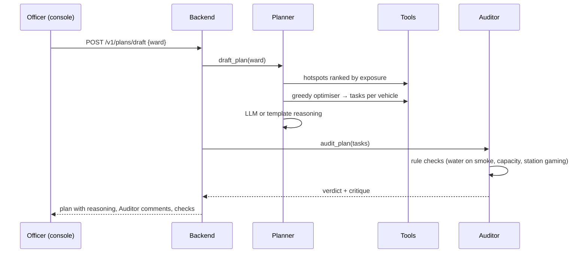

# AI-ML agents

<!-- nav:start -->

**Navigate:** [Project](../../README.md) · [Docs hub](../README.md) · [Overview](../SYSTEM_OVERVIEW.md) · [AWS architecture](../AWS_ARCHITECTURE.md) · [AWS guide](../AWS_SETUP_GUIDE.md) · [API](../backend/API.md) · [Environment](../ENVIRONMENT_VARIABLES.md) · [Contracts](../CONTRACTS.md)

**AI-ML docs:** [Runbook](../../AI-ML/README.md) · [Index](README.md) · [Architecture](ARCHITECTURE.md) · [Models](MODELS.md) · **Agents** · [Data and training](DATA_AND_TRAINING.md) · [Engine API](../../AI-ML/CONTRACTS.md) · [Deployment](DEPLOYMENT.md)

<!-- nav:end -->

The command room: four agents that turn model output into plans, critiques and advisories a person can act on.

- **The optimiser decides, agents explain, officers approve.** No agent can dispatch a vehicle.
- Every agent works without an LLM: a deterministic template writes the text when no provider is configured.

---

## Agents

| Agent | Job | Uses | Called by |
|---|---|---|---|
| **Forecaster** | Summarises the 72 h forecast and warns of GRAP stage crossings | `tool_get_forecast` | `GET /v1/forecast` summary |
| **Planner** | Drafts a dispatch plan and explains why | `tool_get_hotspots`, `tool_run_optimizer` | `POST /v1/plans/draft` |
| **Auditor** | Challenges the plan before an officer sees it; verdict `approved` or `revise` | Rule checks + LLM critique | `POST /v1/plans/draft` |
| **Communicator** | Writes English and Hindi advisories for schools and citizens | Forecast + safe windows | Evening master plan (`pipelines/master_plan.py`) |

Code: `AI-ML/src/hawa_ml/agents/{forecaster,planner,auditor,communicator}_agent.py`.

---

## Plan drafting flow

---

## Auditor checks

| Check | Rule |
|---|---|
| Cause-tool mismatch | Sprinklers or smog guns sent to burning or regional smoke → **revise** |
| Capacity and shifts | No vehicle beyond its tank or shift hours |
| Gaming guard | No spraying clustered around CPCB monitoring stations while nearby streets stay dirty |

- Programmatic checks run first; the LLM only adds the written critique.

---

## Tools

| Tool | Returns |
|---|---|
| `tool_get_forecast(cell_id, current_pm25)` | 72 h P10/P50/P90 and GRAP stages |
| `tool_get_hotspots(ward, limit)` | Hotspots ranked by exposure |
| `tool_run_optimizer(hotspots, assets, shift_hours)` | Cause-matched task list |
| `tool_simulate_whatif(...)` | AI plan vs usual routes |
| `tool_get_effectiveness(cause, action)` | Expected effect from the library |

Code: `AI-ML/src/hawa_ml/agents/tools.py`.

---

## LLM providers

| Provider | When | Model | Settings |
|---|---|---|---|
| Groq | `LLM_PROVIDER=groq` + `GROQ_API_KEY` | `openai/gpt-oss-120b` | temperature 0.2, 600 tokens |
| Amazon Bedrock | `LLM_PROVIDER=bedrock` | `BEDROCK_MODEL_ID` (default Claude 3.5 Sonnet) | temperature 0.2, 800 tokens, instance role auth |
| Template | No provider or a provider error | — | Deterministic text |

- Provider choice: `AI-ML/.env` ([AI-ML deployment](DEPLOYMENT.md#configuration-ai-mlenv)).
- Bedrock setup: [AWS guide §16a](../AWS_SETUP_GUIDE.md#16a-bedrock-for-the-agents).
- Code: `AI-ML/src/hawa_ml/agents/llm_provider.py`.

---

## Prompts

System prompts are plain Markdown files, loaded at runtime:

| Agent | Prompt |
|---|---|
| Planner | [`prompts/planner.md`](../../AI-ML/src/hawa_ml/agents/prompts/planner.md) |
| Auditor | [`prompts/auditor.md`](../../AI-ML/src/hawa_ml/agents/prompts/auditor.md) |
| Forecaster | [`prompts/forecaster.md`](../../AI-ML/src/hawa_ml/agents/prompts/forecaster.md) |
| Communicator | [`prompts/communicator.md`](../../AI-ML/src/hawa_ml/agents/prompts/communicator.md) |

- Edit a prompt, restart the process; no code change needed.

---

## Insights

The insight engine (`insights/triggers.py`) scans each cycle for:

- `grap_threshold_crossing`: a forecast crosses into a higher GRAP stage.
- `school_morning_exposure`: high PM2.5 at school-cluster cells before assembly.
- `twin_blind_spots`: low-confidence areas that need a sensor.
- `sudden_spike`: a sharp rise against the recent baseline.

`insights/narratives.py` turns each insight into a short narrative; served at `GET /insights`.

---

## Related

- [AI-ML architecture](ARCHITECTURE.md) · [Models](MODELS.md) · [Data and training](DATA_AND_TRAINING.md) · [Engine API](../../AI-ML/CONTRACTS.md)

<!-- footer:start -->

---

[Back to top](#ai-ml-agents) · [Docs hub](../README.md) · [Project README](../../README.md)

<!-- footer:end -->
