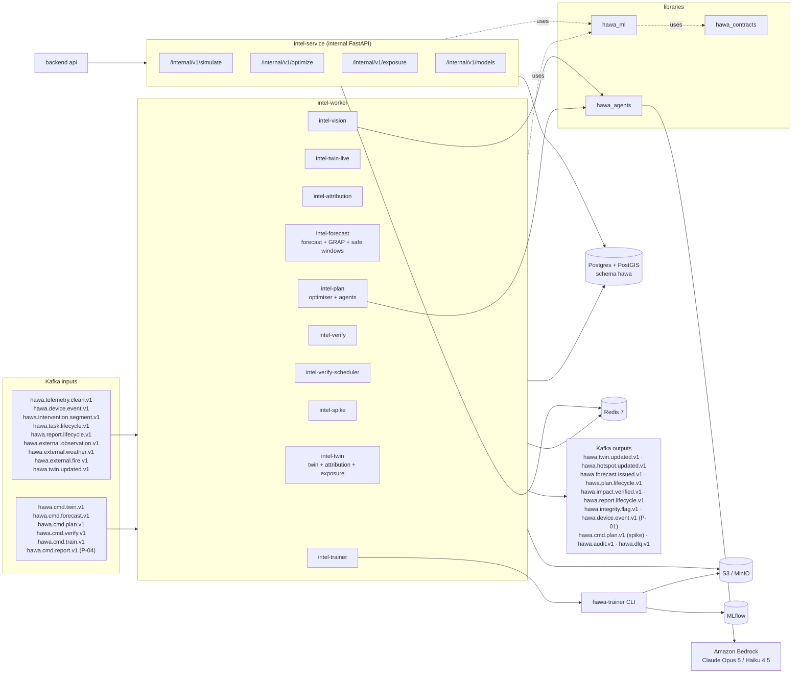
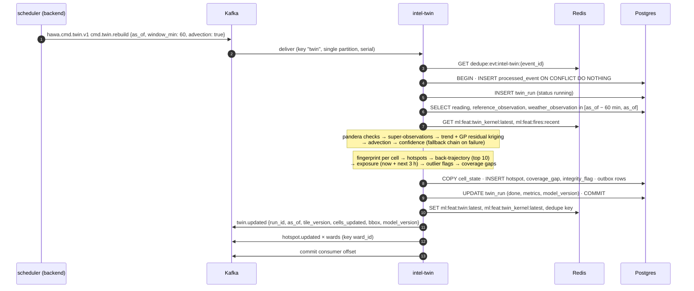
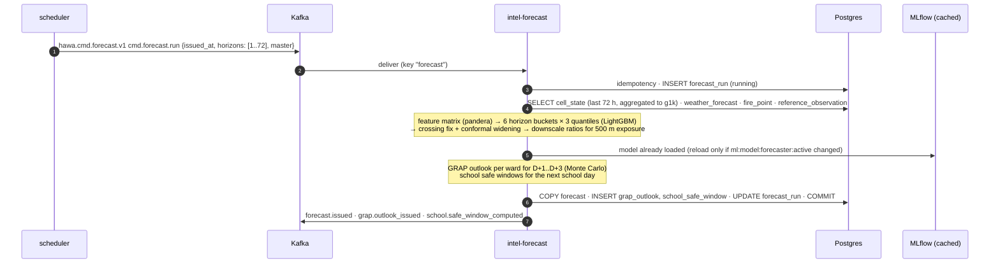
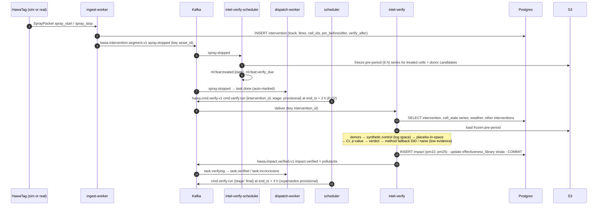
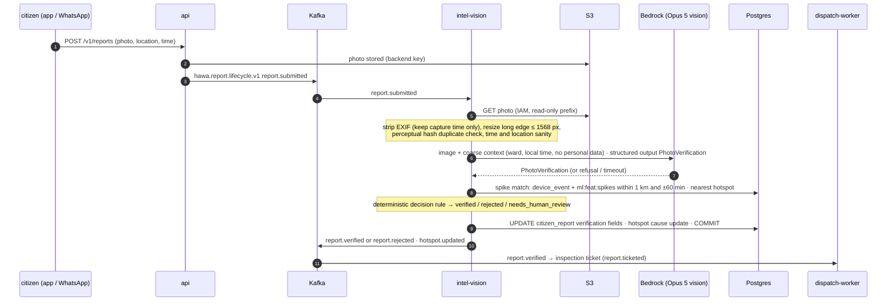

# AI-ML Runtime Architecture

How the AI-ML processes run: what each consumes and produces, which tables and Redis keys it touches, the sequence of every loop flow, and how it fails safely.

Related: [README](README.md) · [CONTEXT](CONTEXT.md) · [STRUCTURE](STRUCTURE.md) · [MODELS](MODELS.md) · [AGENTS](AGENTS.md) · [DATA_AND_TRAINING](DATA_AND_TRAINING.md) · [PLAN](PLAN.md) · [../CONTRACTS.md](../CONTRACTS.md) · [../SYSTEM_OVERVIEW.md](../SYSTEM_OVERVIEW.md)

---

## 1. Overview

AI-ML runs as three deployables built from one Python package set (`AI-ML/src`) plus a library:

- **`intel-worker`**: long-running aiokafka consumers, one consumer group per command or event stream. All asynchronous work (twin, attribution, forecast, plan drafting with agents, verification, photo verification, training) enters here, and only through Kafka (CONTRACTS §7).
- **`intel-service`**: an internal FastAPI app for the few synchronous calls the backend `api` needs while an officer waits (What-If, re-optimise an edited plan, exposure lookup, model versions).
- **`trainer`**: a CLI (`hawa-trainer`) that trains, evaluates, gates and registers models. It is launched by the `intel-trainer` consumer on `cmd.train.run` and can be run by hand.
- **`hawa_agents`**: the Strands Agents library (Forecaster, Planner, Auditor, Communicator, Citizen Eyes verifier) used by `intel-worker` and `intel-service`. See [AGENTS.md](AGENTS.md).



## 2. Processes

| Process | Command | Deploys as | Replicas | Ports | Talks to |
|---|---|---|---|---|---|
| `intel-worker` | `intel-worker --groups all` or a subset (`--groups intel-plan,intel-vision`) | 1 container locally; in AWS split into 4 ECS services: `intel-worker-state` (twin, twin-live, attribution, forecast, spike), `intel-worker-plan` (plan), `intel-worker-verify` (verify, verify-scheduler, vision), `intel-worker-train` (trainer) | 1 each (see §7.3) | `:9102/metrics` | Kafka, Postgres, Redis, S3, MLflow, Bedrock |
| `intel-service` | `intel-service` (Uvicorn, `hawa_intel_service.app:app`) | 1 container, private subnet only | 1–2 | `:8100` (`/internal/v1/*`, `/metrics`) | Postgres, Redis, MLflow |
| `trainer` | `hawa-trainer run --model <m>` | Subprocess of `intel-worker-train` (local, demo); optionally an ECS one-off task in AWS | on demand | — | Postgres (read + owned writes), S3, MLflow |
| `hawa_agents` | library | in-process | — | — | Bedrock via Strands |

### 2.1 `intel-service` endpoints (CONTRACTS §7)

All require `Authorization: Bearer <HAWA_INTERNAL_TOKEN>`; errors are RFC 9457 `application/problem+json`; `X-Correlation-Id` and `X-Request-Id` are echoed and attached to logs and spans.

| Endpoint | Request (JSON) | Response (JSON) | Writes | Budget |
|---|---|---|---|---|
| `POST /internal/v1/simulate` | `{plan_id, baseline: "usual_routes", n_draws: 1000, seed?}`; honours `Idempotency-Key` | `{simulation_id, plan: {p10,p50,p90}, baseline: {p10,p50,p90}, delta: {p10,p50,p90}, per_ward[], per_task[], model_versions, is_simulated}` (person-hours above threshold) | `plan_simulation` | p95 ≤ 3 s |
| `POST /internal/v1/optimize` | `{plan_id?, ward_ids, window_start, window_end, asset_ids?, locked_task_ids[], removed_task_ids[], added_nodes[], solver: "cvrptw"\|"greedy", time_limit_s ≤ 5}` | `{routes[], tasks[], objective: {expected_exposure_avoided_ph: {p10,p50,p90}}, constraint_report, solver_status, model_version}` | none (pure compute; the api persists officer edits) | p95 ≤ 6 s |
| `POST /internal/v1/exposure` | `{cell_ids? \| bbox?, from, to, source: "twin"\|"forecast", quantile: "p10"\|"p50"\|"p90"}` | `{cells: [{cell_id, series: [{ts, exposure_ph, exposure_ph_pm10}]}], total_ph, model_version}` | none | p95 ≤ 1 s |
| `GET /internal/v1/models` | — | `[{name, version, stage, metrics, promoted_at}]` from `model_version` | none | — |
| `GET /internal/v1/healthz` | — | `{status, checks: {db, redis, models_loaded, pop_profiles_loaded}}` | none | — |
| `POST /internal/v1/alerts/draft` | proposed, see P-05 | `AlertDraft` | none | p95 ≤ 4 s |

## 3. Consumer groups, topics and handlers

Every consumer uses the envelope from CONTRACTS §5.1 and the Pydantic models in `hawa_contracts.events`. Unknown `type` values on a subscribed topic are logged and skipped (enums are additive, CONTRACTS §12.5).

| Group | Subscribes (types handled) | Handler | Produces | Writes (tables) |
|---|---|---|---|---|
| `intel-twin` | `hawa.cmd.twin.v1` (`cmd.twin.rebuild`); `hawa.external.observation.v1` (`reference.observed`) and `hawa.external.weather.v1` (`weather.observed`) for freshness gauges only | `handlers/twin.py` | `hawa.twin.updated.v1` (`twin.updated`), `hawa.hotspot.updated.v1` (`hotspot.updated`, one per ward), `hawa.integrity.flag.v1` (`integrity.flagged`) | `twin_run`, `cell_state`, `hotspot`, `coverage_gap`, `integrity_flag` |
| `intel-twin-live` | `hawa.telemetry.clean.v1` (`reading.cleaned`) | `handlers/twin_live.py` | — | Redis only (`ml:feat:cellagg:{cell_id}`) |
| `intel-attribution` | `hawa.external.fire.v1` (`fire.detected`) | `handlers/attribution.py` | `hawa.hotspot.updated.v1` when a live hotspot's cause changes | `hotspot` (cause fields) |
| `intel-forecast` | `hawa.cmd.forecast.v1` (`cmd.forecast.run`); `hawa.external.weather.v1` (`weather.forecasted`) for freshness | `handlers/forecast.py` | `hawa.forecast.issued.v1` (`forecast.issued`, `grap.outlook_issued`, `school.safe_window_computed`) | `forecast_run`, `forecast`, `grap_outlook`, `school_safe_window` |
| `intel-plan` | `hawa.cmd.plan.v1` (`cmd.plan.draft`); `hawa.twin.updated.v1` (`twin.updated`, spike detection only) | `handlers/plan.py` | `hawa.plan.lifecycle.v1` (`plan.drafting`, `plan.drafted`, `plan.failed`), `hawa.cmd.plan.v1` (`cmd.plan.draft`, `mode: spike`), `hawa.audit.v1` (`audit.recorded`, agent actions) | `plan` (insert, `drafting`→`draft`/`failed` only), `plan_task` (insert), `plan_review`, `plan_simulation` |
| `intel-verify` | `hawa.cmd.verify.v1` (`cmd.verify.run`) | `handlers/verify.py` | `hawa.impact.verified.v1` (`impact.verified`, one per pollutant) | `impact`, `effectiveness_library` (incremental) |
| `intel-verify-scheduler` | `hawa.intervention.segment.v1` (`spray.started`, `spray.stopped`); `hawa.task.lifecycle.v1` (`task.done`, `task.skipped`, `task.missed`, `task.cancelled`) | `handlers/verify_scheduler.py` | — | S3 pre-period snapshot; Redis `ml:feat:treated:*`, `ml:feat:verify_due` |
| `intel-spike` | `hawa.device.event.v1` (`device.spike`, `device.tamper`, `device.health`) | `handlers/spike.py` | `hawa.hotspot.updated.v1`, `hawa.cmd.plan.v1` (`mode: spike`), `hawa.integrity.flag.v1` (`device_tamper`) | `hotspot`, `integrity_flag` |
| `intel-vision` | `hawa.report.lifecycle.v1` (`report.submitted` only; its own outputs are ignored) | `handlers/vision.py` | `hawa.report.lifecycle.v1` (`report.verified` \| `report.rejected`), `hawa.hotspot.updated.v1` | `citizen_report` (verification fields only), `hotspot` (cause fields) |
| `intel-trainer` | `hawa.cmd.train.v1` (`cmd.train.run`) | `handlers/trainer.py` → subprocess `hawa-trainer` | `hawa.device.event.v1` (`device.calibrated`, `device.trust_changed`, P-01), `hawa.integrity.flag.v1` (`device_drift`), `hawa.audit.v1` (`audit.recorded`, action `model.promoted` / `model.promotion_blocked`, P-19) | `device_calibration`, `effectiveness_library`, `site_score`, `model_version`, `cell_feature`, `integrity_flag` |
| `intel-report` (P-04) | `hawa.cmd.report.v1` (`cmd.evidence_report.build`) | `handlers/report.py` | `hawa.evidence.report.v1` (`evidence_report.narrative_ready`, P-04) | S3 narrative JSON only |

Backend-owned consumer groups on the same topics (`api-live`, `dispatch`, `alert-engine`, …) are independent; AI-ML never joins them.

### 3.1 Output payloads AI-ML emits

`twin.updated`, `plan.drafted` and `impact.verified` follow CONTRACTS §5.3 exactly. The payloads CONTRACTS leaves open are defined here and proposed for `hawa_contracts` (P-17):

```json
// hotspot.updated (key ward_id)
{ "ward_id": "ward-084", "run_id": "…", "as_of": "2026-11-12T01:15:00Z", "trigger": "twin|spike|fire|vision",
  "hotspots": [ { "hotspot_id": "…", "track_id": "…", "rank": 1, "cell_ids": ["g500-041-077","g500-041-078"],
                  "exposure_ph": 5240.0, "cause_label": "dust", "cause_conf": 0.72,
                  "suspect": { "lon": 77.2201, "lat": 28.6329, "conf": 0.55, "ref_type": "site", "ref_id": "SITE-0311" } } ],
  "model_version": "attribution@1.0.0+a1b2c3d", "is_simulated": true }

// grap.outlook_issued (key "forecast")
{ "forecast_run_id": "…", "issued_at": "…", "days": [ { "ward_id": "ward-084", "date": "2026-11-14",
  "stage_p50": 2, "prob_ge": {"1": 0.97, "2": 0.81, "3": 0.34, "4": 0.06}, "recommended_stage": 2, "early_action": true } ],
  "model_version": "grap@1.0.0+a1b2c3d" }

// school.safe_window_computed (key "forecast")
{ "forecast_run_id": "…", "date": "2026-11-14", "schools": [ { "school_id": "SCH-07050112345",
  "windows": [ { "start": "2026-11-14T07:30:00Z", "end": "2026-11-14T08:30:00Z", "confidence": 0.7 } ],
  "advice": "seal", "alert_trigger": true } ], "model_version": "safe_window@1.0.0+a1b2c3d" }

// report.verified | report.rejected (key report_id)
{ "report_id": "…", "verdict": "verified", "cause_label": "burning", "confidence": 0.84,
  "matched_spike_event_id": "…", "match_distance_m": 290, "hotspot_id": "…", "reasons": ["visible_open_flame", "spike_match_290m_4min"],
  "evidence_level": "high", "model_version": "citizen_eyes@1.0.0+a1b2c3d" }

// integrity.flagged (key subject)
{ "flag_id": "…", "kind": "station_clustering", "subject": "REF-CPCB-site_301", "ward_id": "ward-084",
  "severity": "medium", "score": 2.7, "window_start": "…", "window_end": "…", "evidence": { }, "model_version": "integrity@1.0.0+a1b2c3d" }
```

## 4. Data access

### 4.1 Tables (respecting CONTRACTS §8)

AI-ML connects as DB role `hawa_ml` (P-14). It reads everything it needs and writes only the tables it owns. It never runs DDL; SQLAlchemy Core `Table` objects in `hawa_ml/io/tables.py` mirror the Alembic schema and are checked by the contract test (`tests/contract/test_schema_reflection.py`).

| Table | AI-ML access | Used by |
|---|---|---|
| `grid_meta`, `cell`, `cell_1k`, `ward`, `poi`, `school`, `site` | read | all spatial work |
| `cell_feature` | **write** (feature build, key-cell score) | twin trend, fingerprint, forecaster, verifier donors |
| `device` | read (trust changes go out as `device.trust_changed` events; backend applies) | calibration, twin weights |
| `device_calibration` | **write** | calibration |
| `reading`, `device_event` | read | twin, calibration, spike context, Citizen Eyes matching |
| `reference_station`, `reference_observation`, `weather_observation`, `weather_forecast`, `fire_point` | read | twin, calibration, fingerprint, forecaster, trajectory |
| `twin_run`, `cell_state`, `hotspot` | **write** | twin, attribution |
| `forecast_run`, `forecast`, `grap_outlook`, `school_safe_window` | **write** | forecaster, GRAP, safe windows |
| `asset`, `asset_shift` | read | optimiser, What-If |
| `plan` | **insert** and `drafting`→`draft`/`failed` only | intel-plan |
| `plan_task` | **insert** on draft only | intel-plan |
| `plan_review`, `plan_simulation` | **write** | intel-plan, intel-service |
| `intervention` | read | verifier |
| `impact`, `effectiveness_library` | **write** | verifier, library |
| `citizen_report` | read; **write verification fields only** | intel-vision |
| `inspection`, `alert` | read | verifier (manual interventions), lead-time KPI |
| `site_score`, `integrity_flag`, `coverage_gap`, `model_version` | **write** | trainer, integrity, coverage |
| `processed_event` | **write** (own group rows) | idempotency |
| `outbox_event` | **insert** (P-06) | output events |

All writes use SQLAlchemy 2 Core over asyncpg. Bulk outputs (`cell_state` ≈ 6,000 rows per run, `forecast` ≈ 1,500 cells × 72 h) use asyncpg `copy_records_to_table` on the raw connection inside the same transaction.

### 4.2 Redis keys

All keys carry the `hawa:{env}:` prefix. AI-ML uses only the `ml:` namespace, `lock:plan:{ward_id}` and `dedupe:evt:` (CONTRACTS §9). The `ml:feat:{name}:{key}` names below fit the existing pattern and need no contract change.

| Key | Type | TTL | Writer → reader | Purpose |
|---|---|---|---|---|
| `ml:model:{name}:active` | string | — | trainer → all | Active model version pointer (e.g. `forecaster@1.3.0+a1b2c3d`) |
| `ml:feat:twin:latest` | hash | 2 h | intel-twin → intel-service, agents tools | `run_id`, `as_of`, `tile_version`, `model_version` |
| `ml:feat:twin_kernel:latest` | hash | 7 d | intel-twin | Last fitted GP hyperparameters (warm start) |
| `ml:feat:cellagg:{cell_id}` | hash | 2 h | intel-twin-live → intel-spike | Rolling 60-min per-cell count, weighted mean and 5-min baseline of calibrated PM |
| `ml:feat:fires:recent` | sorted set (score = epoch s) | 48 h, trimmed | intel-attribution → twin, forecast | FIRMS points of the last 48 h (lon, lat, frp, confidence) |
| `ml:feat:spikes:{g1k_id}` | sorted set | 2 h | intel-spike → intel-vision | Recent spike events for merging and photo matching |
| `ml:feat:spike_cooldown:{cell_id}` | string | 30 min | intel-spike | At most one spike-mode plan per cell per 30 min |
| `ml:feat:treated:{yyyymmdd}` | hash `cell_id → [windows]` | 3 d | intel-verify-scheduler → verifier | Fast donor exclusion (DB `intervention` is authoritative) |
| `ml:feat:verify_due` | sorted set (score = due epoch) | — | intel-verify-scheduler | Watchdog: raises `verify_overdue_total` if no `cmd.verify.run` arrives 30 min after due |
| `lock:plan:{ward_id}` | string (random token) | 10 min | intel-plan | One draft per ward at a time; multi-ward plans lock wards in sorted order |
| `dedupe:evt:{group}:{event_id}` | string | 24 h | every AI-ML consumer | Fast idempotency skip; `processed_event` is durable |

### 4.3 Object storage (S3 / MinIO)

| Prefix | Content | Writer |
|---|---|---|
| `s3://hawa-{env}-lake/features/{feature_set}/v{n}/date=YYYY-MM-DD/` | Parquet feature store ([DATA_AND_TRAINING §5](DATA_AND_TRAINING.md#5-feature-engineering-and-feature-store)) | trainer, feature scripts |
| `s3://hawa-{env}-lake/snapshots/{snapshot_id}/` | Frozen training snapshots + manifest (file hashes) | trainer |
| `s3://hawa-{env}-lake/verify/{intervention_id}/pre.parquet` | Pre-period series for treated cell and donor candidates frozen at spray end | intel-verify-scheduler |
| `s3://hawa-{env}-models/` | MLflow artifact store | MLflow |
| `s3://hawa-{env}-agents/{plan_id}/transcript.jsonl` | Full agent transcripts (30 d retention) | intel-plan |
| `s3://hawa-{env}-reports/evidence/{report_id}/narrative.json` | F22 narrative (P-04) | intel-report |
| `s3://hawa-{env}-lake/sim/truth/` | Simulator ground truth, evaluation-only (P-15) | backend simulator |

## 5. Flows

### 5.1 Twin cycle (every 15 min)



`tile_version` is `twin_run.run_seq` (monotonic). The api stores it in `twin:version`.

### 5.2 Hourly forecast (:05, master at 17:00)



### 5.3 Plan draft (master 18:30, re-plan 08:00/11:00/14:00, spike, on demand)

```mermaid
sequenceDiagram
    autonumber
    participant API as api / scheduler / intel-spike
    participant K as Kafka
    participant PL as intel-plan
    participant R as Redis
    participant PG as Postgres
    participant OPT as optimizer (OR-Tools)
    participant AG as hawa_agents (Bedrock)
    API->>K: hawa.cmd.plan.v1 cmd.plan.draft {plan_id, mode, ward_ids, window_start, window_end, asset_ids?, requested_by}
    K->>PL: deliver (key ward_id)
    PL->>R: SET lock:plan:{ward_id} NX PX 600000 (sorted wards)
    PL->>PG: INSERT plan (status drafting, created_by_agent) · COMMIT
    PL->>K: plan.drafting
    PL->>PG: build frozen PlanContext (hotspots, forecast, exposure, assets, shifts, effectiveness, schools, stations)
    PL->>OPT: CVRPTW (time limit 8 s master / 5 s replan / 2 s spike) → greedy fallback
    OPT-->>PL: candidate plan + constraint_report (must pass)
    par explain forecast
        PL->>AG: Forecaster (skipped in spike mode)
    and
        PL->>AG: Planner (tools: read context, run_optimizer ≤ 1, check_constraints)
    end
    AG-->>PL: PlanReview (per-task reasons, optional re-optimisation choice)
    PL->>PL: deterministic pre-audit rules
    loop resolve rounds ≤ 2 (≤ 1 in spike mode)
        PL->>AG: Auditor (plan + pre-audit findings)
        AG-->>PL: AuditorVerdict (drop / swap / flag only)
        PL->>OPT: apply each change → check_constraints → accept or convert to flag_for_officer
        PL->>AG: Planner respond (update reasons, contest → officer flag)
    end
    PL->>OPT: full constraint re-validation
    PL->>AG: Communicator (protect_alert tasks, en + hi)
    PL->>PL: What-If vs usual routes (Monte Carlo, paired draws)
    PL->>PG: INSERT plan_task, plan_review, plan_simulation · UPDATE plan → draft · outbox · COMMIT
    PL->>K: plan.drafted {task_count, expected_exposure_avoided_ph, baseline_exposure_avoided_ph, auditor_verdict, objections, model_versions}
    PL->>R: DEL lock:plan:{ward_id} (only if token matches)
    Note over PL,AG: Any agent refusal, timeout or invalid output → deterministic plan with templated reasons,<br/>plan_review.fallback_used = true. Optimiser failure → greedy. No feasible plan → plan.failed.
```

### 5.4 Verification of an intervention



### 5.5 Real-time spike path (§8.2)

```mermaid
sequenceDiagram
    autonumber
    participant BUS as Bus 7 HawaPod-M
    participant ING as ingest-worker
    participant K as Kafka
    participant SP as intel-spike
    participant R as Redis
    participant PG as Postgres
    participant VI as intel-vision
    participant PL as intel-plan
    participant OFF as officer (web)
    BUS->>ING: 06:42 DeviceEventPacket type spike (PM2.5 ×3.2 in 20 s)
    ING->>K: hawa.device.event.v1 device.spike (ingest double-check passed)
    K->>SP: device.spike
    SP->>R: ml:feat:cellagg (baseline), ml:feat:fires:recent, ml:feat:spikes merge (300 m, 30 min)
    SP->>PG: last cell_state, nearby site / poi, recent citizen_report
    Note over SP: 06:43 fingerprint: high PM2.5/PM10, VOC index up, no FIRMS point<br/>→ burning 0.62 (conf capped: single device)
    SP->>PG: INSERT hotspot (trigger spike) · integrity check · COMMIT
    SP->>K: hotspot.updated (≤ 60 s from packet)
    VI->>PG: 06:44 citizen photo 300 m away verified and matched to the spike
    VI->>K: report.verified · hotspot.updated (burning conf 0.86)
    SP->>K: hawa.cmd.plan.v1 cmd.plan.draft {mode: spike} (cooldown key set)
    K->>PL: spike draft (optimiser 2 s, Planner, Auditor 1 round)
    Note over PL: 06:45 nearest inspection_team proposed · Auditor confirms<br/>a sprinkler would not help smoke (matrix + words)
    PL->>K: plan.drafted (≤ 3 min from spike)
    OFF->>K: approve (api) → dispatch → inspector
    Note over PL,OFF: 07:10 inspector closes case → manual intervention → verifier tracks return to baseline
```

### 5.6 Citizen Eyes photo verification (Flow D)



## 6. Delivery semantics and idempotency

Kafka delivery is at-least-once (CONTRACTS §5.1). Every AI-ML handler is idempotent on `event_id`:

1. **Fast path**: `GET dedupe:evt:{group}:{event_id}`; if present, skip and commit the offset.
2. **Durable path**: in the handler's DB transaction, `INSERT INTO processed_event (group_id, event_id, processed_at) ON CONFLICT DO NOTHING RETURNING 1`. No row returned means the event was already processed: skip work.
3. Write all outputs and their output envelopes (to `outbox_event`, P-06) in the **same transaction**, then commit.
4. `SET dedupe:evt:{group}:{event_id} 1 EX 86400`, then commit the Kafka offset (`enable_auto_commit=False`).

Interim until P-06 is accepted: produce output events after the DB commit with an idempotent producer (`enable_idempotence=True`, `acks="all"`). If a crash happens between commit and produce, the redelivered command hits step 2 and the handler **re-publishes** the completion event rebuilt from the persisted run row (`twin_run`, `forecast_run`, `plan`, `impact`), reusing the event id stored on that row (`completion_event_id`). Downstream consumers dedupe on `event_id`.

Other rules:

- Output envelopes set `source: "intel-worker"` (or `"intel-service"`), copy `correlation_id` from the input, set `causation_id` to the input `event_id`, propagate `is_simulated`, and carry the W3C `traceparent` header.
- Commands keyed by a constant (`"twin"`, `"forecast"`) land on one partition and are processed serially; an overrunning twin run delays the next one instead of overlapping it. If the backlog exceeds one command, the handler processes only the newest `as_of` and marks older ones skipped (`twin_run.status = superseded`).
- Plan drafts for the same `plan_id` are idempotent via `processed_event` and `plan.plan_id` primary key; a re-delivered command for a plan already in `draft` re-publishes `plan.drafted`.
- Retries: handler exceptions retry in-process with backoff 1 s, 5 s, 25 s; then the envelope goes to `hawa.dlq.v1` with headers `hawa-dlq-topic`, `hawa-dlq-group`, `hawa-dlq-error`, and the offset is committed. Plan commands that exhaust retries also set `plan.status = failed` and emit `plan.failed`.

## 7. Timeouts, latency budgets, concurrency and scaling

### 7.1 Budgets

| Flow | p95 target | Hard timeout | On timeout |
|---|---|---|---|
| Twin run (6,000 cells, ~700 super-obs) | 45 s | 120 s | Abort, `twin_run.status = failed`, previous state stays current; two consecutive failures force the IDW path |
| Packet → hotspot on officer map (CONTRACTS, SYSTEM_OVERVIEW §3.1) | ≤ 60 s end to end | — | — |
| Spike handler | 5 s | 20 s | Publish hotspot without trajectory |
| Spike → draft action | ≤ 3 min end to end | — | Deterministic plan |
| Forecast run (1,500 g1k cells × 72 h × 3 quantiles) | 90 s | 240 s | Baseline forecaster (persistence/climatology blend), flagged |
| Plan draft, master / replan | 120 s | 150 s (agent phase budget 110 s; Communicator runs in parallel with What-If) | Deterministic fallback plan |
| Plan draft, spike | 60 s | 90 s (agent phase 45 s) | Deterministic fallback plan |
| Verification (per intervention) | 10 s | 60 s | Retry, then DLQ; `impact` marked `inconclusive` with `reason: compute_timeout` after final attempt |
| Photo verification | 20 s | 45 s | Deterministic checks only, `needs_human_review` |
| `/internal/v1/simulate` | 3 s | 5 s | 503 problem+json with `retry_after` |
| `/internal/v1/optimize` | 6 s | 8 s | Greedy result, `solver_status: greedy_fallback` |
| `/internal/v1/exposure` | 1 s | 2 s | 503 |
| Trainer job (per model) | 45 min | 90 min | Kill, keep champion, audit event |

Per-agent LLM timeouts are in [AGENTS.md §9](AGENTS.md#9-failure-handling-refusal-timeout-invalid-output).

### 7.2 Concurrency inside a process

- One asyncio event loop; one `AIOKafkaConsumer` task per group; `max_poll_records` small (1 for command topics, 500 for `hawa.telemetry.clean.v1`).
- CPU-heavy work (GP fit, LightGBM predict, OR-Tools solve, synthetic control) runs in a `ProcessPoolExecutor` (`max_workers = cpu_count − 1`) so heartbeats and other groups keep flowing. Bedrock calls are I/O and run in threads (`asyncio.to_thread`) wrapped in `asyncio.wait_for`.
- `intel-trainer` sets `max_poll_interval_ms = 3_600_000` and handles one command at a time; the training itself runs as a subprocess with a hard timeout.
- DB pool: SQLAlchemy async engine, `pool_size = 10`, `max_overflow = 5`, statement timeout 30 s (bulk COPY 60 s).

### 7.3 Scaling

| Group | Parallelism limit | Scale-out |
|---|---|---|
| `intel-twin`, `intel-forecast` | Constant key, 1 active consumer | Vertical (CPU); the pilot district fits one core in < 45 s |
| `intel-plan` | Keyed by `ward_id`; up to partition count (3 local, 6 MSK) | Add replicas of `intel-worker-plan`; Bedrock quota is the real limit |
| `intel-verify` | Keyed by `intervention_id` | Replicas up to partitions |
| `intel-twin-live` | Keyed by `device_id` on 6/12 partitions | Replicas; stateless aggregates in Redis |
| `intel-vision` | Keyed by `report_id` | Replicas; Bedrock quota |
| `intel-trainer` | Keyed by `model` | 1 replica; heavy jobs to ECS one-off tasks |
| `intel-service` | Stateless | 1–2 replicas behind an internal ALB; in-memory population profiles and model cache per replica |

## 8. Failure modes and fallbacks

| Failure | Detection | Fallback | Visible to officer as |
|---|---|---|---|
| GP fit fails or ill-conditioned | exception, `n_superobs < 10`, condition number | Chain: regression kriging + advection → without advection → PyKrige ordinary kriging → IDW (power 2, 3 km) → carry forward last state with confidence decayed ×0.8 per missed run | `twin_run.method` badge, lower confidence |
| Wind data stale (> 3 h) | freshness gauge | Advection off for the run | "advection off" in run metadata |
| No mobile data in window | `n_obs` | Stations-only twin; confidence low away from stations | Low-confidence shading |
| Reference feed outage | freshness gauge `external_feed_age_seconds` | Twin on mobile only with fleet-prior calibration; forecaster uses twin-only lags | Data freshness banner |
| Classifier model missing or failing gates | load error, gate | Rule table v1 (always available) | `cause_model = rules` |
| Forecaster model missing | load error | Baseline blend (persistence + climatology) with widened quantiles; `model_version = forecaster-baseline@…` | "baseline forecast" badge |
| Weather forecast missing | freshness | No-NWP forecaster variant trained without forecast-weather features | Wider intervals |
| OR-Tools no solution or timeout | solver status | Greedy insertion (ms) | `solver_status = greedy_fallback` |
| Infeasible (no assets, no windows) | empty solution | Protect-only plan (alerts) if hotspots exist, else `plan.failed` with reason | Plan status |
| Agent refusal / timeout / invalid JSON / tool budget exhausted | `stop_reason`, `wait_for`, Pydantic | Deterministic plan with templated reasons, deterministic pre-audit applied, `fallback_used = true` | "Agent explanations unavailable" banner |
| Bedrock throttling (429) | SDK error | Retry with jitter within the agent budget, then fallback | same |
| Communicator failure | as above | Reviewed en/hi templates filled from the advice matrix | none (templates are approved text) |
| Vision failure | as above | Deterministic checks and spike match only; `needs_human_review = true` | Report in officer review queue |
| Verification: too few donors / poor pre-fit | donor count < 8, pre-RMSPE ratio | Diff-in-diff; then naive before/after flagged `low evidence` (verdict at most `inconclusive`) | Method and evidence level on impact card |
| Verification: no post-period observations | `n_post_obs` | Verdict `inconclusive` (`reason: no_post_observations`); coverage router asks for a pass | Inconclusive with reason |
| DB unavailable | pool errors | Handler retries, then DLQ; consumer pauses partitions after 3 consecutive DLQs | Ops alert |
| Redis unavailable | errors | Skip fast-path dedupe (DB is durable); lock falls back to Postgres advisory lock `pg_try_advisory_lock(hashtext('plan:'||ward_id))` | none |
| Kafka produce failure after commit | producer error | Replay-on-duplicate (§6) | none |

## 9. Observability

### 9.1 Logging (logifyx)

`logifyx` is configured once per process at startup. In containers: `output="console"`, `json_mode=True`, `mask=True`; in `demo` and `aws` the Kafka handler streams Avro to `hawa.logs.v1` through the Schema Registry. Priority: per-logger kwargs > `configure_logging()` > env (`LOG_LEVEL`, `LOG_OUTPUT`, `LOG_JSON`, `LOG_MASK`, `LOG_KAFKA_SERVERS`, `LOG_KAFKA_TOPIC`, `LOG_SCHEMA_REGISTRY`) > `logifyx.yaml` > defaults.

```python
# hawa_ml/common/logging.py (sketch)
from logifyx import configure_logging, get_logify_logger, ContextLoggerAdapter, flush, shutdown

def init_logging(settings) -> None:
    kwargs = {"level": settings.log_level, "output": "console", "json_mode": True, "mask": True}
    if settings.env in {"demo", "aws"}:
        kwargs |= {"kafka_servers": settings.kafka_bootstrap,
                   "kafka_topic": "hawa.logs.v1",
                   "schema_registry_url": settings.schema_registry_url}
    configure_logging(**kwargs)

def event_logger(name: str, envelope) -> ContextLoggerAdapter:
    return ContextLoggerAdapter(get_logify_logger(name), {
        "correlation_id": envelope.correlation_id,
        "event_id": envelope.event_id,
        "is_simulated": envelope.is_simulated,
    })

def close_logging() -> None:   # called on SIGTERM after consumers stop
    flush()
    shutdown()
```

Logger names: `intel.twin`, `intel.twin_live`, `intel.attribution`, `intel.forecast`, `intel.plan`, `intel.verify`, `intel.verify_scheduler`, `intel.spike`, `intel.vision`, `intel.trainer`, `intel.service`, `agents.forecaster`, `agents.planner`, `agents.auditor`, `agents.communicator`, `agents.citizen_eyes`. Rules: `json_mode` and color are mutually exclusive (never enable color); logifyx loggers do not propagate to root, so set third-party loggers (`aiokafka`, `botocore`, `strands`, `uvicorn.access`) to WARNING explicitly and do not rely on root handlers. Never log prompts or photos; log token counts, model ids, stop reasons and hashes. Masking covers `password=`, `token=`, `secret=`, `api_key=`; do not put other secrets in messages.

### 9.2 Tracing (OpenTelemetry)

- Exporter: OTLP → Jaeger (local) / ADOT collector → X-Ray (AWS).
- Kafka: extract `traceparent` from headers, start a consumer span `kafka.consume {topic}` as child; inject into every produced message.
- Auto-instrumentation: FastAPI, asyncpg, redis, botocore (Bedrock).
- Span names: `intel.twin.run` → `load_points`, `superobs`, `fit_trend`, `krige`, `advect`, `attribute`, `trajectory`, `exposure`, `persist`, `publish`; `intel.plan.draft` → `build_context`, `optimize`, `agent.forecaster`, `agent.planner`, `preaudit`, `agent.auditor.round{n}`, `apply_changes`, `revalidate`, `agent.communicator`, `whatif`, `persist`; `intel.verify.run` → `donors`, `fit_sc`, `placebo`, `verdict`, `library_update`.
- Span attributes: `hawa.correlation_id`, `hawa.plan_id`, `hawa.run_id`, `hawa.model_version`, `hawa.is_simulated`, `gen_ai.request.model`, token counts.

### 9.3 Metrics (Prometheus)

| Metric | Type | Labels | Meaning |
|---|---|---|---|
| `twin_run_seconds` | histogram | `method` | Twin run wall time |
| `twin_cells_updated` | gauge | — | Cells written in last run |
| `twin_superobs` | gauge | `source` (mobile, station) | Observations used |
| `twin_mean_confidence` | gauge | `ward_id` | Mean cell confidence |
| `twin_holdout_mae` | gauge | `station_id` | Nightly leave-station-out MAE |
| `forecast_run_seconds` | histogram | `master` | Forecast run wall time |
| `forecast_pinball_loss` | gauge | `quantile`, `horizon_bucket` | Rolling 7-day realised pinball loss |
| `forecast_mae_ratio_persistence` | gauge | `horizon_h` | MAE₅₀ / MAE_persistence (goal < 0.9 at 24 h) |
| `forecast_interval_coverage` | gauge | `horizon_bucket` | Share of truths inside P10–P90 (goal ≈ 0.8) |
| `plan_draft_seconds` | histogram | `mode`, `fallback` | End-to-end draft time |
| `plan_draft_fallback_total` | counter | `reason` (refusal, timeout, invalid_output, disabled, bedrock_error) | Deterministic fallbacks |
| `optimizer_solve_seconds` | histogram | `solver` | Solve time |
| `optimizer_status_total` | counter | `status` | Solver outcomes |
| `agent_tokens_total` | counter | `agent`, `kind` (input, output, cache_read, cache_write) | Token usage |
| `agent_latency_seconds` | histogram | `agent` | Per call latency |
| `agent_refusals_total` | counter | `agent` | Refusal stop reasons |
| `auditor_objections_total` | counter | `category`, `action`, `outcome` | Objections and what happened to them |
| `verify_runs_total` | counter | `method`, `verdict`, `stage` | Verification outcomes |
| `verify_overdue_total` | counter | — | Expected verify command not received |
| `vision_verifications_total` | counter | `verdict` | Citizen Eyes outcomes |
| `handler_seconds` | histogram | `group`, `type` | Handler time |
| `handler_errors_total` / `dlq_total` | counter | `group` | Failures |
| `external_feed_age_seconds` | gauge | `feed` | Freshness of CPCB, weather, FIRMS |
| `model_active_info` | gauge (=1) | `name`, `version` | Active versions |

Consumer lag is scraped from Kafka by the shared exporter (backend-owned).

## 10. Security

- **Internal service token.** `intel-service` accepts only `Authorization: Bearer <HAWA_INTERNAL_TOKEN>`, compared with `hmac.compare_digest`. It binds to the private network (compose network / private subnet, security group allows only `api`). No public route, no CORS.
- **Bedrock via IAM role.** The ECS task role for `intel-worker-plan` and `intel-worker-verify` allows `bedrock:InvokeModel` and `bedrock:InvokeModelWithResponseStream` only on the configured foundation-model and inference-profile ARNs for `anthropic.claude-opus-5` and `anthropic.claude-haiku-4-5` (or their cross-region inference profile ids). No static AWS keys in containers; local development uses an SSO profile. `HAWA_LLM_MODE=stub` needs no AWS access.
- **Least-privilege data access.** DB role `hawa_ml` with write grants only on AI-ML-owned tables (P-14); S3 read-only on `photos/` (Citizen Eyes) and write only on AI-ML prefixes.
- **No PII into LLM prompts beyond what is needed.** Prompts contain ids (cells, wards, assets, tasks, hotspots), numbers and, for school alerts, the school name. Never phone numbers, names of citizens, drivers or officers, raw GPS tracks of people, or report free text beyond the caption field (which is treated as untrusted data). Photos have EXIF stripped (GPS, device serial) before upload to Bedrock.
- **Prompt injection.** Tool results, citizen captions and photos are data. System prompts say so; agents have no write tools; every agent output is schema-validated and constraint-checked; the Auditor can only drop, swap within the allowed set, or flag.
- **Secrets.** From env / AWS Secrets Manager; never logged (logifyx masking on). `.env` is git-ignored; `.env.example` holds placeholders only.
- **Supply chain.** `uv.lock` pinned; `pip-audit` in CI; containers run as non-root.

## 11. Model versioning and loading

- Version string: `{model}@{semver}+{git_sha7}` (CONTRACTS §2), e.g. `forecaster@1.3.0+a1b2c3d`, `twin@1.1.0+a1b2c3d`, `verifier@1.0.0+a1b2c3d`. Rule-based and code-only components carry versions too (`fingerprint-rules@1.0.0+sha`, `optimizer@1.0.0+sha`, `planner@1.0.0+sha` where the planner version covers prompt + model id).
- **Every output row records `model_version`** (`cell_state`, `hotspot`, `forecast`, `grap_outlook`, `school_safe_window`, `plan_task`, `plan_review`, `plan_simulation`, `impact`, `effectiveness_library`, `site_score`, `integrity_flag`, `coverage_gap`, `device_calibration`, citizen report verification). Changing an output's meaning requires a new major version (CONTRACTS §12.6).
- MLflow registry names `hawa-{model}` with aliases `champion` and `challenger`; `model_version` table mirrors it; `ml:model:{name}:active` points to the champion.
- Workers load champions at startup and check the Redis pointer every 60 s; a changed pointer triggers a background load and an atomic swap between runs (never mid-run). A failed load keeps the previous model and raises `model_load_failures_total`.
- Prompts are versioned files in `hawa_agents/prompts/`; the agent version is `sha256(prompt files + model id)[:7]` recorded in `plan_review.model_versions`.

## 12. Proposed contract additions

These are needed by AI-ML and are not (fully) defined in [CONTRACTS.md](../CONTRACTS.md). Each is additive unless noted. IDs are referenced from the other AI-ML docs.

| ID | Area | Proposal | Why |
|---|---|---|---|
| P-01 | Kafka producers | Add **intel-worker** as a producer on `hawa.device.event.v1` for `device.calibrated` and `device.trust_changed`. Payloads: `device.calibrated {device_id, calibration_version, pollutant, a, b, c, n_pairs, mae_holdout, ref_station_id, model_version}`; `device.trust_changed {device_id, trust_score, trust_band, previous_trust, reasons[], model_version}` | CONTRACTS §8 says trust changes flow via `device.trust_changed`, but §5.2 lists only ingest-worker as producer (conflict) |
| P-02 | Verification | `cmd.verify.run` data = `{intervention_id, stage: "provisional"\|"final", requested_by}`; scheduler emits at `end_ts + 2 h` (post window 0–2 h) and `end_ts + 4 h` (post 0–4 h). `impact` gains `stage`, `evidence_level` (`high\|medium\|low`), `donor_weights` JSONB, `pre_rmspe`, `n_post_obs`, `treated_cells` text[], `reason` (for inconclusive). `impact.verified` adds `stage`, `evidence_level` | CONTRACTS §10.3 "start 2 h after end_ts, compute over 0–4 h post" is internally inconsistent (conflict); `cmd.verify.run` data undefined |
| P-03 | Training command | `cmd.train.run` data additive: `{model, device_ids?, reason?, force?}`; model enum adds `twin_eval`, `verifier_eval` (evaluation-only jobs, no artifact swap) | Targeted recalibration; nightly twin LOSO and verifier injected-effect checks |
| P-04 | Evidence narrative | New consumer group `intel-report` on `hawa.cmd.report.v1`; `cmd.evidence_report.build` data `{report_id, period_start, period_end, ward_ids}`; AI-ML writes `s3://hawa-{env}-reports/evidence/{report_id}/narrative.json` and publishes `evidence_report.narrative_ready {report_id, s3_key, model_version}` on new topic `hawa.evidence.report.v1` (key `report_id`, 30 d) consumed by backend `evidence-report` | CONTRACTS §8 says "AI-ML supplies narrative" but defines no channel |
| P-05 | Internal API | `POST /internal/v1/alerts/draft` (caller: backend alert-engine, api). Request `{audience, kind, lang: ["en","hi"], channels[], facts: {pollutant, cause, p10, p50, p90, window_start, window_end, place_name, safe_windows[], advice_codes[]}}` → `AlertDraft`. p95 ≤ 4 s; on timeout/refusal returns the template-filled draft with `source: "template"` | Flow C (19:00 school alerts) needs Communicator text; alert-engine is backend |
| P-06 | Outbox | AI-ML may **insert** into `outbox_event` within its own transactions; `outbox-relay` publishes them | Exactly-once-effect publication of AI-ML outputs (CONTRACTS §8 lists backend only) |
| P-07 | Reading weight | Shared pure function `hawa_contracts.quality.reading_weight(trust, speed_kmh, flags) -> float` used by ingest to fill `reading.weight` ([MODELS §3.3](MODELS.md#33-method)); add the speed curve to CONTRACTS §10.3 | `reading.cleaned.weight` exists but its formula is undefined |
| P-08 | Cause gating | Stricter hard rule on top of the CONTRACTS §3 matrix: `sprinkler`, `anti_smog_gun`, `sweeper` only if `P(dust) ≥ 0.5` and `P(burning) + P(regional_smoke) < 0.3` and cell `confidence ≥ 0.3`. `mixed` resolves to the argmax of the non-mixed class probabilities. Hotspots and cells store `cause_probs` JSONB | Prevents water on smoke when the label is uncertain |
| P-09 | Columns on AI-ML tables | `cell_state`: `run_id`, `exposure_ph_pm10`, `cause_probs`. `hotspot`: `run_id`, `track_id`, `rank`, `ward_id`, `cell_ids`, `peak_cell_id`, `pm25_peak`, `pm10_peak`, `exposure_ph`, `exposure_ph_next3h`, `cause_label`, `cause_conf`, `cause_probs`, `suspect_geom`, `suspect_conf`, `suspect_ref_type`, `suspect_ref_id`, `trajectory` (LineString), `trajectory_spread_m`, `trigger`, `evidence` JSONB, `model_version`. `forecast`: `pollutant` (`pm25` BUILD, `pm10` STRETCH), `valid_at`. `grap_outlook`: `stage_p50`, `prob_ge` JSONB, `recommended_stage`, `early_action`, `drivers` JSONB, `lead_h`. `plan_task`: `target_cell_ids` (g500), `expected_effect` JSONB (`p10/p50/p90` ph), `review_flags` text[], `swapped_from_asset_type`, `alert_draft` JSONB. `plan_review`, `plan_simulation`, `effectiveness_library`, `coverage_gap`, `site_score`, `integrity_flag`: columns as defined in [AGENTS §13](AGENTS.md#13-summarising-transcripts-into-plan_review) and MODELS §11, §13–§16. `citizen_report`: `verification` JSONB, `verification_conf`, `matched_spike_event_id`, `match_distance_m`, `needs_human_review`, `verification_model_version`. `model_version`: `name, version, semver, git_sha, mlflow_run_id, stage, metrics, gates, promoted_at` | Backend DATA_MODEL.md owns full columns; these are what AI-ML writes |
| P-10 | What-If baseline | Backend-owned table (or seed) `asset_usual_route (asset_id, route_geom LineString, service_days, start_times[], cell_ids[], is_simulated)` | "Usual routes" baseline (F13) needs the fixed routes |
| P-11 | Plan cells | Clarify: `plan_task.cell_id` is the **g1k** planning cell (CONTRACTS §2); precise targets go in `plan_task.target_cell_ids` (g500). `impact.cell_id` stays g500 | CONTRACTS §2 says plans use 1 km cells but sprays and impacts are 500 m |
| P-12 | Plan row race | `POST /v1/plans/draft` returns `plan_id` before AI-ML inserts the `drafting` row; api treats a missing row for a known `cmd.plan.draft` as `queued` | Avoid 404 in the first second |
| P-13 | Producer list | `hawa.cmd.plan.v1` producers: "intel-worker (intel-spike, intel-plan)" since `intel-plan` issues spike drafts on `twin.updated` | CONTRACTS lists intel-spike only |
| P-14 | DB role | Backend infra creates role `hawa_ml` with write grants limited to AI-ML tables, `processed_event`, `outbox_event` | Enforce CONTRACTS §8 in the database |
| P-15 | Simulator truth | Backend simulator writes ground truth to `s3://hawa-{env}-lake/sim/truth/` (schemas in [DATA_AND_TRAINING §6](DATA_AND_TRAINING.md#6-synthetic-data-contract-with-the-backend-simulator)); production code never reads it | Verifier and calibration validation on known truth |
| P-16 | Plan command | `cmd.plan.draft` data additive `focus_hotspot_ids?` (spike mode) | Spike drafts target one hotspot |
| P-17 | Payloads | `hotspot.updated`, `grap.outlook_issued`, `school.safe_window_computed`, `report.verified`/`report.rejected`, `integrity.flagged` payloads as in §3.1 | CONTRACTS leaves them undefined |
| P-18 | Metrics endpoint | `intel-service` exposes `GET /metrics` (infra only) | Prometheus scraping |
| P-19 | Audit actions | Action vocabulary AI-ML writes inside `audit.recorded` on `hawa.audit.v1` (additive): `plan_review_submitted`, `objection_raised`, `change_applied`, `change_rejected`, `fallback_used`, `model.promoted`, `model.promotion_blocked`, with actor `agent:{role}@{version}` or `service:intel-trainer` | CONTRACTS lists human and agent actions but no agent/model action names |
| P-20 | Consumer group reuse | `intel-twin` subscribes to `hawa.cmd.twin.v1` plus `hawa.external.observation.v1` / `hawa.external.weather.v1` (freshness only); the twin reads observations from Postgres at run time, so the external subscriptions are optional and may be dropped from CONTRACTS §5.2 | Clarify why the twin group appears on external topics |
