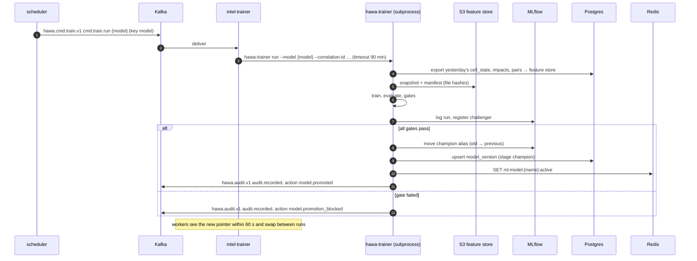

# Data and Training

<!-- nav:start -->

**Navigate:** [Project](../../README.md) · [Docs hub](../README.md) · [Overview](../SYSTEM_OVERVIEW.md) · [AWS architecture](../AWS_ARCHITECTURE.md) · [AWS setup](../AWS_SETUP_GUIDE.md) · [API](../backend/API.md) · [Environment](../ENVIRONMENT_VARIABLES.md) · [Contracts](../CONTRACTS.md)

**AI-ML docs:** [Runbook](../../AI-ML/README.md) · [Index](README.md) · [Context](CONTEXT.md) · [Architecture](ARCHITECTURE.md) · [Models](MODELS.md) · [Agents](AGENTS.md) · **Data and training** · [Engine contracts](../../AI-ML/CONTRACTS.md) · [Structure](STRUCTURE.md) · [Plan](PLAN.md)

<!-- nav:end -->

> **Status (as implemented).**
> - **Data:**
>   - `scripts/fetch_all.py` pulls OpenAQ station metadata, Open-Meteo weather and CAMS (fetched but unused by models), NASA FIRMS fires (unused by models), OSM POIs and synthetic bus corridors.
>   - `scripts/build_dataset.py` turns manual CPCB CSVs in `data/external/cpcb/` into `data/processed/stations_hourly.parquet`, or synthesises 60 days for the stations in `data/fixtures/stations_fallback.csv`. It also builds `grid_covariates_500m.parquet` and `grid_covariates_1000m.parquet`.
> - **Training:** `scripts/train_all.py` trains 21 LightGBM quantile models and the attribution classifier.
>   - Forecaster settings: 75 trees, depth 6, 31 leaves, learning rate 0.08; 37 features; temporal holdout of the last 45 days on `tail(45000)` rows.
>   - The attribution classifier uses weak rule-generated labels.
>   - Training writes `models/*.txt`, both model cards and `reports/forecast_metrics.json`.
> - **Not built (Planned):**
>   - There is no MLflow, no model registry, no promotion gates and no nightly retrain. Model files are committed to git.
>   - ERA5, IMD, `WAQI_TOKEN`, `CDS_API_KEY` and `DATA_GOV_IN_API_KEY` are not used by any ingestion code.
> - **Side effects:** the tests, the demo seed and `GET /interventions/{id}/impact` rewrite tracked files under `AI-ML/data/`.
>
> Layout: [AI-ML/data/README.md](../../AI-ML/data/README.md). Results: [AI-ML/README.md §7](../../AI-ML/README.md#7-measured-results).


Where AI-ML data comes from, how the grid and features are built, the contract with the backend simulator, how models are split, tracked, gated, retrained and kept reproducible and private.

Related: [README](README.md) · [CONTEXT](CONTEXT.md) · [ARCHITECTURE](ARCHITECTURE.md) · [STRUCTURE](STRUCTURE.md) · [MODELS](MODELS.md) · [AGENTS](AGENTS.md) · [PLAN](PLAN.md) · [../CONTRACTS.md](../CONTRACTS.md) · [../SYSTEM_OVERVIEW.md](../SYSTEM_OVERVIEW.md)

---

## 1. Data sources

Live feeds in production are pulled by the backend `feeds-worker` into `reference_observation`, `weather_observation`, `weather_forecast` and `fire_point` (CONTRACTS §8, §11). AI-ML scripts pull **history and static layers** for training, grid build and backfill, and write to the feature store (§5). Licences and limits below are what we plan around; confirm current terms on each provider's site before the pilot, and keep attribution in the open data portal's methods page (F21).

| Source | What we use | Used by | Access | Licence / terms (verify) | Limits and latency | Script |
|---|---|---|---|---|---|---|
| **CPCB / DPCC CAAQMS** | Hourly and 15-min PM2.5, PM10, NO₂, CO, met at Delhi's ~47 stations (§2.1) | Twin (stations as observations), calibration reference, forecaster targets, LOSO validation | CPCB Central Control Room portal (historical download), data.gov.in real-time AQI API (API key) | Government Open Data License – India for data.gov.in resources | Real-time API is modest; poll at most every 15 min (CONTRACTS §11). Portal history is bulk-downloaded once | `fetch_cpcb.py` |
| **OpenAQ** | Same stations via a harmonised API; gap filling; station metadata | Backfill, cross-check | OpenAQ v3 API (free API key) | OpenAQ terms; underlying data keeps its source licence | Per-minute and per-hour request limits on the free tier; page through with backoff | `fetch_openaq.py` |
| **Open-Meteo** | Historical weather (reanalysis-based) and forecasts: 10 m wind, 2 m temperature, RH, boundary-layer height, precipitation, pressure | Advection, trajectories, forecaster weather features, GRAP drivers | HTTP API, no key | CC BY 4.0 data; free tier for non-commercial use (a subscription is needed for commercial pilots) | Daily call budget on the free tier; batch by grid point | `fetch_weather.py --source open-meteo` |
| **ERA5** (ECMWF / Copernicus CDS) | Hourly reanalysis at 0.25°: u10, v10, t2m, d2m, boundary-layer height, precipitation | Training weather history, cross-check of Open-Meteo | CDS API (account, licence acceptance) | Copernicus licence (free, attribution) | Requests are queued; final ERA5 lags ~2–3 months, preliminary ERA5T ~5 days | `fetch_weather.py --source era5` |
| **IMD** | Station observations and forecast products where accessible | Optional validation of wind; the proposal's weather source | IMD portals; programmatic access generally needs an agency arrangement | IMD terms | Treated as optional in the hackathon; Open-Meteo fills the forecast role (documented deviation) | — |
| **NASA FIRMS** | VIIRS 375 m (S-NPP, NOAA-20, NOAA-21) and MODIS 1 km active fire points: time, location, FRP, confidence | Fingerprint (burning, regional smoke), forecaster fire features, key cells | FIRMS area API (free MAP_KEY) | NASA open data; cite FIRMS | Transaction limit per 10-minute window; near-real-time within ~3 h of overpass; a few passes a day (§12.2) | `fetch_firms.py` |
| **WorldPop** | 100 m population grid for India | Exposure `Pop(cell, t)` base | Direct download (GeoTIFF) | CC BY 4.0 | One-off | `worldpop_to_cells.py` |
| **OpenStreetMap** | Roads (by class), land use, schools, hospitals, elder-care, markets, bus stops, construction, industrial areas | Cell covariates, POIs, travel network, candidate sources | Geofabrik extract (northern India) or Overpass API | ODbL 1.0: attribution "© OpenStreetMap contributors"; share-alike applies to derived databases we publish (open data portal) | Overpass fair use; prefer the extract | `fetch_osm_pois.py` |
| **Delhi GTFS** | DTC and cluster bus routes, shapes, trips, stop times | Simulator routes (backend), coverage router, bus-stop exposure | Delhi Open Transit Data platform (registration, key) | Platform terms of use | Static GTFS refreshed weekly | `fetch_gtfs.py` |
| **MCD ward boundaries** | 250 wards (post-2022 delimitation) | `ward` table, plan scope, GRAP outlook | Delhi government / MCD GIS releases or community datasets (e.g. DataMeet) | Verify licence and that it is the 250-ward version | One-off | `fetch_wards.py` |
| **UDISE+** | School codes, enrolment | `SCH-{udise_code}` ids, school population | Public school directory | Government terms | One-off, then yearly | part of `fetch_osm_pois.py` join |
| DPCC C&D dust portal (optional) | Registered construction sites | Sites, construction density | Portal export if available | DPCC terms | One-off | `build_cell_features.py` |
| MAIAC AOD (STRETCH) | Satellite aerosol optical depth | Key-cell ranking | NASA Earthdata | NASA open data | Daily | — |

## 2. Acquisition and storage

- Every script is idempotent and incremental (`--from`, `--to`, resumes from the last partition), retries with exponential backoff, respects the provider's limits, and writes raw responses to `s3://hawa-{env}-lake/raw/{source}/date=YYYY-MM-DD/` before normalising into the feature store.
- Normalised station data uses the backend's ids (`REF-CPCB-site_301`, `REF-OAQ-…`) and CONTRACTS units (µg/m³, ppb).
- Time is converted to UTC at ingestion; source local times (IST) are parsed explicitly with `Asia/Kolkata`.
- Every raw pull records `source`, `retrieved_at`, request parameters and a content hash in the partition manifest.
- History window for the hackathon: **1 Oct 2022 → 15 Sep 2026** (four winters).

## 3. Grid build

`scripts/build_grid.py` (deterministic; output versioned as `grid_version`):

1. Build the NCT of Delhi boundary as the union of the 250 MCD ward polygons (plus NDMC and Cantonment areas where the ward file excludes them).
2. Transform to **EPSG:32643**. Take the bounding box; snap the south-west corner down to multiples of 500 m → `origin_x`, `origin_y`.
3. Generate 500 m squares: `row = 0..n_rows−1` northward, `col = 0..n_cols−1` eastward. Keep cells intersecting the boundary (≈ 6,000). Ids `g500-{row:03d}-{col:03d}` (CONTRACTS §2).
4. 1 km planning cells: `g1k-{row//2:03d}-{col//2:03d}` (≈ 1,500), geometry = union of children.
5. Ward assignment: largest overlap area; cells split across wards keep a `ward_shares` map for population-weighted ward aggregates.
6. Outputs: GeoParquet + CSV seed files for `grid_meta`, `cell`, `cell_1k` (backend seeds them; CONTRACTS §8), and the same layers in the feature store for training.
7. Checks: no duplicate ids, every cell has exactly one parent, total area within 1 % of the boundary area, row/col round-trip exact.

Changing the grid origin or size is a breaking change (all ids move); it requires a new `grid_version` and a coordinated re-seed.

## 4. Cell covariates and population

`scripts/build_cell_features.py` and `worldpop_to_cells.py` produce `cell_feature` (AI-ML-owned) and `cell.population`:

| Covariate | Definition |
|---|---|
| `road_density_km_km2` | OSM highway length per km², weighted by class (motorway/trunk 3, primary 2, secondary/tertiary 1.5, residential 1) |
| `dist_major_road_m` | Distance from centroid to nearest trunk/primary road |
| `construction_density` | Active construction sites (DPCC registered + OSM `landuse=construction`) per km² |
| `industrial_share`, `green_share` | Area share of `landuse=industrial` and parks/forest/grass |
| `land_use_class` | Dominant class: residential, commercial, industrial, green, mixed, transport |
| `poi_counts` | Schools, hospitals, elder-care, markets, bus stops |
| `school_enrolment` | Sum of UDISE enrolment for schools in the cell (default 800 when unknown) |
| `population` | WorldPop 100 m **area-weighted** zonal sum (pixel polygons intersected with cells; centroid assignment biases edge cells); total preserved within 0.5 % |
| `key_cell_score` | F1 score ([MODELS §1.3](MODELS.md#13-key-cells-f1)) |
| `feature_version` | Build version and source hashes |

Hourly population profiles and vulnerability weights are config (`population_profiles.yaml`, `vulnerability_weights.yaml`, [MODELS §9](MODELS.md#9-exposure-engine-f12)).

## 5. Feature engineering and feature store

Parquet on S3 (MinIO locally), partitioned by date, versioned per feature set:

```text
s3://hawa-{env}-lake/features/{feature_set}/v{n}/date=YYYY-MM-DD/part-00000.parquet
```

| Feature set | Grain | Key columns | Producer |
|---|---|---|---|
| `station_hourly` | station × hour | `station_id, ts, pm25, pm10, no2, co, source, qc_flag` | `fetch_cpcb.py`, `fetch_openaq.py` |
| `weather_hourly` | grid point × hour | `grid_point_id, ts, ws, wd, t, rh, blh, precip, p, source` | `fetch_weather.py` |
| `weather_forecast` | grid point × issued × valid | `grid_point_id, issued_at, valid_at, …` | `fetch_weather.py`, nightly export of `weather_forecast` |
| `fire_points` / `fire_daily_sector` | detection / day × sector | `ts, lon, lat, frp, confidence, satellite` / `date, sector, radius_km, count, frp_sum` | `fetch_firms.py` |
| `calendar` | day | `date, holiday, diwali_window, stubble_season, school_day, grap_stage_in_force` | config + manual table |
| `static_cell` | cell | `cell_feature` columns | `build_cell_features.py` |
| `cell1k_hourly` | g1k × hour | aggregated twin `pm25_est, pm10_est, mean_confidence, n_obs, is_simulated` | nightly export |
| `cell500_15min` | g500 × 15 min | twin archive (`cell_state`) | nightly export |
| `calibration_pairs` | device × minute | `device_id, ts, station_id, raw, ref, rh, ws, visit_id` | calibration job |
| `impacts` | intervention × pollutant | `impact` rows + strata keys | nightly export |
| `forecast_training` | origin × cell/station × horizon | materialised matrix per bucket | `hawa-trainer snapshot` |
| `labels_fingerprint` | cell × time | `label, label_source, weight` | trainer (inspections, reports, episodes, sim) |

Rules:

- **Point-in-time correctness.** Every training feature is computed from data available at the forecast origin. Weather forecasts are joined on `issued_at ≤ origin` (the forecast that existed then), never on later reanalysis. For history without archived forecasts, reanalysis used as a stand-in forecast overstates skill; such runs are tagged `nwp_proxy=reanalysis` and reported separately from runs with archived forecasts.
- Late store-and-forward data is included in exports by `ts`, not by arrival time; training reads the archive, not live state.
- Every frame is validated by its pandera schema on write and on read (§11).
- Reads use lazy Parquet scans (polars) with partition pruning.

## 6. Synthetic data contract with the backend simulator

The backend simulator (`backend/simulator`) emits the exact firmware packets (CONTRACTS §4) for a virtual fleet. AI-ML needs it to also publish **ground truth** so calibration, the twin, attribution and — most importantly — the verifier can be validated against known answers (§12.5). Proposed as P-15.

### 6.1 What the simulator generates

| Component | Model |
|---|---|
| Background field | Kriged real CPCB field (live or recorded) at 5-min resolution, per pollutant |
| Local sources | Dust sites (daytime profile, PM2.5/PM10 ≈ 0.3), traffic corridors (rush-hour profile, NO₂ + CO co-emission, ratio ≈ 0.6), burning events (Poisson arrivals weighted to night, PM2.5/PM10 ≈ 0.8, VOC, 30–120 min), regional smoke episodes (NW-wind days, city-wide multiplier with FIRMS-consistent upwind fires) |
| Dispersion | Plume-lite kernel advected by the real wind with decay length 300–800 m |
| Sensor model | `raw = (C_true − c − b·RH)/a + κ·C_true·g(RH) + ε`, `ε ~ N(0, (σ₀ + σ₁·C)²)`; per-device `a, b, c` drawn around a fleet mean; drift `a(t) = a₀(1 + δ·days)`; heater reduces `κ` when on; speed > 60 km/h adds attenuation noise; faults (`fan_stall`, `flatline`, `gps_no_fix`) with matching flags; `warming_up` for the first 30 min of gases; store-and-forward replays with original `seq` |
| Fleet | Devices on GTFS/OSM bus routes and e-rickshaw loops with realistic timetables; **post-period coverage guaranteed for demo cells** (≥ 3 passes within 4 h after each scheduled spray) |
| Interventions | Simulated HawaTag sprays following approved tasks (or a script): `SprayPacket`s per CONTRACTS §4.3; flow and pump current above the detection thresholds |
| Injected effects | Concentration within 200 m of the spray track multiplied by `1 − e·g(t)` with a ramp-then-decay profile of duration `D`; `e` drawn from a configured distribution per (cause, asset type): non-zero only for dust; water on smoke has zero true effect |
| Scenario presets | `burning_spike_bus7_0642` (§8.2), `regional_smoke_thursday`, `dust_near_three_schools`, `gaming_near_station`, `quiet_day_null` |

### 6.2 Ground truth published (evaluation only)

Written to `s3://hawa-{env}-lake/sim/truth/` with a `manifest.json` (simulator version, seed, config hash):

| Dataset | Columns |
|---|---|
| `field/date=…/` | `cell_id, ts (5 min), pm25_true, pm10_true, no2_true, co_true, contrib_by_cause {dust, traffic, burning, regional_smoke}` |
| `devices/` | `device_id, a_true, b_true, c_true, drift_rate, kappa, fault_windows` |
| `sources/` | `source_id, cause, geom, active_windows, scale` |
| `interventions/` | `intervention_id` (= `intervention.id`), `segment_id, cell_id, pollutant, effect_pct_true, duration_min_true, profile` |

**Estimand alignment.** `effect_pct_true` is the **cell-mean** relative reduction of the 15-min means over the verifier's pre-registered window (MODELS §12.3), computed by the simulator with the same definition the verifier estimates. A 200 m plume effect is not the same number as a 500 m cell-mean effect; comparing them would be wrong.

### 6.3 Rules

- Every simulated record carries `is_simulated = true`; derived AI-ML outputs propagate it.
- Production code never reads `sim/truth`: only `hawa_ml.eval` may (import-boundary test), and in AWS only the evaluation role has read access to the prefix.
- Simulator randomness is seeded per scenario; the seed and config hash are recorded in every MLflow evaluation run.
- Metrics computed on simulated data are always labelled "simulated" in reports and dashboards, and never presented as field results.

## 7. Dataset splits and evaluation protocol

| Model | Split | Details |
|---|---|---|
| Forecaster | **Time-based** with a 72 h embargo between splits | Train 2022-10-01 → 2025-06-30; validation 2025-07-01 → 2025-12-31 (includes the Oct–Dec 2025 stubble/Diwali season); test 2026-01-01 → 2026-09-15 (includes Jan–Feb 2026 winter). Rolling-origin backtest on test: origins every 6 h; metrics by horizon and season; day-block bootstrap CIs for skill differences |
| Twin | **Spatial hold-out station** (leave-station-out) | Hold out each pilot-area CPCB/DPCC station in turn (report each, and ≥ 5 in aggregate); baselines nearest-station and IDW; paired bootstrap of the MAE difference; test months as above |
| Calibration | Last 20 % of visits per device | Visit-level, not minute-level, to avoid autocorrelated leakage |
| Fingerprint classifier | Grouped by day / episode | No day appears in two splits; simulated and real-labelled sets reported separately |
| Verifier | Simulated injected-effect suite + real-data null | ≥ 200 simulated interventions; random fake interventions on real twin data for false-positive calibration |
| Effectiveness library | Leave-one-intervention-out | Shrinkage vs raw stratum means |
| TinyML spike | Held-out traces by device and day | Real pod traces kept entirely for test |

The §13.1 KPIs "twin accuracy" and "forecast skill" are computed with exactly these protocols.

## 8. MLflow tracking and registry

| Convention | Value |
|---|---|
| Tracking URI | `MLFLOW_TRACKING_URI` (compose service locally; artifacts in `s3://hawa-{env}-models/`) |
| Experiments | `hawa/{model}`: `hawa/forecaster`, `hawa/fingerprint`, `hawa/calibration`, `hawa/twin-eval`, `hawa/verifier-eval`, `hawa/effectiveness`, `hawa/site-score`, `hawa/tinyml-spike`, `hawa/agents-eval` |
| Run name | `{model}-{YYYYMMDDTHHMM}-{git_sha7}` |
| Tags | `git_sha`, `semver`, `snapshot_id`, `feature_set_versions`, `grid_version`, `trigger` (`nightly` \| `manual` \| `ci`), `correlation_id`, `is_simulated_data`, `nwp_proxy`, `image_digest` |
| Params | All hyperparameters from the resolved config (flattened), random seeds |
| Metrics | `{split}_{metric}_{qualifier}`: `test_mae_h24`, `test_skill_persist_h24`, `test_pinball_q10_b13-24`, `test_coverage_p10p90_b25-48`, `loso_mae_REF-CPCB-site_301`, `sim_ci_coverage`, `sim_fpr_null`, `real_fpr_null` |
| Artifacts | model file(s), feature list, resolved config, metrics JSON, pandera report, plots (reliability, residuals by horizon), snapshot manifest |
| Registered models | `hawa-forecaster`, `hawa-fingerprint`, `hawa-effectiveness`, `hawa-site-score`, `hawa-tinyml-spike` (trained artifacts); `hawa-twin`, `hawa-verifier`, `hawa-calibration` register configuration + evaluation report (their fitting happens at run time) |
| Aliases | `challenger` (just registered, gates pending or failed), `champion` (active); previous champion keeps alias `previous` for rollback |
| Version string | `model_version = {model}@{semver}+{git_sha7}` stored as a registry tag and mirrored to the `model_version` table and `ml:model:{name}:active` |

## 9. Promotion gates

A challenger becomes champion only if every gate passes; results are stored in `model_version.gates` and on the MLflow run.

| Model | Gates |
|---|---|
| Forecaster | 24 h P50 MAE ≤ 0.90 × persistence MAE on test (skill ≥ 0.10, the §13.1 "clear improvement"); 48 h and 72 h MAE better than climatology; pinball loss per quantile not worse than champion by > 2 %; P10–P90 coverage in [0.72, 0.88] per bucket; no quantile crossing after post-processing; input pandera checks pass |
| Twin (config change) | LOSO MAE below the nearest-station baseline with the paired-bootstrap 95 % CI of the difference below 0; 80 % interval coverage in [0.7, 0.9]; not worse than champion by > 3 % MAE |
| Fingerprint classifier | Macro-F1 ≥ rules + 0.05; burning recall ≥ max(rules, 0.8); ECE ≤ 0.08; golden smoke cases all `P(dust) < 0.5` |
| Calibration (per device) | Coefficient bounds; hold-out MAE ≤ 1.05 × current ([MODELS §2.3](MODELS.md#23-method)) |
| Verifier (code change) | Simulated suite: CI coverage ≥ 0.88, bias ≤ 3 pp, null false-positive rate ≤ 0.10; real-data null false-positive rate ≤ 0.10 |
| Effectiveness library | No stratum with n < 3 moves more than 2 prior sd; leave-one-out MSE ≤ raw means |
| Site score | Week-on-week grade changes ≤ 20 % without new evidence; simulated separation AUC ≥ 0.8 |
| TinyML spike | Precision ≥ 0.9, recall ≥ 0.85, int8/float agreement ≥ 98 %, size and latency budgets |
| Agents (prompt or model change) | All blocking golden scenarios pass 5/5 ([AGENTS §11](AGENTS.md#11-evaluation-suite)) |

Failing a gate leaves the challenger registered with `challenger` alias, writes an `audit.recorded` event with action `model.promotion_blocked` (P-19) and keeps the champion.

## 10. Nightly retrain

The scheduler emits `cmd.train.run` at 02:00 IST for `forecaster`, `calibration`, `effectiveness`, `site_score` (CONTRACTS §11), and (P-03) `twin_eval`, `verifier_eval`.



Calibration writes `device_calibration` rows and emits `device.calibrated` / `device.trust_changed` (P-01) directly; the effectiveness job rewrites `effectiveness_library`; the site-score job writes `site_score`. Rollback: `hawa-trainer promote --model forecaster --alias previous`.

## 11. Data quality (pandera)

Schemas in `hawa_ml/validation/schemas.py`; validated lazily at every read and write boundary; failures increment `data_quality_failures_total{schema, check}` and raise a typed error that triggers the component's fallback.

| Schema | Key checks |
|---|---|
| `ReadingWindow` | CONTRACTS §4.1 ranges (0 ≤ pm1 ≤ pm25 ≤ pm10 ≤ 2000, RH 0–100, t −5–55); lat/lon in NCR bbox for mobile roles; `weight ∈ [0, 1]`; `trust ∈ [0, 1]`; unique `(device_id, seq)`; `ts` within window |
| `ReferenceObs` | non-negative; station id format; ≤ 1 row per station per interval |
| `WeatherHourly` / `WeatherForecast` | `ws ≥ 0`, `wd ∈ [0, 360)`, `blh > 0`; `issued_at ≤ valid_at`; freshness |
| `FirePoints` | lon/lat valid; `frp ≥ 0`; confidence enum |
| `CellStateOut` | ids match `^g500-\d{3}-\d{3}$`; `pm_est ≥ 0`; `pm_var ≥ 0`; `confidence ∈ [0, 1]`; `cause_probs` sum to 1 ± 1e-6; `model_version` present |
| `ForecastOut` | `p10 ≤ p50 ≤ p90`; all ≥ 0; horizons 1..72 complete per cell; `valid_at = issued_at + h` |
| `ForecastTraining` | no feature timestamp > origin; no NaN in required features; target present |
| `ImpactOut` | `ci_low ≤ effect_pct ≤ ci_high`; `placebo_p ∈ (0, 1]`; enums match `ImpactMethod`/`ImpactVerdict`; donor weights sum to 1 |
| `PlanTasksOut` | kinds in `TaskKind`; ETA order; asset ids exist |
| `CalibrationPairs` | distance ≤ 200 m, speed < 10 km/h, ws ≤ 3 m/s |

Feed-level monitors: per-station missing share, flatlined stations (identical values ≥ 3 h), and sudden station jumps (> 5 robust sd) are flagged and excluded from the twin and calibration for that window.

## 12. Reproducibility

- Environments locked by `uv.lock`; the Docker image digest is recorded on each MLflow run.
- Every training run reads an immutable snapshot (`snapshots/{snapshot_id}/` with a manifest of file paths and SHA-256 hashes); re-running with the same `snapshot_id`, config and seed reproduces the model.
- Seeds fixed for numpy, LightGBM (`seed`, `deterministic=true`, fixed `num_threads` in training), hypothesis profiles, Monte Carlo draws (What-If, GRAP, trajectories) and the simulator.
- OR-Tools with a wall-clock time limit is not bit-for-bit deterministic; plans store the solution itself (routes, tasks) and the solver parameters, so any draft can be re-audited, and tests use `solution_limit` for determinism.
- Verification freezes its pre-period inputs to S3 at spray end, so impacts can be recomputed even after twin history is reprocessed.
- Configs are validated and hashed; the config hash is part of the MLflow tags and of `twin_run`/`forecast_run` metadata.

## 13. Privacy

- **No personal data in ML datasets.** Population is aggregated (WorldPop, POI capacities); no person-level locations. Citizen phone numbers, names and account ids never leave the backend; AI-ML sees a `report_id`, a photo (EXIF stripped before any model call) and a coarse location.
- **Machines, not people.** Asset tracks are machine positions during shifts, used for verification; driver identities are not in AI-ML tables. Driver location outside shifts is not collected (backend/app rule).
- **Cameras.** HawaEye (VISION) processes on device and uploads only flagged evidence clips with faces blurred; nothing is published (§10.4, §15). Citizen Eyes flags `people_identifiable` / `plates_readable` so the backend blurs before review.
- **LLM prompts** carry ids and numbers only ([AGENTS §8](AGENTS.md#8-guardrails)); transcripts are stored in S3 for 30 days with admin/analyst access only.
- **Logs** are JSON via logifyx with masking on; prompts, photos and raw payloads are never logged.
- **Retention.** Feature store kept for model development; raw photos follow backend retention; simulator truth is non-personal.
- **Open data** (F21) publishes calibrated cell values and methods, never device-level raw tracks of vehicles that could identify operators' schedules beyond what the operator agrees to.

<!-- footer:start -->

---

[Back to top](#data-and-training) · [Docs hub](../README.md) · [Project README](../../README.md)

<!-- footer:end -->
