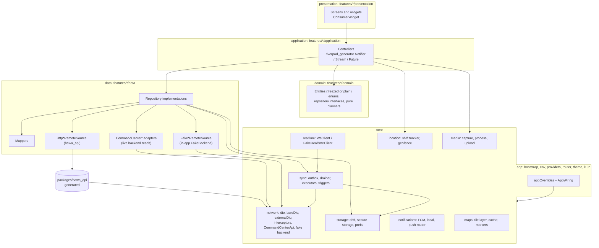
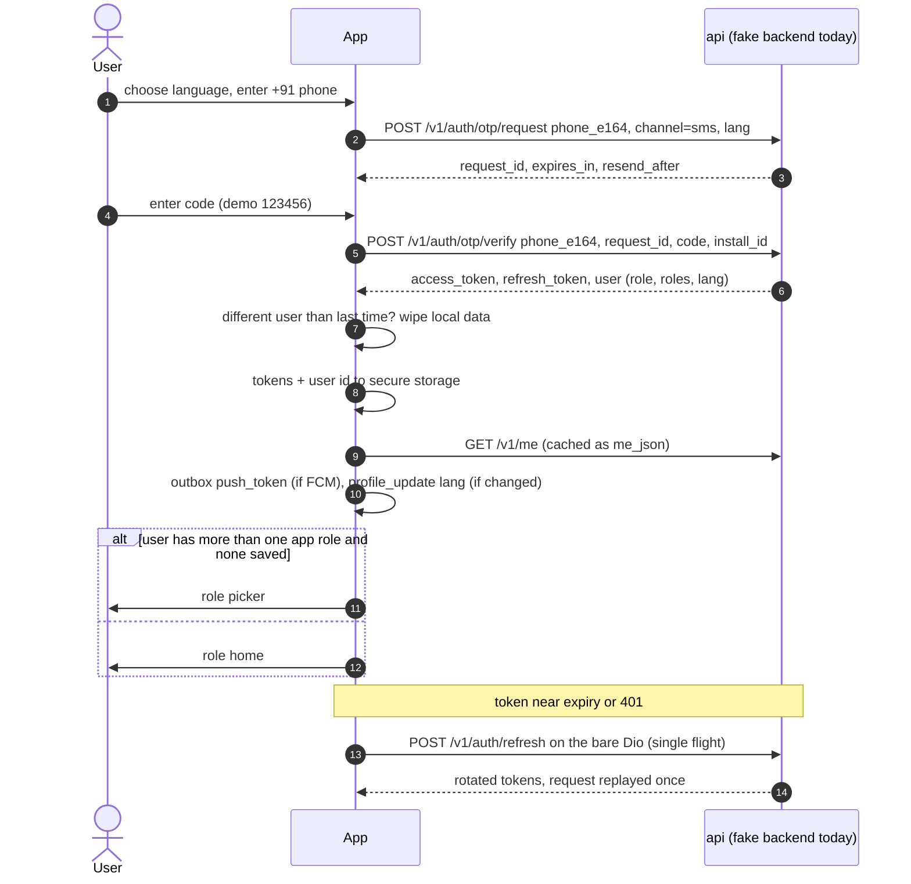
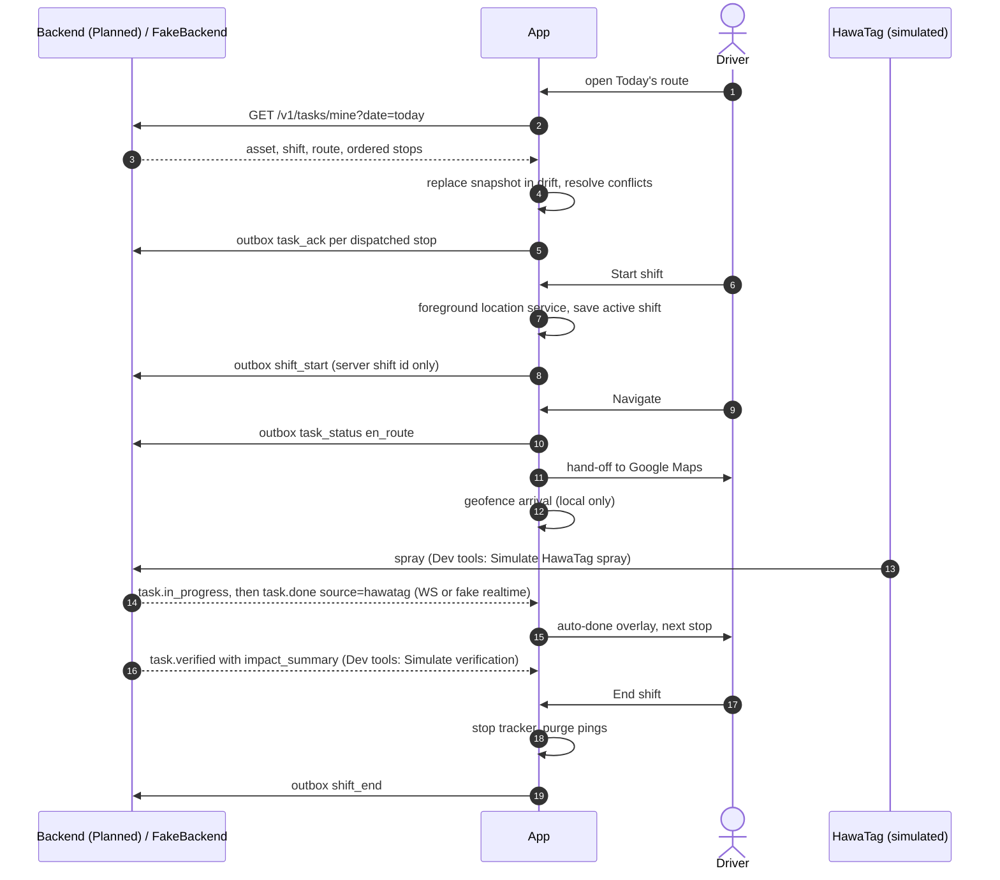
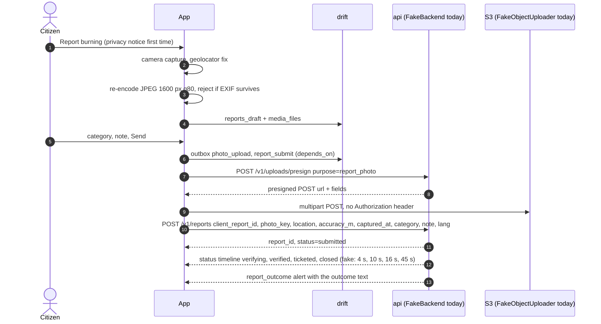

# App architecture

<!-- nav:start -->

**Navigate:** [Project](../../README.md) · [Docs hub](../README.md) · [Overview](../SYSTEM_OVERVIEW.md) · [AWS architecture](../AWS_ARCHITECTURE.md) · [AWS guide](../AWS_SETUP_GUIDE.md) · [API](../backend/API.md) · [Environment](../ENVIRONMENT_VARIABLES.md) · [Contracts](../CONTRACTS.md)

**App docs:** [Runbook](../../app_frontend/README.md) · [Index](README.md) · **Architecture** · [Screens](SCREENS.md) · [Offline and sync](OFFLINE_AND_SYNC.md) · [Notifications and realtime](NOTIFICATIONS_AND_REALTIME.md) · [Deployment](DEPLOYMENT.md)

<!-- nav:end -->

Purpose: how the Flutter app in `app_frontend/` is built, covering layers, state, navigation, networking and fake mode, the API surface against the real backend, storage, realtime, push, location, maps, media, i18n, theming, flavors, errors, security, performance and accessibility, plus the key sequences.

Related: [README](README.md) · [../CONTRACTS.md](../CONTRACTS.md) · [../SYSTEM_OVERVIEW.md](../SYSTEM_OVERVIEW.md) · [../backend/API.md](../backend/API.md)

> Status: this doc describes the code at HEAD. Design targets that are not built are marked **Planned**; the status vocabulary is defined in [README §2](README.md#2-implementation-status). File paths are relative to `app_frontend/`.

---

## 1. Principles

| # | Principle | Status |
|---|---|---|
| 1 | **The local database is the UI's source of truth.** Screens watch drift streams (tables or `cached_payloads` JSON). The network refreshes the cache and the outbox pushes changes | Implemented |
| 2 | **The server is authoritative.** Local writes are optimistic overlays reconciled against server events | Implemented |
| 3 | **Typed client for the field contract.** Every contract call goes through the generated `packages/hawa_api`. Deliberate exceptions: the presigned S3 upload, the WebSocket, `CommandCenterApi` (untyped reads of the endpoints the backend serves today) and `externalDio` (OSRM, Photon) | Implemented |
| 4 | **Every mutation is idempotent.** Outbox ops carry a UUIDv7 that doubles as the `Idempotency-Key`; other mutating calls get a generated key | Implemented |
| 5 | **Honesty and uncertainty are UI invariants.** `is_simulated` → badge; model output → range or confidence (CONTRACTS §1) | Partial: the widgets exist and are used widely, but `UncertaintyText` is unused and the four hard-coded citizen screens rely only on a screen chip |
| 6 | **Contracts over guesses.** Enums keep wire names and an `unknown` member (`core/utils/contract_enums.dart`, generator option `enumUnknownDefaultCase`) | Implemented |
| 7 | **Field-first.** Offline, low-end devices, sunlight, gloves, Hindi | Implemented in the shells; performance budgets unmeasured |
| 8 | **Mock-first.** Every feature has a fake remote source on the in-app fake backend, switched per feature by `Env.isFake` (§6.5) | Implemented |

## 2. Layers

Feature-first, layered. Each feature under `lib/features/<name>/` has `domain`, `data`, `application` and `presentation`. Shared infrastructure lives in `lib/core/`, app wiring in `lib/app/`.



Controllers depend on the repository *providers* (which return the `data` implementation) rather than only on domain interfaces; the interfaces exist in `domain/` for most features.

### 2.1 Dependency rules

| Layer | May import | Must not import | Enforced by |
|---|---|---|---|
| `presentation` | its feature's `application` + `domain`, `core/widgets`, `app/theme`, `app/l10n`, `app/router` | `data`, `hawa_api`, `dio`, `drift` | `tool/architecture_guard.sh` (the `/data/` and `hawa_api` greps); `dio`/`drift` by review |
| `application` | its `domain`, other features' `domain`, `core/*` providers, its own `data` providers | `presentation`, `hawa_api` | `hawa_api` by the guard; the rest by review |
| `domain` | `freezed_annotation`, `json_annotation`, `core/utils` | Flutter widgets, `dio`, `drift`, `hawa_api` | review (no current violation) |
| `data` | `domain`, `hawa_api`, `core/*` | `presentation`, `application` | review |
| `core` | third-party packages, `app/` (env, theme, l10n, routes), `hawa_api` only in `core/network` | any `features/*` | the guard for `hawa_api`; no current `features` import in `core` |

`lib/app/providers.dart` is the only place that binds core seams to feature implementations.

**Prototype theme.** `lib/app/theme.dart` (HawaColors/HawaFonts/HawaText, Geist fonts) is the one file left from the first prototype; four citizen screens still import it, so it is excluded from analysis and filtered out of the architecture guard ([README Known issue 6](README.md#9-known-issues)). The rest of the prototype (package `hawacommand_app`) was removed on 2026-10-11.

## 3. Features

| Feature | Screens | Data sources: fake / real | Real backend today |
|---|---|---|---|
| `auth` | splash, language, phone, OTP | `FakeAuthRemoteSource` / `HttpAuthRemoteSource` | not served |
| `shell` | role picker, permission education, unsupported role, five role shells, More sheet | `permission_handler` + geolocator | n/a |
| `driver_route` | today's route, map, stop detail, skip, manual done, shift summary | `FakeTaskRemoteSource` / `HttpTaskRemoteSource` | not served |
| `inspector` | targets, map, target detail, photo viewer, outcome | `FakeInspectorRemoteSource` / `HttpInspectorRemoteSource` | not served |
| `school` | today, indoor/outdoor, forecast | `FakeSchoolRemoteSource` / `HttpSchoolRemoteSource`, wrapped by `CommandCenterForecastSource` when `school_forecast` is real | forecast only |
| `citizen_air` | air near me, subscription, route tip, safe route, live ops, ward score | open air: `FakeOpenAirRemoteSource` / `CommandCenterOpenAirSource` (or `HttpOpenAirRemoteSource`); subscription (key `citizen_subscription`): fake / HTTP; safe window: `CommandCenterApi` | twin, hotspots, safe-window |
| `citizen_reports` | capture, privacy, review, my reports, status, missed machine | `FakeReportsRemoteSource` / `HttpReportsRemoteSource` | not served |
| `air_map` | AI air map with clean-air routing, place search | `FakeAirMapRemoteSource` / `HttpAirMapRemoteSource` (fake fallback); `OsrmRoutingSource`, `PhotonGeocodingSource` | twin, hotspots, forecast |
| `alerts` | inbox, detail | `FakeAlertsRemoteSource` / `CommandCenterAlertsSource` (or `HttpAlertsRemoteSource`) | broadcast log |
| `site` | site score | `FakeSiteRemoteSource` / `HttpSiteRemoteSource` | not served |
| `profile` | profile | secure-storage `/v1/me` cache | n/a |
| `settings` | settings, sync queue, notification settings, Dev tools, logout flow | outbox, prefs, fake backend | n/a |

Example anatomy (`driver_route`): `domain/` has `today_route.dart`, `stop.dart`, `shift.dart`, `asset_summary.dart`, `impact_summary.dart`, `skip_reason.dart`, `route_diff.dart`, `auto_done_event.dart`, `driver_route_repository.dart`; `data/` has `driver_route_repository_impl.dart`, `task_remote_source.dart`, `fake_task_remote_source.dart`, `task_local_source.dart`, `task_mapper.dart`, `task_event_applier.dart`; `application/` has `today_route_controller.dart`, `shift_controller.dart`, `stop_actions_controller.dart`, `arrival_watcher.dart`, `route_change_detector.dart`, `auto_done_events.dart`.

## 4. State management: Riverpod with code generation

`flutter_riverpod 3.4.3`, `riverpod_annotation 4.0.7`, `riverpod_generator 4.0.9` (generated `*.g.dart`, not committed). `riverpod_lint`/`custom_lint` are **not installed**: no release resolves on Dart 3.12 (`analysis_options.yaml:37-39`).

| Provider kind | Used for | Examples |
|---|---|---|
| `@Riverpod(keepAlive: true)` function | Core singletons | `dio`, `bareDio`, `externalDio`, `hawaApi`, `mutationApi`, `commandCenterApi`, `appDatabase`, `tokenStore`, `settingsStore`, `realtimeClient`, `realtimeDispatcher`, `outboxRepository`, `outboxDrainer`, `opExecutors`, `fakeBackend`, `fcmService`, `localNotifications`, `appClock`, `serverClock`, `tileCache` |
| `@Riverpod(keepAlive: true)` class | App-wide state with methods | `SessionController`, `AppPreferencesController`, `ForcedOffline`, `SyncTriggers`, `ServiceDate`, `ShiftActiveFlag`, `CurrentUserId`, `ConflictBannerBus`, `InAppMessages`, `UploadProgress`, `ShiftController`, `LogoutController` |
| `@riverpod` (auto-dispose) | Screen controllers, drift-backed streams | `outboxDepth`, `visibleOutboxOps`, `outboxActive`, `activeRoleWire`, `currentUser`, feature controllers |
| Hand-written providers | A few app/screen-level cases | `appWiringProvider` (`app/providers.dart`), `safeBreathWindowProvider` (citizen air), the Dev tools health probe |

Rules in the code:
- `bootstrap()` sets a `ProviderScope.retry` policy: only transient `Failure`s (`isTransient`), at most 3 attempts, 400 ms × 2ⁿ.
- `sharedPreferencesProvider` and `crashReporterProvider` are overridden in `bootstrap()`; `appOverrides()` (`app/providers.dart`) binds `tokenRefresherProvider` to `AuthRepository.refreshTokens` and `sessionExpiredProvider` to `SessionController.onExpired`. The same overrides are used in the workmanager isolate.
- `appWiringProvider` (`AppWiring`) is watched by `HawaApp` and eagerly reads `syncTriggersProvider`, `realtimeDispatcherProvider` and the three realtime appliers, builds the `PushRouter`, starts local notifications and FCM, and owns the foreground/background lifecycle of the WebSocket.
- Tests use `ProviderScope`/`ProviderContainer` overrides (`test/helpers/pump_app.dart`).

## 5. Navigation: go_router

### 5.1 Route tree

One `GoRouter` from the keep-alive `routerProvider` (`lib/app/router/router.dart`). `initialLocation` is `/splash`; `refreshListenable` is a `ValueNotifier` bumped on every `sessionControllerProvider` change. Role shells are `StatefulShellRoute.indexedStack`. Modal pages (skip, manual done, outcome, permission education) and the photo viewer use the root navigator. Path constants live in `lib/app/router/routes.dart` (`abstract final class Routes`).

| Path | Screen | Required role | Shell / tab |
|---|---|---|---|
| `/` | redirects to `/splash` | — | — |
| `/splash` | Splash | — | — |
| `/onboarding/language` | Language picker | — | — |
| `/onboarding/permissions/:kind` | Permission education (`notifications`, `location`, `camera`) | — | modal |
| `/auth/phone?from=`, `/auth/otp?from=` | Phone, OTP | signed out | — |
| `/auth/role` | Role picker | signed in | — |
| `/unsupported-role` | "Use the web console" | web-only roles | — |
| `/driver`, `/driver/stops/:taskId`, `/driver/stops/:taskId/skip`, `/driver/stops/:taskId/manual-done`, `/driver/shift/summary`, `/driver/map` | Driver | `driver` | Route · Map · More |
| `/inspector`, `/inspector/targets/:targetId`, `…/outcome`, `…/photos/:index`, `/inspector/map` | Inspector (`:targetId` is the inspection id) | `inspector` | Targets · Map · More |
| `/school?date=`, `/school/forecast`, `/school/air` | School | `school` | Today · Air · Alerts · More |
| `/citizen/map` | AI air map (citizen home) | `citizen` | Map |
| `/citizen`, `/citizen/subscription`, `/citizen/route-tip`, `/citizen/safe-route`, `/citizen/live-ops`, `/citizen/ward-score` | Air near me and children | `citizen` | Air |
| `/citizen/report/new`, `/citizen/report/new/missed-machine`, `/citizen/report/privacy`, `/citizen/report/review?draft=` | Citizen Eyes | `citizen` | Report |
| `/citizen/reports`, `/citizen/reports/:reportId` | My reports, status | `citizen` | My reports |
| `/site` | Site score | `site_manager` | Site · More |
| `/map`, `/map/search?field=from\|to` | AI air map for any role (from More), place search | any signed in | pushed |
| `/alerts`, `/alerts/:alertId` | Inbox, detail | any signed in | pushed |
| `/settings`, `/settings/sync`, `/settings/notifications`, `/settings/dev` | Settings, sync queue, notification prefs, Dev tools | any signed in | pushed |
| `/profile` | Profile | any signed in | pushed |

`Routes.reportMissedMachine` (`/citizen/report/missed-machine`) does not match the registered path above, and `Routes.schoolForecast` is linked from a citizen screen ([README Known issue 5](README.md#9-known-issues)).

### 5.2 Redirect guard

`authRedirect(SessionState, Uri)` in `lib/app/router/guards.dart` is a pure function, unit-tested in `test/app/router/guards_test.dart`:

1. `SessionBooting` → `/splash`.
2. Language not chosen → `/onboarding/language`.
3. `SessionSignedOut`: `/onboarding/language` → `/auth/phone`; `/auth/phone` and `/auth/otp` are allowed; anything else → `/auth/phone?from=<uri>` (no `from` for `/` or `/splash`).
4. Signed in, every role web-only (`officer`, `admin`, `analyst`, `unknown`) → `/unsupported-role`.
5. No active role → `/auth/role`.
6. Auth, splash, language, unsupported-role or `/` → the role home (`Routes.homeFor`: driver `/driver`, inspector `/inspector`, school `/school`, citizen `/citizen/map`, site manager `/site`).
7. A path owned by another role (`Routes.requiredRoleFor`, by prefix) → the active role's home.

`afterLogin(from, role)` returns `from` only when the role may open it, otherwise the role home.

### 5.3 Deep links from push

`resolveDeepLink` (`lib/app/router/deep_links.dart`) maps the backend's entity form `hawa://{entity}/{id}` to a route and the role that may open it. Ids must be UUIDv7 (`isUuidV7`) or a school id (`SCH-…`); anything else returns null.

| `deep_link` | Roles that can open it | Route |
|---|---|---|
| `hawa://route?date=…` | driver, inspector | `/driver` or `/inspector` |
| `hawa://tasks/{uuid}` | driver, inspector | `/driver/stops/{id}` or `/inspector/targets/{id}` |
| `hawa://inspections/{uuid}` | inspector | `/inspector/targets/{id}` |
| `hawa://schools/{SCH-…}/safe-window?date=YYYY-MM-DD` | school | `/school?date=…` (or `/school`) |
| `hawa://schools/{SCH-…}/air` | school | `/school/air` |
| `hawa://reports/{uuid}` | citizen | `/citizen/reports/{id}` |
| `hawa://alerts/{uuid}` | the active role (else the first held role) | `/alerts/{id}` |
| `hawa://sites/me` | site_manager | `/site` |

The active role is preferred when it can open the link, otherwise the first held role that can. `PushRouter.open(payload)` (`lib/core/notifications/push_router.dart`) drops payloads whose `role` the user does not hold, resolves the link, calls `SessionController.chooseRole` if the target role is held but not active, then `router.go(route)`.

| Source of a deep link | Status |
|---|---|
| `FirebaseMessaging.getInitialMessage()` (cold start, waits up to 5 s for the session to restore) | Implemented, inactive without Firebase |
| `FirebaseMessaging.onMessageOpenedApp` | Implemented, inactive without Firebase |
| flutter_local_notifications taps and launch details | Implemented |
| In-app banner taps (`AppWiring.open`) | Implemented |
| Android `hawa://` intent filter (SMS/WhatsApp links) | Partial: declared in the manifest, but no Dart code reads the intent ([README Known issue 8](README.md#9-known-issues)) |
| App Links over https | Planned |

### 5.4 Roles and role switching

- `UserRole` (`features/auth/domain/user_role.dart`): `driver`, `inspector`, `school`, `citizen`, `site_manager`, `officer`, `admin`, `analyst`, `unknown`. The last four are web-only. Picker order: driver, inspector, school, citizen, site manager. `isField` (driver, inspector) selects outdoor mode and 64 dp buttons.
- On sign-in or restore, `SessionController._enter` picks the active role: the saved `active_role` pref if still held, else the only app role, else none (→ role picker).
- **Switch role** (More sheet, shown when the user holds more than one app role): if a shift is running the user confirms, then `chooseRole` saves the pref, updates the session, calls `POST /v1/auth/switch-role` (re-issues tokens; failure is logged and ignored), fires a manual sync trigger and goes to the new home with a "Switched to …" snackbar.
- Push deep links switch role automatically (§5.3).
- A background `/v1/me` refresh after restore clears the active role if the server no longer grants it.

## 6. Networking

### 6.1 HTTP clients and the generated client

| Client | Built in | Base URL | Interceptors | Used for |
|---|---|---|---|---|
| `dioProvider` | `core/network/dio_provider.dart` | `API_BASE_URL` | full chain (§6.2); timeouts 10 s connect / 20 s receive / 20 s send | the generated `HawaApi` (all contract calls except refresh) |
| `bareDioProvider` | same file (re-exported by `bare_dio_provider.dart`) | `API_BASE_URL` | ForcedOffline (non-prod), RequestId, ProblemJson, Logging; 10/30/60 s | token refresh, S3 presigned upload (absolute URL), `CommandCenterApi` |
| `externalDioProvider` | `core/network/command_center_api.dart` | none (absolute URLs) | none; `User-Agent: HawaCommand-field/0.1 (in.hawacommand.field)` | OSRM routing, Photon search |

- **Generated client.** `packages/hawa_api` (openapi-generator 7.17.0, `dart-dio`, `json_serializable`, `enumUnknownDefaultCase`, `skipCopyWith`; config in `openapi/generator-config.yaml`) is built from `openapi/openapi.json`, a hand-written snapshot titled "HawaCommand API (field app surface)" `1.1.0-app` with 36 operations and 124 schemas. `hawaApiProvider` constructs `HawaApi(dio: dio, interceptors: const [])` so the generated APIs share our chain and add none of their own. The guard allows `package:hawa_api` only in `features/*/data/` and `core/network/`.
- **`CommandCenterApi`** wraps the read endpoints the backend serves today: `twin({bbox, limit=2000})`, `hotspots({hour=0, ward})`, `forecast({cellId})`, `safeWindow({persona='general'})`, `alerts()`, `devices()`, `impact()`, `healthy()` (`GET /healthz`, 5 s). It returns raw JSON maps; feature adapters reshape them into contract models. `devices()` and `impact()` are not called anywhere.
- `HttpMutationApi` (`core/network/http_mutation_api.dart`) is the only place outbox ops touch `hawa_api`; it passes the op id as both the `idempotencyKey` parameter and `extra['idempotency_key']`.

### 6.2 Interceptor chain

Order in `dioProvider`. Dio runs request hooks and error hooks in insertion order.

| # | Interceptor | Request | Response / error |
|---|---|---|---|
| 1 | `ForcedOfflineInterceptor` (not in prod) | Rejects with a connection error while Dev tools "Go offline" is on | — |
| 2 | `RequestIdInterceptor` | New UUIDv7 `X-Request-Id` per attempt, stored in `extra['request_id']` | Copies an echoed `X-Request-Id` into `extra` |
| 3 | `IdempotencyInterceptor` | `POST/PUT/PATCH/DELETE` outside `/v1/auth/`: `Idempotency-Key` from `extra['idempotency_key']`, an existing header, or a new UUIDv7 stored back in `extra` (stable across retries) | — |
| 4 | `AuthInterceptor` | `Authorization: Bearer <access>` (skipped for `/v1/auth/*` except `/logout` and `/switch-role`). If the JWT `exp` is under 60 s away, awaits the shared refresh first | — |
| 5 | `RefreshInterceptor` (`QueuedInterceptor`) | — | On `401` from a non-auth path: if no one refreshed since the request left, runs the single-flight refresh, then replays once (`extra['after_refresh']`). A failed refresh calls `SessionExpired` |
| 6 | `RetryInterceptor` | — | Connection/timeouts, `429`, `502/503/504`, `409` `idempotency(.|_)in_progress`: up to 2 retries at 0.5 s / 1.5 s + 0–250 ms jitter, or `Retry-After` if ≤ 10 s. Only `GET`/`PUT`/`DELETE` or requests carrying an `Idempotency-Key` |
| 7 | `ProblemJsonInterceptor` | — | Converts every `DioException` into a typed `Failure` set as `DioException.error` (§6.4) |
| 8 | `LoggingInterceptor` (disabled in prod) | Stamps `started_at` | Logs `METHOD path → status Nms rid=…` at FINE, redacted; feeds `ServerClock` from the `Date` header (also in prod) |

`failureOf(error)` unwraps a `Failure` from any error; data sources rethrow it.

### 6.3 Refresh, single-flight

`SingleFlightRefresh.run()` shares one in-flight `Future` between `AuthInterceptor`, `RefreshInterceptor` and `WsClient`. The refresher is `TokenRefresherImpl` (`features/auth/data/token_refresher.dart`): it reads the refresh token, calls `POST /v1/auth/refresh` through a `HawaApi` built on the **bare** Dio (so the refresh cannot loop through the chain) and saves the rotated pair. On failure the session controller's `onExpired` pauses the drainer, disconnects realtime and moves to `SessionSignedOut(expired: true)`. Data and outbox are kept for the same user; a different user signing in wipes first.

### 6.4 Typed failures

`core/errors/failure.dart` defines a sealed `Failure` (with `requestId`, normalized `code`, `ProblemDetails`, `isTransient`). `Failure.fromStatus` maps HTTP status:

| Failure | From | Transient |
|---|---|---|
| `NetworkFailure` | connection error, unknown socket exception | yes |
| `TimeoutFailure` | connect/send/receive/transform timeout, `408` | yes |
| `UnauthorizedFailure` | `401` | no |
| `ForbiddenFailure` | `403` | no |
| `NotFoundFailure` | `404`, `410` | no |
| `ConflictFailure(code, retryAfter)` | `409` | only `idempotency_in_progress` |
| `ValidationFailure(errors, status)` | `400`, `413`, `415`, `422` | no |
| `RateLimitedFailure(retryAfter)` | `429` | yes |
| `ServerFailure(status)` | `≥ 500` | `502–504` |
| `UnknownFailure(cause)` | anything else | no |
| `SimulatedOfflineFailure` | fake mode "Go offline" | yes |

`ProblemDetails` (`core/errors/problem_details.dart`) parses RFC 9457 bodies; `code` comes from `code` or a `urn:hawa:problem:` type and is normalized (`auth.otp_invalid` → `otp_invalid`, `idempotency.in_progress` → `idempotency_in_progress`, `inspection.already_closed` → `inspection_already_closed`, `upload.too_large` → `media_too_large`, …). Presentation shows `failure.message(l10n)` (`failure_messages.dart`); the raw `detail` is never shown. `asFailure(error)` wraps anything else.

### 6.5 Fake vs real selection

`Env.isFake(feature)` = not in `REAL_FEATURES` and (`USE_FAKE_API` or in `FAKE_FEATURES`). Each feature's `*RemoteSource` provider chooses its implementation; tests override those providers directly. Core seams follow the same switch:

| Seam | Fake when | Real |
|---|---|---|
| `mutationApiProvider` | `USE_FAKE_API=true` → `FakeMutationApi` for every op | `HttpMutationApi`; with `FAKE_FEATURES`, `_RoutingMutationApi` routes per op (tasks/shifts/locations → `driver_route`/`inspector`; close/on-site → `inspector`; reports and presign → `citizen_reports`/`inspector`; alert ack → `alerts`/`school`; push token → `auth`; `PATCH /v1/me` → `auth`/`settings`; subscription → `citizen_air`) |
| `objectUploaderProvider` | `citizen_reports` or `inspector` fake → `FakeObjectUploader` | `DioObjectUploader` on the bare Dio |
| `realtimeClientProvider` | `driver_route` or `alerts` fake → `FakeRealtimeClient` | `WsClient(WS_URL)` |
| `alertsRemoteSourceProvider` | `alerts` fake | `CommandCenterAlertsSource`, or `HttpAlertsRemoteSource` with `ALERTS_CONTRACT=true` |
| `openAirRemoteSourceProvider` | `citizen_air` fake | `CommandCenterOpenAirSource` (twin + hotspots, fixture fallback), or `HttpOpenAirRemoteSource` with `OPEN_AIR_CONTRACT=true` |
| `schoolRemoteSourceProvider` | `school` fake | `HttpSchoolRemoteSource`; `CommandCenterForecastSource` wraps either unless `school_forecast` is fake |
| `airMapRemoteSourceProvider` | `air_map` fake | `HttpAirMapRemoteSource` with `FakeAirMapRemoteSource` as fallback |

### 6.6 The in-app fake backend

`core/network/fake/fake_backend.dart` (`FakeBackend`) is a pure-Dart, in-process stand-in for the contract API, built from `assets/fixtures/api/*.json`:

- **Loading.** Fixtures are read through `rootBundle` and every ISO date/time (and `date=` query values) is rebased from 2026-11-13 to today's IST date. Latency is 180 ms per call. Every fixture item is `is_simulated: true`.
- **Auth.** `otpRequest` validates `+91[6-9]\d{9}`; `otpVerify` accepts `123456` (5 failures → `429`, retry after 60 s), maps the phone to a `/v1/me` fixture (unknown numbers become citizens with a stable id) and issues an unsigned JWT (`alg: none`, 15 min `exp`) plus a refresh token. `refresh`, `switchRole`, `logout`, `me`, `patchMe`, `adoptSession` (re-attach after an app restart). `strictAuth` is off in the app, so the last session is assumed when a token is unknown.
- **Domain.** Tasks (`tasksMine`, `taskGet`, `taskAck`, `taskStatus` with the backend state machine and conflict codes such as `transition_already_past`, `task_already_done`, `task_cancelled`, `already_in_state`), shifts (`shiftAction`, `shiftLocations`), inspections (`inspectionsList`, `inspectionGet`, `inspectionOnSite`, `inspectionClose` with `applied: false` for already-closed cases), alerts (`alertsList`, `alertGet`, `alertAck`, per-role audience and language), schools (`schoolsMe`, `safeWindow` today/tomorrow, `indoorOutdoor`), `forecast`, `grapOutlook`, `openAir` (the fixture grid re-centred on the requested bbox), `presign` (fake S3 URL, ≤ 8 MB), `reportsCreate` (deduped by `client_report_id`), `reportsMine`, `reportGet`, `sitesMe`, `getAlertSubscription`, `putAlertSubscription`, `putPushToken`.
- **Idempotency.** Mutations replay the stored response for a repeated `Idempotency-Key`.
- **Events.** State changes emit WS-shaped envelopes `{channel, type, event_id, seq, ts, data}` on `tasks:me` and `alerts:me`; `eventsFor(token)` filters them per session and language.
- **Simulations** (Dev tools): `simulateSpray` (`task.in_progress`, then `task.done` with `source=hawatag` after 3 s and a `task_done_auto` alert), `simulateVerify` (`task.verified` with an impact summary), `simulateRouteChange` (cancel one stop, add one, bump route version, `route_changed` alert), `setTagOffline` (`device_health` alert), `simulateNewTarget` (spike-origin inspection), `simulateTestAlert` (role-specific push).
- **Persistence.** `fakeBackendProvider` saves `exportState()` to `fake_backend_state.json` in the app documents directory (debounced 400 ms) and restores it on the same IST day; in-progress reports resume their timers.
- `fakeCall` maps `FakeNetworkException` → `SimulatedOfflineFailure` and `FakeHttpException` → the same `Failure` types as HTTP, so controllers cannot tell fake from real.
- The file header says the same engine serves `tool/mock_server`; that mock server does not exist (**Planned**).

### 6.7 Connectivity and server clock

- `networkStatusProvider` maps `connectivity_plus` to `online` / `offline` / `unknown`, forced to `offline` by Dev tools. Connectivity does not prove internet; the first real request does.
- `onMobileDataProvider` is true on mobile data without Wi-Fi (the drainer then uploads one photo at a time; data saver forces the same).
- `ServerClock` (`core/network/server_clock.dart`) applies the skew from response `Date` headers when it exceeds 2 minutes; `FreshnessBanner` uses it.

## 7. API surface used by the app

Shapes are defined by `openapi/openapi.json` (contract snapshot) and, for the live endpoints, by the backend code. "Backend serves" was checked against `backend/src/hawa_backend/api/routes/*.py`.

### 7.1 Endpoints

| Endpoint | Caller | Called when | Backend serves | Status |
|---|---|---|---|---|
| `GET /healthz` | `CommandCenterApi.healthy` | Dev tools | yes | Implemented |
| `GET /v1/twin?limit=2000` then `?bbox=min_lat,min_lon,max_lat,max_lon` strips | `HttpAirMapRemoteSource.grid` | `air_map` real (default) | yes (limit ≤ 2000) | Implemented |
| `GET /v1/twin?bbox=…&limit=400` + `GET /v1/hotspots` | `CommandCenterOpenAirSource` | `citizen_air` real (default) | yes | Implemented |
| `GET /v1/hotspots?hour=0` | `HttpAirMapRemoteSource.hotspots` | `air_map` real | yes | Implemented |
| `GET /v1/forecast` | `HttpAirMapRemoteSource.forecast` | `air_map` real | yes | Implemented |
| `GET /v1/forecast/{cell_id}` | `CommandCenterForecastSource` | `school_forecast` real (default) | yes | Implemented |
| `GET /v1/citizen/safe-window?persona=general` | `safeBreathWindowProvider` | citizen air near me, always | yes (no lat/lon sent; server defaults to central Delhi) | Implemented |
| `GET /v1/alerts` (broadcast log) | `CommandCenterAlertsSource` | `alerts` real (default) | yes | Implemented |
| `GET /v1/devices`, `GET /v1/impact` | `CommandCenterApi` | never | yes | unused |
| `POST /v1/auth/otp/request`, `/otp/verify` | `HttpAuthRemoteSource` | `auth` real | no | Planned (backend) |
| `POST /v1/auth/refresh` | `TokenRefresherImpl` (bare Dio) | `401` or expiring token | no | Planned (backend) |
| `POST /v1/auth/switch-role`, `/logout` | `HttpAuthRemoteSource` | role switch, logout (3 s, best effort) | no | Planned (backend) |
| `GET /v1/me` | `HttpAuthRemoteSource.me` | after verify, background refresh after restore | no | Planned (backend) |
| `PATCH /v1/me` `{lang}` | outbox `profile_update` (`field: me`) | language chosen before login or changed in Settings | no | Planned (backend) |
| `PUT /v1/me/push-token` | outbox `push_token` | after login, on FCM token refresh (only with Firebase) | no | Implemented (backend); routed by the `push` feature key |
| `GET /v1/me/alert-subscription` | `HttpSubscriptionRemoteSource` | `citizen_subscription` real | no | Planned (backend) |
| `PUT /v1/me/alert-subscription` | outbox `profile_update` (`field: alert_subscription`) | C2 save | no | Planned (backend) |
| `GET /v1/tasks/mine?date=`, `GET /v1/tasks/{id}` | `HttpTaskRemoteSource` | `driver_route` real | no (the backend has the older `GET /v1/driver/route`, unused) | Planned (backend) |
| `POST /v1/tasks/{id}/ack` | outbox `task_ack` | route opened, per dispatched stop | no | Planned (backend) |
| `POST /v1/tasks/{id}/status` | outbox `task_status` | driver `en_route`, `skipped`, `done` (`source=manual`); inspector `in_progress` | no | Planned (backend) |
| `POST /v1/shifts/{id}/start`, `/end` | outbox `shift_start`, `shift_end` | Start/End shift (only with a server shift id) | no | Planned (backend) |
| `POST /v1/shifts/{id}/locations` | outbox `location_batch` | every 60 s while pings are kept | no | Planned (backend) |
| `GET /v1/inspections?status=assigned`, `GET /v1/inspections/{id}` | `HttpInspectorRemoteSource` | `inspector` real | no | Planned (backend) |
| `POST /v1/inspections/{id}/on-site` | `MutationApi.markOnSite` | never (no op kind calls it) | no | Planned |
| `POST /v1/inspections/{id}/close` | outbox `inspection_close` | outcome saved | no | Planned (backend) |
| `GET /v1/alerts?cursor=&limit=`, `GET /v1/alerts/{id}` (contract) | `HttpAlertsRemoteSource` | `ALERTS_CONTRACT=true` | list exists with a different shape; `{id}` no | Planned (backend) |
| `POST /v1/alerts/{id}/ack` | outbox `alert_ack` | ack of a non-`cc:` alert | no | Planned (backend) |
| `GET /v1/schools/me`, `/v1/schools/{id}/safe-window?date=`, `/v1/schools/{id}/indoor-outdoor` | `HttpSchoolRemoteSource` | `school` real | no | Planned (backend) |
| `GET /v1/grap/outlook?ward=` | `HttpSchoolRemoteSource` | `school` real | no | Planned (backend) |
| `GET /open/v1/air?bbox=` | `HttpOpenAirRemoteSource` | `OPEN_AIR_CONTRACT=true` | exists with a different contract (`ward`, `limit`) | Planned (contract alignment) |
| `POST /v1/uploads/presign` | `UploadService` inside `photo_upload` | before each upload | no | Planned (backend) |
| presigned `POST` (multipart, fields then `file`) or `PUT` | `DioObjectUploader` (bare Dio, no `Authorization`) | `photo_upload` | n/a (S3/MinIO) | Implemented, unexercised |
| `POST /v1/reports` | outbox `report_submit` | Citizen Eyes Send | no | Planned (backend) |
| `GET /v1/reports/mine`, `GET /v1/reports/{id}` | `HttpReportsRemoteSource` | `citizen_reports` real | no | Planned (backend) |
| `GET /v1/sites/me` | `HttpSiteRemoteSource` | `site` real | no | Planned (backend) |
| WS `GET /v1/ws?token=` | `WsClient` | signed in, foreground, realtime real | no | Planned (backend) |
| `POST /v1/citizen/safe-route`, `GET /v1/citizen/live-operations`, `GET /v1/citizen/wards/leaderboard`, `POST /v1/citizen/reports/missed-machine` | none: the four citizen screens use hard-coded data | — | yes | Planned (app) |
| OSRM `GET {ROUTING_URL}/{lon,lat;…}?overview=full&alternatives=…` | `OsrmRoutingSource` (`externalDio`) | citizen route planning | third party | Implemented |
| Photon `GET {GEOCODING_URL}?q=&limit=8&bbox=76.80,28.38,77.40,28.90&lat=&lon=` | `PhotonGeocodingSource` | place search | third party | Implemented |
| Raster tiles (MapTiler with key, else Esri World Street Map) | `HawaTileLayer` | every map | third party | Implemented |

### 7.2 Shapes the app expects

The contract shapes (task DTO with `asset`, `shift`, `route{geometry,bbox,version}` and per-stop `sequence`, windows, `place_name{en,hi}`, `instructions`, `target_litres`, `arrival_radius_m`, `completion_source`, `impact_summary`; the inspection evidence bundle with `suspect_pin`, `back_trajectory`, `spike{series}`, redacted `photos[]` and `reporter{kind}`; report detail with `timeline[]` and `outcome_text{,_hi}`) are defined in `openapi/openapi.json` and exemplified by the fixtures:

| Shape | Example fixture |
|---|---|
| `GET /v1/tasks/mine` (driver, 6 stops) | `assets/fixtures/api/tasks_mine_driver.json` |
| `GET /v1/tasks/mine` (inspector) | `tasks_mine_inspector.json` |
| `GET /v1/inspections`, `/{id}` | `inspections_assigned.json`, `inspection_detail.json`, `inspection_detail_site.json` |
| `GET /v1/alerts` | `alerts.json` (9 alerts across 5 audiences) |
| `GET /v1/me` per role | `me_*.json` |
| `GET /v1/schools/me`, safe windows, indoor/outdoor, GRAP, forecast | `school_me.json`, `safe_window_2026-11-13.json`, `safe_window_2026-11-14.json`, `indoor_outdoor.json`, `grap_outlook.json`, `forecast_cell.json` |
| `GET /open/v1/air` (contract) | `open_air_bbox.json` |
| `GET /v1/reports/mine`, `/{id}` | `reports_mine.json`, `report_detail_closed.json` |
| `GET /v1/sites/me` | `sites_me.json` |
| `GET /v1/me/alert-subscription` | `alert_subscription.json` |
| problem+json `409 task_already_done` | `problem_409_task_done.json` (unused) |
| WS envelopes | `assets/fixtures/ws/*.json` (unused; the fake backend generates its own) |
| Live backend captures for the air map | `assets/fixtures/air_map/twin_grid.json`, `twin_sample.json`, `hotspots.json`, `forecast.json` (not bundled as assets) |

The app reshapes the live endpoints itself: `AirMapMapper` (hotspots `at: [lon, lat]`, band and cause words, Roman-numeral GRAP stages), `CommandCenterOpenAirSource.featureCollection` (twin cells → AQI via CPCB breakpoints, nearest hotspot within 3 km gives the cause), `CommandCenterAlertsSource.items` (audience School → `school`/`safe_window`, otherwise `citizen`/`pollutant_warning`, ids prefixed `cc:`), `CommandCenterForecastSource.reshape` (`h` offsets → `valid_at`, quantiles sorted). These mappers are unit-tested.

### 7.3 Proposed contract additions the app depends on

In short: the whole field surface above (auth, me, tasks, shifts, inspections, schools, reports, uploads, sites, WS), `roles[]` + switch-role, alert ack, inspection on-site, alert subscription, `/open/v1/air?bbox=` as a FeatureCollection, the FCM data payload (§10.3), problem+json codes, idempotency retention and stable `operationId`s.

## 8. Models

| Kind | Tooling | Where | Notes |
|---|---|---|---|
| API models | json_serializable, generated and committed (217 files incl. `*.g.dart`) | `packages/hawa_api/lib/src/model/` | Used only in `data/`; required keys checked, unknown keys allowed |
| Domain entities | `freezed` 4 (dev) + `json_serializable` for cache payloads, or plain immutable classes | `features/*/domain` | freezed in `driver_route` (`today_route`, `stop`, `shift`, `asset_summary`, `impact_summary`), `alerts/app_alert`, `citizen_air` (`air_snapshot`, `alert_subscription`), `profile`, `site_score` |
| Core value types | freezed | `core/utils/geo.dart` (`GeoPoint`, `GeoBox`), `core/utils/localized_text.dart` (`LocalizedText`) | |
| Contract enums | hand-written enums with `wire` values and `unknown` | `core/utils/contract_enums.dart` (`AqiCategory`, `CauseLabel`, `Pollutant`, `TaskKind`, `TaskStatus`, `InterventionSource`, `ImpactMethod`, `ImpactVerdict`, `InspectionStatus`, `InspectionOrigin`, `DeviceStatus`, `ShiftStatus`, `ReportStatus`, `ConfidenceLevel`) | Labels and icons in `app/l10n/enum_labels.dart` |
| Realtime/push DTOs | hand-written, tolerant parsing | `core/realtime/ws_message.dart`, `core/notifications/push_payload.dart` | Never throw on malformed input |
| Drift rows | drift codegen (`*.g.dart`) | `core/storage/tables/` | `@DataClassName` rows such as `TaskRow`, `OutboxOpRow` |

`build.yaml` scopes the builders: json_serializable (`field_rename: snake`, `checked`, `explicit_to_json`) on `lib/**/domain/**` and `lib/core/**`; freezed on those plus `lib/**/application/**`; riverpod_generator on `lib/**`; drift_dev on `lib/core/storage/**` (`named_parameters`, timestamps stored as integers).

## 9. Local storage

| Store | Package | Holds | Notes |
|---|---|---|---|
| SQLite `hawa.sqlite` (app documents) | drift 2.35 | `routes`, `tasks`, `stops`, `alerts`, `reports_draft`, `outbox_ops`, `sync_state`, `media_files`, `location_pings`, `safe_windows`, `cached_payloads` | `NativeDatabase.createInBackground`, `PRAGMA journal_mode=WAL`, `busy_timeout=5000`. `schemaVersion 1`, `onCreate` only (no migrations yet). Schema in `lib/core/storage/tables/` |
| Secure storage | flutter_secure_storage 11 | `access_token`, `refresh_token`, `user_id`, `me_json` (cached `/v1/me`), `install_id` | Access token also cached in memory. `InMemoryTokenStore` for tests |
| Prefs | shared_preferences | `language`, `active_role`, `display_mode`, `data_saver`, `cvd_palette`, `citizen_privacy_accepted`, `notification_prefs`, `last_app_version` (never written), `dev_fake_offline`, `active_shift`, `citizen_manual_area`, `perm_education_<kind>` | `SettingsStore` + reactive `AppPreferencesController` |
| Files | path_provider | `media/<uuid>.jpg` + `_thumb.jpg` (app documents), `fake_backend_state.json` (app documents), `tiles/` (app support) | |

Android `allowBackup="false"` and `fullBackupContent="false"`, so tokens and the DB do not leave the device through backups.

## 10. Realtime: WebSocket + FCM

### 10.1 WebSocket client

> Status: `WsClient` is Implemented; the backend serves no `/v1/ws` task-event socket, so in every default build the `FakeRealtimeClient` is used instead (§6.5). The citizen live-operations radar connects to the backend's `/v1/ws/fleet` directly.

`WsClient` (`core/realtime/ws_client.dart`):
- Connects to `WS_URL?token=<access JWT>` (10 s timeout) and sends `{"op":"subscribe","channels":["tasks:me","alerts:me"],"id":"c1"}`.
- Sends `{"op":"ping"}` every 25 s, answers server `sys.ping` with `pong`, and reconnects if nothing arrives for 35 s.
- Reconnect: full-jitter backoff, cap `min(30, 2^attempt)` s, attempt counter reset after 60 s connected; at least 5 s after close code 1013. Close 4401 → refresh then reconnect; 4400/4403 → stop (no loop). After 5 failures within 2 minutes it gives up until the next `connect()` (polling via sync triggers covers the gap).
- `sys.token_expiring` → refresh and send `{"op":"auth","token":…}`.
- `RealtimeStatus`: disconnected, connecting, connected, reconnecting (`realtimeStatusProvider` exists but no screen shows it).

`FakeRealtimeClient` subscribes to `FakeBackend.eventsFor(token)` and drops events while offline or marked `push_only`.

`RealtimeDispatcher` (`core/realtime/realtime_dispatcher.dart`) dedupes by `channel|type|task_id or alert_id or report_id|status` within 10 minutes (`EventDeduper`, shared with FCM), routes by type prefix to the registered handlers, and fires the `wsReconnected` sync trigger on (re)connect and on `sys.resync`.

| Prefix | Handler | Effect |
|---|---|---|
| `task.` | `TaskEventApplier` (`driver_route/data`) | Upserts the task row (server wins), runs `ConflictResolver.onServerTaskStatus`, emits `AutoDoneEvent` for `task.done` with `source=hawatag`, signals a route change on `task.updated`, `task.cancelled` or an unknown dispatched task |
| `inspection.` | `inspectorEventApplier` | Refreshes the inspector targets |
| `alert.` | `AlertEventApplier` | Inserts the alert into the inbox for the active role |
| (any) `alert.requested` | `AppWiring._onAlertEvent` | Fake mode's stand-in for push: in-app banner when resumed, local notification when paused |

Lifecycle (`AppWiring`): `SessionController` connects after sign-in; on resume it reconnects if signed in; 30 s after pause it disconnects, except when any feature is fake.

### 10.2 FCM + local notifications

> Status: Partial. The FCM code is complete, but `lib/firebase/firebase_options_{dev,staging,prod}.dart` return `null`, so `Firebase.initializeApp` never runs and every FCM path is a no-op. No `google-services.json` or `GoogleService-Info.plist` exists and the Gradle Google Services plugin is not applied (options are meant to come from `flutterfire configure`).

- `FcmService` (`core/notifications/fcm_service.dart`): `available` only when `Firebase.apps` is non-empty; streams `messages` (foreground `onMessage`), `opened` (`onMessageOpenedApp`) and `tokenRefreshes`; `start()` returns the cold-start message. Notification title/body are folded into the data map when the data lacks them.
- `firebaseMessagingBackgroundHandler` (top-level, `@pragma('vm:entry-point')`): opens its own `AppDatabase`, stores the alert row, marks `sync_state` dirty (`reports` for `report_outcome`, else `tasks`), shows a localized local notification and schedules a one-off workmanager sync. It does not initialise Firebase itself ([README Known issue 9](README.md#9-known-issues)).
- Foreground pushes (`AppWiring._onForegroundPush`): dedupe, store the alert, fire a `push` sync trigger, show an in-app banner (`InAppMessages`, newest of up to 3, auto-dismiss after 6 s; tapping routes like a notification tap).
- `LocalNotifications` (flutter_local_notifications 22): small icon `ic_stat_hawa`, iOS permissions not requested at init, taps decoded from the JSON payload. `requestPermission()` (Android 13+) is called only from the permission education screen.
- Token lifecycle (`PushTokenRegistrar`): after login enqueue `push_token` `{token, platform: android, app_flavor, app_version, locale}` (coalesced, latest wins) and re-enqueue on refresh; on logout cancel the listener and `deleteToken()`.
- Android channels are re-registered with localized names whenever the UI language changes (`HawaApp`):

| Channel id | Importance | Push `type`s |
|---|---|---|
| `route_updates` | high, sound `stop_done` (`res/raw/stop_done.ogg`) | `route_assignment`, `route_changed`, `task_done_auto`, `inspection_target` |
| `air_alerts` | high | `pollutant_warning`, `safe_window`, `grap_outlook`, and any unknown type |
| `reports` | default | `report_outcome` |
| `device_status` | default | `device_health` |
| `shift_tracking` | low | registered for the shift foreground service (geolocator posts that notification itself) |

The manifest sets `default_notification_icon` (`ic_stat_hawa`) and `default_notification_channel_id` (`route_updates`).

### 10.3 FCM data payload (proposed contract; FCM data values are strings)

`PushPayload` (`core/notifications/push_payload.dart`) parses this shape tolerantly (missing fields → null; `type` falls back to `kind`, then `unknown`; `is_simulated` accepts `"true"` or `true`):

```json
{
  "type": "task_done_auto",
  "alert_id": "0192a0d0-…",
  "entity_id": "0192a0c5-…",
  "deep_link": "hawa://tasks/0192a0c5-…",
  "role": "driver",
  "lang": "hi",
  "title": "स्टॉप 1 पूरा",
  "body": "HawaTag ने 612 लीटर छिड़काव दर्ज किया। अगला: करोल बाग़ मेट्रो गेट 2।",
  "args": "{\"n\":1,\"litres\":612,\"next\":\"करोल बाग़ मेट्रो गेट 2\"}",
  "is_simulated": "true",
  "sent_at": "2026-11-13T01:00:05Z",
  "collapse_key": "task:0192a0c5-…"
}
```

- The dedupe key is `collapse_key`, else `alerts:me|alert.requested|<alert_id or entity_id>|`, which matches the WebSocket key for the same alert.
- A notification id is the hash of `collapse_key`/`alert_id`/`entity_id`/title, so repeats replace each other.
- Simulated payloads get the localized "Simulated" suffix on the body.
- Rendering missing `title`/`body` from `type` + `args` with ARB templates is **Planned**; today the app falls back to the app title.

## 11. Location and shift

### 11.1 Rules

> Status: Implemented for drivers. Inspector shifts are Planned (the inspector shell has no shift controls).

- Location is sampled only between **Start shift** and **End shift** (`ShiftController`, `driver_route/application/shift_controller.dart`), through `ShiftLocationTracker` (`core/location/shift_location_tracker.dart`). The manifest has no `ACCESS_BACKGROUND_LOCATION` (the guard checks it); geolocator's `GeolocatorLocationService` is declared with `foregroundServiceType="location"`.
- On Android the stream uses `AndroidSettings` with a `ForegroundNotificationConfig` (localized title and body, `ic_stat_hawa`, ongoing). Stopping the stream removes the notification.
- Start shift: starts tracking, takes a fix, enqueues `shift_start` (only when `tasks/mine` returned a shift id; otherwise a local id `local:<date>` is used and nothing is sent), saves `active_shift` in prefs and sets `ShiftActiveFlag` (60 s periodic sync).
- A 60 s tick flushes pings, prompts "End shift?" when every stop is terminal after the scheduled end, and ends the shift itself at scheduled end + 2 h.
- After an app kill or reboot the saved shift makes the driver home offer **Resume**; location never restarts without the user.
- End shift flushes pings, stops the arrival watcher and tracker, purges `location_pings`, enqueues `shift_end` for a server shift and clears the saved shift.
- `LocationService` gives one-off fixes (15 s timeout, last-known position flagged `coarse`), permission state and the settings deep link. Permission is requested only after the education screen.

### 11.2 Battery-aware sampling policy

`choosePolicy` (`core/location/sampling_policy.dart`, pure). The stream is re-created when the policy changes, debounced 30 s, using `battery_plus` for level and charging state.

| State | Accuracy | Distance filter | Interval |
|---|---|---|---|
| Within 500 m of the next stop | high | 15 m | 5 s |
| Moving, farther than 500 m | medium | 50 m | 15 s |
| Stationary (speed < 1 m/s for 2 min) | medium | 50 m | 60 s |
| Battery < 20 % and not charging | low | 100 m | 60 s (within 500 m: 15 m / 10 s) |
| Shift off | — | — | stream cancelled |

### 11.3 Geofence and upload

- `ArrivalDetector` (`core/location/geofence.dart`): within `radiusM` (default 150 m, per stop `arrival_radius_m`) continuously for 20 s fires once per target. `ArrivalWatcher` feeds it from the shift stream. For drivers arrival is local only (`tasks.arrived_at`); the app never posts `in_progress` for drivers.
- Inspector **Arrived** enqueues `task_status in_progress` for task-backed targets; for task-less inspections it is local only (the on-site endpoint is not called).
- Pings are persisted to `location_pings` only while the HawaTag cannot confirm (`asset.tagCannotConfirm`); every 60 s they become a `location_batch` op (`pings: [{ts, lat, lon, accuracy_m, speed_kmh}]`, expires after 6 h). Otherwise positions stay in memory for the geofence and the map marker (`shiftPositionProvider`).

### 11.4 Navigation hand-off

`url_launcher`: `google.navigation:q=<lat>,<lon>&mode=d`, falling back to `https://www.google.com/maps/dir/?api=1&destination=…`. The manifest declares `<queries>` for `google.navigation` and `https` view intents. The citizen air map hands a chosen clean-air route to Google Maps with its waypoints.

## 12. Maps

### 12.1 Stack

- `flutter_map 8.3.2` + `latlong2`. `HawaTileLayer` (`core/maps/hawa_tile_layer.dart`) uses `Env.basemapUrl`: the MapTiler template with `MAP_API_KEY` when a key is set (not starting with `replace-`), else the keyless **Esri World Street Map** raster (`MAP_FALLBACK_TILE_URL`, demo use only). OSM Foundation tile servers are never used; the guard greps for them.
- The basemap is desaturated by a colour matrix (or inverted for dark mode); the citizen air map keeps street colours. `HawaMapAttribution` always shows the attribution string for the active basemap.
- Markers (`core/maps/map_markers.dart`): `StopMarker` (40 dp ink circle, white number, status icon badge, violet ring when simulated), `SuspectPin` (ink teardrop with a cause glyph, scaled 0.8–1.2 by confidence), `PositionMarker`; `PhotoMarker` is defined but unused.

### 12.2 Layers by role

| Role | Layers |
|---|---|
| Driver | Route polyline, numbered stop markers, own position during a shift |
| Inspector | Suspect pins, back-trajectory line, target detail map |
| Citizen and `/map` | AI pollution overlay from the twin grid, hotspots, forecast slider, clean-air routes |

### 12.3 Tile caching and offline

| Mechanism | Status | Detail |
|---|---|---|
| Runtime cache | Implemented | `TileCache` → `CachedTileProvider(FileCacheStore('<app support>/tiles'), maxStale: 30 days)` from `flutter_map_cache` + `http_cache_file_store` |
| Offline fallback | Implemented | No tiles → plain background with polylines and markers; the list is the offline-safe UI |
| Size cap (100 MB, 40 MB with data saver; LRU by mtime, 30-day max age) | Partial | `TileCache.enforceCap` exists but is never called |
| Corridor prefetch (300 m buffer z15–16 + bbox z12–14, ≤ 400 tiles, MapTiler only) | Partial | `CorridorPrefetcher` exists but is never called |
| Polyline simplification (Douglas–Peucker 5 m) | Partial | `simplifyPolyline` exists but is never called |
| Protomaps offline vector extract | Planned | |

## 13. Camera and images

| Step | Implementation | Status |
|---|---|---|
| Capture | `PhotoCapture.capture()`: `image_picker` camera only, `maxWidth/maxHeight 2048`, `requestFullMetadata: false` | Implemented |
| Lost-activity recovery | `PhotoCapture.retrieveLost()` used by the report capture controller | Implemented |
| Compress + strip EXIF | `ImageProcessor.process`: long edge 1600 px q80 (data saver 1280 px q70) via `flutter_image_compress`; `hasExif` scans the JPEG for an APP1 `Exif` segment and rejects the file if one survives; 320 px q70 thumbnail; `sha256` | Implemented |
| Location + time | geolocator fix with accuracy at capture; coarse fallback after the timeout | Implemented |
| Store | `media/<uuid>.jpg` + `media_files` row (`local` → `uploaded` / `missing`) | Implemented |
| Upload | `photo_upload` op → `UploadService.upload`: presign `{purpose, content_type: image/jpeg, content_length, sha256}` at upload time, presigned `POST` (fields then `file`) or `PUT` on the bare Dio with progress, re-presign once on `403`; `413` → re-compress to 1280 px q70 once | Implemented; Stub/Mock in the default build (`FakeObjectUploader` marks the key on the fake backend) |
| Reference | Dependent ops resolve object keys from media ids at execution time: `report_submit` → `photo_key`, `inspection_close` → `evidence_keys[]`, manual `task_status` → `s3_keys[]` | Implemented |
| Full-size cleanup 24 h after upload | `MediaDao.uploadedBefore` exists, never called | Partial |

## 14. Internationalisation (en + hi)

- `flutter_localizations` + `intl 0.20.2`. ARB files `lib/app/l10n/arb/app_en.arb` (template) and `app_hi.arb`, 638 messages each with matching keys. `l10n.yaml` generates `AppLocalizations` into `lib/app/l10n/gen/` (`nullable-getter: false`) and writes untranslated messages to `build/l10n_untranslated.json`, which `tool/check_untranslated.dart` fails on (`make l10n`).
- `context.l10n`, `context.lang` (`en`/`hi`) and `context.isHindi` come from `lib/app/l10n/l10n_x.dart`. Enum labels and icons: `lib/app/l10n/enum_labels.dart` (AQI category, cause, pollutant, task kind/status, intervention source, impact verdict/method, inspection status, report status, confidence, GRAP stage).
- **Language first.** `/onboarding/language` comes before login (shows both scripts). The choice is stored in prefs; after login, or when changed in Settings, it is sent as `PATCH /v1/me {lang}` through the outbox. Until chosen the UI language is Hindi.
- **Time.** `IstTime` (`core/utils/ist_time.dart`) formats in IST (fixed UTC+05:30, no tz database): en "6:30 AM"; hi day part + clock ("सुबह 6:30") with रात 00–04, सुबह 04–12, दोपहर 12–16, शाम 16–20, रात 20–24; short dates and weekdays via `intl`.
- **Numbers.** `Numbers` (`core/utils/numbers.dart`): Latin digits, `en_IN` grouping, true minus U+2212, en-dash ranges and "to" when a bound is negative.
- **Server text.** `LocalizedText {en, hi?}` falls back to English and reports `isEnglishFallback` so the UI can say "(अंग्रेज़ी में)".
- **Fonts.** Inter (400, 600) and Noto Sans Devanagari (400, 600) are bundled and declared in `pubspec.yaml`; `fontFamily: Inter` with `fontFamilyFallback: [NotoSansDevanagari]`. Their OFL licence is registered in `bootstrap()`. `assets/fonts/` also holds Geist, GeistMono, Silkscreen and two more Noto weights that are not declared (used only by the legacy theme).
- Partial: some newer citizen screens (the air-near-me feature tiles and the four hard-coded citizen screens) use English literals instead of ARB strings.

## 15. Theming

Tokens mirror the web console's design tokens by hand in `lib/app/theme/tokens.dart` (`HawaTokens`). `HawaColors` (`ThemeExtension`, `context.hawaColors`) resolves semantic colours per mode; `AppTheme.light/dark/outdoor` build a Material 3 `ColorScheme` from the tokens (no seed), `HawaTypography` builds the text theme, `AqiPalette` gives AQI fills.

| Token | Light | Dark | On-colour | Use |
|---|---|---|---|---|
| `brand` | `#0E7C66` | fill `#0E7C66`, text `#2BB597` | `#FFFFFF` | Primary actions, route, done/verified |
| `warning` / `warningFg` | `#F59E0B` / `#B45309` | `#F59E0B` | `#0B1220` | Stale banner, tag offline, "lower evidence" text |
| `danger` | `#DC2626` | text `#F87171` | `#FFFFFF` | Errors, missed/failed |
| `info` | `#2563EB` | text `#60A5FA` | `#FFFFFF` | Info, `in_progress`, position marker |
| `simulated` | `#7C3AED` | text `#A78BFA` | `#FFFFFF` | Only simulated data |
| `ink` | `#0B1220` | — | — | Text, pins, outdoor borders |
| `surface` / `surfaceElevated` | `#F8FAFC` / `#FFFFFF` | `#0B1220` / `#111A2E` (overlay `#18233B`) | — | Background / cards |
| `foreground` / `mutedForeground` | `#0B1220` / `#475569` | `#E2E8F0` / `#94A3B8` | — | Body / secondary text |
| `muted` / `border` / `input` | `#F1F5F9` / `#E2E8F0` / `#64748B` | `#1A2540` / `#24314D` / `#64748B` | — | Backgrounds / dividers / outlines |
| `offline` | `#334155` | `#18233B` | `#FFFFFF` (dark `#E2E8F0`) | Offline banner |

| `AqiCategory` | Fill | Text on fill | Border | Viridis (CVD) fill |
|---|---|---|---|---|
| good | `#00B050` | ink | `#008A3E` | `#FDE725` |
| satisfactory | `#92D050` | ink | `#5E8C2C` | `#7AD151` |
| moderate | `#FFD600` | ink | `#9A8000` | `#22A884` |
| poor | `#FF9900` | ink | `#B36B00` | `#2A788E` |
| very_poor | `#FF0000` | ink | `#B30000` | `#414487` |
| severe | `#C00000` | white | `#800000` (dark `#FCA5A5`) | `#440154` |
| unknown | `muted` | ink | `input` | `muted` |

GRAP stages reuse the triggering AQI fill (I → poor, II → very poor, III/IV → severe).

**Modes.** `DisplayMode` (`auto`, `standard`, `dark`, `outdoor`, Settings → Display). In `auto`, the driver and inspector roles get the outdoor theme (white surface, ink text, 2 dp ink borders, no elevation, type scale 1.1) and other roles follow the system light/dark. `outdoor` forces it; `dark` forces dark. `highContrastTheme` is always the outdoor theme. The CVD toggle switches AQI fills to viridis.

**Shape and size.** Radii 4 / 6 / 8 / 12 (chips, buttons, cards, dialogs), gutter 16, buttons 48 dp (64 dp in field shells via `BigActionButton`), `materialTapTargetSize.padded`, navigation bar 68 dp. Typography: Inter + Noto fallback, tabular figures, no letter-spacing, Hindi line heights 1.45–1.65.

**Core widgets** (`lib/core/widgets/`): `AqiChip`, `BigActionButton`, `ConfidenceChip` (word + % + 5-segment meter, 0.7/0.4 thresholds), `showConfirmSheet`, `ConflictBanner`, `EmptyState`, `ErrorView` (localized message, Retry, Details with request id), `LoadingSkeleton`, `OfflineBanner`, `StaleBanner` + `FreshnessBanner` (offline → stale → error strip), `SimulatedBadge`, `SimulatedScreenChip`, `StatusPill`, `SyncStatusChip` (outbox depth, opens `/settings/sync`), `UncertaintyText` (unused).

A test that compares `tokens.dart` with a machine-readable token file is **Planned** (`frontend/src/styles/tokens.json` does not exist).

## 16. Flavors and configuration

### 16.1 Flavors

| Flavor | Android `applicationId` | App name | Network security | Firebase options | Dev tools |
|---|---|---|---|---|---|
| `dev` | `in.hawacommand.field.dev` (version suffix `-dev`) | Hawa DEV | `network_security_config.xml`: cleartext to `10.0.2.2`, `localhost`, `127.0.0.1` | `devFirebaseOptions()` → `FIREBASE_*` defines or null | on when `FLAVOR != prod` and `SHOW_DEV_TOOLS` |
| `staging` | `in.hawacommand.field.stg` (`-stg`) | Hawa STG | none (main manifest allows cleartext) | `stagingFirebaseOptions()` → `FIREBASE_*` defines or null | same rule |
| `prod` | `in.hawacommand.field` | HawaCommand | none (main manifest allows cleartext) | `prodFirebaseOptions()` → `FIREBASE_*` defines or null | hidden when `FLAVOR=prod` |

The application id is a placeholder; confirm the domain before any store upload. One entrypoint, `lib/main.dart` → `bootstrap()`. The Gradle flavor sets the id, name and dev resources; the Dart side reads the `FLAVOR` define, and nothing checks that they match ([README Known issue 12](README.md#9-known-issues)). iOS has no flavors.

### 16.2 Dart defines (`Env`)

`lib/app/env.dart` reads compile-time defines (`--dart-define` or `--dart-define-from-file`). Values are compiled into the binary and are not secrets.

| Define | Default | Meaning |
|---|---|---|
| `FLAVOR` | `dev` | `dev` / `staging` / `prod`; `prod` disables the forced-offline interceptor, HTTP logging and Dev tools and selects prod Firebase options |
| `API_BASE_URL` | `http://10.0.2.2:8000` | Backend base URL (all Dio clients except `externalDio`) |
| `WS_URL` | `ws://10.0.2.2:8000/v1/ws` | WebSocket URL |
| `USE_FAKE_API` | `true` | See [README §6.3](README.md#63-fake-and-real-modes) |
| `FAKE_FEATURES` | empty | CSV of feature keys kept fake when `USE_FAKE_API=false` |
| `REAL_FEATURES` | `air_map,citizen_air,alerts,school_forecast` | CSV of features always real |
| `ALERTS_CONTRACT` | `false` | Contract alerts inbox instead of the broadcast-log adapter (`alerts_remote_source.dart`) |
| `OPEN_AIR_CONTRACT` | `false` | `/open/v1/air?bbox=` instead of the twin adapter (`open_air_remote_source.dart`) |
| `MAP_TILE_URL` | MapTiler `streets-v2/256/{z}/{x}/{y}.png?key={key}` | Keyed basemap template |
| `MAP_API_KEY` | empty | MapTiler key; empty or `replace-…` → fallback basemap |
| `MAP_ATTRIBUTION` | `© MapTiler © OpenStreetMap contributors` | |
| `MAP_FALLBACK_TILE_URL` | Esri World Street Map | Keyless basemap |
| `MAP_FALLBACK_ATTRIBUTION` | `Tiles © Esri · Esri, HERE, Garmin, OpenStreetMap contributors` | |
| `ROUTING_URL` | `https://routing.openstreetmap.de/routed-{profile}/route/v1/driving` | OSRM (`{profile}` = car, bike, foot) |
| `GEOCODING_URL` | `https://photon.komoot.io/api/` | Photon |
| `CRASH_REPORTING` | `false` | Crashlytics (also needs Firebase) |
| `LOG_LEVEL` | `info` | `package:logging` root level |
| `SHOW_DEV_TOOLS` | `true` | Dev tools entry (never in `FLAVOR=prod`) |

`Env.missingKeys()` only logs missing keys at startup; it does not stop the app.

No `env/*.json` file is committed ([README Known issue 2](README.md#9-known-issues)). A template for `app_frontend/env/dev.json`:

```json
{
  "FLAVOR": "dev",
  "API_BASE_URL": "http://10.0.2.2:8000",
  "WS_URL": "ws://10.0.2.2:8000/v1/ws",
  "USE_FAKE_API": true,
  "FAKE_FEATURES": "",
  "REAL_FEATURES": "air_map,citizen_air,alerts,school_forecast",
  "MAP_API_KEY": "",
  "CRASH_REPORTING": false,
  "LOG_LEVEL": "debug",
  "SHOW_DEV_TOOLS": true
}
```

### 16.3 Firebase

`bootstrap()` picks `prod`/`staging`/`dev` options by `Env.flavor`. All three return `firebaseOptionsFromEnv()` (`lib/firebase/firebase_options_env.dart`): a `FirebaseOptions` built from the `FIREBASE_API_KEY`, `FIREBASE_APP_ID`, `FIREBASE_MESSAGING_SENDER_ID` and `FIREBASE_PROJECT_ID` defines (register one Android app per flavor package in the Firebase project), or `null` when any is empty. With `null`, Firebase is skipped, `FirebaseMessaging.onBackgroundMessage` is not registered and the crash reporter is disabled. To enable: create the projects, run `flutterfire configure` per flavor, replace the three functions' bodies, and set `CRASH_REPORTING=true` where wanted. `google-services.json` and `GoogleService-Info.plist` are git-ignored. **Planned.**

## 17. Errors, logging and crash reporting

- **Logging.** `AppLogger.configure(level: LOG_LEVEL)` sends `package:logging` records to `dart:developer` (or a sink). Every line is redacted: bearer tokens, JWTs, `access_token`/`refresh_token`/`token` values, OTP `code` values, `X-Amz-*` presign parameters, `?token=` query values and Indian mobile numbers.
- **Crash reporting.** `CrashReporter` wraps Crashlytics and is a no-op unless `CRASH_REPORTING` and Firebase are both on. When on it installs `FlutterError.onError` and `PlatformDispatcher.instance.onError`, sets the user id as a SHA-256 of the user id, and records non-fatals (permanent outbox failures, `idempotency_key_mismatch`). Context keys (`flavor`, `active_role`, …) are **Planned** (`setKey` exists, unused).
- **Release error widget.** `ErrorWidget.builder` shows an icon instead of the red screen in release builds.
- **Error UI.** Screens render failures with `ErrorView`; cached data stays visible under `FreshnessBanner`'s error strip.

## 18. Security

| Area | Rule in the code | Status |
|---|---|---|
| Secrets | None in the app. Map key and Firebase config are public identifiers | Implemented |
| Tokens | flutter_secure_storage; access token in memory too; never logged; wiped on logout | Implemented |
| Transport | Intended: HTTPS/WSS outside dev. Actual: `usesCleartextTraffic="true"` in the main manifest for every flavor | Partial ([README Known issue 7](README.md#9-known-issues)) |
| S3 upload | Bare Dio, never our `Authorization` header | Implemented |
| Backups | `allowBackup=false`, `fullBackupContent=false` | Implemented |
| Deep links | Allow-listed patterns, ids validated (UUIDv7 / `SCH-`), payload `role` must be held | Implemented |
| Third parties | OSRM/Photon receive only the query (start/end points, search text, an NCR bbox and a 0.001° location bias); no user id | Implemented |
| Certificate pinning | — | Planned |
| Obfuscation (`--obfuscate --split-debug-info`) | Not in `make apk` | Planned |
| Play Integrity on Citizen Eyes | — | Planned |
| Root / jailbreak | Not blocked (field phones are often rooted) | Implemented (by design) |

## 19. Performance budgets

> Status: Planned targets. None of these has been measured.

| Metric | Budget | What the code does toward it |
|---|---|---|
| Cold start → first frame | ≤ 1.5 s | `SharedPreferences` and Firebase init run in parallel before `runApp`; no network before the first frame |
| Cold start → cached route visible | ≤ 2.5 s | Drift on a background isolate; session restore reads cached `/v1/me` offline |
| Push tap → stop detail | ≤ 1.5 s warm, ≤ 3 s cold | Routes resolve from cache |
| WS `task.done` → tick | ≤ 1 s | Direct drift update → stream |
| Release APK (arm64 split) | ≤ 25 MB | Four declared font files; no CI size check yet |
| Battery over a 5 h shift | ≤ 15 % attributable | §11.2 policy, WS off in the background |

## 20. Accessibility

| Requirement | In the code | Status |
|---|---|---|
| Touch targets ≥ 48 dp, 64 dp primary in field shells | `materialTapTargetSize.padded`, `BigActionButton` | Implemented |
| Never colour alone | AQI chip shows number + word + "indicative"; status pills icon + word; simulated badge word + flask | Implemented |
| Semantics labels on icon-only marks | Markers, badges | Partial (not audited) |
| Text scaling to 200 % | `pumpApp` supports a text scale; no golden or test at 2.0 exists | Planned (verification) |
| High contrast | Outdoor theme, `highContrastTheme` | Implemented |
| Reduced motion, haptics, voice prompts | — | Planned (not audited) |

## 21. Key sequences

> Status: these show the **target** flow against the contract API. In the default build, every call to an endpoint marked "Planned (backend)" in §7.1 is answered by the in-app fake backend, push is replaced by fake realtime events, and S3 by `FakeObjectUploader`.

### 21.1 Auth: phone OTP



### 21.2 Driver route lifecycle (Flow B)



### 21.3 Citizen Eyes (Flow D)



<!-- footer:start -->

---

**Related across the project:** [Backend API](../backend/API.md) · [Design system](../frontend/DESIGN_SYSTEM.md) · [Backend services](../backend/SERVICES.md)

[Back to top](#app-architecture) · [Docs hub](../README.md) · [Project README](../../README.md)

<!-- footer:end -->
