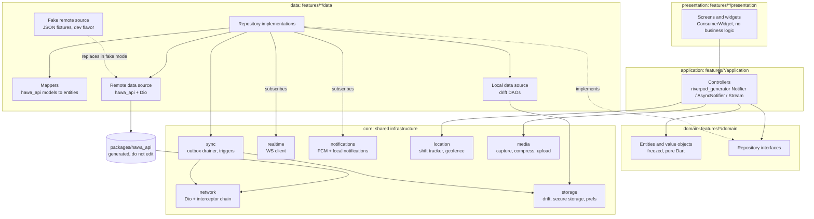
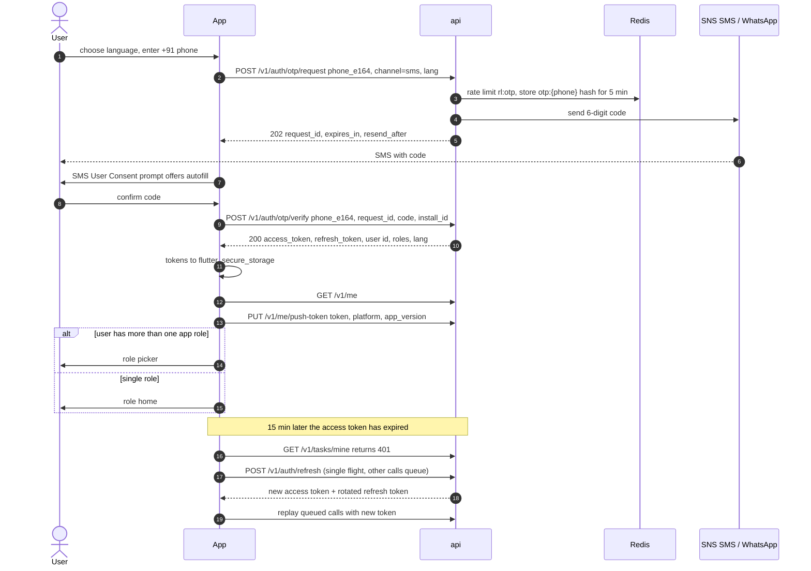
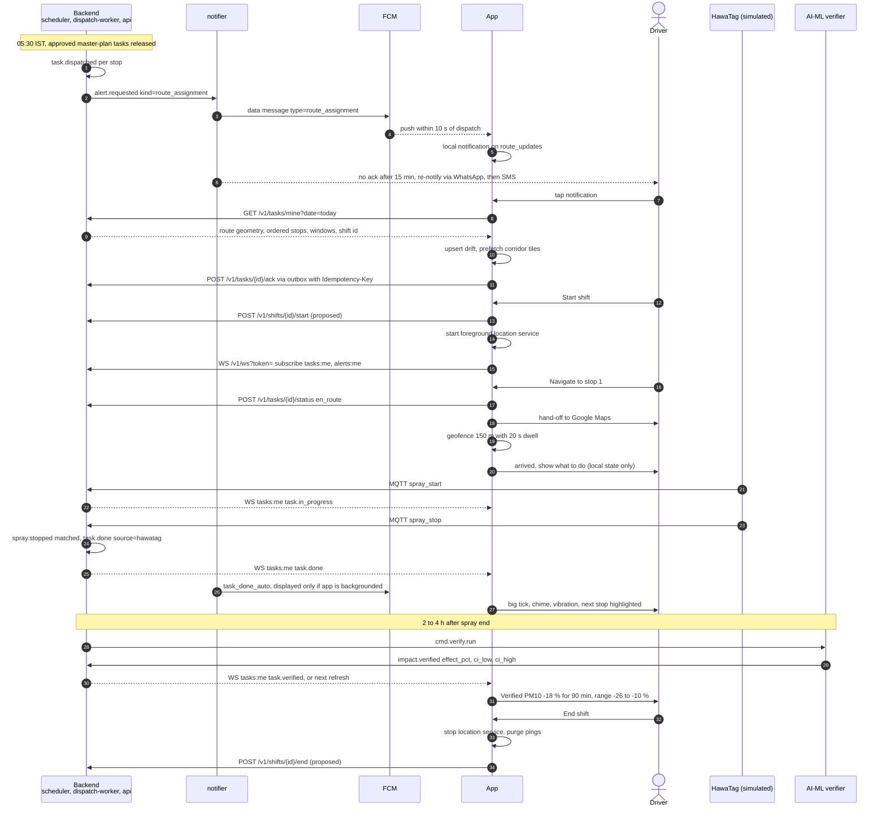
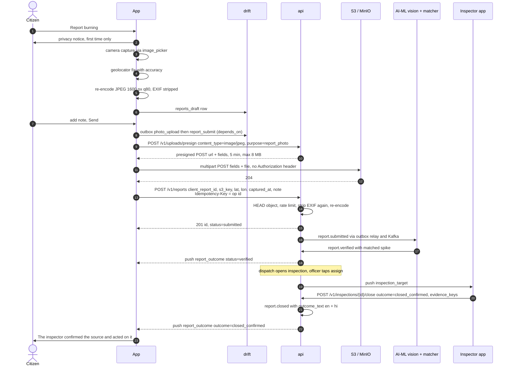

# App architecture

Purpose: how the Flutter app is built, covering layers, state, navigation, networking, storage, realtime, location, maps, media, i18n, theming, flavors, errors, security, performance and accessibility, plus the key sequences.

Related: [README](README.md) · [CONTEXT](CONTEXT.md) · [STRUCTURE](STRUCTURE.md) · [SCREENS](SCREENS.md) · [OFFLINE_AND_SYNC](OFFLINE_AND_SYNC.md) · [LINTING_AND_QUALITY](LINTING_AND_QUALITY.md) · [../CONTRACTS.md](../CONTRACTS.md) · [../SYSTEM_OVERVIEW.md](../SYSTEM_OVERVIEW.md) · [../backend/API.md](../backend/API.md) · [../frontend/DESIGN_SYSTEM.md](../frontend/DESIGN_SYSTEM.md)

---

## 1. Principles

1. **The local database is the source of truth for the UI.** Screens watch drift streams. The network refreshes the cache, and the outbox pushes changes. No screen waits on the network to render.
2. **The server is authoritative for state.** Local writes are optimistic and are reconciled against server events ([OFFLINE_AND_SYNC §7](OFFLINE_AND_SYNC.md#7-conflict-resolution)).
3. **Generated client only.** Every `/v1` call goes through `packages/hawa_api`, which is generated from `/openapi.json`. The two exceptions are the presigned S3 upload (no auth) and the WebSocket.
4. **Every mutation is idempotent.** Each has a client UUIDv7 that doubles as the `Idempotency-Key`.
5. **Honesty and uncertainty are UI invariants.** `is_simulated` → a badge. A model output → its range or confidence (CONTRACTS §1).
6. **Contracts over guesses.** Enum names, units and endpoints come from [CONTRACTS.md](../CONTRACTS.md). Unknown enum values render as `unknown`, never crash (CONTRACTS §12.5).
7. **Field-first.** Offline, low-end devices, sunlight, gloves, Hindi ([CONTEXT §8](CONTEXT.md#8-field-realities-and-design-responses)).

## 2. Layers

Feature-first, layered. Each feature under `lib/features/<name>/` has four layers. Shared infrastructure lives in `lib/core/`, and app wiring in `lib/app/`.



### 2.1 Dependency rules (enforced in review; see [LINTING_AND_QUALITY §11](LINTING_AND_QUALITY.md#11-code-review-checklist))

| Layer | May import | Must not import |
|---|---|---|
| `presentation` | its feature's `application` + `domain`, `core/widgets`, `app/theme`, `app/l10n`, `app/router` (paths only) | `data`, `hawa_api`, `dio`, `drift` |
| `application` | its feature's `domain`, other features' `domain` (read-only types), `core/*` services via providers | `presentation`, `hawa_api` |
| `domain` | `freezed_annotation`, `meta`, `core/utils` (pure) | Flutter SDK widgets, `dio`, `drift`, `hawa_api` |
| `data` | `domain`, `hawa_api`, `core/network`, `core/storage`, `core/sync` | `presentation`, `application` |
| `core` | third-party packages, `hawa_api` (network only) | any `features/*` |

Cross-feature use goes through a `domain` type or a provider, never through another feature's `data` classes.

## 3. Feature anatomy

Example: `driver_route`.

| Layer | Files (abridged; full list in [STRUCTURE §4](STRUCTURE.md#4-libfeatures)) | Role |
|---|---|---|
| presentation | `today_route_screen.dart`, `route_map_screen.dart`, `stop_detail_screen.dart`, `widgets/stop_card.dart`, `widgets/shift_bar.dart` | Render state, call controller methods |
| application | `today_route_controller.dart`, `shift_controller.dart`, `stop_actions_controller.dart`, `auto_done_events.dart` | Compose repositories, expose `AsyncValue`, one-shot UI events |
| domain | `route.dart`, `stop.dart`, `task_status.dart`, `skip_reason.dart`, `driver_route_repository.dart` | Entities (freezed), enums, interface |
| data | `driver_route_repository_impl.dart`, `task_remote_source.dart`, `task_local_source.dart`, `task_mapper.dart`, `fake_task_remote_source.dart` | Fetch, cache, outbox ops, WS event application |

## 4. State management: Riverpod with code generation

Riverpod with `riverpod_annotation` + `riverpod_generator`, linted by `riverpod_lint`. Versions are latest stable, pinned in `pubspec.lock`.

| Provider kind | Use for | Lifetime |
|---|---|---|
| `@Riverpod(keepAlive: true)` function | Core singletons: `dio`, `hawaApi`, `appDatabase`, `tokenStore`, `wsClient`, `outboxDrainer`, `clock` | App |
| `@riverpod` function returning `Stream<T>` | Drift-backed reads (`watchTodayRoute`) | Auto-dispose |
| `@riverpod class X extends _$X` (`Notifier`/`AsyncNotifier`) | Screen controllers with methods (`TodayRouteController.skip`) | Auto-dispose, family by id where needed |
| `@riverpod` family | Per-entity (`stopDetailController(taskId)`) | Auto-dispose |

Rules:
- Controllers expose `AsyncValue<T>`. Errors are typed `Failure`s (§6.4).
- Side effects such as navigation, snackbars and haptics go through one-shot event providers (`StreamProvider` of events) or `ref.listen` in widgets, never through state flags that have to be reset.
- `ref.watch` in `build`, `ref.read` in callbacks. No `ref` use after an `await` without checking `ref.mounted` (Riverpod 3 semantics).
- If the pinned Riverpod major retries failed providers automatically, set a `ProviderScope` retry policy that retries only transient `Failure`s (`NetworkFailure`, `TimeoutFailure`, `ServerFailure` 502–504) and caps at 3 attempts.
- Tests use `ProviderContainer` with overrides ([LINTING_AND_QUALITY §10](LINTING_AND_QUALITY.md#10-testing-strategy)).

```dart
// features/driver_route/application/today_route_controller.dart (sketch)
@riverpod
class TodayRouteController extends _$TodayRouteController {
  @override
  Stream<TodayRoute> build() {
    final repo = ref.watch(driverRouteRepositoryProvider);
    final date = ref.watch(serviceDateProvider); // IST date; flips at 00:00 IST
    unawaited(repo.refresh(date));               // stale-while-revalidate, updates sync_state
    return repo.watchRoute(date);                // drift stream is the source of truth
  }

  Future<void> refresh() =>
      ref.read(driverRouteRepositoryProvider).refresh(ref.read(serviceDateProvider));

  Future<void> skip(String taskId, SkipReason reason, {String? note}) =>
      ref.read(driverRouteRepositoryProvider).skip(taskId, reason, note: note);
}
```

## 5. Navigation: go_router

### 5.1 Route tree

One `GoRouter` built by a keep-alive provider. Role shells are `StatefulShellRoute.indexedStack` so each tab keeps its stack. Shared routes (alerts, settings) sit outside the shells and are pushed on top. The full list with specs is in [SCREENS.md](SCREENS.md).

| Path | Screen | Required role | Shell |
|---|---|---|---|
| `/splash` | Splash / bootstrap | — | — |
| `/onboarding/language` | Language picker | — | — |
| `/auth/phone`, `/auth/otp` | Phone + OTP | — (signed out) | — |
| `/auth/role` | Role picker | signed in | — |
| `/onboarding/permissions/:kind` | Permission education (`notifications`, `location`, `camera`) | signed in | — |
| `/driver`, `/driver/map`, `/driver/stops/:taskId`, `/driver/stops/:taskId/skip`, `/driver/stops/:taskId/manual-done`, `/driver/shift/summary` | Driver | `driver` | Driver (tabs: Route, Map, More) |
| `/inspector`, `/inspector/map`, `/inspector/targets/:targetId`, `/inspector/targets/:targetId/outcome`, `/inspector/targets/:targetId/photos/:index` | Inspector | `inspector` | Inspector (Targets, Map, More) |
| `/school`, `/school/air`, `/school/forecast` | School | `school` | School (Today, Air, Alerts, More) |
| `/citizen`, `/citizen/subscription`, `/citizen/report/privacy`, `/citizen/report/new`, `/citizen/report/review`, `/citizen/reports`, `/citizen/reports/:reportId`, `/citizen/route-tip` | Citizen | `citizen` | Citizen (Air, Report, My reports, More) |
| `/site` | Site manager | `site_manager` | Site (single page + More) |
| `/alerts`, `/alerts/:alertId` | Alert inbox / detail | any signed in | pushed |
| `/settings`, `/settings/sync`, `/profile` | Settings, pending uploads, profile | any signed in | pushed |
| `/unsupported-role` | "Use the web console" | `officer`/`admin`/`analyst` | — |

Path constants live in `lib/app/router/routes.dart` (`abstract final class Routes`), with helper builders such as `Routes.stop(taskId)`. No string literals for paths anywhere else. An inspector `:targetId` is the **inspection id**. Report-origin inspections can exist without a plan task (backend ARCHITECTURE §5.4), so the target is keyed by inspection. It falls back to the task id only for an `inspect` task that has no inspection row.

### 5.2 Redirect guard

The guard is a pure function of the session state and the requested URI, so it's unit-testable. `refreshListenable` is a `ValueNotifier` bridged from the session provider.

```dart
// app/router/guards.dart (sketch)
String? authRedirect(SessionState s, Uri uri) {
  final path = uri.path;
  if (s is SessionBooting) return path == Routes.splash ? null : Routes.splash;
  if (!s.languageChosen) return path == Routes.language ? null : Routes.language;

  if (s is SessionSignedOut) {
    if (Routes.publicAuth.contains(path)) return null;
    return Uri(path: Routes.phone, queryParameters: {'from': uri.toString()}).toString();
  }

  final signedIn = s as SessionSignedIn;
  if (signedIn.roles.every(UserRoleX.isWebOnly)) {
    return path == Routes.unsupportedRole ? null : Routes.unsupportedRole;
  }
  final active = signedIn.activeRole;
  if (active == null) return path == Routes.rolePicker ? null : Routes.rolePicker;
  if (Routes.publicAuth.contains(path) || path == Routes.splash) return Routes.homeFor(active);

  final required = Routes.requiredRoleFor(path); // derived from the route table
  if (required != null && required != active) return Routes.homeFor(active);
  return null;
}
```

After login, the controller navigates to `from` if the active role may open it. Otherwise it goes to the role home.

### 5.3 Deep links from push

- Every push payload carries `deep_link` in the backend's **entity** form `hawa://{entity}/{id}`. The backend `alert.deep_link` column already uses `hawa://tasks/…` (backend DATA_MODEL §10.1). The backend doesn't know app routes, and the app maps entities to routes for the active role:

| Payload `deep_link` | Driver | Inspector | School | Citizen | Site manager |
|---|---|---|---|---|---|
| `hawa://route?date=YYYY-MM-DD` | `/driver` | `/inspector` | — | — | — |
| `hawa://tasks/{task_id}` | `/driver/stops/{task_id}` | `/inspector/targets/{inspection_id or task_id}` | — | — | — |
| `hawa://inspections/{inspection_id}` | — | `/inspector/targets/{inspection_id}` | — | — | — |
| `hawa://schools/{school_id}/safe-window?date=` | — | — | `/school?date=` | — | — |
| `hawa://schools/{school_id}/air` | — | — | `/school/air` | — | — |
| `hawa://reports/{report_id}` | — | — | — | `/citizen/reports/{report_id}` | — |
| `hawa://alerts/{alert_id}` | `/alerts/{alert_id}` | `/alerts/{alert_id}` | `/alerts/{alert_id}` | `/alerts/{alert_id}` | `/alerts/{alert_id}` |
| `hawa://sites/me` | — | — | — | — | `/site` |

- `PushRouter.open(payload)`:
  1. Parses `deep_link` against this allow-list. IDs must match the UUIDv7 or CONTRACTS id regexes, and anything else is dropped.
  2. Resolves the target role. If the user holds it but it isn't active, it calls `session.switchRole(required)` and shows a snackbar "Switched to Driver / ड्राइवर पर बदला गया".
  3. Calls `router.go(route)`. If the user isn't signed in, the guard sends them to login with `from=`.
- Sources:
  - `FirebaseMessaging.instance.getInitialMessage()` (cold start)
  - `FirebaseMessaging.onMessageOpenedApp`
  - flutter_local_notifications `onDidReceiveNotificationResponse`
  - the Android intent filter for the `hawa://` scheme (SMS/WhatsApp links; App Links over https come post-hackathon)

## 6. Networking

### 6.1 Generated client

- `packages/hawa_api` is generated by `openapi-generator` with generator `dart-dio`, options `serializationLibrary=json_serializable`, `pubName=hawa_api` and `enumUnknownDefaultCase=true`. The last option maps unknown enum values to a sentinel, which satisfies CONTRACTS §12.5. Config lives in `openapi/generator-config.yaml` ([STRUCTURE §10](STRUCTURE.md#10-configuration-file-sketches)).
- The snapshot `openapi/openapi.json` and the generated package are committed, and regenerated with `make gen-api`.
- The app constructs `HawaApi(dio: ref.watch(dioProvider))` so the generated APIs share our interceptor chain.
- Only `features/*/data/*_remote_source.dart` imports `package:hawa_api`.
- Requirement on the backend: stable, readable `operationId`s and tags in OpenAPI (FastAPI's default ids produce unusable Dart method names). Listed in the contract proposals ([§7.3](#73-proposed-contract-additions-the-app-depends-on)).

### 6.2 Interceptor chain

Order matters. Dio runs request hooks in insertion order and error hooks in the same order.

| # | Interceptor | Request | Error / response |
|---|---|---|---|
| 1 | `RequestIdInterceptor` | New UUIDv7 `X-Request-Id` **per attempt**. Forwards `X-Correlation-Id` if the caller set one | Reads the echoed ids into `extra` for logs |
| 2 | `IdempotencyInterceptor` | For `POST`/`PUT`/`PATCH`/`DELETE`: sets `Idempotency-Key` from `options.extra['idempotency_key']` (outbox op id), or generates one for non-outbox calls. **Stays the same across retries** | — |
| 3 | `AuthInterceptor` | Adds `Authorization: Bearer <access>`. If `exp` is under 60 s away, awaits the shared refresh first | — |
| 4 | `RefreshInterceptor` (`QueuedInterceptor`) | — | On `401` from a non-auth endpoint: refresh once (single-flight), replay the request once with the new token. On refresh failure: emit `SessionExpired` and pass the error on |
| 5 | `RetryInterceptor` | — | Retries transient errors (connection, timeout, 502/503/504, 429 honouring `Retry-After`, and `409 idempotency_in_progress` with `Retry-After: 1` per backend CACHING §9) up to 2 times with 0.5 s / 1.5 s + jitter. Only for `GET`/`PUT`/`DELETE` and for `POST`s that carry an `Idempotency-Key`. Long-term retry belongs to the outbox |
| 6 | `ProblemJsonInterceptor` | — | Parses `application/problem+json` (`type, title, status, detail, instance, code, errors[]`) into a typed `Failure` and sets it as `DioException.error` |
| 7 | `LoggingInterceptor` (dev/staging) | Logs method, path, request id, duration | Redacts `Authorization`, phone numbers, OTP codes, tokens and presigned URLs |

The S3 upload (a **presigned POST** with policy fields, backend ARCHITECTURE §7 "Uploads") uses a separate bare `Dio` with no interceptors other than logging. Sending our `Authorization` header to S3 would leak the token and break the signature.

### 6.3 Refresh, single-flight

```dart
// core/network/interceptors/refresh_interceptor.dart (sketch)
class RefreshInterceptor extends QueuedInterceptor {
  RefreshInterceptor(this._tokens, this._refresher, this._dio, this._session);
  final TokenStore _tokens;
  final TokenRefresher _refresher; // calls POST /v1/auth/refresh on a bare Dio
  final Dio _dio;
  final SessionEvents _session;
  Future<void>? _inFlight;

  @override
  Future<void> onError(DioException err, ErrorInterceptorHandler handler) async {
    final opts = err.requestOptions;
    final isRetry = opts.extra['after_refresh'] == true;
    if (err.response?.statusCode != 401 || isRetry || ApiPaths.isAuthCall(opts.path)) {
      return handler.next(err);
    }
    try {
      final sentWith = opts.headers['Authorization'] as String?;
      final current = 'Bearer ${await _tokens.readAccess()}';
      if (sentWith == current) {
        // Nobody refreshed since this request left: refresh once for everyone.
        await (_inFlight ??= _refresher.refresh().whenComplete(() => _inFlight = null));
      }
      opts
        ..extra['after_refresh'] = true
        ..headers['Authorization'] = 'Bearer ${await _tokens.readAccess()}';
      return handler.resolve(await _dio.fetch<Object?>(opts));
    } on Object {
      _session.expired(); // router guard sends user to /auth/phone, outbox is kept
      return handler.next(err);
    }
  }
}
```

Refresh tokens rotate (SYSTEM_OVERVIEW §6: access 15 min + rotating refresh). If the server detects reuse and revokes the token family, refresh fails with `401`. The app then signs out **but keeps the outbox**, which is tied to the user id and drains after the same user signs in again. A different user signing in triggers the logout wipe ([OFFLINE_AND_SYNC §10](OFFLINE_AND_SYNC.md#10-storage-limits-cleanup-and-logout)).

### 6.4 Typed failures

```dart
// core/errors/failure.dart (sketch)
sealed class Failure implements Exception {
  const Failure({this.requestId, this.code});
  final String? requestId; // X-Request-Id, shown in "Details" for support
  final String? code;      // problem+json `code`
  bool get isTransient => false;
}
final class NetworkFailure extends Failure { const NetworkFailure({super.requestId}); @override bool get isTransient => true; }
final class TimeoutFailure extends Failure { const TimeoutFailure({super.requestId}); @override bool get isTransient => true; }
final class UnauthorizedFailure extends Failure { const UnauthorizedFailure({super.requestId, super.code}); }
final class ForbiddenFailure extends Failure { const ForbiddenFailure({super.requestId, super.code}); }
final class NotFoundFailure extends Failure { const NotFoundFailure({super.requestId, super.code}); }
final class ConflictFailure extends Failure { const ConflictFailure({required String super.code, this.detail, super.requestId}); final Map<String, Object?>? detail; }
final class ValidationFailure extends Failure { const ValidationFailure(this.errors, {super.requestId, super.code}); final List<FieldError> errors; }
final class RateLimitedFailure extends Failure { const RateLimitedFailure({this.retryAfter, super.requestId}); final Duration? retryAfter; @override bool get isTransient => true; }
final class ServerFailure extends Failure { const ServerFailure(this.status, {super.requestId}); final int status; @override bool get isTransient => status >= 502 && status <= 504; }
final class UnknownFailure extends Failure { const UnknownFailure(this.cause, {super.requestId}); final Object cause; }
```

Presentation maps a `Failure` to localized copy with `failure.message(context.l10n)`. The raw server `detail` is never shown to field users. It goes into an expandable "Details" row along with `requestId`.

## 7. API surface used by the app

Shapes are owned by [../backend/API.md](../backend/API.md). "Proposed" means it isn't in CONTRACTS.md §6 yet and needs a contract PR ([§7.3](#73-proposed-contract-additions-the-app-depends-on)).

### 7.1 Endpoints

| Endpoint | Feature | Offline behaviour | Status |
|---|---|---|---|
| `POST /v1/auth/otp/request`, `POST /v1/auth/otp/verify` | auth | Online only (clear message) | exists |
| `POST /v1/auth/refresh`, `POST /v1/auth/logout` | core/network, settings | refresh retried on regain. Logout works offline (local wipe) and sends later best-effort | exists |
| `GET /v1/me` | auth, shell, profile | cached in secure prefs | exists. The backend model is single-role (`app_user.role`, JWT `role`), and `roles[]` for the role picker is **proposed** |
| `PATCH /v1/me` `{lang, notification_prefs}` | settings | outbox `profile_update` | **proposed** |
| `PUT /v1/me/push-token` | notifications | outbox `push_token` (latest wins) | exists |
| `GET /v1/tasks/mine?date=` | driver_route, inspector | cached (drift `routes`/`tasks`/`stops`) | exists (fields proposed, §7.2) |
| `GET /v1/tasks/{id}` | driver_route, inspector | cached | exists |
| `POST /v1/tasks/{id}/ack` | driver_route, inspector | outbox `task_ack` | exists |
| `POST /v1/tasks/{id}/status` `{status, source?, reason?, note?, litres?, s3_keys?, client_ts, location?}` | driver_route, inspector | outbox `task_status` | exists (body proposed). App-sent statuses follow the backend state machine (backend ARCHITECTURE §5.2). **Driver:** `en_route`, `done` with `source=manual` (only from `acknowledged`/`en_route`), `skipped`. **Inspector:** `en_route`, `in_progress` (on site). The driver never sends `in_progress`: the server sets it on `spray.started` |
| `GET /v1/inspections?status=assigned` | inspector | cached (`tasks` rows with kind `inspect` + `cached_payloads`) | exists. Needed because report-origin inspections may have no plan task |
| `GET /v1/inspections/{id}` (evidence bundle) | inspector | cached in `cached_payloads` + thumbnails | **proposed** |
| `GET /v1/hotspots/{id}` | inspector (evidence for hotspot/spike-origin targets) | cached | exists |
| `POST /v1/inspections/{id}/close` `{outcome, notes, evidence_keys[], closed_at, location}` | inspector | outbox `inspection_close` after `photo_upload` | exists (body proposed). **The app's single close path.** The backend marks the linked `inspect` task `done`. `POST /v1/tasks/{id}/evidence` is not used by the app (clarify in API.md) |
| `POST /v1/shifts/{id}/start`, `POST /v1/shifts/{id}/end`, `POST /v1/shifts/{id}/locations` | driver_route, inspector | outbox `shift_start`, `shift_end`, `location_batch` | **proposed**. `{id}` is the `asset_shift` id returned in `tasks/mine.shift` (`ShiftStatus` `scheduled → active → completed`, backend DATA_MODEL §8.2) |
| `GET /v1/alerts`, `GET /v1/alerts/{id}` | alerts, school | cached (`alerts`) | exists |
| `POST /v1/alerts/{id}/ack` | alerts, school | outbox `alert_ack` | **proposed** |
| `GET /v1/schools/me` | school | cached | exists |
| `GET /v1/schools/{id}/safe-window?date=` | school | cached (`safe_windows`) | exists |
| `GET /v1/schools/{id}/indoor-outdoor?from=&to=` | school | cached (last 6 h) | exists |
| `GET /v1/forecast/{cell_id}` | school | cached (latest issue) | exists |
| `GET /v1/grap/outlook?ward=&days=3` | school, citizen, site | cached | exists (role widening **proposed**) |
| `GET /open/v1/air?bbox=&ts=` | citizen_air | cached (30 min) | exists (fields proposed) |
| `GET`/`PUT /v1/me/alert-subscription` | citizen_air | outbox `profile_update` | **proposed** |
| `POST /v1/uploads/presign` | core/media | inside the `photo_upload` op | exists. Returns a **presigned POST** (url + form fields, 5 min, ≤ 8 MB, key `uploads/{user_id}/…`). `purpose` is proposed |
| `POST /v1/reports` `{client_report_id, s3_key, lat, lon, location_accuracy_m, captured_at, category, note}` | citizen_reports | outbox `report_submit` | JSON after presign, as in backend ARCHITECTURE §5.4. **Conflicts with the "multipart" wording in CONTRACTS §6.** `client_report_id` and `category` are proposed. Backend §5.4 names the time field `taken_at`, while the `citizen_report` column is `captured_at`, so API.md must pick one |
| `GET /v1/reports/mine`, `GET /v1/reports/{id}` | citizen_reports | cached | exists. `outcome_text`/`outcome_text_hi` and `rejection_reason` exist in DATA_MODEL §11.1. `timeline[]` and `outcome` are proposed |
| `GET /v1/sites/me` | site | cached | exists (`pm10_trend` proposed) |
| WS `GET /v1/ws?token=`: `tasks:me`, `alerts:me` | core/realtime | foreground only, gap-filled by REST on reconnect | exists |

### 7.2 Shapes the app expects (proposed where CONTRACTS is silent)

`GET /v1/tasks/mine?date=2026-11-13` (driver). Field names are `snake_case` (CONTRACTS §1).

```json
{
  "date": "2026-11-13",
  "asset": {
    "id": "AST-SPR-0012", "type": "sprinkler", "label": "Sprinkler 12",
    "tag_device_id": "HTG-0031", "tag_status": "active", "tag_last_seen_at": "2026-11-13T00:10:02Z",
    "is_simulated": true
  },
  "shift": { "id": "0192a0a9-…", "status": "scheduled", "start": "2026-11-13T00:30:00Z", "end": "2026-11-13T05:30:00Z" },
  "route": {
    "route_id": "0192a0c4-…", "plan_id": "0192a0b1-…", "version": 3,
    "geometry": { "type": "LineString", "coordinates": [[77.2095, 28.6412], [77.2130, 28.6420]] },
    "bbox": [77.18, 28.62, 77.24, 28.66]
  },
  "items": [
    {
      "id": "0192a0c5-…", "plan_id": "0192a0b1-…", "kind": "spray", "status": "dispatched", "sequence": 1,
      "cell_id": "g500-042-077",
      "location": { "type": "Point", "coordinates": [77.2095, 28.6412] },
      "place_name": { "en": "Ajmal Khan Rd, Karol Bagh", "hi": "अजमल ख़ान रोड, करोल बाग़" },
      "window_start": "2026-11-13T00:40:00Z", "window_end": "2026-11-13T01:10:00Z",
      "instructions": { "en": "Spray about 600 L along 800 m", "hi": "800 मीटर में लगभग 600 लीटर छिड़काव करें" },
      "target_litres": 600, "segment_length_m": 800, "arrival_radius_m": 150,
      "cause_label": "dust", "cause_conf": 0.78,
      "completion_source": null, "intervention_id": null, "impact_summary": null,
      "version": 4, "updated_at": "2026-11-13T00:02:11Z", "is_simulated": true
    }
  ]
}
```

- `impact_summary` (after `task.verified`): `{pollutant, effect_pct, ci_low, ci_high, duration_min, method, verdict}`.
- `completion_source` uses `InterventionSource` (`hawatag | manual | gps_inferred`).
- Inspector tasks (`kind: "inspect"`) add `inspection_id`, `origin` (backend `inspection.origin`: `report | spike | hotspot | plan | manual`), `hotspot_id?`, `report_id?`, `suspect_pin` (GeoJSON Point from `inspection.target_geom`), `priority` (1–5) and `cause_label`/`cause_conf`.

`GET /v1/inspections/{id}` (proposed evidence bundle for inspectors, built from `inspection.evidence_summary` + hotspot + report):

```json
{
  "id": "…", "status": "assigned", "task_id": "…|null", "origin": "report", "priority": 2,
  "cause_label": "burning", "cause_conf": 0.86,
  "suspect_pin": { "type": "Point", "coordinates": [77.1712, 28.6690] },
  "back_trajectory": { "type": "LineString", "coordinates": [[77.1790, 28.6655], [77.1712, 28.6690]] },
  "spike": { "pollutant": "pm25", "baseline": 81, "peak": 262, "series": [{ "ts": "…", "value": 84 }] },
  "photos": [{ "url": "https://…presigned GET, 5 min…", "thumb_url": "https://…", "captured_at": "…", "expires_at": "…" }],
  "reporter": { "kind": "citizen" },
  "is_simulated": true
}
```

The reporter is never identified: no name, no phone. Photos are the faces/plates-redacted copy (`citizen_report.photo_redacted_key`, backend DATA_MODEL §11.1), served by 5-minute presigned GET URLs. The app caches thumbnails on first view and refetches the bundle when `expires_at` has passed.

### 7.3 Proposed contract additions the app depends on

The consolidated list is in the final section of [PLAN.md §11](PLAN.md#11-contract-proposals-to-raise). In short:
- shift start/end/location endpoints on `asset_shift`
- `PATCH /v1/me` and `roles[]` (+ role switch)
- alert ack
- the inspection evidence bundle and an on-site transition for task-less inspections
- the alert subscription endpoint
- GRAP outlook role widening
- `purpose` on presign
- the JSON `POST /v1/reports` body (vs "multipart" in CONTRACTS)
- task DTO fields (`sequence`, windows, `route.geometry`, `instructions`, tag status, `shift.id`, `impact_summary`, `version`)
- `AlertKind += route_changed, task_done_auto`
- a `task.updated` event
- enums `SkipReason`, `UploadPurpose`, `ReportCategory`, plus `ClassroomAdvice` (already in backend DATA_MODEL, missing from CONTRACTS §3)
- the FCM data payload schema (§10.3)
- problem+json `code` values the app branches on
- idempotency retention
- stable OpenAPI `operationId`s

## 8. Models

| Kind | Tooling | Where | Rule |
|---|---|---|---|
| API models | Generated in `hawa_api` (json_serializable) | `packages/hawa_api` | Used only inside `data/` |
| Domain entities | `freezed` (v3 syntax: `sealed`/`abstract` classes) + `json_serializable` for cache payloads | `features/*/domain` | Immutable. No Flutter imports |
| Realtime/push DTOs | `freezed` + `json_serializable` (hand-written, not in OpenAPI) | `core/realtime`, `core/notifications` | Tolerant parsing, unknown `type` → ignored + logged |
| Drift rows | drift codegen | `core/storage/tables` | Mapped to entities in `*_local_source.dart` |

```dart
// features/driver_route/domain/stop.dart (sketch)
@freezed
abstract class Stop with _$Stop {
  const factory Stop({
    required String taskId,
    required int sequence,
    required TaskKind kind,              // spray | sweep | inspect | protect_alert | unknown
    required TaskStatus status,          // server status
    TaskStatus? pendingStatus,           // optimistic, from an unsent outbox op
    required GeoPoint location,
    required LocalizedText placeName,
    required DateTime windowStart,       // UTC; formatted in IST by the UI
    required DateTime windowEnd,
    LocalizedText? instructions,
    int? targetLitres,
    InterventionSource? completionSource,
    ImpactSummary? impact,
    required bool isSimulated,
  }) = _Stop;

  factory Stop.fromJson(Map<String, Object?> json) => _$StopFromJson(json);
}
```

Enums mirror CONTRACTS §3 names exactly and each has an `unknown` member. Example: `enum TaskStatus { pending, dispatched, acknowledged, enRoute, inProgress, done, verifying, verified, inconclusive, skipped, cancelled, missed, failed, unknown }` with `@JsonValue('en_route')`-style mapping, or the mapper converting from the generated enum.

## 9. Local storage

| Store | Package | Holds | Notes |
|---|---|---|---|
| SQLite | **drift** (+ `sqlite3_flutter_libs`) | routes, tasks, stops, alerts, reports_draft, outbox_ops, sync_state, media_files, location_pings, safe_windows, cached_payloads | Opened with `NativeDatabase.createInBackground`, WAL mode, `busy_timeout`. Schema in [OFFLINE_AND_SYNC §3](OFFLINE_AND_SYNC.md#3-drift-schema-sketch). Migrations via drift `MigrationStrategy` with schema dumps tested |
| Secure | **flutter_secure_storage** | access token, refresh token, user id, device install id | Android Keystore-backed. Survives app restart, wiped on logout |
| Prefs | **shared_preferences** | language, active role, theme mode (light/dark/outdoor), data saver, onboarding flags, last-seen app version | Nothing sensitive |
| Files | `path_provider` app documents dir `media/` | compressed photos awaiting upload | Not the cache dir (the OS may purge it before upload) |
| Tile cache | file store under app support dir `tiles/` | map tiles | Size-capped (§12.4) |

Android `android:allowBackup="false"` and `android:fullBackupContent="false"`. Tokens and the DB must not leave the device through backups on shared phones.

## 10. Realtime: WebSocket + FCM

### 10.1 WebSocket client

- URL `WS_URL?token=<access JWT>` (CONTRACTS §6.1: Flutter authenticates with `?token=`). Because query strings can end up in proxy logs, tokens are short-lived (15 min), and a single-use ticket (`POST /v1/ws/ticket`, proposed, optional) can replace the JWT later.
- On open, the client sends `{"op":"subscribe","channels":["tasks:me","alerts:me"]}`.
- Heartbeat: the server pings every 25 s (backend ARCHITECTURE §5.3). The client also sends `{"op":"ping"}` every 25 s and reconnects if nothing arrives for 35 s.
- Reconnect uses exponential backoff with full jitter, 1 s → 30 s cap, reset after 60 s of stable connection. It fetches a fresh token before each attempt and pauses while connectivity is `none`.
- Server signals (backend ARCHITECTURE §5.3, §6):
  - close code **4401**: the token expired. Refresh, then reconnect immediately.
  - close **1013**: the send queue overflowed. Reconnect and refetch.
  - close **1001**: the server is shutting down. Reconnect with backoff.
  - message `{"type":"resync"}`: refetch all subscribed scopes.
- **Gap fill.** WS isn't replayable, and the server drops events older than 60 s. After every (re)connect or `resync`, the app calls `refresh()` on the active role's repositories (`GET /v1/tasks/mine`, `GET /v1/alerts`).
- Lifecycle: connected only while the app is in the foreground (`AppLifecycleState.resumed`). It disconnects 30 s after going to the background. Background delivery is FCM's job.

| Channel | `type` values handled | Effect |
|---|---|---|
| `tasks:me` | `task.dispatched`, `task.acknowledged`, `task.en_route`, `task.in_progress`, `task.done`, `task.skipped`, `task.missed`, `task.cancelled`, `task.verifying`, `task.verified`, `task.inconclusive`, proposed `task.updated` | Upsert task in drift (server wins). Resolve outbox conflicts. `task.done` with `source=hawatag` emits an `AutoDoneEvent` (tick + chime). `task.cancelled`/`task.updated` show the route-changed banner |
| `alerts:me` | `alert.requested` | Insert into `alerts`. Show an in-app banner if the app is foreground. The server's push covers background |

Unknown `type`s are logged and ignored. Messages are deduplicated by `(channel, type, data.task_id or data.alert_id, data.status)` within a 10 min window, which also dedupes against FCM.

### 10.2 FCM + local notifications

- `firebase_messaging` for delivery, `flutter_local_notifications` for display, channels and tap handling.
- **Android: data-only, high-priority messages.** The app renders them so it controls channel, language fallback, grouping and dedupe.
- **iOS: `notification` + `data`**, because data-only delivery isn't reliable when the app is terminated.
- Token lifecycle:
  - after login: `PUT /v1/me/push-token {token, platform, app_flavor, app_version, locale}`
  - on `onTokenRefresh`: re-register
  - on logout: `POST /v1/auth/logout` (the server drops the token for the session) and `deleteToken()`
- Background handler: a top-level `@pragma('vm:entry-point')` function. It initialises Firebase, opens drift (its own connection, WAL), inserts the alert row, shows the local notification and marks `sync_state` dirty. No Riverpod container in that isolate.
- Foreground: if the payload's entity is on screen, show an in-app banner instead of a system notification.
- Tap: `PushRouter.open(payload)` (§5.3).
- Android 13+: request `POST_NOTIFICATIONS` from the education screen ([SCREENS §2](SCREENS.md#2-permission-education)).

| Android channel id | Importance | Push `type`s |
|---|---|---|
| `route_updates` | high | `route_assignment`, `route_changed`, `task_done_auto`, `inspection_target` |
| `air_alerts` | high | `pollutant_warning`, `safe_window`, `grap_outlook` |
| `reports` | default | `report_outcome` |
| `device_status` | default | `device_health` |
| `shift_tracking` | low, ongoing | foreground service notification (not a push) |

Channel names and descriptions are localized and re-registered on language change (Android updates the name for an existing id).

### 10.3 FCM data payload (proposed contract; FCM data values are strings)

```json
{
  "type": "task_done_auto",
  "alert_id": "0192a0d0-…",
  "entity_id": "0192a0c5-…",
  "deep_link": "hawa://tasks/0192a0c5-…",
  "role": "driver",
  "lang": "hi",
  "title": "स्टॉप 1 पूरा",
  "body": "HawaTag ने 612 लीटर छिड़काव दर्ज किया। अगला: करोल बाग़ मेट्रो गेट 2।",
  "args": "{\"n\":1,\"litres\":612,\"next\":\"करोल बाग़ मेट्रो गेट 2\"}",
  "is_simulated": "true",
  "sent_at": "2026-11-13T01:00:05Z",
  "collapse_key": "task:0192a0c5-…"
}
```

- `title`/`body` arrive in the user's `lang` (set via proposed `PATCH /v1/me`). If they're missing, the app renders them from `type` + `args` with its ARB templates. Templates for every `type` are in the [push catalogue](SCREENS.md#9-push-notification-catalogue); the backend notifier should use the same text.
- The `alert.requested` Kafka payload already has `deep_link`, `lang`, `title`, `body` (CONTRACTS §5.2), and the `alert` row has `pollutant`, `task_id`, `report_id`, `expires_at` (backend DATA_MODEL §10.1). The notifier maps them 1:1. `deep_link` stays in the entity form `hawa://…` and the app resolves the route (§5.3).

## 11. Location and shift

### 11.1 Rules

- Location is sampled **only while a shift is active** (driver, and inspector if they start a shift). **Start shift** calls proposed `POST /v1/shifts/{id}/start` on the `asset_shift` returned by `tasks/mine` (`scheduled → active`), and **End shift** calls `/end` (`active → completed`). There's no `ACCESS_BACKGROUND_LOCATION`: a foreground service of type `location`, started from the foreground, can keep receiving updates with the while-in-use permission.
- The foreground service shows an ongoing notification on channel `shift_tracking`: "Shift on: sharing location with the control room / शिफ्ट चालू: कंट्रोल रूम के साथ लोकेशन साझा हो रही है". Tapping it opens `/driver`.
- Auto-stop: when all tasks are terminal and the shift's scheduled end has passed, the app prompts "End shift?". At scheduled end + 2 h it ends the shift itself and notifies the driver. The service never survives logout.
- Implementation: `geolocator` `getPositionStream` with `AndroidSettings(foregroundNotificationConfig: …)`, which makes the plugin run its foreground service. Verify the merged manifest declares the service with `android:foregroundServiceType="location"`. If the pinned plugin version doesn't, declare it in `android/app/src/main/AndroidManifest.xml` with `tools:node="merge"` ([STRUCTURE §8](STRUCTURE.md#8-android-notes)).

```dart
// core/location/shift_location_tracker.dart (sketch)
Stream<Position> _stream(SamplingPolicy p, AppLocalizations l10n) => Geolocator.getPositionStream(
      locationSettings: AndroidSettings(
        accuracy: p.accuracy,
        distanceFilter: p.distanceFilterM,
        intervalDuration: p.interval,
        foregroundNotificationConfig: ForegroundNotificationConfig(
          notificationTitle: l10n.shiftNotificationTitle,
          notificationText: l10n.shiftNotificationBody,
          setOngoing: true,
          enableWakeLock: false,
        ),
      ),
    );
```

### 11.2 Battery-aware sampling policy

The stream is re-created when the policy changes, debounced 30 s.

| State | Accuracy | Distance filter | Interval |
|---|---|---|---|
| Shift on, ≤ 500 m from the next stop | high | 15 m | 5 s |
| Shift on, moving, > 500 m from the next stop | medium | 50 m | 15 s |
| Stationary (speed < 1 m/s for 2 min) | medium | 50 m | 60 s |
| Battery < 20 % and not charging (`battery_plus`) | low | 100 m | 60 s (except within 500 m of the next stop: 15 m / 10 s) |
| Shift off | — | — | stream cancelled, service stopped |

### 11.3 Geofence and upload

- Arrival: haversine distance to the next stop/target ≤ `arrival_radius_m` (default 150 m) with a 20 s dwell, or the **Arrived** button.
  - **Driver:** arrival is a *local* UI state only ("You're here, start spraying"). The server moves the task to `in_progress` itself on `spray.started` (backend ARCHITECTURE §5.2), and manual done is allowed only from `acknowledged`/`en_route`. So the app never posts `in_progress` for drivers.
  - **Inspector:** arrival enqueues `task_status` `in_progress` (on site) for task-backed targets. For task-less inspections it needs the proposed on-site transition. Until that exists, arrival stays local.
- **What leaves the phone.** HawaTag GPS already gives the machine's position (backend CONTEXT §7.5: positions belong to the asset). So the app uploads pings only when the server has no other source:
  - inspector (inspection team) shifts
  - driver shifts while the HawaTag is `offline`/`degraded`

  In those cases pings go into drift `location_pings` and are batched every 60 s into outbox op `location_batch` → proposed `POST /v1/shifts/{id}/locations`. Batches older than 6 h are dropped, not sent.
- In every other case pings stay on the device for the geofence and are purged at shift end. The same applies if the backend doesn't add the shifts endpoints.

### 11.4 Navigation hand-off

`url_launcher` with `google.navigation:q=<lat>,<lon>&mode=d` on Android. The fallback is `https://www.google.com/maps/dir/?api=1&destination=<lat>,<lon>&travelmode=driving` (which also covers iOS). The Android manifest declares `<queries>` for the `google.navigation` scheme and `https` view intents so `canLaunchUrl` works on Android 11+.

## 12. Maps

### 12.1 Stack

- `flutter_map` + `latlong2`. Layers: `TileLayer`, `PolylineLayer`, `MarkerLayer`, `CircleLayer`, plus a current-position marker during shift only.
- **Tiles: MapTiler raster tiles** for the hackathon, with a key restricted in the provider dashboard where supported. The key ships in the APK, so treat it as public and set a usage cap. **Post-hackathon: Protomaps**, a self-hosted Delhi-NCR PMTiles extract rendered with a vector tile plugin. That gives true offline maps with no per-request billing.
- **OSM tile usage policy.** The app never uses `tile.openstreetmap.org`, including for development and prefetch. The OSMF policy forbids bulk and offline downloading from its servers.
- Attribution is always visible (`RichAttributionWidget`): "© MapTiler © OpenStreetMap contributors".

### 12.2 Layers by role

| Role | Layers |
|---|---|
| Driver | Route polyline (`brand` `#0E7C66`, 6 dp, ink casing 2 dp for sunlight). Completed legs dashed `muted-foreground`. Stop markers: numbered 40 dp ink circles with white Latin digits and a status **icon** (tick, skip, clock), never colour alone. Current position during shift. A simulated asset gets a 2 dp violet outer ring (DESIGN_SYSTEM §8 fleet rule) |
| Inspector | Suspect pin per DESIGN_SYSTEM §8: ink teardrop with a white cause glyph and a 2 dp white stroke, scaled 0.8–1.2 by `cause_conf` (**not** danger red, which is reserved for real danger). Back-trajectory: `info` 3 dp dashed `[6, 4]` with arrowheads toward the hotspot and hourly ticks. Citizen photo location marker |
| Citizen | Own position (coarse). The 500 m cell under it filled with its AQI colour at `alpha = 0.25 + 0.60 × confidence`, plus a label chip (number + category + "indicative") |

Basemap: DESIGN_SYSTEM §8 specifies a desaturated light/dark basemap (Protomaps on the web). For the hackathon the app uses a desaturated light MapTiler style that approximates it, and moves to the same Protomaps style post-hackathon.

### 12.3 Map performance

- Polylines are simplified client-side (Douglas-Peucker, 5 m tolerance at z15).
- At most 50 markers.
- The map uses a `RepaintBoundary` and is not rebuilt on location ticks: only the position marker layer listens.

### 12.4 Tile caching and offline routes

| Mechanism | Detail |
|---|---|
| Runtime cache | `flutter_map_cache` + `dio_cache_interceptor` with a file store in `tiles/`. Cached tiles are served when offline (max-stale 30 days) |
| Corridor prefetch | On route receipt or change: tiles intersecting a 300 m buffer around `route.geometry` at z15–z16, plus the route `bbox` at z12–z14. Hard cap of 400 tiles (a 40 km route is roughly 300 tiles, ~6–9 MB raster). Runs on Wi-Fi, or on mobile data only when data saver is off |
| Size cap | 100 MB (40 MB with data saver). LRU by file mtime, evicting tiles older than 30 days first. Enforced after prefetch and on app start |
| Licensing check | Confirm the MapTiler plan permits caching and offline storage before the demo. The Protomaps self-hosted extract removes this constraint |
| Offline fallback | If tiles are missing, the map shows a plain background with the polyline and markers (still usable). The **list** is the offline-safe primary UI |

## 13. Camera and images

| Step | How |
|---|---|
| Capture | `image_picker` `pickImage(source: ImageSource.camera, preferredCameraDevice: CameraDevice.rear, maxWidth: 2048)`. **Camera only**, no gallery for Citizen Eyes. System camera intent: small footprint, robust on low-RAM devices |
| Lost-activity recovery | On low-RAM phones Android may kill our activity while the camera is open. Call `ImagePicker().retrieveLostData()` on startup and resume the draft |
| Compress + strip EXIF | `flutter_image_compress` → JPEG, long edge 1600 px, quality 80 (data saver: 1280 px, q70), `keepExif: false`. Re-encoding drops all EXIF, including GPS and device model. Target ≤ 400 KB |
| Verify | A unit test asserts the output has no EXIF GPS/Make/Model tags (parsed with an EXIF reader in tests only) |
| Location + time | From `geolocator` at capture (`accuracy_m`), and `captured_at` from server-corrected time. Never from EXIF. Accuracy > 100 m warns "Location is rough". No fix within 15 s uses the last known position and flags it `location_quality: coarse` |
| Store | App documents `media/<uuid>.jpg`, `sha256` recorded in `media_files` |
| Upload | Outbox op `photo_upload`: `POST /v1/uploads/presign {purpose, content_type: "image/jpeg", content_length, sha256}` returns a **presigned POST** (`url` + policy `fields`, 5 min expiry, 1 B–8 MB, key prefix `uploads/{user_id}/`, per backend ARCHITECTURE §7). The app sends a `multipart/form-data` POST on a bare Dio: all `fields` first, then `file` (progress shown), and stores the returned key. An expired policy (`403`) triggers a re-presign. The server HEAD-checks the object before accepting the report |
| Reference | The dependent op sends the keys: `report_submit` → `s3_key`, `inspection_close` → `evidence_keys[]`, manual `task_status` → `s3_keys[]` |

The in-app `camera` package (custom viewfinder with a privacy overlay) is optional post-hackathon. It's heavier and more fragile on low-end devices.

## 14. Internationalisation (en + hi)

- `flutter_localizations` + `intl` + ARB files `lib/app/l10n/arb/app_en.arb` (template) and `app_hi.arb`. Generated into `lib/app/l10n/gen/` via `l10n.yaml` ([STRUCTURE §10](STRUCTURE.md#10-configuration-file-sketches)).
- Every user-facing string is in ARB. A missing `hi` translation **fails CI** (`untranslated-messages-file` checked to be empty).
- **Language first.** The onboarding language picker comes before login. The choice is stored in prefs and sent via proposed `PATCH /v1/me {lang}` so pushes/SMS/WhatsApp arrive in the same language. It can be toggled any time in Settings (and on the school home, per F19).
- Enum labels come from extension methods (`AqiCategory.good.label(l10n)`), including `unknown`. Canonical Hindi terms for AQI categories: अच्छा, संतोषजनक, मध्यम, खराब, बहुत खराब, गंभीर.
- **Time:** always IST, whatever the device timezone. IST is a fixed UTC+05:30 with no DST, so `utc.add(const Duration(hours: 5, minutes: 30))` is exact and no tz database is needed.
  - en: "6:30 AM"
  - hi: day-part + clock ("सुबह 6:30", "दोपहर 1:30", "शाम 5:00", "रात 9:00"), using रात 00–04, सुबह 04–12, दोपहर 12–16, शाम 16–20, रात 20–24
  - This deliberately differs from the console's 24-hour "06:45 IST" rule (DESIGN_SYSTEM §12). Field users read 12-hour times with a day-part far more reliably, and the app shows only IST, so it omits the "IST" suffix except on the stop detail's window line.
- **Digits and numbers** follow DESIGN_SYSTEM §12:
  - Latin digits in both locales
  - `en-IN` grouping
  - a space before units ("164 µg/m³", "82 %")
  - a true minus sign U+2212 ("−18.2 %")
  - en-dash ranges ("137–191"), with "to" when a bound is negative ("−26.0 to −9.9")
- **Fonts:** Inter and Noto Sans Devanagari are bundled as assets (no runtime font download; the app must work offline on first launch). Two weights each (Regular 400, SemiBold 600). `fontFamily: 'Inter'` with `fontFamilyFallback: ['NotoSansDevanagari']`, so Latin digits and IDs stay in Inter inside Hindi text.
  - Hindi line heights follow DESIGN_SYSTEM §5 (body 1.65, titles 1.4–1.5) so matras don't clip.
  - Minimum Devanagari size is 13 sp, and weight is never below 400.
  - No letter-spacing on Devanagari (it breaks conjunct rendering) and no all-caps transforms.
- Hindi strings are written for speech-level clarity ("पानी छिड़कें"), not formal Sanskritised terms. Technical tokens stay Latin: PM2.5, NO₂, CO₂, AQI, GRAP, HawaTag, OTP. Terms shared with the console use the DESIGN_SYSTEM §12 glossary (सिम्युलेटेड, सांकेतिक, भरोसा उच्च/मध्यम/कम, धूल/ट्रैफ़िक/खुले में जलाना/क्षेत्रीय धुआँ). Server text with no Hindi version (for example agent `reason_text`) is shown in English with the note "(अंग्रेज़ी में)". It is never machine-translated on device.

## 15. Theming

Tokens mirror [../frontend/DESIGN_SYSTEM.md](../frontend/DESIGN_SYSTEM.md). If that file differs, it wins, and `lib/app/theme/tokens.dart` is updated to match. Implemented as a `ThemeExtension<HawaColors>` plus a Material 3 `ColorScheme` seeded from the tokens (seed not auto-generated).

Token names below are DESIGN_SYSTEM's. `brand` is what the brief calls "primary", and it maps to Material `ColorScheme.primary`.

| Token | Light | Dark | On-colour | Use in the app |
|---|---|---|---|---|
| `brand` | `#0E7C66` | fill `#0E7C66`, text/lines `#2BB597` | `#FFFFFF` (5.1:1) | Primary actions, route polyline, done/verified, P50 lines |
| `warning` | `#F59E0B` | `#F59E0B` | `#0B1220` (9.1:1) | Stale banner, HawaTag-offline chip, near-expiry |
| `warning-fg` | `#B45309` | `#F59E0B` | — | Warning **text** on surfaces ("lower evidence") |
| `danger` | `#DC2626` | fill `#DC2626`, text `#F87171` | `#FFFFFF` (4.8:1) | Errors, missed/failed, adverse effect only |
| `info` | `#2563EB` | fill `#2563EB`, text `#60A5FA` | `#FFFFFF` (5.2:1) | Info banners, back-trajectory, `in_progress` |
| `simulated` | `#7C3AED` | fill `#7C3AED`, text `#A78BFA` | `#FFFFFF` (5.7:1) | **Only** simulated data (badge, map ring) |
| `ink` | `#0B1220` | — | — | Text, pins, outdoor-mode borders |
| `surface` / `surface-elevated` | `#F8FAFC` / `#FFFFFF` | `#0B1220` / `#111A2E` (overlay `#18233B`) | — | Background / cards |
| `foreground` / `muted-foreground` | `#0B1220` / `#475569` | `#E2E8F0` / `#94A3B8` | — | Body / secondary text |
| `muted` / `border` / `input` | `#F1F5F9` / `#E2E8F0` / `#64748B` | `#1A2540` / `#24314D` / `#64748B` | — | Backgrounds / dividers / control outlines (≥ 3:1) |

| AQI token (`AqiCategory`) | Fill | Text on fill | Border on light surfaces | Label en / hi |
|---|---|---|---|---|
| `aqi.good` | `#00B050` | `#0B1220` (6.6:1) | `#008A3E` | Good / अच्छा |
| `aqi.satisfactory` | `#92D050` | `#0B1220` (10.2:1) | `#5E8C2C` | Satisfactory / संतोषजनक |
| `aqi.moderate` | `#FFD600` | `#0B1220` (13.4:1) | `#9A8000` | Moderate / मध्यम |
| `aqi.poor` | `#FF9900` | `#0B1220` (8.8:1) | `#B36B00` | Poor / खराब |
| `aqi.very_poor` | `#FF0000` | `#0B1220` (4.7:1) | `#B30000` | Very poor / बहुत खराब |
| `aqi.severe` | `#C00000` | `#FFFFFF` (6.5:1) | `#800000` (dark: `#FCA5A5`) | Severe / गंभीर |

A missing or unknown category renders a neutral `muted` fill + "—" + "No estimate". The colour-blind-safe (viridis) alternative from DESIGN_SYSTEM §2.3 is available as **Settings → Display → Colour-blind safe colours**. It changes fills only, never names.

**Encodings shared with the console** (DESIGN_SYSTEM §2.4–§2.5, §4):

| Domain | App encoding |
|---|---|
| Confidence | High ≥ 0.7, Medium 0.4–0.7, Low < 0.4. Word + percentage (never colour alone). Hindi "भरोसा उच्च / मध्यम / कम" |
| `TaskStatus` | pending/dispatched/acknowledged/en_route → neutral + step icon. `in_progress` → `info` + dot. `done`/`verifying` → `brand` outline + tick. `verified` → `brand` solid + tick. `inconclusive` → neutral. `skipped`/`cancelled` → neutral + word. `missed`/`failed` → `danger` + word. Manual completion adds a `warning-fg` "lower evidence" label |
| `ImpactVerdict` | effective → `brand` + check. no_detectable_effect → neutral + circle. inconclusive → neutral + dashed circle. adverse → `danger` + triangle |
| `GrapStage` | Roman numeral + label ("Stage III · Severe / चरण III · गंभीर") on the triggering AQI fill. Stage IV adds a 2 dp ink border |
| `SiteGrade` | A → `brand` + "A". B → `warning` + "B". C → `danger` + "C" + stripe pattern |
| `CauseLabel` | Icon + label only, **no hue** (so cause is never confused with AQI) |

**Icons.** The console uses lucide. The app uses the bundled Material Symbols equivalent for each DESIGN_SYSTEM §7 meaning, so no icon package is added:

| Meaning | Material icon |
|---|---|
| dust / traffic / burning / regional smoke / unknown | `construction` / `directions_car` / `local_fire_department` / `foggy` / `help` |
| sprinkler (spray) / smog gun / sweeper / inspection | `water_drop` / `air` / `cleaning_services` / `fact_check` |
| simulated / real device | `science` / `verified` |
| stale / offline / GRAP | `schedule` / `wifi_off` / `shield` |

**Rules**
- **Never colour alone.** Every AQI chip shows number + category word + "indicative" and carries its light-surface border. Every status shows icon + word. Every simulated item shows the word "Simulated" with the flask (`science`) icon. Charts use dash patterns and direct labels.
- Typography: Inter + Noto Sans Devanagari. Base body 16 sp (18 sp in outdoor mode). Driver stop titles 22 sp SemiBold. Tabular figures for metrics.
- Three modes:
  - **light**: default for school/citizen/site
  - **dark**: follows the system for non-driver roles, using the DESIGN_SYSTEM dark surfaces and the `*-fg-dark` text colours. Brand, danger, info and simulated fills are never used as text in dark mode
  - **outdoor**: high contrast. `#FFFFFF` surface, ink text, 2 dp ink borders, no elevation shadows or translucency, primary buttons with ink border. Outdoor is the default for the driver and inspector shells, and `MediaQuery.highContrastOf(context)` forces it
- Shapes follow DESIGN_SYSTEM §6 radii (chips 4, buttons 6, cards 8, dialogs 12). Gutters are 16 dp. Primary buttons are 64 dp in the driver/inspector shells and 48 dp elsewhere (mobile targets exceed the console's 24 px minimum).
- Tokens are hand-mirrored into `lib/app/theme/tokens.dart`. A unit test reads `../frontend/src/styles/tokens.json` (same repo, the machine-readable source per DESIGN_SYSTEM §2) when it exists and fails on drift. DESIGN_SYSTEM asks for the Flutter lead to be tagged on token changes.

```dart
// core/widgets/simulated_badge.dart (sketch)
class SimulatedBadge extends StatelessWidget {
  const SimulatedBadge({super.key});
  @override
  Widget build(BuildContext context) {
    final c = context.hawaColors;
    return Semantics(
      label: context.l10n.simulatedBadgeSemantics, // "Simulated data"
      child: DecoratedBox(
        decoration: BoxDecoration(color: c.simulated, borderRadius: BorderRadius.circular(999)),
        child: Padding(
          padding: const EdgeInsets.symmetric(horizontal: 8, vertical: 2),
          child: Row(
            mainAxisSize: MainAxisSize.min,
            children: [
              Icon(Icons.science, size: 14, color: c.onSimulated), // flask, never icon-only
              const SizedBox(width: 4),
              Text(context.l10n.simulatedBadge, style: TextStyle(color: c.onSimulated, fontWeight: FontWeight.w600)),
            ],
          ),
        ),
      ),
    );
  }
}
```

## 16. Flavors and configuration

| Flavor | Android `applicationId` | API | Firebase project | Crash reporting | Dev tools |
|---|---|---|---|---|---|
| `dev` | `in.hawacommand.field.dev` | local (10.0.2.2 / adb reverse) or fake | `hawacommand-dev` | off | on |
| `staging` | `in.hawacommand.field.stg` | staging HTTPS | `hawacommand-staging` | on | on (hidden behind 7 taps on version) |
| `prod` | `in.hawacommand.field` | prod HTTPS | `hawacommand-prod` | on | off |

(The application id and project names are placeholders. Confirm the domain before any Play upload.)

- Run: `fvm flutter run --flavor dev --dart-define-from-file=env/dev.json`. Build: `fvm flutter build apk --flavor prod --dart-define-from-file=env/prod.json --split-per-abi --obfuscate --split-debug-info=build/symbols`.
- One entrypoint `lib/main.dart`. `FLAVOR` comes from the define file, and Android `productFlavors` set the app id suffix, app name and `google-services.json` source set (`android/app/src/<flavor>/`). This avoids per-flavor `main_*.dart` drift.
- `lib/app/env.dart` reads `String.fromEnvironment`/`bool.fromEnvironment` into `abstract final class Env`. `bootstrap()` asserts the required keys are non-empty and the flavor matches the Android flavor (read via a platform channel or `package_info_plus` package name suffix).
- **Values in `env/*.json` are compiled into the binary and are not secrets** (§18). Only the `.example` files are committed. Real files come from the team vault or CI secrets.

`env/dev.json.example`:

```json
{
  "FLAVOR": "dev",
  "API_BASE_URL": "http://10.0.2.2:8000",
  "WS_URL": "ws://10.0.2.2:8000/v1/ws",
  "USE_FAKE_API": true,
  "FAKE_FEATURES": "",
  "MAP_TILE_URL": "https://api.maptiler.com/maps/streets-v2/256/{z}/{x}/{y}.png?key={key}",
  "MAP_API_KEY": "replace-with-restricted-public-key",
  "MAP_ATTRIBUTION": "© MapTiler © OpenStreetMap contributors",
  "CRASH_REPORTING": false,
  "LOG_LEVEL": "debug",
  "SHOW_DEV_TOOLS": true
}
```

(Copy the exact tile URL template from the provider dashboard. The one above is illustrative.) `FAKE_FEATURES` is an optional comma-separated list (e.g. `"inspector,school"`). When `USE_FAKE_API=false`, only those features use fake remote sources. This mixes real and fake during integration ([PLAN §6](PLAN.md#6-mock-first-approach)).

## 17. Errors, logging and crash reporting

- **Crash reporting: Firebase Crashlytics.** Firebase is already required for FCM, so this adds no new vendor. (Sentry is a valid alternative if the team prefers its Dart stack traces. Pick one, not both.)
  - `FlutterError.onError = FirebaseCrashlytics.instance.recordFlutterFatalError`
  - `PlatformDispatcher.instance.onError` → `recordError(fatal: true)`
  - `runZonedGuarded` is not needed with these handlers
- Crash context keys: `flavor`, `active_role`, `shift_active`, `outbox_depth`, `app_version`. The user identifier is a SHA-256 of the user id, never a phone number.
- Logging uses `package:logging` with a redacting formatter (phones, OTPs, tokens, presigned URLs). Dev → console. Staging/prod → Crashlytics breadcrumbs (`log()`), at info level and above. Every network log line carries `X-Request-Id` so backend logifyx logs can be joined.
- Error UI:
  - Screens render `AsyncValue` errors with `ErrorView(failure)`, which shows a localized message, a **Retry** button and a "Details" expander (request id).
  - Unhandled widget errors in release show a friendly fallback via `ErrorWidget.builder`.
  - An error never wipes the cached data: the error becomes a banner over the stale content.
- Non-fatal reporting: permanent outbox failures, refresh failures and WS protocol errors are recorded as non-fatal with the problem `code`.

## 18. Security

| Area | Rule |
|---|---|
| Secrets | **No secrets in the app.** No backend service tokens, WhatsApp/SNS credentials or S3 keys (uploads use presigned URLs). The map key and Firebase config are public identifiers, restricted provider-side |
| Tokens | flutter_secure_storage only. Access token in memory + secure storage. Never logged. Wiped on logout |
| Transport | HTTPS/WSS in staging/prod (`usesCleartextTraffic=false`). A dev network security config allows cleartext to `10.0.2.2` and `localhost` only |
| Certificate pinning | Optional, off for the hackathon. If enabled for prod: pin the SPKI of the API's intermediate CA plus one backup, via a custom `HttpClient` `SecurityContext` on the Dio adapter, and ship pin rotation with app updates |
| Backups | `allowBackup=false`, `fullBackupContent=false`, no `dataExtractionRules` exporting app data |
| Root / jailbreak | Not blocked: field phones are often cheap, rooted or modified, and blocking would stop a driver working. Post-hackathon: Play Integrity verdict sent as a header on Citizen Eyes submissions to cut abuse, as an input to server-side trust, not a hard gate |
| Deep links | Allow-listed path patterns only. IDs validated as UUIDv7. No arbitrary URLs opened from payloads |
| Screens | `FLAG_SECURE` not used (drivers may need screenshots for support). The OTP field is excluded from autofill suggestions except SMS User Consent |
| Dependencies | New packages need a PR note (maintenance, licence, size). No GPL packages in the app binary without team sign-off (e.g. check the licence of any tile-caching package) |
| Obfuscation | `--obfuscate --split-debug-info` for prod builds. Symbols uploaded to Crashlytics |

## 19. Performance budgets

Measured on the reference low-end device ([README §6](README.md#6-supported-platforms)) with release builds.

| Metric | Budget | How we hold it |
|---|---|---|
| Cold start → first frame | ≤ 1.5 s | Minimal `main`. Firebase init, DB open and prefs load run in parallel. No network before first frame |
| Cold start → cached route visible | ≤ 2.5 s | Drift in a background isolate. Route list renders from cache, network refresh after |
| Push tap → stop detail visible | ≤ 1.5 s (warm), ≤ 3 s (cold) | Deep link resolves from cache |
| WS `task.done` → tick on screen | ≤ 1 s after receipt | Direct drift upsert → stream |
| Frame time on route list / map | 60 fps target, no jank > 32 ms in profile traces | `ListView.builder`, `const` widgets, map `RepaintBoundary`, simplified polylines |
| Release APK size (arm64-v8a, split per ABI) | ≤ 25 MB | 4 bundled font files, no Lottie, icon tree-shaking, deferred heavy features only if needed |
| Memory (driver home + map) | ≤ 200 MB RSS | Image cache limits, thumbnails not full images in lists |
| Battery during a 5 h shift | ≤ 15 % attributable to the app (target) | §11.2 policy, WS off in background |
| Data per shift | ≤ 10 MB without tile prefetch | ETag on `tasks/mine` (proposed), compressed photos |

Lists are always virtualised (`ListView.builder`/`SliverList`). The alert inbox and report list use cursor pagination (`?limit=50&cursor=`, CONTRACTS §6).

## 20. Accessibility

| Requirement | Implementation |
|---|---|
| TalkBack | Every icon-only control has a `Semantics` label. AQI chip reads "Air quality poor, AQI 245, indicative". Stop cards read "Stop 2 of 6, spray, arrive 6:10 to 6:40 AM, done automatically by HawaTag". Logical traversal order |
| Text scaling to 200 % | No fixed heights on text containers. `Flexible`/`Wrap` layouts. Goldens at `TextScaler.linear(2.0)` for driver home, stop detail and OTP. Nothing clips, and primary actions stay reachable |
| Touch targets | ≥ 48 dp everywhere (`materialTapTargetSize: padded`). 64 dp primary actions in driver/inspector shells. ≥ 8 dp spacing between destructive and primary actions |
| Colour | Never the only signal (§15). Contrast ≥ 4.5:1 for text, ≥ 3:1 for large text and UI glyphs |
| High-contrast outdoor mode | §15. Toggle in Settings and a sun icon on driver/inspector app bars. Honours system high-contrast |
| Motion | Auto-done celebration respects `MediaQuery.disableAnimations`. Haptics + sound give non-visual confirmation |
| Low literacy | Icon + short word on every action. Consistent icons (water drop = spray, broom = sweep, magnifier = inspect). Voice prompts are on the roadmap ([PLAN §10](PLAN.md#10-post-hackathon-roadmap)) |

## 21. Key sequences

### 21.1 Auth: phone OTP



### 21.2 Driver route lifecycle (Flow B)



### 21.3 Citizen Eyes (Flow D)


