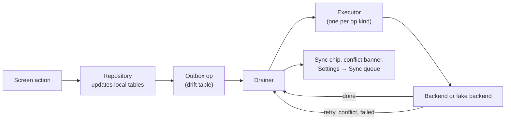

# App offline and sync

<!-- nav:start -->

**Navigate:** [Project](../../README.md) · [Docs hub](../README.md) · [Overview](../SYSTEM_OVERVIEW.md) · [AWS architecture](../AWS_ARCHITECTURE.md) · [AWS guide](../AWS_SETUP_GUIDE.md) · [API](../backend/API.md) · [Environment](../ENVIRONMENT_VARIABLES.md) · [Contracts](../CONTRACTS.md)

**App docs:** [Runbook](../../app_frontend/README.md) · [Index](README.md) · [Architecture](ARCHITECTURE.md) · [Screens](SCREENS.md) · **Offline and sync** · [Notifications and realtime](NOTIFICATIONS_AND_REALTIME.md) · [Deployment](DEPLOYMENT.md)

<!-- nav:end -->

Field staff lose signal often. Every action is saved on the phone first and sent when the network allows.

- Code: `lib/core/storage/` (database), `lib/core/sync/` (outbox, drainer, triggers, executors).

---

## How a write travels

- The screen updates at once from local tables; the server call happens later.
- Each op is immutable once queued and carries an idempotency key.

---

## Local tables

| Table | Holds |
|---|---|
| `outbox_ops` | Queued writes: kind, ordering key, dependency, coalesce key, priority, attempts, state |
| `tasks`, `stops`, `routes` | Driver and inspector work |
| `reports_draft` | Citizen Eyes drafts and their server status |
| `media_files` | Captured photos, processed copies, uploaded keys |
| `alerts` | Inbox, including pushes received in the background |
| `location_pings` | Shift GPS samples waiting to upload |
| `safe_windows`, `cached_payloads` | Cached reads for offline viewing |
| `sync_state` | Which scopes need a refresh |

---

## Operation kinds

| Kind | Priority | Sends |
|---|---|---|
| `task_ack`, `task_status` | 1 | Task acknowledged, started, done, skipped |
| `alert_ack`, `shift_start`, `shift_end`, `push_token` | 1 | Acknowledgements, shift edges, FCM token |
| `inspection_close`, `report_submit` | 2 | Inspection outcome, Citizen Eyes report |
| `photo_upload` | 3 | Presign + upload to S3 |
| `location_batch`, `profile_update` | 4 | GPS batches, profile and alert-area changes |

- **Ordering:** ops with the same ordering key (for example one task) run in order.
- **Dependencies:** a report waits for its photo upload; if the upload fails, the report fails too.
- **Coalescing:** latest-wins ops (push token, profile) replace older queued ones.
- **Concurrency:** at most 3 ops in flight, one photo upload at a time.

---

## Retry rules

| Response | Outcome |
|---|---|
| Network down | Released; retried when connectivity returns |
| Timeout, 5xx, 429 | Retry with exponential backoff and full jitter: 2 s base, 15 min cap; `Retry-After` respected |
| 401 | Pause the queue until the session refreshes |
| 403, 422 | Failed (shown in the sync queue) |
| 404 | Superseded (the target is gone) |
| 409 | Superseded or retried, depending on the conflict; a banner explains it |
| Other client errors | Failed after 5 attempts |

---

## When sync runs

| Trigger | When |
|---|---|
| `connectivityRegained` | Network comes back |
| `resumed` | App returns to the foreground |
| `push`, `wsReconnected` | A push or realtime event says data changed |
| `periodic` | Every 60 s on shift, 5 min otherwise |
| `dateRollover` | A new service day starts |
| `manual` | Pull to refresh or **Settings → Sync queue** |
| Background | workmanager every 15 min (Android) and after a background push |

---

## Real or fake backend

- Ops are routed per feature, like reads: `citizen_reports`, `citizen_subscription` and `push` can go to the real backend while sign-in and tasks stay on the fake one.
- Report photos follow `citizen_reports` and go to the real S3 bucket; inspection photos follow `inspector`.

---

## Related

- [Screens](SCREENS.md) · [Notifications and realtime](NOTIFICATIONS_AND_REALTIME.md) · [App architecture](ARCHITECTURE.md)

<!-- footer:start -->

---

**Related across the project:** [Citizen reports service](../backend/SERVICES.md#citizen-reports) · [Backend API](../backend/API.md) · [Data stores](../backend/DATA_STORES.md)

[Back to top](#app-offline-and-sync) · [Docs hub](../README.md) · [Project README](../../README.md)

<!-- footer:end -->
