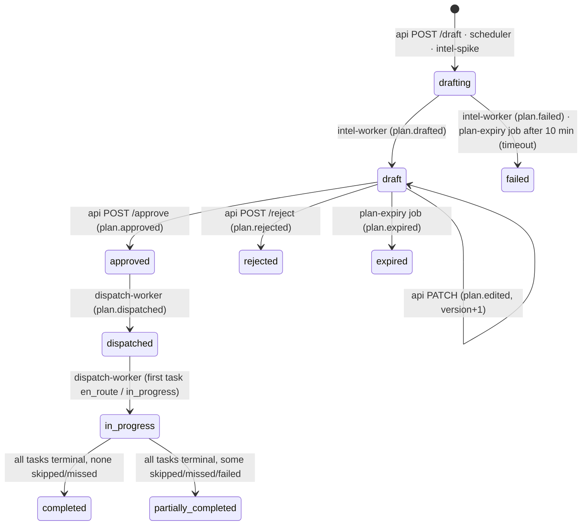

# HawaCommand Backend — REST and WebSocket API

Purpose: the full specification of the public REST (`/v1`, `/open/v1`) and WebSocket (`/v1/ws`) surface served by the backend `api` process, plus its client contract with the internal AI-ML service.

Related: [../CONTRACTS.md](../CONTRACTS.md) (binding index in §6, enums in §3, Redis keys in §9) · [../SYSTEM_OVERVIEW.md](../SYSTEM_OVERVIEW.md) · [DATA_MODEL.md](DATA_MODEL.md) · [ARCHITECTURE.md](ARCHITECTURE.md) · [EVENTS.md](EVENTS.md) · [CACHING.md](CACHING.md) · [LOGGING_AND_OBSERVABILITY.md](LOGGING_AND_OBSERVABILITY.md) · [DEPLOYMENT.md](DEPLOYMENT.md) · [../frontend/README.md](../frontend/README.md) · [../app/README.md](../app/README.md) · [../aiml/ARCHITECTURE.md](../aiml/ARCHITECTURE.md)

The proposal's §9.3 endpoints (twin, forecast, hotspots, plans draft/simulate/approve, impact, reports webhook, open air) are marked ★. The proposal sketches Node.js + Express/Fastify + Zod (§9.3, §11); this build uses FastAPI + Pydantic v2 (SYSTEM_OVERVIEW §8) with the same endpoints.

---

## Contents

1. [Conventions](#1-conventions)
2. [Authentication and authorisation](#2-authentication-and-authorisation)
3. [Auth and session endpoints](#3-auth-and-session-endpoints)
4. [Twin and cells](#4-twin-and-cells)
5. [Hotspots, forecast, GRAP](#5-hotspots-forecast-grap)
6. [Plans](#6-plans)
7. [Tasks (field app)](#7-tasks-field-app)
8. [Fleet and devices](#8-fleet-and-devices)
9. [Interventions and impact](#9-interventions-and-impact)
10. [Alerts](#10-alerts)
11. [Schools](#11-schools)
12. [Citizen Eyes and the WhatsApp webhook](#12-citizen-eyes-and-the-whatsapp-webhook)
13. [Inspections](#13-inspections)
14. [Sites](#14-sites)
15. [Integrity and coverage](#15-integrity-and-coverage)
16. [Evidence reports](#16-evidence-reports)
17. [Uploads](#17-uploads)
18. [Open data](#18-open-data)
19. [Ops](#19-ops)
20. [WebSocket protocol](#20-websocket-protocol)
21. [Internal client to AI-ML](#21-internal-client-to-ai-ml)
22. [Cache map](#22-cache-map)
23. [Proposed contract additions](#23-proposed-contract-additions)

---

## 1. Conventions

### 1.1 Base paths and versioning

| Base | Audience | Auth |
|---|---|---|
| `/v1` | Web console, Flutter app, Meta webhook | `Authorization: Bearer <JWT>` (except the auth endpoints, the webhook, and the anonymous coarse `GET /v1/twin`) |
| `/open/v1` | Public portal, researchers | none; rate-limited per IP |
| `/v1/ws` | Web console, Flutter app | JWT in `Sec-WebSocket-Protocol` or `?token=` |
| `/healthz`, `/readyz`, `/metrics` | Infrastructure | network-restricted |

Versioning is by path (CONTRACTS §12.3). Within `v1`, changes are additive only: new endpoints, new optional request fields, new response fields, new enum values (clients map unknown values to `unknown`). Anything else ships as `/v2` alongside `/v1`. A deprecated endpoint returns:

```http
Deprecation: @1788220800
Sunset: Tue, 31 Aug 2027 00:00:00 GMT
Link: </docs/backend/API.md#23-proposed-contract-additions>; rel="deprecation"
```

`Deprecation` (RFC 9745, epoch date) says when it was deprecated, `Sunset` (RFC 8594) when it will stop working. The OpenAPI operation is also marked `deprecated: true`.

### 1.2 Formats

| Topic | Rule |
|---|---|
| Media type | `application/json; charset=utf-8` for requests and responses; `application/problem+json` for errors; `application/geo+json` for GeoJSON bodies; `application/vnd.mapbox-vector-tile` for tiles; `multipart/form-data` only on `POST /v1/reports` and `POST /v1/tasks/{id}/evidence` |
| Field names | `snake_case` everywhere (CONTRACTS §1) |
| Timestamps | UTC, ISO-8601 with `Z`, second precision (`2026-11-13T00:41:10Z`). Date-only parameters (`date=2026-11-13`) are **IST calendar days** and documented as such. |
| Geometry | GeoJSON, EPSG:4326, coordinates `[lon, lat]`, 6 decimals. `bbox` query parameters are `minLon,minLat,maxLon,maxLat`. Point inputs in forms use separate `lat` and `lon` fields. |
| Numbers | Concentrations in µg/m³ with 1 decimal, gases in ppb, exposure in person-hours (`*_ph`), money in integer paise (`*_paise`) |
| Uncertainty | Never a bare estimate: twin values carry `*_var` and `confidence`, forecasts `p10/p50/p90`, impacts `ci_low/ci_high`, attribution `cause_conf` (CONTRACTS §1) |
| Simulated data | Every entity that can be simulated carries `is_simulated`; aggregates carry `simulated_share` (0–1) |
| Bilingual text | Both languages are returned where they exist: `reason_text` + `reason_text_hi`, `summary_text` + `summary_text_hi`. `Accept-Language: hi` only localises problem `title` / `detail`. |
| Nulls | Optional fields are present with `null`, not omitted, so generated clients stay stable |

### 1.3 Standard headers

| Header | Direction | Rule |
|---|---|---|
| `Authorization: Bearer <JWT>` | request | §2 |
| `X-Request-Id` | both | Accepted if it is a UUID; otherwise generated (UUIDv7). Always echoed. Logged on every line (logifyx `ContextLoggerAdapter`). |
| `X-Correlation-Id` | both | Accepted and echoed; defaults to the request id. Copied into every outbox envelope's `correlation_id` and forwarded to AI-ML, so one approve click can be traced through dispatch to verification. |
| `traceparent` | request | W3C trace context, continued by OpenTelemetry |
| `Idempotency-Key` | request | §1.7 |
| `If-Match` | request | Optimistic concurrency on plans (§6) |
| `If-None-Match` | request | Conditional GET on tiles, forecasts and open data (§1.8) |
| `ETag`, `Cache-Control`, `Vary` | response | §1.8 |
| `RateLimit-Limit`, `RateLimit-Remaining`, `RateLimit-Reset`, `Retry-After` | response | §1.9 |
| `Idempotent-Replayed: true` | response | Present when a stored idempotent response is replayed |
| `Location` | response | On `201` and `202` |

### 1.4 Errors (RFC 9457)

Every non-2xx response is `application/problem+json` with the CONTRACTS §6 shape plus two extension members (`request_id`, and endpoint-specific extras such as `current_version`):

```json
{
  "type": "urn:hawa:problem:plan.version_conflict",
  "title": "Plan was changed by someone else",
  "status": 409,
  "detail": "Plan 01932c4e-5a10-7c3e-8f41-2b9d6e0a7c15 is at version 4; you sent version 3.",
  "instance": "/v1/plans/01932c4e-5a10-7c3e-8f41-2b9d6e0a7c15/approve",
  "code": "plan.version_conflict",
  "request_id": "01932c61-0f3e-7b2a-9c11-5d7e8f9a0b12",
  "current_version": 4,
  "errors": []
}
```

`type` is `urn:hawa:problem:<code>`; `code` is the stable machine value clients branch on (never parse `title` or `detail`). `errors[]` lists field problems as `{"pointer": "#/ward_ids/0", "code": "pattern_mismatch", "detail": "must match ^ward-[0-9A-Za-z]+$"}`. FastAPI's `RequestValidationError` and Pydantic errors are mapped to `validation_failed` with one entry per error. Unhandled exceptions become `internal_error` with no internals in `detail`. Implemented in `core/errors.py` as `HawaError(code, status, detail, **extra)` plus exception handlers.

### 1.5 Error code catalogue

| Code | HTTP | Meaning |
|---|---|---|
| `validation_failed` | 422 | Body, query or path failed validation; see `errors[]` |
| `bad_request` | 400 | Malformed JSON, wrong content type for the operation |
| `pagination.invalid_cursor` | 400 | Cursor is corrupt or was issued for different filters |
| `unauthenticated` | 401 | No or unparsable `Authorization` header |
| `auth.invalid_credentials` | 401 | Email/password wrong (same response for an unknown email) |
| `auth.token_invalid` | 401 | Bad signature, wrong `iss`/`aud`/`typ` |
| `auth.token_expired` | 401 | Access token past `exp`; client refreshes |
| `auth.token_revoked` | 401 | `jti` on the deny list |
| `auth.refresh_invalid` | 401 | Unknown or expired refresh token |
| `auth.refresh_reused` | 401 | A rotated refresh token was presented again; the whole family is revoked |
| `auth.otp_invalid` | 401 | Wrong code |
| `auth.otp_expired` | 401 | No live code for the phone (5 min TTL passed or never requested) |
| `auth.otp_attempts_exceeded` | 429 | 5 wrong attempts; the code is burned |
| `auth.otp_resend_too_soon` | 429 | New code requested within 30 s |
| `auth.account_locked` | 403 | Too many failed logins; `locked_until` in the problem |
| `auth.account_disabled` | 403 | `app_user.is_active = false` |
| `auth.role_not_allowed` | 403 | E.g. a driver account using password login |
| `forbidden` | 403 | Role not allowed for the operation |
| `forbidden.ward_scope` | 403 | A requested `ward` or the plan's wards are outside the caller's scope |
| `not_found` | 404 | Unknown id, or an object outside the caller's scope (no existence leak) |
| `method_not_allowed` | 405 | |
| `conflict` | 409 | Generic state conflict |
| `idempotency.in_progress` | 409 | Same `Idempotency-Key` is still being processed; retry after `Retry-After` |
| `idempotency.key_reuse_mismatch` | 422 | Same key, different request body |
| `precondition_required` | 428 | `If-Match` (or body `version`) missing on a versioned write |
| `payload_too_large` / `upload.too_large` | 413 | Body or file over the limit |
| `unsupported_media_type` / `upload.unsupported_type` | 415 | |
| `upload.not_found` | 422 | Referenced upload key does not exist or belongs to another user |
| `rate_limited` | 429 | Over a limit in §1.9; `Retry-After` set |
| `twin.bbox_too_large` | 422 | Bbox over 400 km²; use tiles |
| `twin.no_data` | 404 | No succeeded twin run at or before `ts` in the hot window |
| `tile.zoom_out_of_range` | 422 | `z` outside 8–16 |
| `forecast.not_available` | 404 | No forecast issue for the cell |
| `plan.drafting_in_progress` | 409 | A draft for the same ward(s) is being built; `existing_plan_id` in the problem |
| `plan.not_draft` | 409 | Operation needs status `draft`; `current_status` in the problem |
| `plan.version_conflict` | 409 | Stale `If-Match` / `version`; `current_version` in the problem |
| `plan.constraint_violation` | 422 | An edit breaks a hard constraint (cause → asset type, shift window, capacity, double-booking); `errors[]` names each task and rule |
| `plan.unresolved_objections` | 422 | Blocking Auditor objections remain and no `override_reason` was given |
| `plan.window_invalid` | 422 | Window in the past, longer than 24 h, or end ≤ start |
| `plan.expired` | 409 | Draft passed its first task window |
| `task.not_assigned_to_you` | 403 | Task's asset is not in the caller's `asset_ids` and it is not assigned to them |
| `task.invalid_transition` | 409 | E.g. `done` → `en_route`; `allowed` list in the problem |
| `task.window_closed` | 409 | Status update more than 2 h after `window_end` |
| `report.photo_required` | 422 | No photo file or `photo_key` |
| `report.location_out_of_bounds` | 422 | Outside the NCR bbox |
| `report.duplicate_photo` | 409 | Same photo hash from the same reporter within 24 h |
| `inspection.already_closed` | 409 | |
| `device.id_conflict` | 409 | Device id already registered |
| `webhook.signature_invalid` | 401 | `X-Hub-Signature-256` missing or wrong |
| `webhook.verify_token_mismatch` | 403 | GET verification with the wrong `hub.verify_token` |
| `upstream.aiml_unavailable` | 503 | AI-ML circuit open or connection refused (§21) |
| `upstream.timeout` | 504 | AI-ML call exceeded its timeout |
| `service_unavailable` | 503 | Dependency down (DB, Redis) |
| `internal_error` | 500 | Unexpected; `request_id` is the key for support |

### 1.6 Pagination

Lists use opaque cursors (CONTRACTS §6): `?limit=50&cursor=…` → `{"items": [...], "next_cursor": "…" | null}`.

- `limit` default 50, max 200.
- The cursor is base64url JSON `{"k": [<sort key values>], "id": "<last id>", "f": "<hash of filters>"}`; the server applies `WHERE (sort_key, id) < (:k, :id)` on an index that matches the endpoint's fixed order (usually `created_at DESC, id DESC`; UUIDv7 ids keep this cheap).
- A cursor reused with different filters returns `400 pagination.invalid_cursor`.
- No total counts (expensive and unstable on live data); endpoints that need counts expose them explicitly (e.g. `/v1/impact/summary`).

### 1.7 Idempotency

`Idempotency-Key` is accepted on every `POST` / `PATCH` that creates or changes state. The generated clients always send one; the Flutter offline queue reuses the same key on every retry of a queued action.

| Rule | Behaviour |
|---|---|
| Format | 1–64 chars `[A-Za-z0-9_-]`; a UUIDv7 is recommended |
| Scope | `(sub, method, route template, key)`; anonymous webhook calls are deduped by provider message id instead |
| Storage | Redis `idem:{user_id}:{key}` (`user_id` = JWT `sub`), a string holding an orjson record `{state, req_hash, status, headers, body_b64}`, TTL **24 h** (proposed key PCA-13 in [CACHING.md §9](CACHING.md)) |
| Fingerprint `req_hash` | SHA-256 of method + path + canonical JSON body (sorted keys) or, for multipart, the part hashes |
| First request | `SET … {"state":"processing"} NX EX 86400`, run the handler, then overwrite with the final response (`XX KEEPTTL`) |
| Same key, same `fp` | Replay the stored status, headers and body with `Idempotent-Replayed: true`; no side effects |
| Same key, different `fp` | `422 idempotency.key_reuse_mismatch` |
| Same key while in progress | `409 idempotency.in_progress`, `Retry-After: 1` |
| 5xx responses | Not stored, so the client can retry with the same key |

Business idempotency is layered on top where it matters: approving an already-approved plan at the same version returns the same `200` even without a key (§6.6); HawaTag and WhatsApp duplicates are deduped by `segment_id` / `wamid`.

### 1.8 HTTP caching

| Response | `Cache-Control` | Validator |
|---|---|---|
| Authenticated JSON (default) | `private, no-store` | — |
| `GET /v1/twin`, `/v1/hotspots` | `private, max-age=30` | `ETag: "t{tile_version}-{bbox_hash}"` / `"h{run_id}"` |
| Tiles `…/{z}/{x}/{y}.mvt` | `private, max-age=60`; with `?v={tile_version}`: `private, max-age=86400, immutable` | `ETag: "{tile_version}-{z}-{x}-{y}"` |
| `GET /v1/forecast/*` | `private, max-age=300` | `ETag: "f{issued_at_epoch}"` |
| Plan detail | `private, no-cache` | `ETag: "v{version}"` (also the `If-Match` value) |
| `/open/v1/*` | `public, max-age=60, stale-while-revalidate=120` | strong `ETag` |
| `/open/v1/methods` | `public, max-age=86400` | strong `ETag` |

`If-None-Match` with a matching validator returns `304 Not Modified` without touching the database when the validator can be computed from Redis (`twin:version`). `Vary: Authorization, Accept-Encoding` on private responses. Responses over 1 KB are gzip-compressed (`GZipMiddleware`); tiles are served gzip-encoded from the cache as stored.

### 1.9 Rate limits

Sliding-window counters in Redis `rl:{scope}:{subject}:{window}` (CONTRACTS §9). Every limited response carries `RateLimit-Limit`, `RateLimit-Remaining`, `RateLimit-Reset` (seconds); a `429 rate_limited` adds `Retry-After`.

Scope names follow [CACHING.md §7](CACHING.md) (`open`, `otp_req`, `otp_verify_ip`, `login`, `report`, `wa_in`, `user`); the scopes marked † are additions proposed here (§23). Phone numbers and emails are hashed wherever they appear in a key.

| Scope | Subject | Limit |
|---|---|---|
| `login` | IP and hashed lowercased email | 10 / 15 min each |
| `otp_req` | hashed phone; IP | 3 / 15 min per phone (30 s cooldown); 20 / h per IP |
| `otp_verify_ip` | IP | 30 / 15 min (the per-code limit of 5 attempts lives in the `otp:{phone_e164}` hash) |
| `refresh` † | user | 30 / min |
| `user` (default authenticated) | user | 600 / min |
| `plan_draft` † | user | 10 / min |
| `simulate` † | user | 30 / min |
| `report` | user; IP | 10 / h per user; 30 / h per IP |
| `presign` † | user | 30 / min |
| `wa_in` | hashed WhatsApp sender | 20 inbound messages / 10 min (excess is ignored, still answered `200`) |
| `open` | IP (`X-Forwarded-For` from the trusted ALB only) | **60 / min** |
| `twin_anon` † (anonymous `GET /v1/twin`) | IP | 60 / min |
| WebSocket client ops | connection (in-process, not Redis) | 20 messages / s (§20) |

### 1.10 OpenAPI and generated clients

The API serves OpenAPI at `/openapi.json` (FastAPI, OpenAPI 3.1). It is also exported in CI to `backend/openapi/openapi.v1.json` and diffed for breaking changes (`oasdiff breaking` against `main`); a breaking change in `v1` fails the build.

| Convention | Rule |
|---|---|
| `operationId` | `<tag>_<action>`, stable forever: `plans_draft`, `plans_approve`, `twin_get`, `twin_tile`, `tasks_mine`. Set via `generate_unique_id_function=lambda r: f"{r.tags[0]}_{r.name}"` with handler functions named after the action. |
| Tags | One per area: `auth`, `me`, `twin`, `cells`, `hotspots`, `forecast`, `grap`, `plans`, `tasks`, `assets`, `fleet`, `devices`, `interventions`, `impact`, `alerts`, `schools`, `reports`, `webhooks`, `inspections`, `sites`, `integrity`, `coverage`, `evidence_reports`, `uploads`, `open`, `ops` |
| Responses | Every operation declares `response_model` and its error responses (`responses={409: {"model": Problem}, …}`) so clients get typed errors |
| Enums | Python `StrEnum` from `hawa_contracts.enums` → OpenAPI string enums with stable component names (`PlanStatus`, `TaskStatus`, …) |
| Schemas | Pydantic models in `api/schemas/*.py`, named `<Thing>Out`, `<Thing>In`, `<Thing>Page`; no inline anonymous objects in responses |
| Nullability | `X \| None` → `anyOf: [X, null]`; fields always present (§1.2) |
| Binary | Tiles and PDFs are documented with `content: {"application/vnd.mapbox-vector-tile": {"schema": {"type": "string", "format": "binary"}}}` |

Consumers:

- **Web** (`frontend/`): `openapi-typescript` generates `src/lib/api/schema.d.ts` from `/openapi.json`; `openapi-fetch` `createClient<paths>()` gives typed calls; a middleware adds `Authorization`, `Idempotency-Key` and `X-Request-Id`. The Next.js server keeps the refresh token in an httpOnly cookie and never exposes it to browser JS. See [../frontend/README.md](../frontend/README.md).
- **Flutter** (`app_frontend/`): `openapi-generator` with the `dart-dio` generator produces the `hawa_api` package; `enumUnknownDefaultCase=true` so unknown enum values decode to a fallback case (CONTRACTS §12.5). A Dio interceptor adds auth, idempotency keys and refresh-on-401. OpenAPI 3.1 support differs between generator versions; CI runs the generator against the exported document so any incompatibility shows up in the backend PR. See [../app/README.md](../app/README.md).

---

## 2. Authentication and authorisation

### 2.1 Login flows

| Roles | Flow | Credential store |
|---|---|---|
| `officer`, `admin`, `analyst` | Email + password → `POST /v1/auth/login` | `app_user.password_hash`, **argon2id** via `argon2-cffi` (PHC string; parameters tuned so a hash takes ~250 ms on the api instance; rehash on login when parameters change) |
| `driver`, `inspector`, `school`, `site_manager`, `citizen` | Phone OTP → `POST /v1/auth/otp/request` then `POST /v1/auth/otp/verify` | Redis `otp:{phone_e164}` (CONTRACTS §9) |

Password rules: unknown emails run a dummy argon2 verify so timing does not reveal accounts; 5 consecutive failures set `locked_until = now + 15 min` (`auth.account_locked`); successful login resets `failed_login_count`.

OTP rules:

| Rule | Value |
|---|---|
| Code | 6 digits from `secrets.randbelow(10**6)`, zero-padded |
| Storage | `otp:{phone_e164}` hash `{h, attempts, channel, created_at}`, where `h = HMAC-SHA256(OTP_PEPPER, phone ‖ code)`; the code itself is never stored or logged |
| TTL | 5 min |
| Attempts | 5 per code; the 5th failure deletes the key (`auth.otp_attempts_exceeded`) |
| Resend | 30 s cooldown; 3 per 15 min per phone; 20 per hour per IP |
| Delivery | SMS (Amazon SNS) or WhatsApp authentication template, called directly by the api through `OtpSender`. **OTPs never go through Kafka, the outbox or logs.** |
| Account existence | `otp/request` always answers `202` with the same body. On `verify`, an unknown phone creates a `citizen` account; every other phone role must be pre-provisioned by an admin. |
| Local / demo | `HAWA_OTP_DEV_CODE=000000` accepted only when `HAWA_ENV=local`; the demo stack sends real SMS to the test numbers |

### 2.2 Tokens and claims

| Token | Format | TTL | Storage |
|---|---|---|---|
| Access | JWT, `RS256`, header `kid` | **15 min** | not stored; revocation via `jwt:deny:{jti}` |
| Refresh | opaque 256-bit random, base64url, prefix `rt_` | **30 d**, rotated on every use | `refresh_token.token_hash = SHA-256(token)` ([DATA_MODEL §12.2](DATA_MODEL.md#122-refresh_token--writer-backend)) |

Access token claims:

```json
{
  "iss": "hawa-api",
  "aud": "hawa",
  "typ": "access",
  "sub": "01927f40-1111-7aaa-8bbb-00000000a001",
  "role": "officer",
  "wards": ["ward-084", "ward-085"],
  "asset_ids": [],
  "school_id": null,
  "site_id": null,
  "jti": "01932c3a-77e1-7c2d-b0a4-1e2f3a4b5c6d",
  "iat": 1762966800,
  "exp": 1762967700
}
```

| Claim | Source | Notes |
|---|---|---|
| `sub` | `app_user.id` | |
| `role` | `app_user.role` | CONTRACTS `UserRole` |
| `wards` | `user_ward_scope` rows; `["*"]` for admin | officers and analysts |
| `asset_ids` | assets of the user's `asset_shift` rows overlapping `[now − 12 h, now + 24 h]` | drivers and inspectors (their `AST-TEAM-…`); recomputed on every refresh |
| `school_id`, `site_id` | `app_user` | school principals, site managers |
| `jti` | UUIDv7 | deny-list key |
| `typ` | `access` (user) or `service` (machine tokens) | refresh tokens are opaque, so a JWT with `typ` other than `access`/`service` is rejected |

Refresh rotation and reuse detection: each `POST /v1/auth/refresh` marks the presented token `rotated_at = now` and issues a child in the same `family_id`. Presenting a token that is already rotated or revoked revokes **every** token in the family (`revoke_reason = 'reuse_detected'`), writes an `audit.recorded` event, and returns `401 auth.refresh_reused`: a stolen token and the legitimate client cannot both keep a session. A 10-second grace window returns the same child token for an immediate duplicate (mobile retry on a flaky network) instead of treating it as reuse.

Signing keys: an RSA key pair per environment from Secrets Manager (local: generated on first boot into `.secrets/`), with `kid` = `hawa-{yyyy}-{mm}`; two keys are published during rotation. The public keys are served at `GET /v1/auth/jwks.json` (proposed, §23) so other services can verify tokens without calling the api.

### 2.3 Verifier interface (Cognito-compatible)

Routers depend only on `Principal`; how a token is verified is pluggable (`core/security.py`), selected by `HAWA_AUTH_VERIFIER=local|cognito`.

```python
class Principal(BaseModel):
    sub: UUID
    role: UserRole
    wards: list[str]                   # ["*"] = all
    asset_ids: list[str] = []
    school_id: str | None = None
    site_id: str | None = None
    jti: str
    exp: datetime
    typ: Literal["access", "service"]

class TokenVerifier(Protocol):
    async def verify(self, token: str) -> Principal: ...

class LocalJwtVerifier:          # PyJWT, RS256, keys by kid, iss/aud/exp/typ checks, then jwt:deny:{jti} EXISTS
    ...

class CognitoJwtVerifier:        # JWKS from https://cognito-idp.{region}.amazonaws.com/{pool_id}/.well-known/jwks.json (cached 1 h)
    # checks iss, token_use == "access", client_id; maps cognito:groups → role and
    # custom:wards / custom:school_id / custom:site_id → claims; asset_ids looked up from asset_shift
    ...

async def current_principal(request: Request, verifier: TokenVerifier = Depends(get_verifier)) -> Principal: ...
def require_roles(*roles: UserRole) -> Callable[..., Principal]: ...    # 403 forbidden
```

With `cognito`, the login, OTP and refresh endpoints return `404` (Cognito's hosted flows issue the tokens) and logout only writes the deny list.

### 2.4 RBAC and scoping

`officer+` below means `officer`, `analyst` and `admin`; `analyst` is read-only everywhere. ● = allowed, ◐ = allowed with the scoping rule in the next table, — = `403 forbidden`.

| Endpoint group | admin | officer | analyst | inspector | driver | school | site_manager | citizen | public |
|---|---|---|---|---|---|---|---|---|---|
| `auth/login` | ● | ● | ● | — | — | — | — | — | ● (to log in) |
| `auth/otp/*` | — | — | — | ● | ● | ● | ● | ● | ● (to log in) |
| `auth/refresh`, `auth/logout`, `me`, `me/push-token` | ● | ● | ● | ● | ● | ● | ● | ● | — |
| `GET /v1/twin` | ● | ● | ● | coarse | coarse | coarse | coarse | coarse | coarse |
| Twin tiles, cells | ● | ● | ● | — | — | — | — | — | — |
| Hotspots list | ● | ◐ | ◐ | — | — | — | — | — | — |
| Hotspot detail | ● | ◐ | ◐ | ◐ | — | — | — | — | — |
| Forecast for a cell | ● | ● | ● | — | — | ◐ | — | — | — |
| Forecast grid, GRAP outlook / checklist | ● | ● | ● | — | — | — | — | — | — |
| Plans read | ● | ◐ | ◐ | — | — | — | — | — | — |
| Plans draft / edit / simulate / approve / reject | ● | ◐ | — | — | — | — | — | — | — |
| `tasks/mine`, task ack / status | — | — | — | ◐ | ◐ | — | — | — | — |
| Task detail | ● | ◐ | ◐ | ◐ | ◐ | — | — | — | — |
| Task evidence | — | — | — | ◐ | — | — | — | — | — |
| Assets, fleet live | ● | ● | ● | — | — | — | — | — | — |
| Devices read, calibration | ● | — | ● | — | — | — | — | — | — |
| Device register | ● | — | — | — | — | — | — | — | — |
| Interventions, impact, effectiveness | ● | ● | ● | — | — | — | — | — | — |
| Alerts list / detail | ● | ◐ | ◐ | own | own | own | own | own | — |
| Alerts create | ● | ◐ | — | — | — | — | — | — | — |
| `schools/me` | — | — | — | — | — | ● | — | — | — |
| School safe-window, indoor-outdoor | ● | ● | ● | — | — | ◐ | — | — | — |
| Reports create, `reports/mine` | — | — | — | — | — | — | — | ● | — |
| Report detail | ● | ◐ | ◐ | ◐ | — | — | — | own | — |
| WhatsApp webhook | Meta signature only |||||||||
| Inspections list | ● | ◐ | ◐ | ◐ | — | — | — | — | — |
| Inspection close | ● | ◐ | — | ◐ | — | — | — | — | — |
| Sites list / detail | ● | ● | ● | — | — | — | — | — | — |
| `sites/me` | — | — | — | — | — | — | ● | — | — |
| Integrity flags, blind spots | ● | ● | ● | — | — | — | — | — | — |
| Evidence reports read / PDF | ● | ◐ | ◐ | — | — | — | — | — | — |
| Evidence reports create | ● | ◐ | — | — | — | — | — | — | — |
| Uploads presign | ● | ● | — | ● | ● | — | — | ● | — |
| `/open/v1/*` | ● | ● | ● | ● | ● | ● | ● | ● | ● |
| `/healthz`, `/readyz`, `/metrics` | network-restricted (infra) |||||||||

Scoping rules (enforced in the service layer, not only in the UI):

| Role | Rule | Violation |
|---|---|---|
| officer, analyst | Plans are visible when `plan.ward_ids && wards` (overlap). Editing, simulating, approving and rejecting require `plan.ward_ids <@ wards` (all of the plan's wards). `POST /v1/plans/draft` requires every requested ward in scope. | list filter outside scope → `403 forbidden.ward_scope`; single object outside scope → `404 not_found` |
| officer, analyst | Hotspots, inspections, alerts, evidence reports filtered to `ward_id ∈ wards`; an explicit `?ward=` outside scope → `403 forbidden.ward_scope` | |
| officer, analyst | The twin map, tiles, forecast grid and GRAP outlook are city-wide (context for decisions; the coarse version is public anyway) | |
| admin | `wards = ["*"]`: no ward filter | |
| driver | Tasks whose `asset_id ∈ asset_ids` or whose `assigned_user_id = sub`; nothing else | `403 task.not_assigned_to_you` |
| inspector | Tasks, inspections and hotspots linked to their `assigned_user_id` or their team asset | `403 task.not_assigned_to_you` / `404` |
| school | Only `school_id`; forecast only for the school's 1 km cell | `404` |
| site_manager | Only `site_id` | `404` |
| citizen | Only reports where `reporter_user_id = sub` and alerts where `recipient_user_id = sub` | `404` |

Claims are a fast path. For writes on tasks the service re-checks `asset_shift` in the database, so a shift change takes effect immediately rather than at the next refresh.

### 2.5 Logout and the deny list

`POST /v1/auth/logout` revokes the refresh token's family (or every family of the user with `all_devices: true`) and sets `jwt:deny:{jti}` with TTL `exp − now` for the presented access token. Every verification does one `EXISTS jwt:deny:{jti}`. If Redis is unavailable, verification fails closed for write operations and open for read operations with a warning log (short-lived tokens bound the risk); this trade-off is a config flag (`HAWA_DENYLIST_FAIL_OPEN_READS`).

---

## 3. Auth and session endpoints

#### `POST /v1/auth/login`

`operationId: auth_login` · public · rate limit `login` · no idempotency key needed

```http
POST /v1/auth/login
Content-Type: application/json

{ "email": "a.sharma@mcd.example.in", "password": "••••••••••••", "device_label": "Chrome on Windows" }
```

`200 OK`

```json
{
  "access_token": "eyJhbGciOiJSUzI1NiIsImtpZCI6Imhhd2EtMjAyNi0xMSIsInR5cCI6IkpXVCJ9.…",
  "token_type": "Bearer",
  "expires_in": 900,
  "refresh_token": "rt_Qm9v3xk7m2Yp0T8cV4wZ1sR6aE9dF5gH2jK3lN4pQ7u",
  "refresh_expires_in": 2592000,
  "user": {
    "id": "01927f40-1111-7aaa-8bbb-00000000a001",
    "role": "officer",
    "display_name": "A. Sharma",
    "lang": "en",
    "wards": ["ward-084", "ward-085"],
    "asset_ids": [], "school_id": null, "site_id": null,
    "is_simulated": true
  }
}
```

Errors: `401 auth.invalid_credentials`, `403 auth.account_locked | auth.account_disabled | auth.role_not_allowed`, `422 validation_failed`, `429 rate_limited`. Side effects: `refresh_token` row; `audit.recorded` (`auth.login`, success and failure) via outbox → `hawa.audit.v1`.

#### `POST /v1/auth/otp/request`

`operationId: auth_otp_request` · public · rate limit `otp_req`

```json
{ "phone_e164": "+919810012345", "channel": "sms", "lang": "hi", "app_signature": "FA+9qCX9VSu" }
```

`channel` ∈ `sms | whatsapp`. `app_signature` (optional) is the Android SMS Retriever hash appended to the SMS so the Flutter app can auto-read the code.

`202 Accepted` (identical for every phone):

```json
{ "status": "sent", "expires_in": 300, "resend_after": 30 }
```

Errors: `422 validation_failed` (not E.164), `429 auth.otp_resend_too_soon | rate_limited`.

#### `POST /v1/auth/otp/verify`

`operationId: auth_otp_verify` · public · rate limit `otp_verify_ip` + 5 attempts per code

```json
{ "phone_e164": "+919810012345", "code": "418305", "device_label": "Redmi Note 13 (Android 14)" }
```

`200 OK`: same body as login. A driver example of `user`:

```json
{ "id": "01927f40-2222-7aaa-8bbb-00000000d014", "role": "driver", "display_name": "Ramesh K.", "lang": "hi",
  "wards": [], "asset_ids": ["AST-SPR-0012"], "school_id": null, "site_id": null, "is_simulated": true }
```

Errors: `401 auth.otp_invalid | auth.otp_expired`, `403 auth.account_disabled`, `429 auth.otp_attempts_exceeded`. Side effects: deletes `otp:{phone}`; creates a `citizen` `app_user` for unknown phones; sets `phone_verified_at`; `audit.recorded`.

#### `POST /v1/auth/refresh`

`operationId: auth_refresh` · public (the refresh token is the credential) · rate limit `refresh`

```json
{ "refresh_token": "rt_Qm9v3xk7m2Yp0T8cV4wZ1sR6aE9dF5gH2jK3lN4pQ7u" }
```

`200 OK`: same body as login with a **new** refresh token and recomputed claims (`wards`, `asset_ids`). Errors: `401 auth.refresh_invalid | auth.refresh_reused`, `403 auth.account_disabled`.

#### `POST /v1/auth/logout`

`operationId: auth_logout` · any authenticated

```json
{ "refresh_token": "rt_Qm9v3xk7m2Yp0T8cV4wZ1sR6aE9dF5gH2jK3lN4pQ7u", "all_devices": false }
```

`204 No Content`. Side effects: family revoked, `jwt:deny:{jti}` set, `audit.recorded`.

#### `GET /v1/me`

`operationId: me_get` · any authenticated

`200 OK`

```json
{
  "id": "01927f40-1111-7aaa-8bbb-00000000a001",
  "role": "officer",
  "display_name": "A. Sharma",
  "email": "a.sharma@mcd.example.in",
  "phone_e164": null,
  "lang": "en",
  "wards": [{ "ward_id": "ward-084", "name": "Ward 084" }, { "ward_id": "ward-085", "name": "Ward 085" }],
  "asset_ids": [],
  "school": null,
  "site": null,
  "current_shift": null,
  "features": { "citizen_eyes": true, "school_scheduler": true, "open_data": true },
  "is_simulated": true
}
```

`features` mirrors server-side feature flags (the §16 cut rule can switch F19 / F20 off without an app release).

#### `PUT /v1/me/push-token`

`operationId: me_put_push_token` · any authenticated · idempotent by nature (upsert)

```json
{ "token": "fcm:dQw4w9WgXcQ:APA91bH…", "platform": "android", "app_version": "1.0.3+17", "device_label": "Redmi Note 13" }
```

`200 OK` → `{ "id": "01932c70-…", "platform": "android", "last_seen_at": "2026-11-12T23:58:02Z" }`. Upserts `push_token` by `token` (re-pointing it to this user if it belonged to someone else on a shared phone). `DELETE /v1/me/push-token?token=` removes it on sign-out (proposed, §23).

---

## 4. Twin and cells

Twin values come from the latest `succeeded` `twin_run` at or before `ts` (15-minute runs; [DATA_MODEL §7.1–7.2](DATA_MODEL.md#7-tables-twin-and-forecast-ai-ml)). The current `tile_version` lives in Redis `twin:version`, set by the api's `api-cache` consumer on `twin.updated`.

#### ★ `GET /v1/twin?bbox=&ts=`

`operationId: twin_get` · officer+ (full); any other role or anonymous (coarse) · rate limit `user` / `twin_anon`

| Param | Type | Default | Notes |
|---|---|---|---|
| `bbox` | `minLon,minLat,maxLon,maxLat` | pilot district bbox | full: ≤ 400 km² (≈ 1,600 cells), else `422 twin.bbox_too_large`; coarse: whole NCT allowed |
| `ts` | timestamp | now | resolves to the run at or before `ts`; ≤ 30 d back for 15-min resolution, older returns the hourly-thinned state |
| `resolution` | `500 \| 1000` | `500` (full), `1000` (coarse, forced) | |

`200 OK` (`application/geo+json`), full:

```json
{
  "type": "FeatureCollection",
  "run_id": "01932c5a-1e00-7aaa-8bbb-000000000f15",
  "as_of": "2026-11-12T01:15:00Z",
  "tile_version": 18342,
  "resolution_m": 500,
  "model_version": "twin@1.0.0+a1b2c3d",
  "aqi_basis": "indicative_hourly",
  "is_simulated": true,
  "simulated_share": 0.97,
  "features": [
    {
      "type": "Feature",
      "id": "g500-041-077",
      "geometry": { "type": "Polygon", "coordinates": [[[77.216981, 28.630812], [77.222101, 28.630871], [77.222038, 28.635380], [77.216917, 28.635321], [77.216981, 28.630812]]] },
      "properties": {
        "cell_id": "g500-041-077", "ward_id": "ward-084",
        "pm25_est": 164.3, "pm25_var": 210.5, "pm10_est": 271.0, "pm10_var": 640.2,
        "confidence": 0.78, "aqi": 354, "aqi_category": "very_poor", "aqi_dominant": "pm25",
        "cause_label": "dust", "cause_conf": 0.71, "exposure_ph": 4210.5,
        "n_obs": 38, "is_blind_spot": false, "is_simulated": true
      }
    }
  ]
}
```

Coarse (anonymous and field roles): `resolution_m: 1000`, `id` = `g1k-…`, and properties limited to `pm25_est`, `pm10_est`, `confidence`, `aqi`, `aqi_category`, `is_simulated`. No cause, exposure or blind-spot data.

Errors: `404 twin.no_data`, `422 twin.bbox_too_large | validation_failed`. Caching: Redis `cache:twin:{tile_version}:{bbox_hash}` (20 min; the key changes when the version bumps, so no explicit delete is needed); HTTP `ETag: "t18342-9f2c1a"`, `private, max-age=30`.

#### `GET /v1/twin/tiles/{z}/{x}/{y}.mvt?ts=&v=`

`operationId: twin_tile` · officer+ · rate limit `user` (tile requests are counted at 1/10 weight)

| Param | Notes |
|---|---|
| `z`, `x`, `y` | XYZ Web Mercator; `z` 8–16 (`422 tile.zoom_out_of_range`); `z < 10` serves layer `cells_1k`, `z ≥ 10` layer `cells` ([DATA_MODEL §15.3](DATA_MODEL.md#153-vector-tiles-get-v1twintileszxymvt)) |
| `ts` | as for `/v1/twin` |
| `v` | optional `tile_version`; when present and matching, the response is `immutable` (proposed, §23) |

`200 OK`, `Content-Type: application/vnd.mapbox-vector-tile`, `Content-Encoding: gzip`, `ETag: "18342-14-11729-6836"`. Feature properties: `cell_id, pm25, pm10, conf, aqi, cat, cause, cause_conf, exp_ph, sim`. `204 No Content` for a tile with no cells. `304` on `If-None-Match`. Caching: `cache:tile:{tile_version}:{z}:{x}:{y}` (20 min).

The web client builds tile URLs from the `tile_version` in the `twin` WebSocket message (`…/{z}/{x}/{y}.mvt?v=18343`), so a new twin run is a URL change and the browser cache never serves stale tiles.

#### `GET /v1/cells/{cell_id}`

`operationId: cells_get` · officer+

`cell_id` is a 500 m id (`g500-041-077`); a 1 km id returns the planning cell with aggregated values.

`200 OK`

```json
{
  "cell_id": "g500-041-077",
  "cell_1k_id": "g1k-020-038",
  "ward": { "ward_id": "ward-084", "name": "Ward 084" },
  "geometry": { "type": "Polygon", "coordinates": [[[77.216981, 28.630812], [77.222101, 28.630871], [77.222038, 28.635380], [77.216917, 28.635321], [77.216981, 28.630812]]] },
  "centroid": { "type": "Point", "coordinates": [77.219509, 28.633096] },
  "population": 18420,
  "vulnerability_weight": 1.6,
  "land_use": "mixed",
  "is_key_cell": true,
  "features": { "road_density_km_km2": 21.4, "construction_permits_n": 3, "industrial_share": 0.02, "green_share": 0.08 },
  "poi_counts": { "school": 3, "hospital": 1, "market": 2, "bus_stop": 5 },
  "state": {
    "as_of": "2026-11-12T01:15:00Z", "pm25_est": 164.3, "pm25_var": 210.5, "pm10_est": 271.0, "pm10_var": 640.2,
    "confidence": 0.78, "aqi": 354, "aqi_category": "very_poor", "cause_label": "dust", "cause_conf": 0.71,
    "exposure_ph": 4210.5, "n_obs": 38, "model_version": "twin@1.0.0+a1b2c3d", "is_simulated": true
  },
  "forecast_24h": {
    "issued_at": "2026-11-12T01:05:00Z", "forecast_cell_id": "g1k-020-038",
    "peak_p50": 238.0, "peak_p90": 301.0, "peak_at": "2026-11-13T02:00:00Z", "max_grap_stage": 3
  },
  "recent_interventions": [
    { "intervention_id": "01932d10-4b21-7c3e-9a10-7e8f9a0b1c2d", "asset_id": "AST-SPR-0012", "start_ts": "2026-11-11T00:40:00Z", "verdict": "effective", "effect_pct": -14.1 }
  ]
}
```

Errors: `404 not_found`.

#### `GET /v1/cells/{cell_id}/history?from=&to=&interval=&pollutants=`

`operationId: cells_history` · officer+

| Param | Default | Notes |
|---|---|---|
| `from`, `to` | last 24 h | max span 30 d (15 min) / 365 d (1 h) |
| `interval` | `15m` if span ≤ 7 d, else `1h` | `15m` only inside the 30-day hot window |
| `pollutants` | `pm25,pm10` | |
| `include` | — | `readings` adds raw calibrated device points (≤ 2,000) |

`200 OK`

```json
{
  "cell_id": "g500-041-077",
  "interval": "15m",
  "series": [
    { "ts": "2026-11-12T00:45:00Z", "pm25_est": 158.9, "pm25_var": 230.1, "pm10_est": 262.4, "pm10_var": 655.0, "confidence": 0.76, "cause_label": "dust", "exposure_ph": 3988.0, "n_obs": 31 },
    { "ts": "2026-11-12T01:00:00Z", "pm25_est": 161.7, "pm25_var": 219.8, "pm10_est": 268.2, "pm10_var": 648.3, "confidence": 0.77, "cause_label": "dust", "exposure_ph": 4102.3, "n_obs": 35 },
    { "ts": "2026-11-12T01:15:00Z", "pm25_est": 164.3, "pm25_var": 210.5, "pm10_est": 271.0, "pm10_var": 640.2, "confidence": 0.78, "cause_label": "dust", "exposure_ph": 4210.5, "n_obs": 38 }
  ],
  "interventions": [ { "intervention_id": "01932d10-4b21-7c3e-9a10-7e8f9a0b1c2d", "start_ts": "2026-11-11T00:40:00Z", "end_ts": "2026-11-11T00:57:00Z" } ],
  "is_simulated": true
}
```

---

## 5. Hotspots, forecast, GRAP

#### ★ `GET /v1/hotspots?ward=&limit=&run_id=&cause=`

`operationId: hotspots_list` · officer+ (ward-scoped)

| Param | Default | Notes |
|---|---|---|
| `ward` | all wards in scope | `403 forbidden.ward_scope` outside scope |
| `limit` | 20 | max 100; ranked, not cursor-paginated |
| `run_id` | latest run | historical view |
| `cause` | — | `CauseLabel` filter |

Ranked by `exposure_ph` descending (§9.4: people exposed × vulnerability, not AQI).

`200 OK`

```json
{
  "run_id": "01932c5a-1e00-7aaa-8bbb-000000000f15",
  "as_of": "2026-11-12T01:15:00Z",
  "ward_id": "ward-084",
  "model_version": "hotspot@0.9.0+a1b2c3d",
  "items": [
    {
      "id": "01932c5a-2f10-7b3e-8c44-5d6e7f8a9b01",
      "rank": 1, "city_rank": 4,
      "cell_ids": ["g500-041-077", "g500-041-078", "g500-042-077"],
      "centroid": { "type": "Point", "coordinates": [77.221210, 28.634580] },
      "exposure_ph": 11840.2,
      "pm25_peak": 212.4, "pm25_mean": 171.0, "pm10_peak": 402.0, "aqi_max": 378, "confidence": 0.74,
      "cause_label": "dust", "cause_conf": 0.71,
      "cause_evidence": { "pm25_pm10_ratio": 0.42, "no2_ppb_mean": 38, "daytime": true, "construction_sites_nearby": 2 },
      "suspect": { "type": "Point", "coordinates": [77.224890, 28.636120], "confidence": 0.62, "distance_m": 410, "bearing_deg": 297 },
      "poi_counts": { "school": 3, "hospital": 1 },
      "recommended_asset_types": ["sprinkler", "sweeper", "inspection_team"],
      "matched_report_count": 0,
      "is_simulated": true
    }
  ]
}
```

Caching: `cache:hotspots:{ward_id}:{run_id}` (20 min), filled on first read after `hotspot.updated`; HTTP `ETag: "h{run_id}"`. The `hotspots:{ward_id}` WebSocket channel announces new runs.

#### `GET /v1/hotspots/{id}`

`operationId: hotspots_get` · officer+ (ward-scoped); inspector (only hotspots linked to their inspections)

`200 OK`: the list item plus:

```json
{
  "geometry": { "type": "MultiPolygon", "coordinates": [[[[77.216981, 28.630812], [77.227221, 28.630930], [77.227158, 28.639947], [77.216917, 28.639829], [77.216981, 28.630812]]]] },
  "back_trajectory": { "type": "LineString", "coordinates": [[77.221210, 28.634580], [77.222950, 28.635300], [77.224890, 28.636120]] },
  "trajectory_hours": 1.5,
  "cells": [ { "cell_id": "g500-041-077", "pm25_est": 164.3, "pm10_est": 271.0, "confidence": 0.78, "exposure_ph": 4210.5 } ],
  "evidence": {
    "spikes": [ { "device_event_id": "01932c59-9a00-7c1d-8e22-3f4a5b6c7d8e", "device_id": "HPM-0142", "ts": "2026-11-12T01:12:04Z", "pollutant": "pm25", "ratio": 3.2, "distance_m": 180 } ],
    "reports": [],
    "fire_points": [],
    "readings_summary": { "n": 412, "devices": 9, "window_min": 60 }
  },
  "linked": { "task_ids": [], "inspection_ids": [] }
}
```

Errors: `404 not_found`.

#### ★ `GET /v1/forecast/{cell_id}?pollutant=&issued_at=`

`operationId: forecast_get` · officer+; school (its own school's cell only)

`cell_id` may be a 500 m id; it is mapped to its parent 1 km cell (forecasts are per 1 km, CONTRACTS §2). `pollutant` default `pm25`; `issued_at` default latest.

`200 OK`

```json
{
  "requested_cell_id": "g500-041-077",
  "cell_id": "g1k-020-038",
  "pollutant": "pm25",
  "issued_at": "2026-11-12T01:05:00Z",
  "run_id": "01932c56-0a00-7aaa-8bbb-000000000e01",
  "model_version": "forecaster@1.3.0+a1b2c3d",
  "is_simulated": true,
  "series": [
    { "horizon_h": 1,  "valid_at": "2026-11-12T02:05:00Z", "p10": 141.0, "p50": 162.0, "p90": 188.0, "aqi_p50": 345, "grap_stage": 2, "p_stage_up": 0.08 },
    { "horizon_h": 2,  "valid_at": "2026-11-12T03:05:00Z", "p10": 138.5, "p50": 160.2, "p90": 191.4, "aqi_p50": 343, "grap_stage": 2, "p_stage_up": 0.09 },
    { "horizon_h": 24, "valid_at": "2026-11-13T01:05:00Z", "p10": 176.0, "p50": 238.0, "p90": 301.0, "aqi_p50": 391, "grap_stage": 2, "p_stage_up": 0.34 },
    { "horizon_h": 72, "valid_at": "2026-11-15T01:05:00Z", "p10": 120.0, "p50": 205.0, "p90": 310.0, "aqi_p50": 368, "grap_stage": 2, "p_stage_up": 0.29 }
  ],
  "daily": [
    { "date": "2026-11-12", "max_p50": 214.0, "max_p90": 262.0, "grap_stage": 2, "peak_at": "2026-11-12T19:00:00Z" },
    { "date": "2026-11-13", "max_p50": 251.0, "max_p90": 322.0, "grap_stage": 3, "peak_at": "2026-11-13T02:00:00Z" },
    { "date": "2026-11-14", "max_p50": 229.0, "max_p90": 305.0, "grap_stage": 2, "peak_at": "2026-11-14T02:00:00Z" }
  ]
}
```

`series` always has 72 entries (abridged above). `daily.date` is the IST day; `daily.grap_stage` uses the daily maximum of the indicative AQI from P50 (CONTRACTS §10.2). Errors: `404 forecast.not_available`. Caching: `cache:forecast:{cell_id}:{issued_at}` (75 min); HTTP `ETag: "f1762909500"`, `private, max-age=300`.

#### `GET /v1/forecast/grid?horizon_h=&issued_at=&pollutant=&bbox=`

`operationId: forecast_grid` · officer+

`horizon_h` 1–72 (required); others optional. `200 OK`: a GeoJSON `FeatureCollection` of 1 km cells with `properties: {cell_id, p10, p50, p90, aqi_p50, grap_stage, p_stage_up}` plus top-level `issued_at`, `valid_at`, `horizon_h`, `model_version`, `is_simulated`. Caching: `cache:forecast_grid:{issued_at}:{horizon_h}:{pollutant}` (75 min, proposed key §23).

#### `GET /v1/grap/outlook?ward=&days=`

`operationId: grap_outlook` · officer+

`ward` required; `days` 1–3 (default 3).

`200 OK`

```json
{
  "ward_id": "ward-084",
  "issued_at": "2026-11-12T11:30:00Z",
  "model_version": "forecaster@1.3.0+a1b2c3d",
  "is_simulated": true,
  "days": [
    { "date": "2026-11-12", "stage": 2, "probability": 0.81, "stage_probs": [0.0, 0.05, 0.81, 0.13, 0.01], "aqi_p10": 318, "aqi_p50": 356, "aqi_p90": 392, "peak_at": "2026-11-12T19:00:00Z", "drivers": { "wind": "NW 1.2 m/s", "blh_m": 310, "fires_upwind": 142 } },
    { "date": "2026-11-13", "stage": 3, "probability": 0.58, "stage_probs": [0.0, 0.02, 0.40, 0.46, 0.12], "aqi_p10": 352, "aqi_p50": 404, "aqi_p90": 447, "peak_at": "2026-11-13T02:00:00Z", "drivers": { "wind": "calm", "blh_m": 240, "fires_upwind": 188 } },
    { "date": "2026-11-14", "stage": 2, "probability": 0.63, "stage_probs": [0.0, 0.04, 0.63, 0.30, 0.03], "aqi_p10": 331, "aqi_p50": 372, "aqi_p90": 431, "peak_at": "2026-11-14T02:00:00Z", "drivers": { "wind": "W 2.1 m/s", "blh_m": 420, "fires_upwind": 96 } }
  ],
  "checklist_stage": 3,
  "note": "Outlook 24-48 h ahead; act before formal invocation (F6)."
}
```

`probability` = P(stage ≥ `stage`). Caching: `cache:grap:{ward_id}:{issued_at}` (75 min, proposed §23).

#### `GET /v1/grap/checklist?ward=&stage=`

`operationId: grap_checklist` · officer+

Checklist text is config (`config/grap_actions.yaml`, CONTRACTS §10.2), not model output, rendered per ward (ward-specific agencies and known sites).

`200 OK`

```json
{
  "ward_id": "ward-084",
  "stage": 3,
  "config_version": "grap-actions-2026-10",
  "items": [
    { "id": "g3-dust-01", "from_stage": 1, "category": "dust", "agency": "MCD", "action": "Mechanised sweeping and water sprinkling on all major roads before 07:00", "action_hi": "सुबह 07:00 से पहले सभी मुख्य सड़कों पर मशीन से सफाई और पानी का छिड़काव", "linked_sites": [] },
    { "id": "g3-cons-02", "from_stage": 3, "category": "construction", "agency": "DPCC", "action": "Stop non-essential construction and demolition", "action_hi": "गैर-जरूरी निर्माण और तोड़फोड़ रोकें", "linked_sites": ["SITE-0311", "SITE-0314"] }
  ]
}
```

---

## 6. Plans

The human-in-the-loop gate (§5 step 5, Flow A). **The deterministic optimiser proposes, agents explain and critique, an officer approves; nothing dispatches without approval** (SYSTEM_OVERVIEW §5.2).

### 6.1 Lifecycle and who moves it



Every plan transition, edit and task status change bumps `plan.version`. The version is the plan's `ETag` (`"v4"`) and must be sent back as `If-Match` (or body `version`) on `PATCH`, `approve` and `reject`; a stale value returns `409 plan.version_conflict` with `current_version`. Missing both returns `428 precondition_required`.

#### ★ `POST /v1/plans/draft`

`operationId: plans_draft` · officer, admin (every requested ward in scope) · rate limit `plan_draft` · `Idempotency-Key` recommended

```http
POST /v1/plans/draft
Authorization: Bearer eyJ…
Idempotency-Key: 01932c4e-59ff-7000-8000-00000000abcd
Content-Type: application/json

{
  "ward_ids": ["ward-084"],
  "mode": "manual",
  "window_start": "2026-11-13T00:00:00Z",
  "window_end": "2026-11-13T05:30:00Z",
  "asset_ids": null,
  "notes": "Prioritise the school corridor before 08:00 IST"
}
```

| Field | Rules |
|---|---|
| `ward_ids` | 1–5 ward ids, all in scope |
| `mode` | `manual` (default) or `replan`; `master` and `spike` are scheduler / intel-spike only (admin may pass `master` in `local`/`demo`) |
| `window_start`, `window_end` | end > start, span ≤ 24 h, start ≥ now − 15 min (`422 plan.window_invalid`) |
| `asset_ids` | optional subset of assets; `null` = every asset with a shift in the window |

`202 Accepted`

```http
HTTP/1.1 202 Accepted
Location: /v1/plans/01932c4e-5a10-7c3e-8f41-2b9d6e0a7c15
Retry-After: 5
```

```json
{
  "plan_id": "01932c4e-5a10-7c3e-8f41-2b9d6e0a7c15",
  "status": "drafting",
  "version": 1,
  "correlation_id": "01932c4e-5a0f-7aaa-8bbb-000000000c01",
  "ws_channel": "plan:01932c4e-5a10-7c3e-8f41-2b9d6e0a7c15",
  "poll_url": "/v1/plans/01932c4e-5a10-7c3e-8f41-2b9d6e0a7c15",
  "estimated_ready_s": 45
}
```

Side effects, in one transaction: insert `plan` in `drafting` (proposed ownership, §23) and an outbox row `cmd.plan.draft` → `hawa.cmd.plan.v1` (key = first ward id) with `{plan_id, mode, ward_ids, window_start, window_end, asset_ids, requested_by}`; `audit.recorded` (`plan.request_draft`). intel-worker takes `lock:plan:{ward_id}`, runs the exposure engine, OR-Tools (CVRPTW, greedy fallback), then the Planner and Auditor agents, and emits `plan.drafting` → `plan.drafted` or `plan.failed`.

Getting the result: subscribe to the WebSocket channel `plan:{plan_id}` (messages `plan.drafting`, `plan.drafted`, `plan.failed`), or poll `GET /v1/plans/{id}` every 5 s until `status ≠ drafting`. The p95 target for a single-ward draft is under 60 s (agent latency dominates).

Errors: `403 forbidden.ward_scope`, `409 plan.drafting_in_progress` (a plan for an overlapping ward is `drafting`, created < 10 min ago, or `lock:plan:{ward_id}` is held; `existing_plan_id` in the problem), `422 plan.window_invalid | validation_failed`, `429 rate_limited`.

#### `GET /v1/plans?status=&ward=&mode=&from=&to=&limit=&cursor=`

`operationId: plans_list` · officer+ (ward-scoped). Order: `created_at DESC, id DESC`. `from`/`to` filter on `window_start`.

`200 OK`

```json
{
  "items": [
    {
      "id": "01932c4e-5a10-7c3e-8f41-2b9d6e0a7c15",
      "mode": "master", "status": "draft", "version": 3,
      "ward_ids": ["ward-084"],
      "window_start": "2026-11-13T00:00:00Z", "window_end": "2026-11-13T05:30:00Z",
      "task_count": 14,
      "expected_exposure_avoided_ph": { "p10": 14100.0, "p50": 18450.0, "p90": 22300.0 },
      "baseline_exposure_avoided_ph": 7120.0,
      "auditor_verdict": "approve_with_changes", "unresolved_blocking": 0,
      "expires_at": "2026-11-13T00:00:00Z",
      "created_at": "2026-11-12T13:00:41Z",
      "is_simulated": true
    }
  ],
  "next_cursor": null
}
```

#### `GET /v1/plans/{id}?include=`

`operationId: plans_get` · officer+ (visible if the plan's wards overlap the caller's) · `include` ⊆ `tasks,review,simulation` (default all)

`200 OK`, `ETag: "v3"`, `Cache-Control: private, no-cache`

```json
{
  "id": "01932c4e-5a10-7c3e-8f41-2b9d6e0a7c15",
  "mode": "master",
  "status": "draft",
  "version": 3,
  "ward_ids": ["ward-084"],
  "window_start": "2026-11-13T00:00:00Z",
  "window_end": "2026-11-13T05:30:00Z",
  "expires_at": "2026-11-13T00:00:00Z",
  "trigger": "scheduler",
  "requested_by": null,
  "created_by_agent": "planner@0.4.0+a1b2c3d",
  "inputs": {
    "twin_run_id": "01932c5a-1e00-7aaa-8bbb-000000000f15",
    "forecast_run_id": "01932e10-0000-7aaa-8bbb-000000000e17",
    "forecast_issued_at": "2026-11-12T11:30:00Z"
  },
  "summary_text": "14 tasks: 9 sprinkler and sweeper runs on dust cells near 5 schools before the 08:00 peak, 3 inspections of suspected burning, 2 protective alerts. No machines sent to the regional smoke in the north-west cells.",
  "summary_text_hi": "14 कार्य: सुबह 08:00 के चरम से पहले 5 स्कूलों के पास धूल वाले सेल में 9 स्प्रिंकलर और स्वीपर रन, संदिग्ध जलाने की 3 जांच, 2 सुरक्षा अलर्ट।",
  "task_count": 14,
  "expected_exposure_avoided_ph": { "p10": 14100.0, "p50": 18450.0, "p90": 22300.0 },
  "baseline_exposure_avoided_ph": 7120.0,
  "auditor": { "verdict": "approve_with_changes", "objections": 2, "unresolved_blocking": 0 },
  "model_versions": { "optimizer": "optimizer@1.2.0+a1b2c3d", "planner": "planner@0.4.0+a1b2c3d", "auditor": "auditor@0.3.0+a1b2c3d" },
  "approval": null,
  "tasks": [
    {
      "id": "01932c4f-0b22-7d10-9a55-6c1e2f3a4b01",
      "asset_id": "AST-SPR-0012", "asset_type": "sprinkler", "stop_order": 1,
      "kind": "spray", "status": "pending",
      "cell_id": "g500-041-077", "hotspot_id": "01932c5a-2f10-7b3e-8c44-5d6e7f8a9b01", "cause_label": "dust",
      "target": { "type": "Point", "coordinates": [77.219509, 28.633096] },
      "window_start": "2026-11-13T00:30:00Z", "window_end": "2026-11-13T01:30:00Z", "eta": "2026-11-13T00:41:00Z",
      "service_min": 20, "expected_litres": 600.0, "expected_effect_pct": -15.0, "expected_exposure_avoided_ph": 2140.0,
      "reason_text": "Road dust (PM2.5/PM10 0.42) next to 3 schools before the 08:00 peak. Sprinklers here cut PM10 by about 15% for about 90 min.",
      "reason_text_hi": "08:00 के चरम से पहले 3 स्कूलों के पास सड़क की धूल। यहाँ स्प्रिंकलर से PM10 लगभग 90 मिनट तक लगभग 15% घटता है।",
      "site_id": null, "is_manual_edit": false, "model_version": "optimizer@1.2.0+a1b2c3d", "is_simulated": true
    }
  ],
  "review": [
    {
      "agent": "auditor", "round": 1, "verdict": "approve_with_changes",
      "rationale_text": "Two tasks sent water to cells whose cause is burning; water does not help smoke.",
      "objections": [
        { "id": "obj-1", "task_id": "01932c4f-0b22-7d10-9a55-6c1e2f3a4b07", "severity": "blocking", "code": "cause_asset_mismatch",
          "text": "AST-ASG-0019 assigned to g500-044-081 (cause: burning). Replace with an inspection.", "resolution": "task_replaced", "resolved": true }
      ],
      "model_version": "auditor@0.3.0+a1b2c3d"
    }
  ],
  "latest_simulation": {
    "simulation_id": "01932c52-7c00-7d3e-8a11-0b1c2d3e4f50", "plan_version": 3, "baseline": "usual_routes",
    "plan_avoided_p50_ph": 18450.0, "baseline_avoided_p50_ph": 7120.0, "delta_p50_ph": 11330.0
  },
  "is_simulated": true
}
```

Errors: `404 not_found`. Caching: `cache:plan:{plan_id}:{version}` (10 min); every transition bumps the version, so old keys simply expire.

#### `PATCH /v1/plans/{id}`

`operationId: plans_update` · officer, admin (all plan wards in scope) · requires `If-Match: "v3"` · `Idempotency-Key` recommended

```json
{
  "remove_task_ids": ["01932c4f-0b22-7d10-9a55-6c1e2f3a4b09"],
  "update_tasks": [
    { "id": "01932c4f-0b22-7d10-9a55-6c1e2f3a4b03", "asset_id": "AST-ASG-0007", "window_start": "2026-11-13T00:45:00Z", "window_end": "2026-11-13T01:45:00Z" }
  ],
  "add_tasks": [
    { "asset_id": "AST-TEAM-0003", "kind": "inspect", "cell_id": "g500-043-079",
      "target": { "type": "Point", "coordinates": [77.230120, 28.642410] },
      "window_start": "2026-11-13T01:00:00Z", "window_end": "2026-11-13T02:30:00Z",
      "reason_text": "Officer: residents report garbage burning behind the market", "site_id": null }
  ],
  "resequence": true,
  "notes": "Moved ASG-0007 to the school corridor"
}
```

Processing:

1. Status must be `draft` (`409 plan.not_draft`); `If-Match` must equal the current version (`409 plan.version_conflict`).
2. Hard constraints are checked in the api before anything else (`422 plan.constraint_violation`, one `errors[]` entry per violation): cause → asset type (CONTRACTS §3; e.g. no sprinkler on `burning` or `regional_smoke`), the asset has a shift covering the window and is not `maintenance`/`offline`, no overlapping task for the same asset in this plan or any `approved`/`dispatched` plan, capacity (litres per shift), window inside the plan window.
3. With `resequence: true` (default), the api calls `POST /internal/v1/optimize` (§21) to recompute stop order, ETAs, route legs and expected exposure. If AI-ML is unavailable the edit is rejected with `503 upstream.aiml_unavailable`; resend with `resequence: false` to save the edit without new ETAs (tasks keep their windows; `eta` becomes `null`).
4. Commit: tasks updated (`is_manual_edit = true`), `version` + 1, outbox `plan.edited` → `hawa.plan.lifecycle.v1` with `{plan_id, version, changes: {added, removed, updated}, edited_by}`, `audit.recorded` (`plan.edit` with before/after).

`200 OK`: the full plan (as `GET`) with `ETag: "v4"`. Simulations are stored per `plan_version`, so the What-If panel shows "re-run simulation" after an edit.

Constraint violation example:

```json
{
  "type": "urn:hawa:problem:plan.constraint_violation",
  "title": "Plan edit breaks a constraint",
  "status": 422,
  "code": "plan.constraint_violation",
  "detail": "1 task violates a hard constraint.",
  "instance": "/v1/plans/01932c4e-5a10-7c3e-8f41-2b9d6e0a7c15",
  "request_id": "01932c63-1a2b-7c3d-8e4f-5a6b7c8d9e0f",
  "errors": [
    { "pointer": "#/update_tasks/0/asset_id", "code": "cause_asset_mismatch",
      "detail": "AST-ASG-0007 (anti_smog_gun) cannot be assigned to g500-044-081 (cause: burning); allowed: inspection_team" }
  ]
}
```

#### ★ `POST /v1/plans/{id}/simulate`

`operationId: plans_simulate` · officer, admin (all plan wards in scope) · rate limit `simulate`

What-If (F13): the plan against a baseline, in person-hours of harmful exposure avoided (CONTRACTS §10.4), with uncertainty.

```json
{ "baseline": "usual_routes", "version": 3 }
```

`baseline` ∈ `usual_routes` (default: the fixed routes the fleet runs today) | `no_action`. `version` defaults to the current version. Allowed plan statuses: `draft`, `approved`, `dispatched`, `in_progress`, `completed`, `partially_completed`; `drafting`/`failed` return `409 conflict` with `current_status`.

The api first looks for a stored `plan_simulation (plan_id, plan_version, baseline)`; if none, it calls `POST /internal/v1/simulate` with `{plan_id, plan_version, baseline, requested_by, correlation_id}` (p95 ≤ 3 s, timeout 5 s, §21). AI-ML evaluates both against the forecast used by the plan, persists `plan_simulation`, and returns it.

`200 OK`

```json
{
  "simulation_id": "01932c52-7c00-7d3e-8a11-0b1c2d3e4f50",
  "plan_id": "01932c4e-5a10-7c3e-8f41-2b9d6e0a7c15",
  "plan_version": 3,
  "baseline": "usual_routes",
  "forecast_issued_at": "2026-11-12T11:30:00Z",
  "window_start": "2026-11-13T00:00:00Z",
  "window_end": "2026-11-13T05:30:00Z",
  "no_action_exposure_ph": 96400.0,
  "plan_result": { "avoided_ph": { "p10": 14100.0, "p50": 18450.0, "p90": 22300.0 } },
  "baseline_result": { "avoided_ph": { "p10": 4900.0, "p50": 7120.0, "p90": 9300.0 } },
  "delta_ph": { "p10": 8200.0, "p50": 11330.0, "p90": 14100.0 },
  "ratio_p50": 2.59,
  "per_ward": [ { "ward_id": "ward-084", "plan_avoided_p50_ph": 18450.0, "baseline_avoided_p50_ph": 7120.0 } ],
  "top_cells": [
    { "cell_id": "g500-041-077", "plan_avoided_p50_ph": 2140.0, "baseline_avoided_p50_ph": 0.0, "schools": 3 },
    { "cell_id": "g500-042-077", "plan_avoided_p50_ph": 1710.0, "baseline_avoided_p50_ph": 420.0, "schools": 1 }
  ],
  "assumptions": { "effect_priors": "effectiveness_library current (2026-11-12)", "compliance_rate": 0.9, "c_safe_pm25": 60, "c_safe_pm10": 100 },
  "model_version": "whatif@0.5.0+a1b2c3d",
  "duration_ms": 1840,
  "cached": false,
  "is_simulated": true
}
```

`delta_ph` quantiles come from joint sampling in AI-ML, not from subtracting the marginal quantiles. Errors: `404`, `409 conflict | plan.version_conflict`, `503 upstream.aiml_unavailable`, `504 upstream.timeout`, `429`. No Kafka event (the result is a stored row owned by AI-ML); the `plan:{id}` WebSocket channel is not notified.

#### ★ `POST /v1/plans/{id}/approve`

`operationId: plans_approve` · officer, admin (all plan wards in scope) · `If-Match` or body `version` · `Idempotency-Key` recommended

```http
POST /v1/plans/01932c4e-5a10-7c3e-8f41-2b9d6e0a7c15/approve
If-Match: "v3"
Idempotency-Key: 01932c63-0000-7000-8000-00000000f001

{ "comment": "Approved. Keep ASG-0007 on the school corridor.", "override_reason": null }
```

Rules, in order:

| Check | Result |
|---|---|
| Plan not found or out of scope | `404 not_found` / `403 forbidden.ward_scope` |
| Status is `approved` (or later) **and** `approved_version` equals the sent version **and** the caller approved it | `200` with the original approval (idempotent, even without a key) |
| Status is not `draft` | `409 plan.not_draft` (`current_status` in the problem) |
| Sent version ≠ current version | `409 plan.version_conflict` (`current_version`) |
| `expires_at` has passed | `409 plan.expired` |
| `unresolved_blocking > 0` and no `override_reason` | `422 plan.unresolved_objections` (objection ids in `errors[]`) |

`200 OK`, `ETag: "v4"`

```json
{
  "plan_id": "01932c4e-5a10-7c3e-8f41-2b9d6e0a7c15",
  "status": "approved",
  "version": 4,
  "approved_version": 3,
  "approved_by": { "id": "01927f40-1111-7aaa-8bbb-00000000a001", "display_name": "A. Sharma" },
  "approved_at": "2026-11-12T14:31:07Z",
  "dispatch_at": "2026-11-13T00:00:00Z",
  "task_count": 14
}
```

Side effects, in one transaction: conditional update (`WHERE version = 3 AND status = 'draft'`) sets `approved_by`, `approved_at`, `approved_version`, `approval_comment`, `override_reason`; outbox `plan.approved` → `hawa.plan.lifecycle.v1` (key `plan_id`) with `{plan_id, version, approved_by, approved_at, ward_ids, window_start, window_end, task_ids, dispatch_at}`; `audit.recorded` (`plan.approve`, including any override). Then, asynchronously: `dispatch-worker` releases tasks (master plans at 05:30 IST, `dispatch_at` above; other modes immediately) → `task.dispatched`, `plan.dispatched`; `alert.requested` (`route_assignment`) to drivers and (`inspection_target`) to inspectors → push + SMS/WhatsApp (Flow A → B).

#### `POST /v1/plans/{id}/reject`

`operationId: plans_reject` · officer, admin · `If-Match` or body `version`

```json
{ "reason": "Uses AST-SPR-0004, which is in the workshop today.", "redraft": true }
```

`200 OK`

```json
{ "plan_id": "01932c4e-5a10-7c3e-8f41-2b9d6e0a7c15", "status": "rejected", "version": 4,
  "rejected_by": { "id": "01927f40-1111-7aaa-8bbb-00000000a001", "display_name": "A. Sharma" },
  "rejected_at": "2026-11-12T14:29:40Z", "new_plan_id": "01932c64-2b00-7c3e-8f41-2b9d6e0a7c99" }
```

With `redraft: true`, a new plan is requested with the same wards, window and asset subset (exactly as `POST /draft`, so `new_plan_id` is `drafting`). Errors as for approve (`plan.not_draft`, `plan.version_conflict`). Side effects: outbox `plan.rejected` (+ `cmd.plan.draft` for the redraft), `audit.recorded`.

---

## 7. Tasks (field app)

Drivers see only their assets' tasks; inspectors only their targets (§2.4). Flow B: the driver should not need to report anything, because HawaTag's `spray.stopped` auto-marks the stop `done` (dispatch-worker). The status endpoint is the **manual fallback** and produces lower-grade evidence.

Task transitions accepted from the app:

| From | To (app) | Notes |
|---|---|---|
| `dispatched` | `acknowledged` | via `/ack` |
| `dispatched`, `acknowledged` | `en_route` | |
| `acknowledged`, `en_route` | `in_progress` | |
| `en_route`, `in_progress` | `done` | manual; creates a `manual` intervention unless HawaTag already did |
| any non-terminal | `skipped` | `reason` required |
| terminal (`done`, `verifying`, `verified`, `inconclusive`, `skipped`, `cancelled`, `missed`, `failed`) | anything | `409 task.invalid_transition` (a repeat of the same terminal status is an idempotent `200`) |

#### `GET /v1/tasks/mine?date=`

`operationId: tasks_mine` · driver, inspector · `date` = IST day (default today IST)

`200 OK`, `ETag: "m-4-7f3a"` (changes when any of the user's tasks or plan versions change; `If-None-Match` → `304`, which keeps the Flutter poll cheap)

```json
{
  "date": "2026-11-13",
  "role": "driver",
  "asset": {
    "asset_id": "AST-SPR-0012", "type": "sprinkler", "name": "Sprinkler 12",
    "depot": { "name": "Anand Parbat depot", "location": { "type": "Point", "coordinates": [77.176540, 28.656210] } },
    "capacity": { "value": 12000, "unit": "litres" },
    "tag_device_id": "HTG-0031",
    "is_simulated": true
  },
  "shift": { "id": "01932b90-0000-7aaa-8bbb-000000005012", "starts_at": "2026-11-13T00:00:00Z", "ends_at": "2026-11-13T05:30:00Z", "status": "scheduled" },
  "plan": { "plan_id": "01932c4e-5a10-7c3e-8f41-2b9d6e0a7c15", "version": 5, "status": "dispatched" },
  "route": { "type": "LineString", "coordinates": [[77.176540, 28.656210], [77.198310, 28.641120], [77.219509, 28.633096], [77.224100, 28.637800]] },
  "route_distance_km": 18.4,
  "stops": [
    {
      "task_id": "01932c4f-0b22-7d10-9a55-6c1e2f3a4b01",
      "stop_order": 1, "kind": "spray", "status": "dispatched",
      "cell_id": "g500-041-077",
      "location": { "type": "Point", "coordinates": [77.219509, 28.633096] },
      "arrival_window": { "start": "2026-11-13T00:30:00Z", "end": "2026-11-13T01:30:00Z" },
      "eta": "2026-11-13T00:41:00Z",
      "service_min": 20,
      "expected_litres": 600.0,
      "instructions": "Spray both kerbs for 500 m towards the school gate.",
      "instructions_hi": "स्कूल गेट की ओर 500 मीटर तक दोनों किनारों पर छिड़काव करें।",
      "reason_text": "Road dust next to 3 schools before the 08:00 peak.",
      "reason_text_hi": "08:00 के चरम से पहले 3 स्कूलों के पास सड़क की धूल।",
      "completion": "auto_hawatag",
      "is_simulated": true
    }
  ],
  "server_time": "2026-11-12T23:58:10Z"
}
```

For an inspector, `asset` is the team (`AST-TEAM-0003`) and each stop adds `inspection_id`, `suspect` (point + confidence), and `evidence` (spike, matched citizen photo thumbnail URL, trajectory). `completion` is `evidence_required` for `inspect` stops. With no tasks for the day the response has `stops: []` and `plan: null`. Live updates arrive on the `tasks:me` WebSocket channel; on reconnect the app refetches this endpoint.

#### `GET /v1/tasks/{id}`

`operationId: tasks_get` · driver/inspector (own), officer+ (ward-scoped)

`200 OK`: the stop object above plus `plan_id`, `asset_id`, `history` (`[{status, at, source, actor}]`), `interventions` (`[{intervention_id, source, start_ts, end_ts, litres}]`), `inspection` (inspect tasks). Errors: `403 task.not_assigned_to_you`, `404`.

#### `POST /v1/tasks/{id}/ack`

`operationId: tasks_ack` · driver, inspector (own) · `Idempotency-Key` (the offline queue always sends one)

```json
{ "at": "2026-11-12T23:59:02Z" }
```

`200 OK` → `{ "task_id": "01932c4f-0b22-7d10-9a55-6c1e2f3a4b01", "status": "acknowledged", "acknowledged_at": "2026-11-12T23:59:02Z" }`. Acknowledging twice returns the same body. Side effects: outbox `task.acknowledged` → `hawa.task.lifecycle.v1` (key `plan_id`). Errors: `403 task.not_assigned_to_you`, `409 task.invalid_transition`.

#### `POST /v1/tasks/{id}/status`

`operationId: tasks_update_status` · driver, inspector (own) · `Idempotency-Key`

```json
{
  "status": "done",
  "at": "2026-11-13T00:59:30Z",
  "location": { "type": "Point", "coordinates": [77.220140, 28.633310] },
  "accuracy_m": 12,
  "litres": 580,
  "note": "HawaTag light was off; sprayed the full 500 m stretch.",
  "reason": null
}
```

| Field | Rules |
|---|---|
| `status` | `en_route`, `in_progress`, `done`, `skipped` |
| `at` | device time (the app may be offline); accepted within `[window_start − 2 h, now + 2 min]`; more than 2 h after `window_end` → `409 task.window_closed` |
| `location`, `accuracy_m` | optional; used for `gps_inferred` matching and shown to the officer |
| `litres` | optional, `done` on spray tasks |
| `reason` | required for `skipped` (`vehicle_breakdown`, `road_blocked`, `water_unavailable`, `unsafe`, `other` + `note`) |

`200 OK`

```json
{
  "task_id": "01932c4f-0b22-7d10-9a55-6c1e2f3a4b01",
  "status": "done",
  "status_source": "manual",
  "intervention_id": "01932d10-4b21-7c3e-9a10-7e8f9a0b1c2d",
  "evidence_level": "low",
  "verify_after": "2026-11-13T02:59:30Z"
}
```

Behaviour: `done` sets `status_source = 'manual'` and creates an `intervention` with `source = 'manual'`, `evidence_level = 'low'` (no flow/pump proof, no track), unless a HawaTag segment already matched the task, in which case the task keeps `status_source = 'hawatag'` and the manual report is stored only as a note. Manual interventions are verified like any other, but their `impact.low_evidence = true` and the UI labels them "manual report, low evidence". Side effects: outbox `task.en_route | task.in_progress | task.done | task.skipped`; `audit.recorded` (`task.status_manual`); for `done`, the verification scan picks it up at `verify_after` (CONTRACTS §10.3). Errors: `403 task.not_assigned_to_you`, `409 task.invalid_transition | task.window_closed`, `422 validation_failed`.

#### `POST /v1/tasks/{id}/evidence`

`operationId: tasks_add_evidence` · inspector (own `inspect` tasks) · `multipart/form-data` or JSON · `Idempotency-Key`

JSON form (photos uploaded first via `POST /v1/uploads/presign`, purpose `inspection_evidence`):

```json
{
  "outcome": "source_found",
  "notes": "Garbage fire behind the vegetable market, about 2 m x 3 m. Extinguished with the RWA; MCD sanitation informed.",
  "photo_keys": ["uploads/inspection_evidence/2026/11/13/01932d20-1111-7c3e-9a10-000000000001.jpg"],
  "location": { "type": "Point", "coordinates": [77.230120, 28.642410] },
  "site_id": null,
  "violation_code": "open_burning",
  "close_inspection": true
}
```

Multipart form: fields `outcome`, `notes`, `lat`, `lon`, `site_id`, `violation_code`, `close_inspection`, and 1–5 `photos` parts (JPEG/PNG/HEIC, ≤ 8 MB each).

`outcome` ∈ `source_found | not_found | unreachable`. The task moves to `done` (`status_source = 'manual'` is not used for inspections; inspections are evidence-based by nature). With `close_inspection: true` the linked inspection is closed exactly as `POST /v1/inspections/{id}/close` would (`source_found → closed_confirmed`, `not_found → closed_not_found`, `unreachable → closed_unreachable`).

`200 OK` → `{ "task_id": "…", "status": "done", "inspection_id": "01932c70-5c00-7d3e-8a11-0b1c2d3e4f77", "inspection_status": "closed_confirmed", "photo_count": 1 }`. Side effects: `task.done`; if closed, the inspection close side effects (§13). Errors: `403 task.not_assigned_to_you`, `409 task.invalid_transition`, `413 upload.too_large`, `415 upload.unsupported_type`, `422 upload.not_found | validation_failed`.

---

## 8. Fleet and devices

#### `GET /v1/assets?type=&status=&ward=&limit=&cursor=`

`operationId: assets_list` · officer+ · order `asset_id ASC`

`200 OK`

```json
{
  "items": [
    { "asset_id": "AST-SPR-0012", "type": "sprinkler", "name": "Sprinkler 12", "agency": "MCD", "home_ward_id": "ward-084",
      "status": "on_task", "capacity": { "value": 12000, "unit": "litres" },
      "depot": { "name": "Anand Parbat depot", "location": { "type": "Point", "coordinates": [77.176540, 28.656210] } },
      "tag_device_id": "HTG-0031", "current_shift_id": "01932b90-0000-7aaa-8bbb-000000005012", "is_simulated": true }
  ],
  "next_cursor": "eyJrIjpbIkFTVC1TUFItMDAxMiJdLCJpZCI6IkFTVC1TUFItMDAxMiJ9"
}
```

#### `GET /v1/assets/{id}`

`operationId: assets_get` · officer+

`200 OK`: the list item plus `current_task` (stop object), `next_task`, `last_position` (from Redis `live:fleet`: `{"type":"Point","coordinates":[77.2095,28.6412]}`, `ts`, `speed_kmh`, `spraying`), `today` (`{"litres": 1840.0, "interventions": 3, "verified": 1}`), `shifts` for today and tomorrow, and `recent_interventions`.

#### `GET /v1/fleet/live?bbox=&kinds=`

`operationId: fleet_live` · officer+ · `kinds` ⊆ `asset,sensor_vehicle` (default both) · served from Redis (`live:fleet` GEO + `live:device:{id}` hashes), never from Postgres

`200 OK`

```json
{
  "as_of": "2026-11-13T00:41:12Z",
  "items": [
    { "id": "AST-SPR-0012", "kind": "asset", "asset_type": "sprinkler", "position": { "type": "Point", "coordinates": [77.209500, 28.641200] },
      "ts": "2026-11-13T00:41:10Z", "speed_kmh": 11.0, "heading_deg": 78, "status": "on_task", "spraying": true,
      "task_id": "01932c4f-0b22-7d10-9a55-6c1e2f3a4b01", "is_simulated": true },
    { "id": "VEH-DTC-0457", "kind": "sensor_vehicle", "device_id": "HPM-0142", "position": { "type": "Point", "coordinates": [77.219400, 28.633100] },
      "ts": "2026-11-13T00:41:00Z", "speed_kmh": 14.2, "heading_deg": 101, "pm25": 164.3, "flags": ["heater_on"], "is_simulated": true }
  ]
}
```

Positions older than 10 min are dropped. The `fleet` WebSocket channel streams the same items (§20), throttled to 1 Hz. Driver location is only kept during a shift (SYSTEM_OVERVIEW §13, privacy).

#### `GET /v1/devices?role=&status=&trust_band=&is_simulated=&limit=&cursor=`

`operationId: devices_list` · admin, analyst · order `device_id ASC`

Items: `{device_id, role, placement, status, vehicle_id, asset_id, school_id, firmware, trust_score, trust_band, calibration_version, last_seen, health_flags, is_simulated}`.

#### `GET /v1/devices/{id}`

`operationId: devices_get` · admin, analyst

```json
{
  "device_id": "HPM-0142", "role": "M", "placement": "mobile", "status": "active",
  "vehicle_id": "VEH-DTC-0457", "asset_id": null, "school_id": null,
  "firmware": "1.4.2", "hw_rev": "B", "trust_score": 0.86, "trust_band": "high",
  "calibration": { "version": 7, "pm25": { "a": 0.64, "b": -0.81, "c": 12.3 }, "pm10": { "a": 0.71, "b": -0.90, "c": 14.2 }, "activated_at": "2026-11-11T20:31:00Z" },
  "live": { "last_seen": "2026-11-13T00:41:00Z", "last_seq": 88214, "position": { "type": "Point", "coordinates": [77.219400, 28.633100] },
            "batt_v": 4.02, "flags": ["heater_on"], "packets_last_hour": 118 },
  "recent_events": [ { "id": "01932c59-9a00-7c1d-8e22-3f4a5b6c7d8e", "type": "spike", "ts": "2026-11-12T01:12:04Z", "pollutant": "pm25", "ratio": 3.2 } ],
  "open_integrity_flags": [],
  "is_simulated": true
}
```

#### `POST /v1/devices`

`operationId: devices_register` · admin · `Idempotency-Key`

```json
{
  "device_id": "HPM-0151", "role": "M", "placement": "mobile", "vehicle_id": "VEH-ERK-0031",
  "asset_id": null, "school_id": null, "fixed_location": null,
  "firmware": "1.4.2", "hw_rev": "B", "is_simulated": false, "notes": "Second real pod, e-rickshaw partner"
}
```

`201 Created`, `Location: /v1/devices/HPM-0151`

```json
{
  "device": { "device_id": "HPM-0151", "role": "M", "status": "provisioned", "is_simulated": false },
  "credentials": {
    "kind": "mqtt_password",
    "broker_url": "mqtts://mqtt.local.hawa:8883",
    "mqtt_username": "HPM-0151",
    "mqtt_password": "shown-once-3c9f2a…",
    "topics": { "publish": ["hawa/v1/HPM-0151/telemetry", "hawa/v1/HPM-0151/event"], "subscribe": ["hawa/v1/HPM-0151/cmd"] }
  }
}
```

On AWS, `credentials.kind` is `x509` and carries `iot_thing_name`, `certificate_pem` and `private_key` from AWS IoT; the private key is returned **once** and never stored. Validation: id pattern and prefix/role match (CONTRACTS §2, `422`), `TAG` needs `asset_id`, `S` needs `school_id` and `placement` `outdoor|indoor`. Errors: `409 device.id_conflict`, `422 validation_failed`. Side effects: `device` row, Mosquitto credential file / IoT Thing, `audit.recorded` (`device.register`). ingest-worker refreshes its registry cache within 60 s (and looks up the DB before rejecting an `unknown_device`).

#### `GET /v1/devices/{id}/calibration?limit=`

`operationId: devices_calibration` · admin, analyst

```json
{
  "device_id": "HPM-0142",
  "active_version": 7,
  "versions": [
    { "version": 7, "pollutant": "pm25", "slope_a": 0.64, "rh_coef_b": -0.81, "offset_c": 12.3, "fit_method": "huber",
      "n_pairs": 46, "r2": 0.88, "rmse": 11.4, "bias": -0.6, "drift_score": 0.04,
      "reference_station_id": "REF-CPCB-site_301", "window_start": "2026-11-11T03:10:00Z", "window_end": "2026-11-11T03:58:00Z",
      "is_active": true, "model_version": "calibration@1.1.0+a1b2c3d" },
    { "version": 6, "pollutant": "pm25", "slope_a": 0.67, "rh_coef_b": -0.74, "offset_c": 10.9, "fit_method": "huber",
      "n_pairs": 31, "r2": 0.84, "rmse": 13.0, "bias": 1.1, "drift_score": 0.07,
      "reference_station_id": "REF-DPCC-site_1421", "window_start": "2026-11-08T02:40:00Z", "window_end": "2026-11-08T03:22:00Z",
      "is_active": false, "model_version": "calibration@1.1.0+a1b2c3d" }
  ],
  "trust_history": [ { "at": "2026-11-11T20:31:00Z", "trust_score": 0.86 }, { "at": "2026-11-08T21:02:00Z", "trust_score": 0.83 } ]
}
```

---

## 9. Interventions and impact

#### `GET /v1/interventions?from=&to=&asset=&ward=&source=&verification_status=&limit=&cursor=`

`operationId: interventions_list` · officer+ · order `start_ts DESC, id DESC`

Items: `{id, segment_id, source, evidence_level, asset_id, asset_type, task_id, plan_id, start_ts, end_ts, litres, primary_cell_id, ward_id, verification_status, verdict, effect_pct, is_simulated}` (`verdict`/`effect_pct` from the primary pollutant's impact when verified).

#### `GET /v1/interventions/{id}`

`operationId: interventions_get` · officer+

```json
{
  "id": "01932d10-4b21-7c3e-9a10-7e8f9a0b1c2d",
  "segment_id": "HTG-0031-5521",
  "source": "hawatag", "evidence_level": "high",
  "asset_id": "AST-SPR-0012", "device_id": "HTG-0031",
  "task_id": "01932c4f-0b22-7d10-9a55-6c1e2f3a4b01", "plan_id": "01932c4e-5a10-7c3e-8f41-2b9d6e0a7c15",
  "start_ts": "2026-11-13T00:41:10Z", "end_ts": "2026-11-13T00:58:40Z",
  "track": { "type": "LineString", "coordinates": [[77.2095, 28.6412], [77.2130, 28.6420]] },
  "cell_ids": ["g500-042-076", "g500-042-077"], "primary_cell_id": "g500-042-077",
  "litres": 612.3, "flow_lpm_avg": 38.9, "pump_a_avg": 6.3,
  "pm_before": { "pm25": 188.0, "pm10": 402.0 }, "pm_after": { "pm25": 181.0, "pm10": 331.0 },
  "verify_after": "2026-11-13T02:58:40Z", "verification_status": "verified",
  "injected_effect_pct": -18.0,
  "is_simulated": true
}
```

`injected_effect_pct` (the effect the simulator injected, §12.5) is returned **only to admins** and only for simulated interventions, so the demo can show "injected −18 %, recovered −18.2 % [−26.0, −9.9]"; everyone else gets `null`.

#### ★ `GET /v1/interventions/{id}/impact`

`operationId: interventions_impact` · officer+

`200 OK` (verified)

```json
{
  "intervention_id": "01932d10-4b21-7c3e-9a10-7e8f9a0b1c2d",
  "verification_status": "verified",
  "verify_after": "2026-11-13T02:58:40Z",
  "impacts": [
    {
      "impact_id": "01932d55-0c00-7d3e-8a11-0b1c2d3e4f88",
      "cell_id": "g500-042-077", "pollutant": "pm10",
      "effect_pct": -18.2, "ci_low": -26.0, "ci_high": -9.9, "effect_abs": -73.2,
      "duration_min": 90, "method": "synthetic_control", "verdict": "effective", "low_evidence": false,
      "donor_cells": ["g500-045-070", "g500-039-081", "g500-047-074"], "donor_weights": [0.41, 0.33, 0.26],
      "placebo_p": 0.04, "pre_rmse": 6.1,
      "window": { "start": "2026-11-13T00:58:40Z", "end": "2026-11-13T04:58:40Z" },
      "series": {
        "treated":   [ { "ts": "2026-11-13T00:45:00Z", "value": 398.0 }, { "ts": "2026-11-13T01:15:00Z", "value": 322.0 } ],
        "synthetic": [ { "ts": "2026-11-13T00:45:00Z", "value": 395.0, "p10": 381.0, "p90": 409.0 }, { "ts": "2026-11-13T01:15:00Z", "value": 394.0, "p10": 377.0, "p90": 411.0 } ]
      },
      "model_version": "verifier@1.0.0+a1b2c3d",
      "is_simulated": true
    }
  ]
}
```

While not yet verified: `200` with `verification_status: "pending"` (or `requested`), `impacts: []` and `verify_after`, so the UI can show "verifying from 08:28 IST". `series` is computed by the api from `cell_state` for the treated cell and the weighted donors (abridged above; 15-minute points from 6 h before to 4 h after). Errors: `404`. Updates arrive on the `impact` WebSocket channel.

#### `GET /v1/impact/summary?ward=&from=&to=&group_by=`

`operationId: impact_summary` · officer+ (ward-scoped) · `from`/`to` IST dates · `group_by` ∈ `asset_type` (default) `| cause | week`

```json
{
  "ward_id": "ward-084", "from": "2026-11-06", "to": "2026-11-12",
  "interventions": 64, "verified": 58, "verified_share": 0.906,
  "verdicts": { "effective": 31, "no_detectable_effect": 21, "inconclusive": 6, "adverse": 0 },
  "low_evidence": 5,
  "litres": 38400.0, "cost_paise": 4128000,
  "groups": [
    { "key": "sprinkler", "n": 40, "verified": 37, "median_effect_pct_pm10": -12.4, "p25": -17.9, "p75": -4.1, "cost_paise_per_verified": 69000 },
    { "key": "anti_smog_gun", "n": 18, "verified": 16, "median_effect_pct_pm10": -6.2, "p25": -10.8, "p75": 0.9, "cost_paise_per_verified": 91000 },
    { "key": "sweeper", "n": 6, "verified": 5, "median_effect_pct_pm10": -9.7, "p25": -13.0, "p75": -2.2, "cost_paise_per_verified": 77000 }
  ],
  "exposure_avoided_ph": { "plan_p50": 118200.0, "baseline_p50": 46900.0 },
  "is_simulated": true, "simulated_share": 1.0
}
```

`verified_share` is the KPI "verified actions ≥ 90 %" (§13.1).

#### `GET /v1/effectiveness?cause=&asset_type=&land_use=&season=&hour_band=&pollutant=`

`operationId: effectiveness_list` · officer+

```json
{
  "items": [
    { "cause_label": "dust", "asset_type": "sprinkler", "land_use": "mixed", "season": "winter", "hour_band": "h05_08", "pollutant": "pm10",
      "n_obs": 37, "effect_pct_p10": -24.0, "effect_pct_p50": -13.5, "effect_pct_p90": -2.0, "duration_min_p50": 85, "radius_m": 220,
      "prior_source": "blended", "model_version": "effectiveness@0.6.0+a1b2c3d" }
  ]
}
```

---

## 10. Alerts

Targeted, pollutant-specific alerts (F16): the text names the dominant pollutant and gives matching advice, in Hindi and English. Most alerts are created by the alert-engine and dispatch-worker; officers can also send them.

#### `GET /v1/alerts?audience=&kind=&status=&ward=&from=&to=&limit=&cursor=`

`operationId: alerts_list` · officer+ (ward-scoped, all audiences); every other role gets only alerts addressed to them · order `created_at DESC, id DESC`

Items: `{id, audience, kind, status, channels, lang, title, body, pollutant, ward_id, cell_id, plan_id, task_id, report_id, origin, created_at, sent_at, read_at, expires_at, is_simulated}`. Recipient phone numbers are never returned.

#### `GET /v1/alerts/{id}`

`operationId: alerts_get` · officer+ (scoped) or the recipient

```json
{
  "id": "01932c80-1a00-7d3e-8a11-0b1c2d3e4f10",
  "audience": "school", "kind": "safe_window", "status": "delivered",
  "recipient": { "school_id": "SCH-07050112345", "name": "Govt. Sr. Sec. School No. 2" },
  "channels": ["whatsapp", "push"], "lang": "hi",
  "title": "कल सुबह PM2.5 बहुत अधिक रहेगा",
  "body": "कल सुबह 8 बजे PM2.5 लगभग 250 µg/m³ रहने का अनुमान है। प्रार्थना सभा अंदर करें और खिड़कियाँ बंद रखें। खेल के लिए सुरक्षित समय: 12:00–13:30।",
  "pollutant": "pm25",
  "deep_link": "hawa://schools/SCH-07050112345/safe-window?date=2026-11-13",
  "origin": "communicator", "drafted_by_agent": "communicator@0.2.0+a1b2c3d",
  "created_at": "2026-11-12T13:30:04Z", "sent_at": "2026-11-12T13:30:09Z", "expires_at": "2026-11-13T08:00:00Z",
  "deliveries": [
    { "channel": "whatsapp", "status": "delivered", "provider": "whatsapp", "sent_at": "2026-11-12T13:30:09Z", "delivered_at": "2026-11-12T13:30:12Z", "read_at": null },
    { "channel": "push", "status": "sent", "provider": "fcm", "sent_at": "2026-11-12T13:30:09Z", "delivered_at": null, "read_at": null }
  ],
  "is_simulated": true
}
```

#### `POST /v1/alerts`

`operationId: alerts_create` · officer, admin (target wards in scope) · `Idempotency-Key`

```json
{
  "audience": "school",
  "kind": "pollutant_warning",
  "target": { "ward_ids": ["ward-084"], "school_ids": null, "user_ids": null },
  "channels": ["whatsapp", "push"],
  "pollutant": "pm25",
  "title": { "en": "Very high PM2.5 tomorrow morning", "hi": "कल सुबह PM2.5 बहुत अधिक" },
  "body": { "en": "Hold assembly indoors and keep windows shut until 11:00.", "hi": "प्रार्थना सभा अंदर करें और 11:00 तक खिड़कियाँ बंद रखें।" },
  "expires_at": "2026-11-13T05:30:00Z",
  "draft_with_communicator": false
}
```

Exactly one of `target.ward_ids | school_ids | user_ids`. Officers may address `school`, `citizen`, `driver`, `inspector`, `site_manager`. With `draft_with_communicator: true`, `title`/`body` may be omitted and the Communicator agent drafts pollutant-specific text; the response then has `status: "drafting"` and the alerts are sent after the officer confirms (stretch). Max 500 recipients per call.

`202 Accepted` → `{ "alert_ids": ["01932c80-1a00-7d3e-8a11-0b1c2d3e4f10", "…"], "recipients": 12, "status": "requested" }`. Side effects: one `alert` row per recipient (text picked in the recipient's `lang`), outbox `alert.requested` → `hawa.alert.requested.v1` (key `recipient_id`), `audit.recorded`. Delivery status flows back through `hawa.alert.delivery.v1`. Errors: `403 forbidden.ward_scope | forbidden`, `422 validation_failed`.

---

## 11. Schools

#### `GET /v1/schools/me`

`operationId: schools_me` · school

```json
{
  "school_id": "SCH-07050112345",
  "name": "Govt. Sr. Sec. School No. 2", "name_hi": "राजकीय सर्वोदय विद्यालय नं. 2",
  "ward_id": "ward-084", "cell_id": "g500-041-077", "forecast_cell_id": "g1k-020-038",
  "location": { "type": "Point", "coordinates": [77.218920, 28.632840] },
  "devices": { "outdoor": "HPS-0007-O", "indoor": "HPS-0007-I" },
  "hours": { "day_start": "07:30", "day_end": "13:30", "assembly": "07:45", "timezone": "Asia/Kolkata" },
  "now": { "outdoor_pm25": 171.0, "indoor_pm25": 64.0, "indoor_co2_ppm": 1210, "ratio_in_out": 0.37, "ts": "2026-11-13T01:40:00Z", "advice": "seal" },
  "today": { "date": "2026-11-13", "advice": "seal", "safe_windows": [ { "start": "2026-11-13T06:30:00Z", "end": "2026-11-13T08:00:00Z", "label": "safe" } ] },
  "whatsapp_opt_in": true, "preferred_lang": "hi",
  "is_simulated": true
}
```

#### `GET /v1/schools/{id}/safe-window?date=`

`operationId: schools_safe_window` · school (own), officer+ · `date` = IST day (default today)

Returns the final (22:00 IST) issue if present, else the latest (19:00 IST draft).

```json
{
  "school_id": "SCH-07050112345",
  "date": "2026-11-13",
  "issued_at": "2026-11-12T16:30:00Z",
  "is_final": true,
  "windows": [
    { "start": "2026-11-13T01:30:00Z", "end": "2026-11-13T04:30:00Z", "label": "avoid",   "pm25_p50": 246.0, "pm25_p90": 301.0 },
    { "start": "2026-11-13T06:30:00Z", "end": "2026-11-13T08:00:00Z", "label": "safe",    "pm25_p50": 58.0,  "pm25_p90": 81.0 }
  ],
  "advice": "seal",
  "advice_reason": "Outdoor PM2.5 above 200 until 10:00 IST; keep windows shut, ventilate after 12:00 when CO2 rises.",
  "advice_reason_hi": "सुबह 10:00 तक बाहर PM2.5 200 से ऊपर; खिड़कियाँ बंद रखें, 12:00 के बाद CO2 बढ़ने पर हवा आने दें।",
  "alert_required": true,
  "model_version": "safewindow@0.3.0+a1b2c3d",
  "is_simulated": true
}
```

Errors: `404 not_found` (no issue yet, or not the caller's school).

#### `GET /v1/schools/{id}/indoor-outdoor?from=&to=&interval=`

`operationId: schools_indoor_outdoor` · school (own), officer+ · default last 24 h, `interval` `5m | 15m | 1h`

```json
{
  "school_id": "SCH-07050112345",
  "interval": "15m",
  "series": [
    { "ts": "2026-11-13T01:30:00Z", "outdoor_pm25": 176.0, "indoor_pm25": 71.0, "indoor_co2_ppm": 980, "ratio_in_out": 0.40 },
    { "ts": "2026-11-13T01:45:00Z", "outdoor_pm25": 171.0, "indoor_pm25": 64.0, "indoor_co2_ppm": 1210, "ratio_in_out": 0.37 }
  ],
  "summary": { "mean_ratio_in_out": 0.39, "hours_indoor_above_60": 1.5, "alerts_sent": 1 },
  "devices": { "outdoor": "HPS-0007-O", "indoor": "HPS-0007-I" },
  "is_simulated": true
}
```

The indoor/outdoor ratio is the proof that an alert protected children (§10.4). Computed from `reading` (`placement` column), not from the twin.

---

## 12. Citizen Eyes and the WhatsApp webhook

Flow D (F20): photo → vision check → match to a sensor spike → inspection → outcome to the reporter.

#### ★ `POST /v1/reports`

`operationId: reports_create` · citizen · rate limit `report` · `Idempotency-Key` (the app's offline queue reuses it)

Either multipart:

```http
POST /v1/reports
Content-Type: multipart/form-data; boundary=----hawa
Idempotency-Key: 01932c90-0000-7000-8000-0000000000aa

------hawa
Content-Disposition: form-data; name="photo"; filename="IMG_20261113_0644.jpg"
Content-Type: image/jpeg

<binary>
------hawa
Content-Disposition: form-data; name="lat"

28.6352
------hawa
Content-Disposition: form-data; name="lon"

77.2218
------hawa
Content-Disposition: form-data; name="accuracy_m"

9
------hawa
Content-Disposition: form-data; name="note"

कूड़ा जल रहा है, बहुत धुआँ
------hawa
Content-Disposition: form-data; name="captured_at"

2026-11-13T01:14:00Z
------hawa--
```

or JSON after a presigned upload (purpose `report_photo`, §17):

```json
{
  "photo_key": "uploads/report_photo/2026/11/13/01932c8f-7a00-7c3e-9a10-000000000042.jpg",
  "location": { "type": "Point", "coordinates": [77.221800, 28.635200] },
  "accuracy_m": 9,
  "note": "Garbage burning, lots of smoke",
  "lang": "en",
  "captured_at": "2026-11-13T01:14:00Z"
}
```

Photo: JPEG, PNG, HEIC or WebP, ≤ 8 MB. EXIF is read (time, GPS as a cross-check) and then **stripped** from the stored object; a face/plate-blurred copy is made for officer views (§12.4 privacy).

`202 Accepted`, `Location: /v1/reports/01932c90-3e00-7c3e-9a10-7e8f9a0b1c55`

```json
{ "report_id": "01932c90-3e00-7c3e-9a10-7e8f9a0b1c55", "status": "submitted", "ward_id": "ward-084", "cell_id": "g500-042-078" }
```

Side effects: `citizen_report` row (`source='app'`) + outbox `report.submitted` → `hawa.report.lifecycle.v1` (key `report_id`). Then: intel-vision (Bedrock multimodal) writes the verification columns and emits `report.verified` / `report.rejected`; it matches the photo to spikes within 300 m and ±30 min (`matched_spike_event_id`); dispatch-worker opens an inspection (`report.ticketed`); closing the inspection emits `report.closed` and the notifier sends a `report_outcome` alert to the reporter. Errors: `409 report.duplicate_photo`, `413 upload.too_large`, `415 upload.unsupported_type`, `422 report.photo_required | report.location_out_of_bounds | upload.not_found`, `429 rate_limited`.

#### `GET /v1/reports/mine?limit=&cursor=`

`operationId: reports_mine` · citizen

Items: `{id, status, created_at, ward_id, note, thumbnail_url, verification_label, inspection_status, outcome_text, outcome_text_hi, closed_at}`. `thumbnail_url` is a presigned S3 GET valid 5 min.

#### `GET /v1/reports/{id}`

`operationId: reports_get` · the reporter; officer+ (ward-scoped); inspector (if it is linked to their inspection)

```json
{
  "id": "01932c90-3e00-7c3e-9a10-7e8f9a0b1c55",
  "source": "app", "status": "ticketed",
  "location": { "type": "Point", "coordinates": [77.221800, 28.635200] }, "accuracy_m": 9,
  "ward_id": "ward-084", "cell_id": "g500-042-078",
  "note": "Garbage burning, lots of smoke", "lang": "en",
  "captured_at": "2026-11-13T01:14:00Z", "created_at": "2026-11-13T01:14:21Z",
  "photo_url": "https://s3.ap-south-1.amazonaws.com/hawa-demo-media/uploads/report_photo/…_redacted.jpg?X-Amz-Expires=300&…",
  "verification": { "verified": true, "label": "burning", "confidence": 0.91, "model_version": "vision@0.2.0+a1b2c3d", "verified_at": "2026-11-13T01:14:39Z" },
  "matched_spike": { "device_event_id": "01932c59-9a00-7c1d-8e22-3f4a5b6c7d8e", "device_id": "HPM-0142", "distance_m": 300, "ts": "2026-11-13T01:12:04Z" },
  "inspection": { "id": "01932c70-5c00-7d3e-8a11-0b1c2d3e4f77", "status": "assigned", "assigned_team": "AST-TEAM-0003" },
  "outcome_text": null,
  "is_simulated": false
}
```

The reporter sees the redacted photo of their own report and never sees inspector identities; officers see the redacted photo; the raw photo is admin-only and expires by the retention rule ([DATA_MODEL §19](DATA_MODEL.md#19-retention-archiving-backups)).

#### ★ `GET /v1/reports/webhook/whatsapp` (verification)

`operationId: webhooks_whatsapp_verify` · Meta · no JWT

```http
GET /v1/reports/webhook/whatsapp?hub.mode=subscribe&hub.verify_token=<WHATSAPP_VERIFY_TOKEN>&hub.challenge=1158201444
```

If `hub.mode == "subscribe"` and `hub.verify_token` equals the configured secret (constant-time compare): `200 OK`, `Content-Type: text/plain`, body `1158201444` (the challenge echoed verbatim). Otherwise `403 webhook.verify_token_mismatch`.

#### ★ `POST /v1/reports/webhook/whatsapp`

`operationId: webhooks_whatsapp_receive` · Meta · no JWT · `X-Hub-Signature-256` required

1. Read the **raw** body, compute `sha256=` + hex(HMAC-SHA256(`WHATSAPP_APP_SECRET`, raw_body)) and compare with `X-Hub-Signature-256` using `hmac.compare_digest`, before any JSON parsing. Mismatch → `401 webhook.signature_invalid`.
2. Parse, then answer `200 OK` with `{}` quickly (Meta retries non-2xx responses); heavy work runs after the response in a background task with its own error handling.
3. For each `entry[].changes[].value`:
   - `messages[]` of type `image` (photo + caption) and `location`: the photo and a location sent within 15 minutes by the same `wa_id` form one report. Conversation state lives in Redis `wa:conv:{sha256(wa_id)}` (15 min, proposed §23). Photo only → the bot asks for the location; location only → the bot asks for a photo. The media id is resolved through the Graph API, downloaded to S3 (`uploads/report_photo/…`), EXIF stripped, then the report is created exactly as `POST /v1/reports` with `source='whatsapp'`, `external_ref = messages[].id` (the `wamid`, unique: duplicate webhook deliveries are no-ops; fast path `dedupe:evt:wa-webhook:{wamid}` per CACHING.md) and `reporter_phone_hash`.
   - `statuses[]` (sent / delivered / read / failed for our outbound alerts): look up `alert_delivery` by `(provider='whatsapp', provider_message_id)` and emit `alert.delivered | alert.read | alert.failed` through the outbox to `hawa.alert.delivery.v1` (api as an extra producer, proposed §23).

Example inbound body (abridged):

```json
{
  "object": "whatsapp_business_account",
  "entry": [ { "id": "1234567890", "changes": [ { "field": "messages", "value": {
    "messaging_product": "whatsapp",
    "metadata": { "display_phone_number": "9111XXXXXX", "phone_number_id": "1098765432" },
    "contacts": [ { "wa_id": "919810012345", "profile": { "name": "Citizen" } } ],
    "messages": [ { "from": "919810012345", "id": "wamid.HBgMOTE5ODEwMDEyMzQ1FQIAEhgg…", "timestamp": "1763000061",
                    "type": "image", "image": { "id": "1407220913622410", "mime_type": "image/jpeg", "caption": "कूड़ा जल रहा है" } } ]
  } } ] } ]
}
```

Media download failures are retried three times over ~2 minutes; after that the report is stored `rejected` with `rejection_reason = "media_unavailable"` and the bot asks the citizen to resend.

---

## 13. Inspections

#### `GET /v1/inspections?status=&ward=&assigned=&limit=&cursor=`

`operationId: inspections_list` · officer+ (ward-scoped); inspector (own: `assigned=me` is implied) · order `priority ASC, created_at DESC`

```json
{
  "items": [
    {
      "id": "01932c70-5c00-7d3e-8a11-0b1c2d3e4f77",
      "status": "assigned", "origin": "report", "priority": 2,
      "target": { "type": "Point", "coordinates": [77.221800, 28.635200] },
      "ward_id": "ward-084", "cell_id": "g500-042-078",
      "report_id": "01932c90-3e00-7c3e-9a10-7e8f9a0b1c55", "hotspot_id": "01932c5a-2f10-7b3e-8c44-5d6e7f8a9b01",
      "task_id": "01932c71-0000-7d10-9a55-6c1e2f3a4b31", "site_id": null,
      "evidence_summary": { "spike_ratio": 3.2, "photo_label": "burning", "photo_conf": 0.91, "fire_points": 0 },
      "assigned_team_asset_id": "AST-TEAM-0003",
      "created_at": "2026-11-13T01:14:45Z",
      "is_simulated": false
    }
  ],
  "next_cursor": null
}
```

#### `POST /v1/inspections/{id}/close`

`operationId: inspections_close` · assigned inspector; officer, admin (ward-scoped) · `Idempotency-Key`

```json
{
  "status": "closed_confirmed",
  "outcome_notes": "Garbage fire behind the market; extinguished; sanitation notified.",
  "photo_keys": ["uploads/inspection_evidence/2026/11/13/01932d20-1111-7c3e-9a10-000000000001.jpg"],
  "violation_found": true,
  "violation_code": "open_burning",
  "site_id": null,
  "citizen_outcome": { "en": "An inspector found and put out the fire. Thank you for reporting.", "hi": "निरीक्षक ने आग ढूंढकर बुझा दी। सूचना देने के लिए धन्यवाद।" }
}
```

`status` ∈ `closed_confirmed | closed_not_found | closed_unreachable`. `200 OK` → the inspection with `closed_at`, `closed_by`. Side effects: linked `inspect` task → `done` (`task.done`); linked report → `closed` with `outcome_text` (outbox `report.closed` → notifier sends `report_outcome` to the reporter); `site.violations` and `last_inspection_at` updated when `site_id` is set; `audit.recorded`. Errors: `403 task.not_assigned_to_you` (inspector not assigned), `409 inspection.already_closed`, `422 upload.not_found | validation_failed`.

---

## 14. Sites

#### `GET /v1/sites?grade=&type=&ward=&limit=&cursor=`

`operationId: sites_list` · officer+ · order `site_id ASC`. Items: `{site_id, type, name, ward_id, grade, score, violations, last_inspection_at, centroid, active, is_simulated}`.

#### `GET /v1/sites/{id}`

`operationId: sites_get` · officer+

```json
{
  "site_id": "SITE-0311", "type": "construction", "name": "Residential tower, Block C", "operator_name": "Example Infra Pvt Ltd",
  "permit_no": "DPCC/C&D/2026/0311", "ward_id": "ward-084",
  "geometry": { "type": "Polygon", "coordinates": [[[77.2251, 28.6358], [77.2262, 28.6358], [77.2262, 28.6366], [77.2251, 28.6366], [77.2251, 28.6358]]] },
  "grade": "B", "score": 64.0, "violations": 1, "last_inspection_at": "2026-11-10T06:20:00Z",
  "score_history": [ { "period_start": "2026-11-03", "period_end": "2026-11-09", "grade": "B", "score": 64.0, "pm10_excess_hours": 11.5, "violations_n": 1, "model_version": "site_score@0.2.0+a1b2c3d" } ],
  "pm10_trend_7d": [ { "date": "2026-11-06", "mean_pm10": 288.0 }, { "date": "2026-11-12", "mean_pm10": 251.0 } ],
  "inspections": [ { "id": "01932a10-…", "status": "closed_confirmed", "closed_at": "2026-11-10T06:20:00Z" } ],
  "is_simulated": true
}
```

#### `GET /v1/sites/me`

`operationId: sites_me` · site_manager. Same body as `GET /v1/sites/{id}` for the caller's `site_id`, plus `score.components` (the explainable breakdown) and `tips` (`[{en, hi}]`, config text on how to improve the grade). Read-only (F9: better grades face lighter curbs on bad days).

---

## 15. Integrity and coverage

#### `GET /v1/integrity/flags?kind=&status=&ward=&limit=&cursor=`

`operationId: integrity_flags` · officer+ · default `status=open` · order `detected_at DESC`

```json
{
  "items": [
    {
      "id": "01932c33-0000-7d3e-8a11-0b1c2d3e4f01",
      "kind": "station_clustering", "severity": "warning", "status": "open",
      "subject": "station:REF-CPCB-site_301", "station_id": "REF-CPCB-site_301", "cell_id": "g500-043-075",
      "score": 0.82,
      "evidence": { "interventions_within_500m_share": 0.61, "city_share_expected": 0.08, "station_minus_mobile_ring_pm25": -41.0, "window_days": 7 },
      "detected_at": "2026-11-12T20:30:00Z",
      "model_version": "antigaming@0.1.0+a1b2c3d",
      "is_simulated": true
    }
  ],
  "next_cursor": null
}
```

F15: cleaning clusters around an official station while mobile readings in the surrounding ring stay high.

#### `GET /v1/coverage/blind-spots?ward=&limit=`

`operationId: coverage_blind_spots` · officer+, analyst · latest twin run

```json
{
  "run_id": "01932c5a-1e00-7aaa-8bbb-000000000f15",
  "items": [
    { "cell_id": "g500-038-080", "confidence": 0.21, "priority": 0.74, "reason": "No observation in 6 h; 2 schools; forecast peak at 08:00",
      "suggested_vehicle_id": "VEH-ERK-0012", "suggested_device_id": "HPM-0117", "suggested_detour_m": 650,
      "suggested_route": { "type": "LineString", "coordinates": [[77.2301, 28.6190], [77.2338, 28.6207]] },
      "expires_at": "2026-11-13T02:00:00Z", "model_version": "router@0.1.0+a1b2c3d" }
  ]
}
```

F11: low-confidence cells sent to the planner as blind spots, with a suggested pass-through.

---

## 16. Evidence reports

#### `GET /v1/evidence-reports?ward=&limit=&cursor=`

`operationId: evidence_reports_list` · officer+ (ward-scoped). Items: `{id, ward_ids, period_start, period_end, status, pages, summary, built_at, is_simulated}` where `summary` holds the headline numbers (`hotspots`, `interventions`, `verified_share`, `exposure_avoided_ph`, `cost_paise_per_verified`).

#### `POST /v1/evidence-reports`

`operationId: evidence_reports_create` · officer, admin · `Idempotency-Key`

```json
{ "ward_ids": ["ward-084"], "period_start": "2026-11-09", "period_end": "2026-11-15" }
```

`202 Accepted` → `{ "id": "01932f00-0000-7d3e-8a11-0b1c2d3e4f99", "status": "requested" }`. Side effects: `evidence_report` row + outbox `cmd.evidence_report.build` → `hawa.cmd.report.v1` (key `"report"`); the builder asks AI-ML for the narrative, renders the PDF, uploads it to `reports/evidence/…`, and sets `status = ready`. The weekly report (Monday 07:00 IST) is created by the scheduler the same way.

#### `GET /v1/evidence-reports/{id}/pdf`

`operationId: evidence_reports_pdf` · officer+ (ward-scoped)

`302 Found`, `Location:` a presigned S3 GET URL valid 5 minutes (`Content-Disposition: attachment; filename="hawa-evidence-ward-084-2026-W46.pdf"`). `409 conflict` with `current_status` while `requested`/`building`; `404` otherwise.

---

## 17. Uploads

#### `POST /v1/uploads/presign`

`operationId: uploads_presign` · authenticated; `purpose` limited by role · rate limit `presign`

```json
{ "purpose": "report_photo", "content_type": "image/jpeg", "content_length": 2483112, "sha256": "b1946ac92492d2347c6235b4d2611184c2b8a5b1f6c4c0a6d4f7e2b9a1c3d5e7" }
```

| `purpose` | Roles | Max size | Types |
|---|---|---|---|
| `report_photo` | citizen | 8 MB | JPEG, PNG, HEIC, WebP |
| `inspection_evidence` | inspector, officer | 8 MB | JPEG, PNG, HEIC, WebP |
| `device_clip` | `service` principal (HawaEye gateway, VISION tier) | 20 MB | MP4 |

`200 OK`

```json
{
  "key": "uploads/report_photo/2026/11/13/01932c8f-7a00-7c3e-9a10-000000000042.jpg",
  "upload_url": "https://s3.ap-south-1.amazonaws.com/hawa-demo-media/uploads/report_photo/2026/11/13/01932c8f-….jpg?X-Amz-Algorithm=AWS4-HMAC-SHA256&X-Amz-Expires=600&…",
  "method": "PUT",
  "headers": { "Content-Type": "image/jpeg", "x-amz-checksum-sha256": "sZRqySSS0jR8YjW00mERhA==", "x-amz-tagging": "uploader=01927f40-3333-7aaa-8bbb-00000000c005" },
  "expires_at": "2026-11-13T01:24:00Z",
  "max_bytes": 8388608
}
```

The client must send exactly the returned headers. Keys are `uploads/{purpose}/{yyyy}/{mm}/{dd}/{uuid7}.{ext}`; the bucket blocks public access. When a key is later referenced (`photo_key`, `photo_keys`), the api `HEAD`s the object and checks the `uploader` tag against the caller (`422 upload.not_found` otherwise). Locally, MinIO serves the same presigned URLs. Errors: `403 forbidden` (purpose not allowed), `413 upload.too_large`, `415 upload.unsupported_type`.

---

## 18. Open data

AEROS-style open feed (F21): coarse, calibrated, with methods published. No authentication; `open` rate limit (**60 requests / min / IP**); CORS `Access-Control-Allow-Origin: *`; `Cache-Control: public, max-age=60, stale-while-revalidate=120` with strong `ETag`.

Rules for every `/open/v1` response:

- **Coarse**: 1 km cells (`g1k-…`); values rounded (PM to integers, confidence to 0.05). No cause labels, suspect pins, exposure, device ids, vehicle ids or positions.
- **Calibrated**: only calibrated twin values and official station observations. Raw low-cost sensor values are never published.
- **Simulated data**: excluded by default. Cells whose `simulated_share > 0.5` are dropped unless `include_simulated=true`, in which case each feature carries `is_simulated`. The demo portal passes `include_simulated=true` and shows a "Simulated fleet" banner (SYSTEM_OVERVIEW §1.4).
- **Licence** block on every payload: data under CC BY 4.0 (proposed, to be confirmed with the data owner before a real launch); OpenStreetMap-derived content under ODbL; CPCB / DPCC and OpenAQ observations attributed to their sources.
- Indicative, not regulatory: low-cost sensors are for targeting and verification, and official stations remain the legal record (§12.4).

#### ★ `GET /open/v1/air?bbox=&ts=&include_simulated=`

`operationId: open_air`

```json
{
  "type": "FeatureCollection",
  "as_of": "2026-11-12T01:15:00Z",
  "resolution_m": 1000,
  "aqi_basis": "indicative_hourly",
  "licence": { "data": "CC-BY-4.0", "osm": "ODbL-1.0", "attribution": "HawaCommand; CPCB/DPCC; OpenAQ; © OpenStreetMap contributors" },
  "methods_url": "/open/v1/methods",
  "features": [
    { "type": "Feature", "id": "g1k-020-038",
      "geometry": { "type": "Polygon", "coordinates": [[[77.216981, 28.630812], [77.227221, 28.630930], [77.227095, 28.639947], [77.216853, 28.639829], [77.216981, 28.630812]]] },
      "properties": { "cell_id": "g1k-020-038", "pm25": 168, "pm10": 279, "confidence": 0.75, "aqi": 358, "aqi_category": "very_poor", "is_simulated": true } }
  ]
}
```

`bbox` optional (default NCT), `ts` within the last 365 days (hourly resolution beyond 30 days). Errors: `422 validation_failed`, `429 rate_limited`.

#### `GET /open/v1/stations`

`operationId: open_stations`

```json
{
  "items": [
    { "station_id": "REF-CPCB-site_301", "source": "CPCB", "name": "Station 301", "location": { "type": "Point", "coordinates": [77.2273, 28.6280] },
      "latest": { "ts": "2026-11-12T01:00:00Z", "averaging": "1h", "pm25": 182, "pm10": 311, "no2_ppb": 41, "co_ppb": 1650 } }
  ],
  "licence": { "attribution": "CPCB / DPCC / OpenAQ" }
}
```

#### `GET /open/v1/cells/{cell_id}/history?from=&to=`

`operationId: open_cell_history` · hourly series; a 500 m id is mapped to its 1 km parent; max span 30 d per request, back to 365 d.

```json
{
  "cell_id": "g1k-020-038", "interval": "1h",
  "series": [ { "ts": "2026-11-12T00:00:00Z", "pm25": 159, "pm10": 262, "confidence": 0.70, "aqi": 351, "is_simulated": true } ],
  "licence": { "data": "CC-BY-4.0" }
}
```

#### `GET /open/v1/methods`

`operationId: open_methods` · `Cache-Control: public, max-age=86400`

```json
{
  "version": "2026-11-01",
  "sections": [
    { "id": "sensing", "title": "Sensing", "text": "Low-cost optical PM and metal-oxide gas sensors on buses, e-rickshaws and bikes; indicative, not regulatory." },
    { "id": "calibration", "title": "Drive-by calibration", "text": "ref = a·raw + b·RH + c fitted per device near reference stations (within 200 m, < 10 km/h, wind ≤ 3 m/s, ≥ 20 paired minutes)." },
    { "id": "twin", "title": "Digital twin", "text": "Gaussian-process interpolation with land-use covariates and wind advection; each cell carries a confidence from the posterior variance." },
    { "id": "aqi", "title": "Indicative AQI", "text": "CPCB breakpoints applied to hourly values; the official AQI uses 24 h averages." },
    { "id": "simulated", "title": "Simulated data", "text": "The pilot fleet is partly simulated; simulated cells are excluded unless include_simulated=true." }
  ],
  "model_versions": { "twin": "twin@1.0.0+a1b2c3d", "calibration": "calibration@1.1.0+a1b2c3d" },
  "licence": { "data": "CC-BY-4.0", "osm": "ODbL-1.0" }
}
```

---

## 19. Ops

Served on the api's main port but blocked at the load balancer for public traffic (`/metrics` is only reachable from the VPC / Compose network).

| Endpoint | `operationId` | Behaviour |
|---|---|---|
| `GET /healthz` | `ops_healthz` | Liveness: process and event loop alive. No dependency checks. `200 {"status":"ok","service":"api","version":"1.0.0+a1b2c3d"}` |
| `GET /readyz` | `ops_readyz` | Readiness: Postgres `SELECT 1` (≤ 1 s), Redis `PING`, DB Alembic revision not behind the image's `ALEMBIC_HEAD` ([DATA_MODEL §17.11](DATA_MODEL.md#1711-running-migrations-in-a-deploy)), JWT keys loaded. Kafka consumer health is reported but does not fail readiness (REST still works; live updates degrade). `200` or `503` with `{"status":"ready"\|"not_ready","checks":{"postgres":"ok","redis":"ok","migrations":"ok","kafka_live":"degraded"}}` |
| `GET /metrics` | `ops_metrics` | Prometheus text: `http_requests_total{route,method,status}`, `http_request_duration_seconds` (histogram), `ws_connections`, `ws_messages_sent_total{channel}`, `ws_messages_dropped_total{channel}`, `aiml_requests_total{endpoint,outcome}`, `aiml_circuit_state{endpoint}`, `cache_requests_total{cache,result}`, `rate_limited_total{scope}`, `idempotency_replays_total`. See [LOGGING_AND_OBSERVABILITY.md](LOGGING_AND_OBSERVABILITY.md). |

During shutdown (deploy drain) the api stops accepting connections, `/readyz` returns `503`, WebSockets are closed with `1001`, and in-flight requests get up to 20 s.

---

## 20. WebSocket protocol

`GET /v1/ws` upgrades to a WebSocket carrying JSON text frames (CONTRACTS §6.1).

### 20.1 Connecting and authenticating

| Client | How |
|---|---|
| Browser | `new WebSocket(url, ["bearer", jwt])`, which sends `Sec-WebSocket-Protocol: bearer, <JWT>`. The server selects and echoes only `bearer` (never the token). |
| Flutter | `wss://…/v1/ws?token=<JWT>` (or an `Authorization` header, which `dart:io` supports). The `token` query parameter is redacted from access logs. |

The token is verified at the handshake exactly like REST (§2.3, deny list included). Because browsers cannot read an HTTP 401 on a failed upgrade, the server accepts the socket and immediately closes it with **4401**. Sixty seconds before `exp` the server sends `sys.token_expiring`; the client refreshes over REST and sends `{"op":"auth","token":"<new JWT>"}` on the same socket. If `exp` passes without a new token, the server closes with 4401.

### 20.2 Client → server

| Message | Meaning |
|---|---|
| `{"op":"subscribe","channels":["twin","hotspots:ward-084","plan:01932c4e-5a10-7c3e-8f41-2b9d6e0a7c15"],"id":"c1"}` | Subscribe; `id` (optional) is echoed in the ack |
| `{"op":"unsubscribe","channels":["hotspots:ward-084"],"id":"c2"}` | Unsubscribe |
| `{"op":"ping","id":"p7"}` | Client keep-alive; server answers `sys.pong` |
| `{"op":"pong"}` | Answer to a server `sys.ping` |
| `{"op":"auth","token":"eyJ…"}` | Replace the connection's token (proposed, §23) |

Limits: 50 channels per connection, 20 client messages per second (over → close **4429**), 16 KB per frame. Malformed JSON or an unknown `op` returns a `sys.error`; three in a row close with 4400.

### 20.3 Server → client

Envelope (CONTRACTS §6.1, with two additive fields):

```json
{
  "channel": "twin",
  "type": "twin.updated",
  "event_id": "01932c5a-3000-7aaa-8bbb-000000000f16",
  "seq": 1042,
  "ts": "2026-11-12T01:15:03Z",
  "data": {
    "run_id": "01932c5a-1e00-7aaa-8bbb-000000000f15",
    "as_of": "2026-11-12T01:15:00Z",
    "tile_version": 18343,
    "cells_updated": 5938,
    "bbox": [76.84, 28.40, 77.35, 28.88],
    "model_version": "twin@1.0.0+a1b2c3d"
  }
}
```

`type` and `data` are the Kafka event's (CONTRACTS §5), with sensitive fields removed. `event_id` lets clients drop duplicates; `seq` is per connection and increases by one per message, so a gap tells the client it missed something and should resync (§20.6).

`sys` channel messages:

| `type` | `data` |
|---|---|
| `subscribed` | `{"id":"c1","channels":["twin","hotspots:ward-084"],"rejected":[{"channel":"hotspots:ward-999","code":"ws.unknown_channel"}]}` |
| `unsubscribed` | `{"id":"c2","channels":[…]}` |
| `ping` | `{}`: every 25 s |
| `pong` | `{"id":"p7"}` |
| `resync` | `{"channels":["plan:…"],"reason":"backpressure"}`: refetch those resources over REST |
| `token_expiring` | `{"exp":"2026-11-12T01:30:00Z"}` |
| `error` | `{"code":"ws.bad_message","detail":"…"}` |

Examples on other channels:

```json
{ "channel": "plan:01932c4e-5a10-7c3e-8f41-2b9d6e0a7c15", "type": "plan.drafted", "event_id": "01932c4f-7000-7aaa-8bbb-000000000c02", "seq": 17, "ts": "2026-11-12T13:01:22Z",
  "data": { "plan_id": "01932c4e-5a10-7c3e-8f41-2b9d6e0a7c15", "mode": "master", "ward_ids": ["ward-084"], "window_start": "2026-11-13T00:00:00Z", "window_end": "2026-11-13T05:30:00Z",
            "task_count": 14, "expected_exposure_avoided_ph": 18450.0, "baseline_exposure_avoided_ph": 7120.0, "auditor_verdict": "approve_with_changes", "objections": 2,
            "model_versions": { "optimizer": "optimizer@1.2.0+a1b2c3d", "planner": "planner@0.4.0+a1b2c3d" }, "version": 2 } }

{ "channel": "fleet", "type": "fleet.positions", "event_id": null, "seq": 5530, "ts": "2026-11-13T00:41:12Z",
  "data": { "items": [ { "id": "AST-SPR-0012", "kind": "asset", "position": { "type": "Point", "coordinates": [77.209500, 28.641200] }, "speed_kmh": 11.0, "heading_deg": 78, "spraying": true, "status": "on_task", "is_simulated": true } ] } }

{ "channel": "tasks:me", "type": "task.dispatched", "event_id": "01932d00-0000-7aaa-8bbb-000000000d01", "seq": 3, "ts": "2026-11-13T00:00:02Z",
  "data": { "task_id": "01932c4f-0b22-7d10-9a55-6c1e2f3a4b01", "plan_id": "01932c4e-5a10-7c3e-8f41-2b9d6e0a7c15", "asset_id": "AST-SPR-0012", "status": "dispatched", "stop_order": 1, "eta": "2026-11-13T00:41:00Z" } }
```

### 20.4 Channels and authorisation

Authorisation is checked at subscribe time (and again if the token is replaced). A forbidden channel closes the connection with **4403** and reason `forbidden:<channel>`; clients only subscribe to channels their role allows, so this indicates a bug or a stale scope. An unknown channel is only rejected in the `subscribed` ack.

| Channel | Who | Fed by | Rate / shaping | Removed fields |
|---|---|---|---|---|
| `twin` | officer+ | `hawa.twin.updated.v1` | ~1 per 15 min | — |
| `hotspots:{ward_id}` | officer+ with the ward in scope | `hawa.hotspot.updated.v1` | per twin run | — |
| `fleet` | officer+ | Redis GEO updates from `hawa.telemetry.clean.v1` (TAG + vehicle positions) | **coalesced to 1 Hz**, latest position per id | driver identity |
| `devices` | admin, analyst | `hawa.device.event.v1` | coalesced to 1 Hz for `health` | credentials |
| `plan:{plan_id}` | officer+ whose wards overlap the plan's | `hawa.plan.lifecycle.v1` + `hawa.task.lifecycle.v1` for that plan | as events occur | `injected_effect_pct` |
| `tasks:me` | driver, inspector | `hawa.task.lifecycle.v1` filtered to `asset_id ∈ asset_ids` or `assigned_user_id = sub` | as events occur | other assets' tasks |
| `alerts:me` | any authenticated | `hawa.alert.requested.v1` filtered to the user (or their school) | as events occur | recipient phone |
| `impact` | officer+ | `hawa.impact.verified.v1` | as events occur | `injected_effect_pct` (admins only) |

### 20.5 Fan-out across api replicas

Each api replica consumes the live topics in the shared consumer group `api-live`, so a Kafka message reaches exactly one replica. That replica filters and shapes it, then publishes to Redis pub/sub: `hawa:{env}:ws:{channel}` for shared channels (CONTRACTS §9 `ws:{channel}`), and `hawa:{env}:ws:user:{user_id}` for user-targeted channels (`tasks:me`, `alerts:me`), with the recipients resolved from the task's asset/assignee or the alert's recipient (CACHING PCA-13). Every replica subscribes to the patterns and forwards each message to its local sockets on that channel or for that user. The 1 Hz fleet coalescing happens in the publishing replica, before Redis. Delivery over WebSocket is best-effort (at most once); REST is the source of truth.

### 20.6 Heartbeats, back-pressure, reconnect

| Mechanism | Rule |
|---|---|
| Server heartbeat | `sys.ping` every **25 s**. If the server receives nothing from the client (a `pong`, `ping` or any op) for 60 s, it closes with **4408**. |
| Send queue | Bounded per connection (256 messages). Coalescable channels (`fleet`, `devices`) keep only the latest message per entity. When non-coalescable messages would overflow, the oldest are dropped and a `sys.resync` for those channels is queued. A connection that still has not drained after 30 s is closed with 1013. |
| Reconnect | Exponential backoff with full jitter, 1 s doubling to 30 s max; reset after 60 s of healthy connection. |
| Resync on reconnect (and on `sys.resync` or a `seq` gap) | Resubscribe, then refetch over REST: **twin**: `GET /v1/twin` (or `twin:version` via the tile `ETag`) and compare `tile_version` with the one the map uses; **plan**: `GET /v1/plans/{id}` and compare `version`; **tasks**: `GET /v1/tasks/mine` with `If-None-Match`; **alerts**: `GET /v1/alerts?from=<last seen>`; **hotspots**: `GET /v1/hotspots?ward=`. The server does not replay missed WebSocket messages. |

### 20.7 Close codes

| Code | Meaning | Client action |
|---|---|---|
| 1000 | Normal close | — |
| 1001 | Server going away (deploy drain) | Reconnect with jitter |
| 1011 | Internal error | Reconnect with backoff |
| 1012 | Service restart | Reconnect with jitter |
| 1013 | Try again later (slow consumer) | Reconnect after ≥ 5 s, subscribe to fewer channels |
| 4400 | Repeated malformed messages (proposed) | Fix the client; do not loop |
| **4401** | Unauthorised: missing, invalid, expired or revoked token | Refresh the token over REST, then reconnect |
| **4403** | Forbidden channel | Do not resubscribe to that channel; refresh claims (scope may have changed) |
| **4408** | Heartbeat timeout | Reconnect immediately |
| **4429** | Client message rate limit exceeded | Back off ≥ 10 s |

---

## 21. Internal client to AI-ML

The api calls `intel-service` (`/internal/v1/*`, CONTRACTS §7) through one shared `IntelClient` (`hawa_backend/clients/intel.py`) built on `httpx.AsyncClient`. Asynchronous work (drafting, verification, photo checks) never uses this client; it goes through Kafka.

| Setting | Value |
|---|---|
| Base URL | `HAWA_INTEL_URL` (e.g. `http://intel-service:8081`), private network only |
| Auth | `Authorization: Bearer ${HAWA_INTERNAL_TOKEN}` (from Secrets Manager / `.env`) |
| Propagated headers | `X-Request-Id`, `X-Correlation-Id`, `traceparent`; `User-Agent: hawa-api/<version>` |
| Connection pool | `httpx.Limits(max_connections=50, max_keepalive_connections=20)`, keep-alive 30 s |

| Endpoint | Caller | Connect / read timeout | Budget (p95) | Retries | Breaker |
|---|---|---|---|---|---|
| `POST /internal/v1/simulate` | `POST /v1/plans/{id}/simulate` | 0.5 s / 5 s | 3 s | 1 retry on connect error, read timeout, 502/503/504 (pure and keyed by `(plan_id, plan_version, baseline)`, so a retry cannot double-write) | yes |
| `POST /internal/v1/optimize` | `PATCH /v1/plans/{id}` | 0.5 s / 8 s | 6 s (solver cap 5 s) | connect errors only (a timed-out solve is expensive; the officer retries) | yes |
| `POST /internal/v1/exposure` | cell and school views | 0.5 s / 2 s | 1 s | 1 retry | yes |
| `GET /internal/v1/models` | `GET /v1/models` (proposed) | 0.5 s / 2 s | — | 1 retry | yes |
| `GET /internal/v1/healthz` | `/readyz` detail | 0.5 s / 1 s | — | none | no |

Retries use 100–300 ms jittered backoff, and only if the caller's remaining deadline covers another full attempt. 4xx responses are never retried.

Circuit breaker (per endpoint, per api replica, a small in-house class):

```text
closed ──(5 consecutive failures, or ≥ 50 % failures over the last 20 calls in 30 s)──▶ open
open   ──(after 15 s)──▶ half-open: allow 1 probe
half-open ──(probe succeeds)──▶ closed      half-open ──(probe fails)──▶ open (15 s again)
failure = connect error, timeout, 5xx.  4xx and 409 do not count.
```

While open, calls fail fast with `503 upstream.aiml_unavailable` and `Retry-After: 15`. Transitions are logged and exported as `aiml_circuit_state{endpoint}` (0 closed, 1 half-open, 2 open).

Error mapping: AI-ML problem responses are translated, never passed through verbatim. An AI-ML `422` with code `constraint_violation` becomes `422 plan.constraint_violation` (its `errors[]` kept); `409 stale_plan_version` becomes `409 plan.version_conflict`; any other 4xx becomes `500 internal_error` (a contract bug, logged with both request ids); timeouts become `504 upstream.timeout`; connection failures and 5xx become `503 upstream.aiml_unavailable`.

Request sketches (the shapes are owned by AI-ML; see [../aiml/ARCHITECTURE.md](../aiml/ARCHITECTURE.md)):

```jsonc
// POST /internal/v1/simulate
{ "plan_id": "01932c4e-5a10-7c3e-8f41-2b9d6e0a7c15", "plan_version": 3, "baseline": "usual_routes",
  "requested_by": "01927f40-1111-7aaa-8bbb-00000000a001", "correlation_id": "01932c4e-5a0f-7aaa-8bbb-000000000c01" }

// POST /internal/v1/optimize
{ "plan_id": "01932c4e-5a10-7c3e-8f41-2b9d6e0a7c15", "plan_version": 3, "mode": "resequence", "solver": "cvrptw", "time_limit_s": 5,
  "tasks": [ { "id": "01932c4f-0b22-7d10-9a55-6c1e2f3a4b03", "asset_id": "AST-ASG-0007", "kind": "spray", "cell_id": "g500-041-078",
               "window_start": "2026-11-13T00:45:00Z", "window_end": "2026-11-13T01:45:00Z", "locked": true } ] }
// → { "feasible": true, "solver_used": "cvrptw", "objective": { "exposure_avoided_p50_ph": 18910.0 },
//     "tasks": [ { "id": "…", "stop_order": 2, "eta": "2026-11-13T00:52:00Z", "route_geom": { "type": "LineString", "coordinates": [[…]] },
//                  "expected_effect_pct": -9.0, "expected_exposure_avoided_ph": 1320.0 } ], "violations": [], "model_version": "optimizer@1.2.0+a1b2c3d" }
```

---

## 22. Cache map

All keys carry the `hawa:{env}:` prefix (CONTRACTS §9). "Version-keyed" means the key embeds a version that changes when the data changes, so invalidation is a key rotation and stale entries just expire. Details: [CACHING.md](CACHING.md).

| Endpoint | Redis key | TTL | Invalidation |
|---|---|---|---|
| `GET /v1/twin` | `cache:twin:{tile_version}:{bbox_hash}` | 20 min | `twin.updated` → api-cache sets `twin:version`; version-keyed |
| `GET /v1/twin/tiles/{z}/{x}/{y}.mvt` | `cache:tile:{tile_version}:{z}:{x}:{y}` | 20 min | `twin.updated`; version-keyed |
| `GET /v1/hotspots` | `cache:hotspots:{ward_id}:{run_id}` | 20 min | `hotspot.updated` (new `run_id`); version-keyed |
| `GET /v1/forecast/{cell_id}` | `cache:forecast:{cell_id}:{issued_at}` | 75 min | `forecast.issued` sets the pointer `forecast:issued_at` (CACHING PCA-13); version-keyed |
| `GET /v1/forecast/grid` | `cache:forecast_grid:{issued_at}:{horizon_h}:{pollutant}` (proposed) | 75 min | `forecast.issued`; version-keyed |
| `GET /v1/grap/outlook` | `cache:grap:{ward_id}:{issued_at}` (proposed) | 75 min | `grap.outlook_issued`; version-keyed |
| `GET /v1/plans/{id}` | `cache:plan:{plan_id}:{version}` | 10 min | every plan transition **and** every task status change of the plan bumps `plan.version` in the same transaction, so the key rotates (safe: versioned writes such as `PATCH`/`approve` only happen in `draft`, when task statuses do not move) |
| `GET /v1/fleet/live` | `live:fleet` (GEO) + `live:device:{device_id}` (hash, 1 h) | — / 1 h | primary live data written by ingest-worker, not a cache |
| `GET /v1/impact/summary` | `cache:impact_summary:{ward_id}:{from}:{to}:{group_by}` (proposed) | 10 min | TTL only (a verified impact shows up within 10 min; no pattern deletes) |
| `GET /v1/effectiveness` | `cache:effectiveness:{query_hash}` (proposed) | 60 min | TTL only (nightly retrain) |
| `GET /open/v1/air`, `/open/v1/stations`, `/open/v1/cells/{id}/history` | `cache:open:{endpoint}:{tile_version}:{params_hash}` (CACHING PCA-13) | 60 s | `twin.updated`; version-keyed |
| `GET /open/v1/methods`, `GET /v1/grap/checklist` | in-process (config) | until deploy | config reload |
| Idempotent writes | `idem:{user_id}:{key}` (CACHING PCA-13) | 24 h | never invalidated |
| OTP | `otp:{phone_e164}` | 5 min | deleted on success or after 5 failed attempts |
| Logout | `jwt:deny:{jti}` | token TTL | — |
| Rate limits | `rl:{scope}:{subject}:{window}` | window | — |
| WhatsApp conversation | `wa:conv:{sha256(wa_id)}` (proposed) | 15 min | deleted when the report is created |

Not cached: task endpoints (per-user, `ETag` computed from the DB), report and inspection endpoints, device registry (admin-only, low traffic), cell detail and history (cheap PK scans).

---

## 23. Proposed contract additions

For the lead to merge into [CONTRACTS.md](../CONTRACTS.md) or reject. Data-model items are in [DATA_MODEL.md §20](DATA_MODEL.md#20-proposed-contract-additions).

### 23.1 REST

| Addition | Detail |
|---|---|
| Error catalogue | §1.5 as the canonical list for CONTRACTS §6; problem `type` = `urn:hawa:problem:<code>`; extension members `request_id` and per-code extras (`current_version`, `current_status`, `existing_plan_id`, `allowed`) |
| `GET /v1/auth/jwks.json` | Public keys for access-token verification (`kid` rotation) |
| `DELETE /v1/me/push-token?token=` | Remove an FCM token on sign-out |
| `GET /v1/models` | admin, analyst; proxies `GET /internal/v1/models` (CONTRACTS §7 lists "web admin" as a caller, but the web cannot reach internal endpoints) |
| Query parameters | tiles `v={tile_version}` (immutable caching); `GET /v1/twin` `resolution`; `GET /v1/plans/{id}` `include`; `/open/v1/air` `include_simulated`; `GET /v1/forecast/*` `pollutant` |
| Plan concurrency | `ETag: "v{version}"` + `If-Match` on `PATCH`/`approve`/`reject`; `428 precondition_required` when absent |
| `POST /v1/plans/{id}/reject` body | `redraft: bool` returning `new_plan_id` |
| Small value sets | `SimulationBaseline = usual_routes \| no_action`; `SkipReason = vehicle_breakdown \| road_blocked \| water_unavailable \| unsafe \| other`; `InspectionOutcome = source_found \| not_found \| unreachable`; `UploadPurpose = report_photo \| inspection_evidence \| device_clip`; `TaskCompletion = auto_hawatag \| evidence_required \| manual`; `PushPlatform = android \| ios \| web`; `OtpChannel = sms \| whatsapp` |

### 23.2 WebSocket

| Addition | Detail |
|---|---|
| Server message fields | `event_id` (from the Kafka envelope; `null` for derived messages) and per-connection `seq` |
| `sys` channel | message types `subscribed`, `unsubscribed`, `ping`, `pong`, `resync`, `token_expiring`, `error` |
| Client ops | `pong`, `auth` (in-band token replacement) in addition to `subscribe` / `unsubscribe` / `ping` |
| `fleet` message type | `fleet.positions` (a coalesced 1 Hz batch; not a Kafka type) |
| Close codes | 4400, 4401, 4403, 4408, 4429 (plus standard 1001, 1011, 1012, 1013) |

### 23.3 Redis keys (CONTRACTS §9)

Already proposed by [CACHING.md](CACHING.md) as PCA-13 and used here unchanged: `idem:{user_id}:{key}`, `cache:grap:{ward_id}:{issued_at}`, `cache:open:{endpoint}:{tile_version}:{params_hash}`, the pointers `twin:run_id` / `forecast:issued_at`, `ws:user:{user_id}`, and the `rl` scope names. Additional keys and scopes proposed by this document:

| Pattern | Type | Owner | TTL |
|---|---|---|---|
| `wa:conv:{sha256(wa_id)}` | hash | api | 15 min |
| `cache:forecast_grid:{issued_at}:{horizon_h}:{pollutant}` | string | api | 75 min |
| `cache:impact_summary:{ward_id}:{from}:{to}:{group_by}` | string | api | 10 min |
| `cache:effectiveness:{query_hash}` | string | api | 60 min |
| `rl` scopes `refresh`, `plan_draft`, `simulate`, `presign`, `twin_anon` | counter | api | window |

### 23.4 Kafka producers and ownership

| Item | Proposal |
|---|---|
| `hawa.alert.delivery.v1` | api becomes an additional producer (via outbox) for WhatsApp `statuses[]` callbacks arriving on the shared webhook URL |
| `plan.failed` | backend's plan-expiry job also emits it (with `failure_reason: "timeout"`) for plans stuck in `drafting` more than 10 min; CONTRACTS lists only intel-worker |
| `plan` header insert | the api inserts the `drafting` row for on-demand drafts (DATA_MODEL §20.4) so `GET /v1/plans/{id}` works right after `202` |
| `plan.edited` payload | `{plan_id, version, changes: {added, removed, updated}, edited_by}` |
| `plan.approved` payload | `{plan_id, version, approved_by, approved_at, ward_ids, window_start, window_end, task_ids, dispatch_at}` |
| `version` in every `plan.*` payload | additive field so WebSocket clients can compare against the version they hold (§20.6) |
