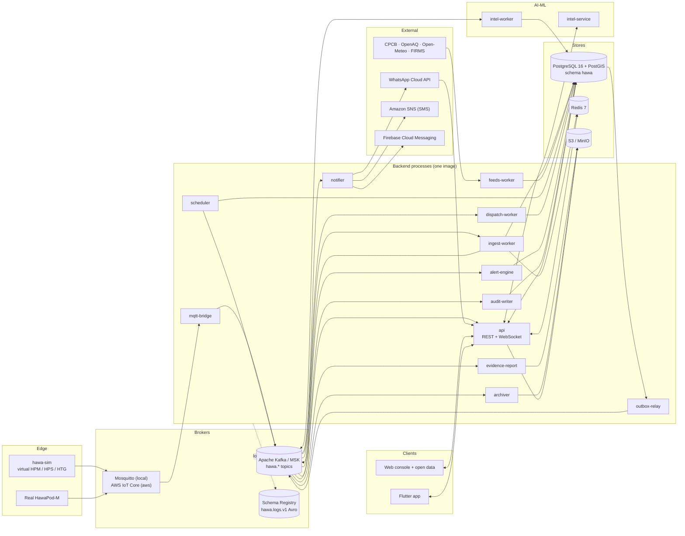
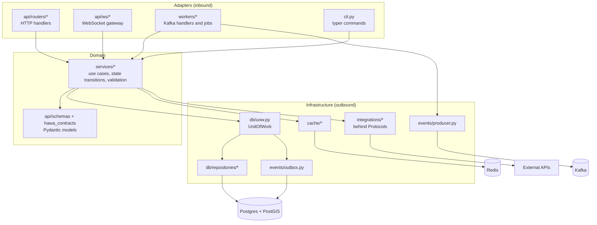
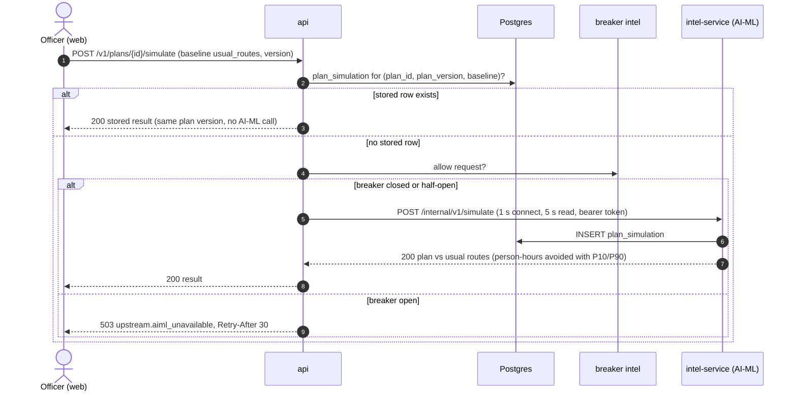
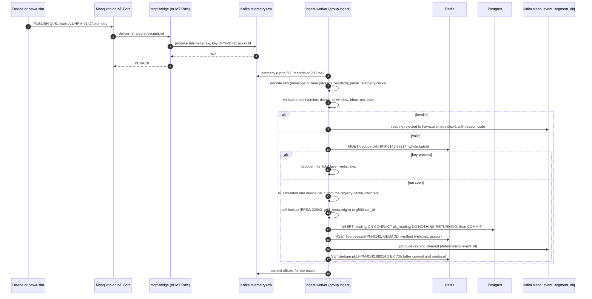
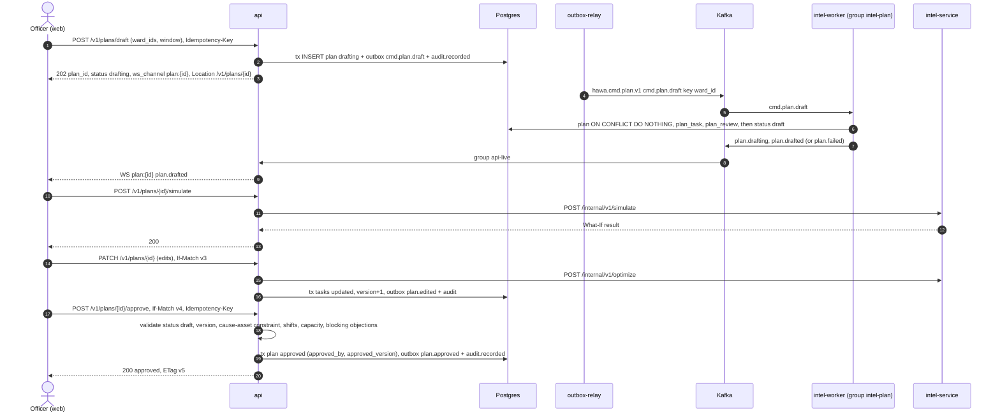
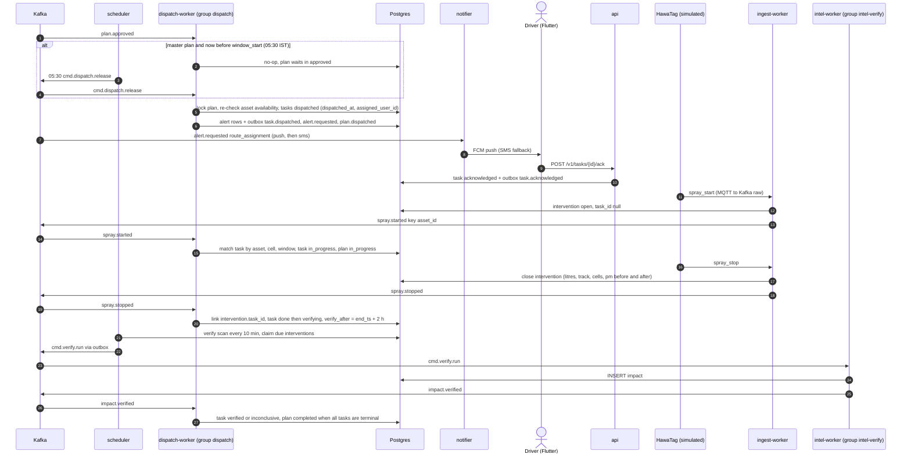
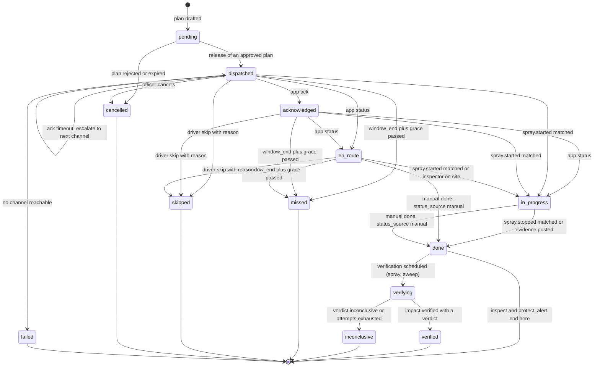
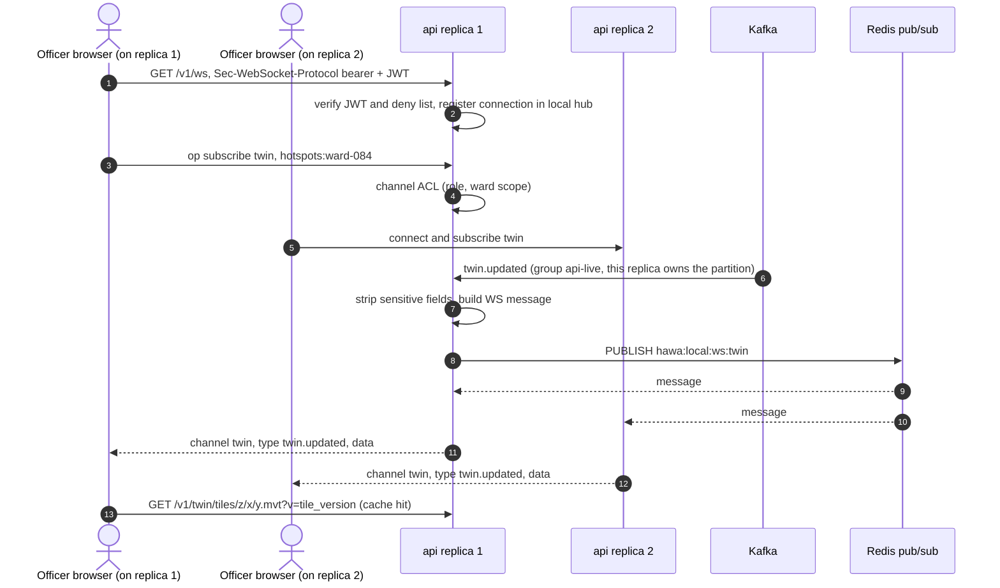
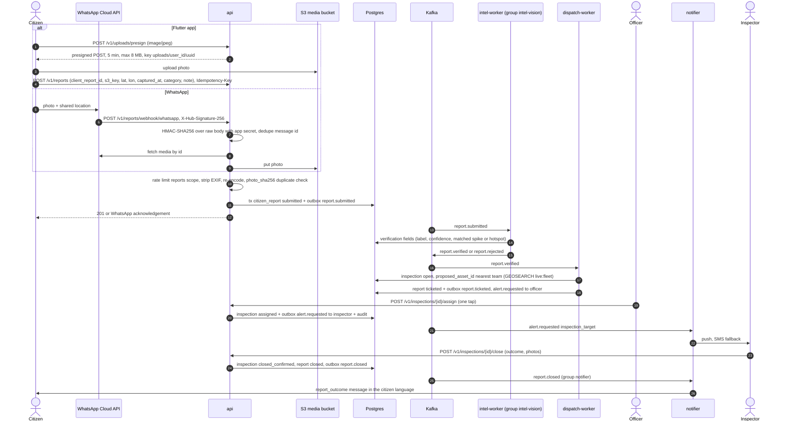
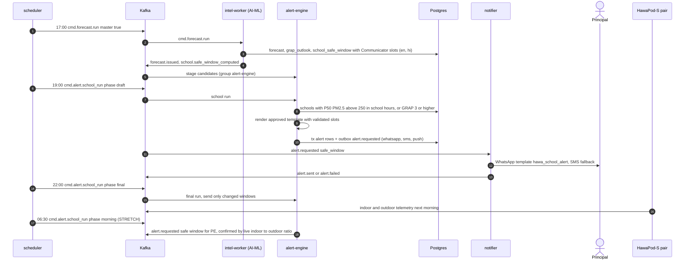

# Backend Architecture

How the backend is built: its processes, the internal layering, the key flows as sequence diagrams, and the security, resilience, performance and scaling decisions.

Related: [README](README.md) · [CONTEXT](CONTEXT.md) · [STRUCTURE](STRUCTURE.md) · [EVENTS](EVENTS.md) · [CACHING](CACHING.md) · [DATA_MODEL](DATA_MODEL.md) · [API](API.md) · [LOGGING_AND_OBSERVABILITY](LOGGING_AND_OBSERVABILITY.md) · [DEPLOYMENT](DEPLOYMENT.md) · [../CONTRACTS.md](../CONTRACTS.md) · [../SYSTEM_OVERVIEW.md](../SYSTEM_OVERVIEW.md)

---

## 1. Principles

1. **One codebase, many processes.** A single Python package `hawa_backend` and a single Docker image. `hawa api` or `hawa worker <name>` chooses the process. Every process shares the same config, logging, DB, cache and event plumbing.
2. **Kafka between loop stages; Postgres as the system of record; Redis for speed and coordination only.** No correctness property depends on Redis.
3. **At-least-once everywhere, idempotent everywhere.** Packets dedupe on `(device_id, seq)`, events on `event_id`, HTTP on `Idempotency-Key`.
4. **Transactional outbox for state changes.** A service that changes state and emits an event does both in one DB transaction ([EVENTS.md](EVENTS.md) §6). The only exception is the ingest hot path, which uses deterministic event ids instead ([EVENTS.md](EVENTS.md) §3.4).
5. **Async end to end.** asyncio, uvloop, asyncpg, redis-py asyncio, aiokafka, httpx, aiomqtt. Blocking or CPU-heavy work (boto3, WeasyPrint, Pillow) runs in `asyncio.to_thread` or a bounded process pool.
6. **The human gate is code, not convention.** Tasks only become `dispatched` from a plan whose status is `approved`. The transition function refuses anything else, and there is a unit test that proves it.
7. **The honesty rule is data.** `is_simulated` comes from the registry and flows through every table, event, response and WebSocket message ([CONTEXT.md](CONTEXT.md) §6).

## 2. Processes

### 2.1 Catalogue

| Process | Entry point | Consumer groups (topics) | Produces | DB writes | Scale unit | Ops port |
|---|---|---|---|---|---|---|
| `api` | `hawa api` | `api-live` (clean, device.event, intervention.segment, twin, hotspot, forecast, plan, task, impact, report, integrity, alert.requested), `api-cache` (twin, hotspot, forecast, impact), `api-alert-status` (alert.delivery) | via outbox: `cmd.plan.draft`, `plan.edited/approved/rejected`, `task.*` from the app, `alert.requested`, `report.submitted/closed`, `cmd.evidence_report.build`, `audit.recorded` | `plan` (inserts the `drafting` header on request, DATA_MODEL §20.4; every post-draft transition), plan_task status, manual `intervention` (API.md §7), alert, citizen_report, inspection, app_user, tokens, school, site, device (registry), outbox | HTTP load; stateless | 8000 |
| `ingest-worker` | `hawa worker ingest` | `ingest` (telemetry.raw), `ingest-calibration` (external.observation) | direct: `reading.cleaned`, `reading.rejected`, `device.*`, `spray.started/stopped` | reading, device_event, intervention (HawaTag open/close), device.last_seen, calibration_pair (PCA-15) | raw partitions | 9100 |
| `feeds-worker` | `hawa worker feeds` | none | via outbox: `reference.observed`, `weather.observed/forecasted`, `fire.detected` | reference_station, reference_observation, weather_*, fire_point | 1 replica | 9100 |
| `scheduler` | `hawa worker scheduler` | none | direct: `hawa.cmd.*`; via outbox: `cmd.verify.run` | intervention.verify_* (verify scan, PCA-16) | 1 active per job via `lock:sched:{job}` | 9100 |
| `dispatch-worker` | `hawa worker dispatch` | `dispatch` (plan.lifecycle, task.lifecycle PCA-06, intervention.segment, impact.verified, report.lifecycle, cmd.dispatch PCA-03) | via outbox: `plan.dispatched/in_progress/completed/partially_completed/expired/failed` (drafting timeout), `task.*`, `alert.requested`, `report.ticketed`, `cmd.verify.run` | plan, plan_task, intervention (task link, verify_after, verification_status, gps_inferred), inspection, alert | plan partitions | 9100 |
| `notifier` | `hawa worker notifier` | `notifier` (alert.requested, task.lifecycle, report.lifecycle) | via outbox: `alert.sent/failed/delivered` | alert_delivery | alert partitions; per-channel semaphores | 9100 |
| `outbox-relay` | `hawa worker outbox-relay` | none | everything in `outbox_event` | outbox_event.published_at | 1 replica (sharded for N) | 9100 |
| `mqtt-bridge` | `hawa worker mqtt-bridge` | none | direct: `hawa.telemetry.raw.v1` | none | 1 (shared subscription for HA) | 9100 |
| `audit-writer` | `hawa worker audit-writer` | `audit-writer` (hawa.audit.v1), `audit` (plan, task, integrity) | none | audit_log (INSERT only) | 1 | 9100 |
| `alert-engine` | `hawa worker alert-engine` | `alert-engine` (hotspot, forecast, cmd.alert PCA-04), `device-health` (device.event, PCA-26) | via outbox: `alert.requested` | alert, device.status, device.trust_score, device.cal_* + calibration_version (applying `device.calibrated`, DATA_MODEL §5.1) | 1 | 9100 |
| `evidence-report` | `hawa worker evidence-report` | `evidence-report` (cmd.report) | via outbox: `audit.recorded` | evidence_report | 1 | 9100 |
| `archiver` | `hawa worker archiver` | `archiver` (telemetry.clean, cmd.maintenance PCA-05) | none | runs `hawa partitions` (DATA_MODEL §14.3: create, archive with a verified manifest, drop, row retention) using the owner login; optional streaming Parquet of clean readings | 1 | 9100 |
| `simulator` | `hawa-sim run` | none (MQTT publisher; uses the REST API as simulated drivers) | MQTT packets | none (registers devices via seed) | N virtual devices | 9100 |

AI-ML processes (`intel-service`, `intel-worker`, `trainer`) are specified in [../aiml/ARCHITECTURE.md](../aiml/ARCHITECTURE.md). They own the `intel-*` consumer groups.

### 2.2 Component diagram



## 3. Internal layering

### 3.1 Layers and dependency rule



Rules (enforced by review and by ruff `TID` banned imports, see [STRUCTURE.md](STRUCTURE.md) §3):

| Layer | May import | Must not import |
|---|---|---|
| `api/routers`, `api/ws` | `services`, `api/schemas`, `api/deps`, `core` | `db.models`, `db.repositories`, `integrations`, `sqlalchemy` |
| `workers/*` | `services`, `events`, `core`, `hawa_contracts` | `api/*` |
| `services` | `db.uow`, `cache`, `integrations` (Protocols only), `core`, `hawa_contracts` | `fastapi`, `api/*`, `aiokafka` |
| `db.repositories` | `db.models`, `db.spatial`, `sqlalchemy`, `geoalchemy2` | `services`, `cache` |
| `integrations` | `httpx`, `boto3`, `firebase_admin`, `core` | `db`, `services` |

Repositories return ORM entities or small dataclasses. Services return Pydantic schemas or domain dataclasses. Routers never see a SQLAlchemy object.

### 3.2 Dependency injection

`hawa_backend/bootstrap.py` builds one `Container` per process: settings, engine and sessionmaker, Redis client, Kafka producer, integrations, clock and metrics. FastAPI's lifespan stores it on `app.state.container`; workers receive it in their constructor. FastAPI `Depends` resolves request-scoped objects from it.

```python
# api/deps.py (sketch)
def container(request: Request) -> Container:
    return request.app.state.container

async def current_principal(
    request: Request,
    verifier: TokenVerifier = Depends(get_verifier),          # LocalJwtVerifier | CognitoJwtVerifier (API.md §2.3)
) -> Principal:
    principal = await verifier.verify(bearer_token(request))
    ctx.current().bind_principal(principal)                    # user_id / role into log context
    return principal

def require_roles(*roles: UserRole) -> Callable[..., Awaitable[Principal]]:
    async def _dep(p: Principal = Depends(current_principal)) -> Principal:
        if p.role not in roles:
            raise HawaError("forbidden", 403)
        return p
    return _dep

def get_plan_service(c: Container = Depends(container)) -> PlanService:
    return PlanService(uow_factory=c.uow_factory, intel=c.intel, clock=c.clock, cache=c.cache)

# api/routers/plans.py
@router.post("/{plan_id}/approve", response_model=PlanOut)
async def approve(
    plan_id: UUID,
    body: ApproveIn,                                            # {version?, comment?, override_reason?}
    expected_version: int = Depends(if_match_or_body_version),  # If-Match "v3" or body.version, else 428
    principal: Principal = Depends(require_roles(UserRole.officer, UserRole.admin)),
    _idem: None = Depends(idempotency("plans.approve")),      # CACHING.md §9
    svc: PlanService = Depends(get_plan_service),
) -> PlanOut:
    return await svc.approve(plan_id, expected_version, body, principal)
```

```python
# services/plan_service.py (sketch; the conditional-UPDATE repository is in DATA_MODEL.md §16.6)
async def approve(self, plan_id: UUID, expected_version: int, body: ApproveIn, p: Principal) -> PlanOut:
    async with self._uow() as uow:
        plan = await uow.plans.get_for_update(plan_id, scope=p.scope)   # SELECT ... FOR UPDATE, ward-scoped
        plan.require_status(PlanStatus.draft).require_version(expected_version)   # plan.not_draft / plan.version_conflict
        violations = constraints.check(plan, await uow.assets.for_plan(plan))  # cause->asset, shifts, capacity
        if violations:
            raise HawaError("plan.constraint_violation", 422, errors=violations)
        plan.approve(by=p.sub, at=self._clock.now(), approved_version=expected_version)
        uow.outbox.add(topics.PLAN_LIFECYCLE, key=str(plan.id), event=PlanApproved.from_plan(plan))
        uow.outbox.add(topics.AUDIT, key=str(p.sub), event=AuditRecorded.approve(plan, p))
        await uow.commit()
    await self._cache.invalidate_plan(plan_id)                 # version bump; see CACHING.md §3
    return PlanOut.from_model(plan)
```

Tests replace any Protocol with a fake (`integrations/fakes.py`) and the clock with `FrozenClock`, with no monkeypatching.

### 3.3 Async rules

- One event loop per process, uvloop enabled. No `time.sleep`, no `requests`, no sync DB drivers (ruff `ASYNC` rules plus banned imports).
- boto3 (S3 presign is pure CPU, but `put_object` does I/O) runs through `asyncio.to_thread` with a dedicated `ThreadPoolExecutor(max_workers=8)` bulkhead. WeasyPrint rendering runs in a `ProcessPoolExecutor(max_workers=1)` in `evidence-report`.
- Every outbound call has a timeout. Every `asyncio.create_task` is owned by a `TaskGroup` or a supervisor that logs and restarts it. Fire-and-forget tasks are banned.
- Pyproj transformers are created once per process (thread-safe with `always_xy=True`) and reused for cell lookup.

### 3.4 Integrations behind interfaces

```python
# integrations/base.py (sketch)
class SmsSender(Protocol):
    async def send(self, to_e164: str, body: str, *, template_id: str | None, lang: str) -> ProviderResult: ...

class WhatsAppClient(Protocol):
    async def send_template(self, to_e164: str, template: str, lang: str, params: list[str]) -> ProviderResult: ...
    async def download_media(self, media_id: str) -> bytes: ...

class PushSender(Protocol):
    async def send(self, token: str, title: str, body: str, data: Mapping[str, str]) -> ProviderResult: ...

class ObjectStore(Protocol):
    async def presign_post(self, key: str, content_types: Sequence[str], max_bytes: int, ttl_s: int) -> PresignedPost: ...
    async def put(self, key: str, data: bytes, content_type: str) -> None: ...
    async def presign_get(self, key: str, ttl_s: int) -> str: ...

class IntelClient(Protocol):
    async def simulate(self, plan_id: UUID, plan_version: int, baseline: str) -> SimulationResult: ...
    async def optimize(self, plan_id: UUID, edits: PlanEdits) -> OptimizeResult: ...
    async def exposure(self, cell_ids: Sequence[str], start: datetime, end: datetime) -> ExposureResult: ...
    async def narrative(self, report_input: EvidenceInput) -> Narrative: ...   # PCA-18
```

Each has a real implementation (`sns.py`, `whatsapp.py`, `fcm.py`, `s3.py`, `intel_client.py`), a `log` implementation for local runs (writes a masked line instead of sending), and a fake for tests. Settings choose the implementation (`HAWA_NOTIFY_SMS_PROVIDER=log|sns` and similar).

## 4. Calls to the AI-ML intel-service

The API calls intel-service synchronously only for the endpoints in [CONTRACTS §7](../CONTRACTS.md#7-internal-ai-ml-service-surface). All asynchronous work goes through `hawa.cmd.*`.

| API endpoint | Intel call | Timeouts (connect / read) | Retry | Breaker | Fallback |
|---|---|---|---|---|---|
| `POST /v1/plans/{id}/simulate` | `POST /internal/v1/simulate` (only when no `plan_simulation` row exists for `(plan_id, plan_version, baseline)`) | 1 s / 5 s | 1 retry on connect error only | `intel` | Breaker open or connection refused → `503 upstream.aiml_unavailable` + `Retry-After: 30`; timeout → `504 upstream.timeout` (API.md §1.5) |
| `PATCH /v1/plans/{id}` (edits) | `POST /internal/v1/optimize` | 1 s / 8 s | none | `intel` | Accept edits that pass the hard constraints without re-optimising, and warn in the response that the ETAs were not recomputed |
| `GET /v1/cells/{id}` (exposure panel) | `POST /internal/v1/exposure` | 1 s / 1.5 s | none | `intel` | Omit the exposure block (`exposure: null`, `reason: "unavailable"`) |
| evidence-report worker | **Proposed contract addition (PCA-18):** `POST /internal/v1/narrative` | 1 s / 60 s | 2 with backoff | `intel-narrative` | Template-only narrative, labelled "auto-generated without narrative" |

`integrations/intel_client.py` builds one `httpx.AsyncClient` with `base_url=HAWA_INTEL_URL`, `Authorization: Bearer ${HAWA_INTERNAL_TOKEN}`, HTTP/1.1 keep-alive, `limits=Limits(max_connections=16, max_keepalive_connections=8)`, and propagates `X-Request-Id`, `X-Correlation-Id` and `traceparent`. A semaphore (8 in flight per replica) is the bulkhead that keeps a slow intel-service from exhausting API workers.



Breaker policy (`core/resilience.py`, in-house, around 100 lines): open after 5 consecutive failures, or ≥ 50 % failures over the last 20 calls within 30 s. Stay open for 30 s, then allow 1 half-open probe. State is exported as `hawa_circuit_breaker_state{target}`.

## 5. Key flows

### 5.1 Telemetry ingest



Steps in detail:

1. **Decode.** `hawa.telemetry.raw.v1` carries either the JSON envelope from `mqtt-bridge` or a bare packet with headers from the AWS IoT Rule (**Proposed contract addition PCA-02**, [EVENTS.md](EVENTS.md) §3.3). The MQTT topic suffix picks the model: `telemetry` → `TelemetryPacket`, `event` → `DeviceEventPacket`, `spray` → `SprayPacket`, `clip` → `ClipPacket`.
2. **Validate** with the rules and reason codes in [CONTRACTS §4.1](../CONTRACTS.md#41-telemetrypacket-exactly-106-plus-optional-role-fields). The device registry is cached in process. It refreshes every 60 s, and immediately when a message arrives on the Redis pub/sub channel `hawa:{env}:inv:device`, which the api (device registration) and the `device-health` group publish on registry changes. An unknown device is rejected with `unknown_device`. A rejection never sets the dedupe key, so a replay after the device is registered succeeds.
3. **Dedupe** follows [DATA_MODEL.md](DATA_MODEL.md) §14.2: a batch `MGET` of `dedupe:pkt:*` keys, then the insert and commit, then the publish, then `SET … EX 262800`. The key is marked only after success, so a failed insert is never mistaken for a duplicate. The durable guarantee is `pk_reading PRIMARY KEY (device_id, seq, ts)`. Postgres requires the partition key in unique constraints, so CONTRACTS' "unique `(device_id, seq)`" becomes `(device_id, seq, ts)` in the DB. Replays keep the original `ts`, so the two are equivalent for real duplicates (**PCA-12**, a CONTRACTS wording change; DATA_MODEL already adopts it). Crash window: if the worker dies after the commit but before the publish, the redelivered packets conflict on insert. For conflicting rows whose `received_at` is less than 15 min old, ingest re-publishes `reading.cleaned`. The deterministic `event_id` (PCA-11) makes that republish harmless downstream. Older conflicts are skipped.
4. **Calibrate.** `pm25 = a·pm25_raw + b·rh + c` with the device's current coefficients `device.cal_slope/cal_rh_coef/cal_offset`, and `cal_coeffs` for the other pollutants (§9.4 F3, [DATA_MODEL.md](DATA_MODEL.md) §5.1), read from the in-process registry cache. The `device-health` consumer applies each `device.calibrated` event to those columns and publishes `inv:device`, so a new calibration is live within seconds. Version 0 is the factory identity. The reading stores raw and calibrated values plus `calibration_version`.
5. **Weight.** `weight = trust_score × f_speed × f_flags` with coefficients in `config/reading_weights.yaml` (AI-ML may tune them): `high_speed` → ×0.3, `warming_up` → ×0.5, `gps_no_fix` → ×0, `hdop > 3` → ×0.5.
6. **Cell lookup.** Project with pyproj to EPSG:32643. `row = floor((y − origin_y)/500)`, `col = floor((x − origin_x)/500)` from `grid_meta`. The result is `g500-{row:03d}-{col:03d}` if the cell exists (in-memory set), else `cell_id = null`. Sentinels (role `S`) use the registry location.
7. **Store.** Batched `INSERT ... ON CONFLICT DO NOTHING RETURNING` for up to 500 rows per statement. `device.last_seen` is updated at most once per device per batch.
8. **Live state.** `HSET live:device:{id}` (last packet summary, TTL 1 h). `GEOADD live:fleet` for vehicles and assets ([CACHING.md](CACHING.md) §12).
9. **Publish** `reading.cleaned` to `hawa.telemetry.clean.v1` keyed by `device_id`, with a deterministic UUIDv7 `event_id` derived from `(device_id, seq, "reading.cleaned")` (**PCA-11**). Then commit offsets.
10. **Events.** `device_event.raw` → `device_event` row + `device.spike|tamper|health|boot` on `hawa.device.event.v1`. For spikes, ingest double-checks that `peak ≥ 3 × baseline` against the device's recent readings in `live:device`. It stores the result in `device_event.confirmed_by_cloud` ([DATA_MODEL.md](DATA_MODEL.md) §5.4) and publishes it as **`data.confirmed_by_cloud: bool`** (**Proposed contract addition PCA-19**). Spikes older than 10 min (replays) are published with `data.late=true`, so no stale alert fires.
11. **Spray.** `spray_start` → an `intervention` row (open, `end_ts` null, `source=hawatag`, `evidence_level=high`, `task_id=null`, unique `segment_id`) + `spray.started`. `spray_stop` with the same `segment_id` closes the row with `end_ts`, `litres`, `geom_track` (a LineString built from the tag's telemetry between start and stop), `cell_ids`, `primary_cell_id`, and the before/after PM from the start and stop packets. Then `spray.stopped`. Ingest double-checks the detection rule (flow > 5 lpm and pump > 2 A for ≥ 10 s, [CONTRACTS §10.3](../CONTRACTS.md#103-thresholds-used-across-services)) against the tag telemetry. A segment that fails it is kept with flag `spray_unconfirmed` (`intervention.flags`, PCA-16) and is not auto-matched to a task. A start without a stop is closed after 2 h by the dispatch sweep with flag `stop_inferred`.
12. **Drive-by pairing (group `ingest-calibration`).** On each `reference.observed`, select the readings from `role=M` devices within 200 m of the station whose `speed_kmh < 10` inside the observation interval, aggregate them per minute, and insert them into **`calibration_pair`** (**Proposed contract addition PCA-15**: `device_id, station_id, minute_ts, pm25_raw, pm10_raw, rh, t, ref_pm25, ref_pm10, distance_m, speed_kmh, is_simulated`). AI-ML applies the wind (≤ 3 m/s) and count (≥ 20 points) conditions when it fits.

### 5.2 Plan draft → approve → dispatch saga

Draft and approval:



Dispatch, spray and verification:



Task state machine as the dispatch saga drives it ([CONTRACTS §3](../CONTRACTS.md#3-enums) `TaskStatus`). Timeouts are evaluated by the every-minute `cmd.dispatch.sweep` (PCA-03, PCA-09):



| Wait | Timeout | On timeout | Setting |
|---|---|---|---|
| Plan `drafting` | 10 min (API.md §6.1) | `plan.failed` (`failure_reason=timeout`) | — |
| Plan `draft` awaiting approval | `plan.expires_at` (first task window start) | `plan.expired`, tasks `cancelled` | — |
| Plan `approved` awaiting release | master: `plan.window_start` (05:30 IST); `replan`, `spike`, `manual`: immediately | release | `HAWA_MASTER_RELEASE_TIME` |
| Task `dispatched` awaiting ack | 15 min per escalation step from `plan_task.dispatched_at`; the step count comes from the task's `alert_delivery` rows | re-notify on the next channel (push → WhatsApp → SMS); after the 3rd step, alert the ward officer; status unchanged | `HAWA_DISPATCH_ACK_TIMEOUT_MIN` |
| Task awaiting spray | `plan_task.window_end` + 30 min grace | `task.missed` + officer alert | `HAWA_DISPATCH_SPRAY_GRACE_MIN` |
| Spray started awaiting stop | 2 h | close the segment from the last tag telemetry, flag `stop_inferred`, task `done` | `HAWA_SPRAY_MAX_OPEN_MIN` |
| Task `verifying` awaiting impact | `verify_after` + 3 attempts, 1 h apart | `task.inconclusive` (reason `verification_timeout`), `intervention.verification_status = inconclusive` | `HAWA_VERIFY_DELAY_MIN`, `HAWA_VERIFY_MAX_ATTEMPTS` |

**Spray ↔ task matching** (`workers/dispatch/matching.py`). A segment matches a task when all of these hold:
- `segment.asset_id = task.asset_id`
- `task.status ∈ {dispatched, acknowledged, en_route, in_progress}` (index `ix_plan_task_open_by_asset`, DATA_MODEL §8.4)
- the segment track passes within 250 m of the task's 500 m cell or its `target_geom`
- `segment.start_ts ∈ [task.window_start − 30 min, task.window_end + grace]`

Ties go to the earliest pending task by `stop_order`. An unmatched segment stays an **unplanned intervention** (`task_id = null`). It is still scheduled for verification, so the effectiveness library learns from it. The sweep re-tries matching for unlinked segments from the last 2 h, which covers a spray reported before its task was released.

**Manual fallback** follows [API.md](API.md) §7. `POST /v1/tasks/{id}/status` with `status=done`:
- The **api** sets `status_source = manual` and creates an `intervention` with `source=manual`, `evidence_level=low` and `verify_after`, in the same transaction.
- It then emits `task.done` (api producer).
- If a HawaTag segment already matched the task, the manual report is stored only as a note.

The `dispatch` group consumes app-originated `hawa.task.lifecycle.v1` events (envelope `source="api"`, **PCA-06**). It uses them to roll plan status up (`in_progress`, `completed`, `partially_completed`), to move `done` tasks to `verifying`, and to stop escalations. **Conflict for the lead:** CONTRACTS §8 lists `intervention` writers as ingest-worker and dispatch-worker, and DATA_MODEL §9.1 names the dispatch-worker for manual rows, but API.md §7 has the api write them. This design follows API.md, so CONTRACTS §8 needs "api (manual)" added.

**Saga state** is derived from `plan.status`, `plan_task.status` and the timestamps DATA_MODEL already has (`plan.expires_at`, `plan_task.dispatched_at`, `acknowledged_at`, `window_start/end`, `status_source`). This is the "derive from statuses" alternative DATA_MODEL §20.3 names instead of a `dispatch_saga` table. The only extra columns needed are **PCA-16**: `intervention.verify_requested_at`, `intervention.verify_attempts` and `intervention.flags` (`spray_unconfirmed`, `stop_inferred`), alongside DATA_MODEL's `verify_after` and `verification_status`.

### 5.3 WebSocket live-update path



- Every api replica joins the same consumer group, so each Kafka event reaches exactly one replica. That replica publishes to Redis `ws:{channel}` (full key `hawa:{env}:ws:{channel}`). Every replica `PSUBSCRIBE`s `hawa:{env}:ws:*` and delivers the message to its local subscribers.
- Per-user channels (`tasks:me`, `alerts:me`) fan out on the internal channel `ws:user:{user_id}` (**PCA-13**). api-live resolves the recipients: a task event goes to `plan_task.assigned_user_id` (set at dispatch from `asset_shift`, DATA_MODEL §8.4), and an alert goes to `alert.recipient_user_id`.
- `fleet` is throttled to 1 Hz. api-live accumulates position changes from `reading.cleaned` (TAG and vehicles) and publishes one `fleet.positions` batch per second.
- `api-live` uses `auto_offset_reset=latest` and drops events older than 60 s (stale after a restart); clients refetch state over REST after a reconnect.
- Client ops are rate-limited to 20 messages/s per connection (API.md §1.9). Each connection has a bounded send queue of 100 messages. `twin` and `fleet` are coalesced (only the latest is kept). If other channels overflow, the connection is closed with 1013 and the client reconnects and refetches. Server ping every 25 s (the ALB idle timeout is 60 s).
- When the Redis subscription drops, a replica sends `{"type":"resync"}` to its clients on recovery. When Redis publish fails, the replica delivers to its local hub only (single-replica fallback, [CACHING.md](CACHING.md) §14).

### 5.4 Citizen Eyes (Flow D, F20)



- **Approval gate.** Inspectors are never dispatched without an officer action. The dispatch-worker only proposes the nearest available `inspection_team` (live position from `live:fleet` during shift, otherwise the depot). **Proposed contract addition (PCA-17):** `inspection.proposed_asset_id` and `POST /v1/inspections/{id}/assign`. If API.md chooses a different approval endpoint, API.md wins. For the §8.2 spike path, the same inspection can instead be assigned through an approved `spike` plan's `inspect` task (the inspection stores `task_id`).
- **WhatsApp webhook.** `GET` verification echoes `hub.challenge` when `hub.verify_token` matches. `POST` computes `sha256=` + HMAC-SHA256(app_secret, raw_body), compares it with `hmac.compare_digest` **before** parsing JSON, and returns 200 quickly. Dedupe on the WhatsApp message id is durable through `citizen_report.external_ref` UNIQUE (DATA_MODEL §11.1), with `dedupe:evt:wa-webhook:{wamid}` (24 h) as the fast path. The same webhook receives delivery `statuses[]` for outbound alerts. The api looks them up by `alert_delivery.provider_message_id` and emits `alert.delivered` / `alert.read` (**PCA-07**).
- **Photo handling.** The allowed types are JPEG, PNG and HEIC/WebP, up to 8 MB. Keys follow DATA_MODEL §11.1 (`uploads/report_photo/yyyy/mm/dd/<uuid>.jpg`). EXIF is read for `captured_at` and GPS (used only if the report has no location), then stripped. `photo_sha256` detects duplicates (`409 report.duplicate_photo`). Officers see only the redacted copy (`photo_redacted_key`). Photos are served only through presigned GET URLs valid for 5 min, and retention follows DATA_MODEL §19.1.

### 5.5 School alert (Flow C, F16 + F19)



- The trigger rule comes from [CONTRACTS §10.3](../CONTRACTS.md#103-thresholds-used-across-services): forecast P50 PM2.5 > 250 µg/m³ in school hours, or GRAP ≥ 3.
- **LLM text never goes out raw.** The Communicator (AI-ML) fills structured slots: `pollutant`, `peak_window`, `safe_windows[]`, `advice_code`, `seal_or_ventilate`. The alert-engine validates the slots (enum values, times inside the day, windows not overlapping the peak) and renders them into pre-approved Jinja2 templates (`config/alert_templates/{lang}/safe_window.{channel}.j2`) that match the registered WhatsApp templates. Protective alerts under this rule are sent automatically, as the schedule requires. The approval gate covers fleet and inspector dispatch. An officer can mute a ward's automatic school alerts with a per-ward switch in the console, which the alert-engine checks before every run.
- `alert.requested` channels are an ordered fallback chain. **Proposed contract addition (PCA-20):** `data.delivery = "first_success" | "all"` (default `first_success`). Schools use `first_success` over `[whatsapp, sms]` and always add `in_app`.
- Each alert goes to each school contact once per phase. The idempotency key is `(school_id, date, phase)`, enforced by a unique index on `alert` (DATA_MODEL.md).

### 5.6 Feeds and other flows (summary)

| Flow | Path |
|---|---|
| CPCB / OpenAQ every 15 min | feeds-worker job → `integrations/cpcb.py`, `openaq.py` (tenacity + breaker) → upsert `reference_observation` (unique on station + ts) + outbox `reference.observed` → `ingest-calibration`, `intel-twin` |
| Weather hourly | Open-Meteo (current + 72 h hourly forecast on a 0.1° grid over NCR) → `weather_observation` / `weather_forecast` + outbox `weather.*` |
| FIRMS every 3 h | VIIRS/MODIS NRT CSV for the NCR bbox and upwind Punjab/Haryana → `fire_point` + outbox `fire.detected` (keyed by `tile_id`) |
| Integrity flag | intel-worker `integrity.flagged` → api-live (WS) + `audit` group |
| Device health | `device.tamper`, `device.health` → `device-health` group → `device.status = degraded` + officer alert (`device_health`); `device.trust_changed` → `device.trust_score` |
| Evidence report | Monday 07:00 `cmd.evidence_report.build` → evidence-report aggregates hotspots, sources, actions, impact per rupee → narrative (PCA-18) → WeasyPrint PDF → S3 `reports/{yyyy}/{week}.pdf` → `evidence_report` row |

## 6. Auth and RBAC overview

Full detail lives in [API.md](API.md). The architectural decisions are:

| Aspect | Decision |
|---|---|
| Identity | Officers, admins and analysts use email + password (argon2id). Drivers, inspectors, school contacts, site managers and citizens use phone OTP (6 digits, 5 min, hashed in Redis, [CACHING.md](CACHING.md) §8). |
| Tokens | Access JWT, RS256 with `kid`, 15 min, plus an opaque rotating refresh token (`rt_…`, stored as SHA-256 in `refresh_token`, family reuse detection). The verifier can be swapped for Cognito (`HAWA_AUTH_VERIFIER=local\|cognito`). Claims (API.md §2.2): `iss=hawa-api`, `aud=hawa`, `typ`, `sub`, `role`, `wards`, `asset_ids`, `school_id`, `site_id`, `jti`, `iat`, `exp`. |
| Revocation | Logout and admin disable write `jwt:deny:{jti}` for the rest of the token lifetime and revoke the refresh family in Postgres. If Redis is down, the deny-list check fails closed for writes and open for reads (`HAWA_DENYLIST_FAIL_OPEN_READS`, API.md §2.5). |
| Roles | `admin`, `officer`, `analyst`, `inspector`, `driver`, `school`, `site_manager`, `citizen`, plus `public` (anonymous) and `service` (machine-to-machine) ([CONTRACTS §3](../CONTRACTS.md#3-enums)). |
| Ward scoping | `user_ward_scope` rows become the `wards` claim (`["*"]` for admin). Every ward-bearing query takes a `Scope` from `deps`, and repositories add the ward filter (`ward_ids && :wards` for plans). An explicit `?ward=` outside the scope → `403 forbidden.ward_scope`. A single object outside the scope → `404 not_found` (no existence leak). The twin map, tiles, forecast grid and GRAP outlook are city-wide. |
| Officer vs field | Officers read and act on their wards' hotspots, plans, inspections and alerts. Drivers see tasks for `asset_ids` (from their `asset_shift`) or assigned to them. Inspectors see their assigned targets. Schools see their own school. Site managers see their own sites. Citizens see their own reports and alerts. Writes re-check `asset_shift` in the DB (API.md §2.4). |
| WebSocket | Same JWT (`Sec-WebSocket-Protocol: bearer, <JWT>` or `?token=`). Channel ACL at subscribe time. A token expiring during a session closes the socket with 4401, and the client reconnects with a fresh token. |
| Service tokens | `HAWA_INTERNAL_TOKEN` for api → intel-service. Rotation accepts current + next ([DEPLOYMENT.md](DEPLOYMENT.md) §11). |

## 7. Security

| Control | Implementation |
|---|---|
| Input validation | Pydantic v2 strict models on every body, query and path parameter (twin bbox ≤ 400 km², tile `z` 8–16, `limit ≤ 200`, ids matched by the regexes in `hawa_contracts.ids`). `extra="forbid"` on request models. Packets validated by `hawa_contracts.packets`. Error codes come from the API.md §1.5 catalogue. |
| Body limits | 1 MB JSON bodies (pure ASGI middleware). Media never goes through the API except the WhatsApp media fetch (8 MB cap, streamed). |
| SQL | SQLAlchemy Core/ORM with bound parameters only. Raw SQL (tiles, partitions) uses `text()` with bind parameters. Identifiers in partition DDL are validated against `^reading_p\d{8}$`. |
| Rate limits | Redis sliding window with the scopes of API.md §1.9 ([CACHING.md](CACHING.md) §7): open data 60 req/min/IP, OTP request 3 per 15 min per phone (30 s cooldown), OTP verify 5 attempts per code, login 10 per 15 min per IP and per email, report submit 10/hour/user. |
| Webhooks | WhatsApp `X-Hub-Signature-256` verified on raw bytes in constant time. Requests with a bad or missing signature get 401 and a WARNING log with no body. |
| Uploads | Presigned **POST** with policy conditions (`content-length-range` 1 B–8 MB, `Content-Type` in the allow-list, key prefix `uploads/{user_id}/`) and a 5 min expiry. Server-side HEAD check before accepting a report. Buckets block public access and use SSE. |
| CORS | Allow-list from `HAWA_CORS_ORIGINS` (console and public site origins). No credentials (bearer tokens only). Allowed headers: `Authorization`, `Content-Type`, `Idempotency-Key`, `X-Request-Id`, `X-Correlation-Id`. Exposed headers: `X-Request-Id`, `X-Correlation-Id`, `Retry-After`, `RateLimit-*`, `ETag`. |
| Security headers | `Strict-Transport-Security` (behind TLS), `X-Content-Type-Options: nosniff`, `Referrer-Policy: no-referrer`, `Cache-Control: no-store` on auth responses. |
| Client IP | Uvicorn `--proxy-headers` with `--forwarded-allow-ips` set to the ALB or compose network only. Never trust a client-sent `X-Forwarded-For` directly. |
| Secrets | `.env` locally (git-ignored, `.env.example` has no real values). On AWS: Secrets Manager, injected as ECS task secrets. Never in images, logs or Kafka. |
| Least privilege | DB roles per [DATA_MODEL.md](DATA_MODEL.md) §1.2 and §17.7: `hawa_owner` (owns everything, used through the `hawa_migrator` login), `app_rw` (DML on backend-owned tables, INSERT/SELECT only on `audit_log`), `ml_rw` (DML on AI-ML-owned tables plus column grants on split tables; triggers guard plan transitions), `readonly` (no PII columns). There is one login user per backend service (`hawa_api`, `hawa_ingest`, `hawa_feeds`, `hawa_dispatch`, `hawa_notifier`, `hawa_outbox`, `hawa_scheduler`). The grants live in Alembic revision `0010`. Per-service IAM task roles; MSK topic-level IAM (`kafka-cluster:WriteData` only on the topics a service produces). Per-device IoT policies. |
| PII | Masking helpers plus the logifyx `mask=True` safety net. Phones masked to the last 4 in API responses to non-owners. No PII in Kafka except `alert.requested.recipient`. Photos private. See [LOGGING_AND_OBSERVABILITY.md](LOGGING_AND_OBSERVABILITY.md) §9. |
| Audit | Every human and agent action becomes `audit.recorded` → `audit_log` (append-only; DB role cannot UPDATE or DELETE). |
| Dependencies | `uv lock` pinned; `pip-audit` (or `uv` audit when available) in CI; Dependabot for GitHub Actions and Docker base images. |

## 8. Resilience

| Concern | Mechanism | Defaults |
|---|---|---|
| External feeds | tenacity: retry on `httpx.TransportError`, 5xx and 429 (honouring `Retry-After`); `wait_exponential_jitter(initial=1, max=30)`; `stop_after_attempt(5) \| stop_after_delay(60)` | per-source breaker; the last observation is served with `stale_since` |
| Messaging providers | Channel fallback chain; per-channel breaker (`whatsapp`, `sns`, `fcm`); a provider 4xx is permanent (no retry), 5xx/timeouts retry 3 times | notifier concurrency: 10 per channel |
| intel-service | Timeouts, 1 retry on connect error, breaker, bulkhead semaphore, stored-result fallback (§4) | 8 in flight per replica |
| Kafka consumers | Bounded in-process retries, then `hawa.dlq.v1`; poison messages straight to DLQ ([EVENTS.md](EVENTS.md) §5) | 5 attempts, 0.2 s → 5 s |
| DB | `statement_timeout` 5 s for the api, 30 s for workers; pool `pool_pre_ping=True`; `OperationalError` treated as retryable in consumers | api pool 10 + overflow 10 per replica |
| Redis | 0.5 s socket timeout; breaker `redis`; every Redis use has a DB or in-process fallback ([CACHING.md](CACHING.md) §14) | |
| Bulkheads | Separate processes per concern; separate httpx clients per integration with their own connection limits; dedicated thread and process pools; one consumer group per concern so a slow notifier never delays ingest | |
| Backpressure | ingest `getmany(max_records=500)`; the WebSocket per-connection queue bound; outbox relay batch of 500 | |
| Graceful shutdown | On SIGTERM: `/readyz` → 503 (draining); uvicorn stops accepting (`--timeout-graceful-shutdown 20`); WebSocket clients get close 1001; consumers stop fetching, finish the in-flight batch, **commit offsets**, `consumer.stop()`; producer `flush()` + `stop()`; outbox relay finishes its batch; DB and Redis pools close; `logifyx.flush(timeout=5.0)` (then the atexit `shutdown()` runs) | ECS `stopTimeout` 30 s |
| Startup | `/readyz` stays 503 until the DB is reachable, the DB's `alembic_version` is not **behind** the image's `ALEMBIC_HEAD` (ahead is fine, by expand/contract, DATA_MODEL §17.11), Redis is reachable (degraded is allowed), and for workers the Kafka partitions are assigned | |

## 9. Performance

### 9.1 Vector tiles (`GET /v1/twin/tiles/{z}/{x}/{y}.mvt`)

The authoritative query and its indexes are in [DATA_MODEL.md](DATA_MODEL.md) §15.3, and the feature properties and headers in [API.md](API.md) §4. The shape is:

```sql
-- db/spatial.py: TILE_SQL (bind params only)
WITH bounds AS (
  SELECT ST_TileEnvelope(:z, :x, :y) AS geom_3857
),
cells AS (
  SELECT
    cs.cell_id,
    round(cs.pm25_est::numeric, 1)  AS pm25,
    round(cs.confidence::numeric, 2) AS conf,
    cs.aqi, cs.cause_label, round(cs.exposure_ph::numeric) AS exposure_ph,
    ST_AsMVTGeom(ST_Transform(c.geom, 3857), b.geom_3857, 4096, 64, true) AS geom
  FROM hawa.cell_state cs
  JOIN hawa.cell c ON c.id = cs.cell_id
  CROSS JOIN bounds b
  WHERE cs.run_id = :run_id
    AND c.geom && ST_Transform(b.geom_3857, 4326)
)
SELECT ST_AsMVT(cells.*, 'twin', 4096, 'geom') FROM cells WHERE geom IS NOT NULL;
```

- The Delhi grid has about 6,000 cells at 500 m, so the query is small. The cost is concurrency, and Redis absorbs it: `cache:tile:{tile_version}:{z}:{x}:{y}` stores gzip-compressed MVT bytes and is served with `Content-Encoding: gzip`.
- The tile URL carries `?v={tile_version}`, which the web client builds from the `twin` WebSocket message. With `v`, responses are `Cache-Control: private, max-age=86400, immutable`. Without it they are `private, max-age=60`. Both carry `ETag: "t{tile_version}"` (API.md §1.8, PCA-22, [CACHING.md](CACHING.md) §4).
- On `twin.updated`, the `api-cache` group pre-renders tiles z10–z13 over the Delhi bbox (about 100 tiles), then sets `twin:version`. Unknown tiles are filled on demand with single-flight.
- Required indexes (DATA_MODEL.md): GiST on `cell.geom`, B-tree `(run_id, cell_id)` on `cell_state`, BRIN on `reading.ts` per partition, B-tree `(device_id, ts)`.

### 9.2 General

- **Serialization.** Response models are serialised by pydantic-core. Hand-built payloads (tiles metadata, WebSocket) use orjson. GZip middleware applies to JSON > 1 KB (not to MVT, which is already compressed).
- **Pagination.** Keyset pagination on UUIDv7 ids (`WHERE id < :cursor ORDER BY id DESC LIMIT :n`). No `OFFSET`.
- **ORM.** `selectinload` for plan → tasks and plan → review. No lazy loading in async code (`lazy="raise"` on relationships).
- **asyncpg.** The prepared statement cache stays on (no pgbouncer in transaction mode). The JSON codec is orjson.
- **Server.** Uvicorn with `uvloop` + `httptools`, one worker per container (scale by containers, which keeps Prometheus out of multiprocess mode).
- **Ingest.** Batched inserts (up to 500 rows), in-process caches for registry, calibration and grid, one Redis pipeline per batch (`SET NX`, `HSET`, `GEOADD`), and one Kafka `send_batch` per partition.

Load targets for the demo tier: 200 concurrent officer and app sessions; 50 tile requests/s at p95 < 50 ms; ingest 100 packets/s sustained on one replica.

## 10. Scaling plan

| Stage | Devices | Topology | Changes from the previous stage |
|---|---|---|---|
| Hackathon (local) | 50–100 sim + 1 real | Docker Compose on one laptop: all processes, 1 replica each; Kafka 3 partitions (telemetry 6), RF 1 | — |
| Demo on AWS | same | One EC2 (m6i.xlarge class) running compose + AWS IoT Core, with `mqtt-bridge` subscribed to IoT Core over TLS (shared subscription) | Real IoT Core identities; public HTTPS via Caddy/ALB |
| Campus pilot | ~160 | CDK: ECS Fargate (api ×2, workers ×1), RDS PostgreSQL (db.t4g.medium, Multi-AZ), ElastiCache (cache.t4g.small), **MSK provisioned** kafka.t3.small ×2–3 (PCA-01), IoT Rule Kafka action → MSK (SCRAM) | mqtt-bridge retired; alarms; backups |
| MCD zone | ~1,000 | ingest ×3 (12 telemetry partitions), api ×3, RDS db.m7g.large + 1 read replica (open data, analytics), MSK kafka.m7g.large ×3 | Open data served from the read replica; CloudFront in front of `/open/v1` |
| NCR | ~10,000 | ingest ×6–12 (24 partitions), notifier ×3, api ×6, Redis cluster mode or a larger node, `reading` hot retention cut to 30 d, Parquet/Athena for history | Hash tags in Redis keys for cluster mode; `dedupe:pkt` TTL cut to 6 h (the DB is the backstop); per-ward plan sharding |

Throughput is bounded by partitions (ingest), by DB write IOPS (readings) and by provider rate limits (notifier). Each has a metric and an alert ([LOGGING_AND_OBSERVABILITY.md](LOGGING_AND_OBSERVABILITY.md) §14).

## 11. Proposed contract additions (defined here)

- **PCA-12** CONTRACTS wording: `reading` uniqueness is `(device_id, seq, ts)` (DATA_MODEL `pk_reading`).
- **PCA-15** table `calibration_pair`, written by `ingest-worker` group `ingest-calibration` (not yet in DATA_MODEL.md).
- **PCA-16** `intervention.verify_requested_at`, `intervention.verify_attempts`, `intervention.flags`. The scheduler becomes a writer of `intervention.verification_status` and the `verify_*` columns. Saga state is derived instead of stored in DATA_MODEL's optional `dispatch_saga` table.
- **PCA-17** `inspection.proposed_asset_id` + `POST /v1/inspections/{id}/assign` (API.md §13 is not written yet).
- **PCA-18** `POST /internal/v1/narrative` (AI-ML) for the evidence report.
- **PCA-19** `device.spike` data `confirmed_by_cloud: bool` (same name as the `device_event` column) and `late: bool` for replayed spikes.
- **PCA-29** writers of `intervention`: add "api (manual fallback)" to CONTRACTS §8, following API.md §7.
- **PCA-20** `alert.requested` data `delivery: "first_success" | "all"`.
- Internal cache-invalidation channel `hawa:{env}:inv:device` (pub/sub, no stored key).
- A per-ward switch that mutes automatic school alerts (§5.5). The storage (for example `ward.school_alerts_muted`) belongs in DATA_MODEL.md, and the endpoint in API.md.
