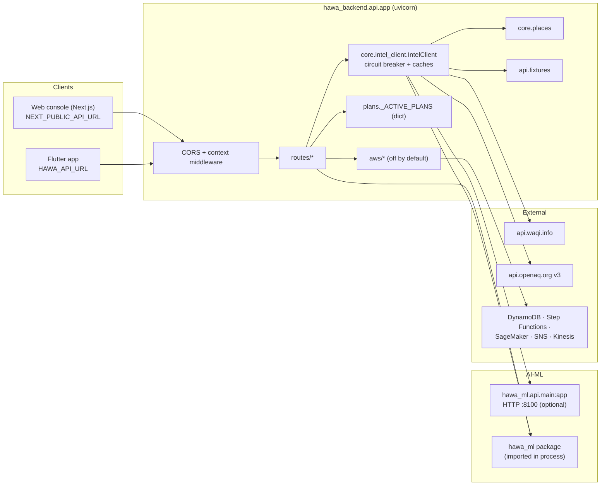
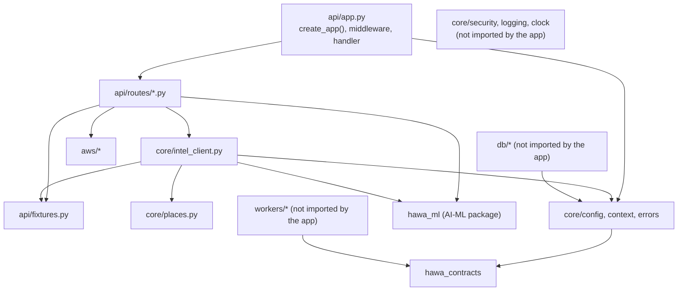
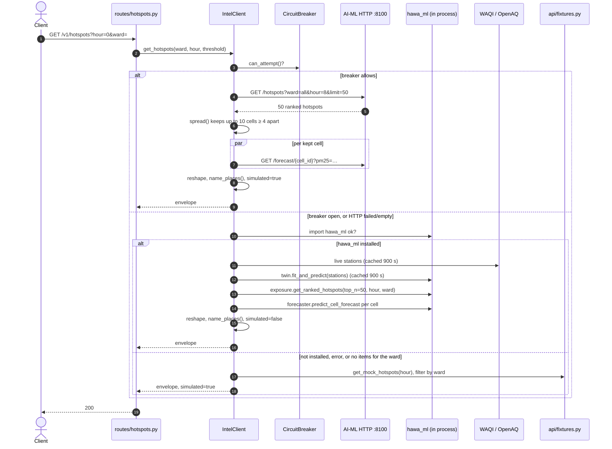
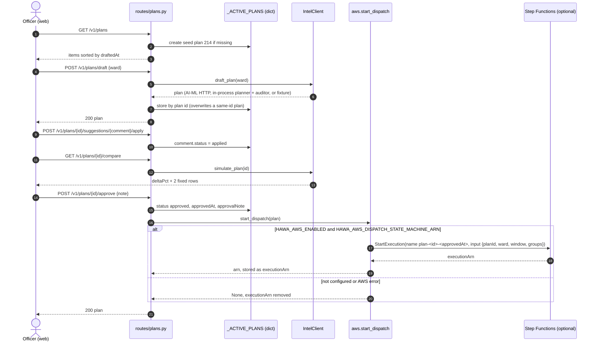

# Backend Architecture

<!-- nav:start -->

**Navigate:** [Project](../../README.md) · [Docs hub](../README.md) · [Overview](../SYSTEM_OVERVIEW.md) · [AWS architecture](../AWS_ARCHITECTURE.md) · [AWS setup](../AWS_SETUP_GUIDE.md) · [API](API.md) · [Environment](../ENVIRONMENT_VARIABLES.md) · [Contracts](../CONTRACTS.md)

**Backend docs:** [Runbook](../../backend/README.md) · [Index](README.md) · [Context](CONTEXT.md) · **Architecture** · [API](API.md) · [Data model](DATA_MODEL.md) · [Events](EVENTS.md) · [Caching](CACHING.md) · [Logging](LOGGING_AND_OBSERVABILITY.md) · [Deployment](DEPLOYMENT.md) · [Structure](STRUCTURE.md) · [Plan](PLAN.md)

<!-- nav:end -->

How the backend is built today: the one process that runs, how a request flows through the AI-ML fallback chain, the circuit breaker and live-data cache exactly as coded, the plan flow, the worker classes, and the optional AWS layer. The event-driven multi-process design the project is aiming for follows in §10, labelled **Planned**.

Related: [README](README.md) · [CONTEXT](CONTEXT.md) · [STRUCTURE](STRUCTURE.md) · [API](API.md) · [EVENTS](EVENTS.md) · [CACHING](CACHING.md) · [DATA_MODEL](DATA_MODEL.md) · [LOGGING_AND_OBSERVABILITY](LOGGING_AND_OBSERVABILITY.md) · [DEPLOYMENT](DEPLOYMENT.md) · [../CONTRACTS.md](../CONTRACTS.md) · [../SYSTEM_OVERVIEW.md](../SYSTEM_OVERVIEW.md) · [../aiml/ARCHITECTURE.md](../aiml/ARCHITECTURE.md)

> Status: one FastAPI process, stateless apart from in-memory plans and two in-process caches. No database, Redis, Kafka or MQTT connection is made at runtime.

---

## 1. Principles

As built:

1. **AI-ML is the source of analytical truth, and the API never fails because of it.** Every analytical answer comes from `hawa_ml`, over HTTP when the AI-ML service is reachable, in process when it is not, and from deterministic fixtures as the last resort. AI-ML outages are invisible to clients (no 503s).
2. **The backend owns the client contract.** Routes reshape AI-ML's snake_case models into the camelCase shapes the web console validates with Zod (`frontend/src/lib/api.ts`), add readable place names, and synthesise missing pieces (73-point series, GRAP probability, impact curves).
3. **Cloud is optional.** The `aws/` package is inert unless `HAWA_AWS_ENABLED=true`; every AWS call returns `None` on failure and the caller falls back.
4. **Contracts are shared code.** `hawa_contracts` (enums, ids, packets, events) is installed as a package and imported by the backend; AI-ML can import it too.

Target principles (Planned, §10): one image with many processes, Kafka between loop stages, Postgres as system of record, idempotency everywhere, transactional outbox, approval gate enforced in code, `is_simulated` from the device registry.

## 2. Processes

### 2.1 What runs

| Process | Entry point | Port | Status | Talks to |
|---|---|---|---|---|
| `api` | `uvicorn hawa_backend.api.app:app` | 8000 by convention | **Implemented** | AI-ML HTTP (optional), `hawa_ml` in process, WAQI and OpenAQ over HTTPS, AWS (optional) |
| AI-ML service (owned by AI-ML) | `uvicorn hawa_ml.api.main:app --port 8100` | 8100 expected by the backend | external | — |
| Postgres + PostGIS, Redis, Kafka | `docker compose up -d` in `backend/` | 5432, 6379, 9092 | infrastructure only | nothing in the backend connects |
| `hawa` CLI | `hawa` / `python -m hawa_backend.cli` | — | **Partial** | reads settings only |
| Ingest, simulator, dispatch saga | classes in `hawa_backend.workers` | — | **Partial** | run only inside tests |

There is no worker process, scheduler, MQTT bridge, outbox relay or WebSocket gateway.

### 2.2 Component diagram (as built)



## 3. Request handling

### 3.1 Module layering (as built)



Notes:

- `core/intel_client.py` imports `api/fixtures.py`, so `core` depends on `api` (a layering inversion, harmless today).
- `api/routes/citizen.py` imports `hawa_ml` at module level; `core/intel_client.py` imports it lazily inside methods. That is why the app cannot start without AI-ML installed (README Known issue 1) even though `IntelClient` itself tolerates its absence.
- `db/`, `workers/`, `core/security.py`, `core/logging.py` and `core/clock.py` are used only by tests.

### 3.2 The fallback chain

Every analytical `IntelClient` method follows the same order. `GET /v1/hotspots` is the richest example:



Rules that apply to every method:

| Rule | Code |
|---|---|
| The HTTP leg runs only when `prefer_http=True` (the default) and the breaker allows it. | `IntelClient._http_get/_http_post` |
| A response counts as success only on `200` (`200`/`201` for POST). The JSON must also have the expected key (`tasks`, `horizons`, `delta_gain_pct`, `measured_effect_pct`, `records`) or be a non-empty list, otherwise the next leg runs. | per method |
| `ConnectError`, `TimeoutException`, `NetworkError` and any `≥ 500` status record a breaker failure. `4xx` returns `None` without counting. Other exceptions (for example invalid JSON) propagate. | `_http_get` / `_http_post` |
| The in-process leg runs if `import hawa_ml` succeeds (checked once per client, then remembered). Any exception in it is logged as a warning and the fixture leg runs. | `_check_in_process_ml` |
| The fixture leg never fails. | `api/fixtures.py` |

### 3.3 Circuit breaker (exact)

`core/intel_client.py:38-81`. One `CircuitBreaker` per `IntelClient`; `get_intel_client()` keeps one `IntelClient` per process, so there is one breaker per API process shared by all AI-ML endpoints. State is in memory and not exported.

| Parameter | Value |
|---|---|
| `failure_threshold` | 5 consecutive failures (the count resets only on success) |
| `recovery_timeout_s` | 15.0 s, measured with `time.monotonic()` |
| States | `CLOSED`, `OPEN`, `HALF_OPEN` |

```text
CLOSED    --(failure_count >= 5)--------------------------------> OPEN
OPEN      --(can_attempt() called >= 15 s after opening)--------> HALF_OPEN (that call is allowed)
HALF_OPEN --(record_success)-----------------------------------> CLOSED (failure_count = 0)
HALF_OPEN --(record_failure)-----------------------------------> OPEN (timer restarts)
any       --(record_success)-----------------------------------> CLOSED
```

While `OPEN`, `can_attempt()` returns `False` and the HTTP leg is skipped (logged at DEBUG). In `HALF_OPEN` every call is allowed, not just one probe. Transitions are logged at INFO/WARNING on the logger `hawa_backend.intel_client`. `tests/integration/test_aiml_integration.py::test_circuit_breaker_lifecycle` covers CLOSED → OPEN → HALF_OPEN → CLOSED.

The HTTP client is a fresh `httpx.AsyncClient(timeout=HAWA_AIML_TIMEOUT_SECONDS)` per request (default 10 s), with no retries and no auth header.

### 3.4 Live station ingestion and the twin cache (exact)

`IntelClient._fetch_live_stations` (`core/intel_client.py:194-279`) builds the observation list that `hawa_ml` kriges into the 500 m twin whenever the in-process path runs (hotspots, twin, forecast, citizen safe route and safe window).

| Step | Source | Request | Converted to | Used when |
|---|---|---|---|---|
| 1 | WAQI | `GET https://api.waqi.info/map/bounds/?latlng=28.40,76.84,28.88,77.35&token=<WAQI_TOKEN>`, header `User-Agent: HawaCommand/1.0`, timeout 5 s | Each station with a numeric `aqi`: `latitude`, `longitude`, `station` name; PM2.5 from the AQI by piecewise-linear segments: ≤ 50 → ×0.6; ≤ 100 → 30 + (aqi − 50)×0.6; ≤ 200 → 60 + (aqi − 100)×0.3; ≤ 300 → 90 + (aqi − 200)×0.3; ≤ 400 → 120 + (aqi − 300)×1.3; else 250 + (aqi − 400)×1.3; `pm10 = 1.6 × pm25` | `WAQI_TOKEN` is non-empty (a default token is hard-coded) and the response `status` is `ok` |
| 2 | OpenAQ v3 | `GET https://api.openaq.org/v3/locations?bbox=76.84,28.40,77.35,28.88&limit=15`, headers `X-API-Key: <OPENAQ_API_KEY>`, `User-Agent`, timeout 5 s | Location coordinates and name, with fixed `pm25 78.0`, `pm10 135.0` | Step 1 gave fewer than 3 stations |
| 3 | Built-in baseline | — | 5 stations: Connaught Place 74, Aurobindo Marg 62, Punjabi Bagh 88, Jahangirpuri 92, Anand Vihar 95 µg/m³ PM2.5 | Still fewer than 3 stations |

| Cache | Key | TTL | Scope |
|---|---|---|---|
| Station list | `IntelClient._cached_live_stations` + `_cached_live_time` | 900 s (`time.monotonic()`) | per process; an empty list is never cached |
| Kriged twin DataFrame | `_cached_twin_df` + `_cached_twin_time` | 900 s | per process |

Both fetches use blocking `urllib.request` and the GP fit runs synchronously, all inside async handlers (README Known issue 19). On 2026-10-10 WAQI returned 23 Delhi stations from this environment; the first `/v1/hotspots` call took about 3 s and later calls about 0.1 s.

`WAQI_TOKEN` and `OPENAQ_API_KEY` are `Settings.waqi_token` and `Settings.openaq_api_key` (`core/config.py`), read from the environment or `backend/.env` (absolute path) without the `HAWA_` prefix; the prefixed names are aliases. Both default to `None`: an unset or empty key skips that source, and with neither the backend falls back to its 5 baseline stations.

### 3.5 Shaping hotspots

| Step | Code | Rule |
|---|---|---|
| Spread | `core/places.spread(cell_ids, limit, min_cells=4)` | Parses the trailing `row-col` of each cell id and keeps cells whose Chebyshev distance to every kept cell is ≥ 4; fills up with the best remaining cells if fewer than `limit` qualify |
| Cause label | `IntelClient.get_hotspots` | AI-ML cause → `Dust` (road dust, dust, unknown, anything else), `Burning` (burning, open burning), `Regional smoke`, `Traffic`, `Industrial` |
| Ward filter | `_only_ward` | exact, case-insensitive; an empty result falls through to the next leg |
| Place names | `core/places.name_places` | Nearest of 41 Delhi localities (equirectangular km); repeats become `<Direction> <Locality>` (8 compass sectors), then numbered; `placeFull = "Near <locality> · cell <cellId> · <ward>"` |
| Forecast | `_hotspot_forecast` | 73 points from AI-ML horizons, else flat `p10 = 0.85·pm25`, `p50 = pm25`, `p90 = 1.25·pm25` |

### 3.6 Forecast aggregation

`GET /v1/forecast` is built from hotspots, not from a forecast store (`IntelClient._aggregate_forecast`, `core/intel_client.py:580-622`). The steps and the GRAP probability formula are in [API.md](API.md) §5. The GRAP thresholds (`GRAP_STAGE_MIN = IV 381, III 251, II 121, I 61` µg/m³) are copied from AI-ML `config/grap.yaml`.

## 4. AI-ML integration surface

| Direction | Mechanism | Details |
|---|---|---|
| Backend → AI-ML service | HTTP, unprefixed paths, `HAWA_AIML_SERVICE_URL` | `GET /health`, `GET /twin`, `GET /hotspots`, `GET /forecast/{cell_id}`, `POST /plans/draft`, `POST /plans/{id}/simulate`, `POST /interventions/{id}/verify`, `GET /effectiveness-library` ([API.md](API.md) §10) |
| Backend → `hawa_ml` package | Python imports | `hawa_ml.api.deps`: `get_twin_engine`, `get_exposure_engine`, `get_forecaster`, `forecaster_agent`, `planner_agent`, `auditor_agent`, `get_whatif_simulator`, `get_grid`, `get_effectiveness_library`, `drive_by_calibrator`; `hawa_ml.schemas`: `AssetSpec`, `PlanTask`, `Hotspot`; `hawa_ml.causal.placebo.verify_injected_intervention_recovery`; `hawa_ml.exposure.routing.safe_route_optimizer`; `hawa_ml.forecasting.safe_window.safe_window_calculator`; `hawa_ml.simulation.audit.iot_auditor`, `FLEET_TELEMETRY` |
| AI-ML → backend | none | AI-ML does not call the backend |
| Shared contracts | `hawa_contracts` | Declared for both sides; the backend's HTTP translation does not use contract models |

`tests/integration/test_aiml_integration.py::test_cross_service_http_asgi_integration` exercises the AI-ML app over ASGI and then the backend app, but the backend in that test still reaches AI-ML through the in-process leg, not through the ASGI client. The HTTP leg was verified manually on 2026-10-10 by running AI-ML on a spare port and pointing `HAWA_AIML_SERVICE_URL` at it: hotspots, twin, forecast, draft, simulate, verify and library all answered through HTTP.

## 5. Plan flow (as built)



There is no approval gate beyond the officer calling `approve`: no status check, no constraint validation, no audit row, no idempotency key, and nothing is dispatched to drivers unless an AWS state machine does it.

## 6. Worker classes (library code)

`src/hawa_backend/workers/` contains three classes with no runner. They produce `hawa_contracts` event models but nothing publishes them. `tests/workers/test_workers.py` and `tests/integration/test_end_to_end.py` compose them.

| Class | Method | Behaviour (exact) |
|---|---|---|
| `IngestProcessor` | `process_packet(packet, baseline_pm25=80.0)` | 1) duplicate `(dev, seq)` in an in-memory set → `ReadingRejected(reason="duplicate_packet")`; 2) `validate_packet` (future > 60 s → `timestamp_in_future`; outside lat 28.2–28.9 / lon 76.8–77.4 → `coordinates_outside_delhi`; `fan_stall` flag → `hardware_fan_stall`; unparsable ts → `malformed_json`); 3) cell ids from origin 28.40 N, 76.80 E, step 0.0045° on both axes (`g500-{row:03d}-{col:03d}`, parent `g1k-{row//2}-{col//2}`); 4) calibration `pm = max(0, 0.85·raw − 0.15·RH + 5.0)` (PM10 floored at the calibrated PM2.5), version `cal-huber-v1.0`; 5) indicative AQI and category from `hawa_contracts.units`; 6) `DeviceSpike` when calibrated PM2.5 ≥ 3 × baseline, always `confirmed_by_cloud=True`. Returns `(ReadingCleaned | None, ReadingRejected | None, DeviceSpike | None)`. Note the dedupe check runs before validation, so a rejected packet still consumes its `(dev, seq)`. |
| `FleetSimulator(device_count=10)` | `generate_telemetry_batch()` | One `TelemetryPacket` per device `HPM-0001…`, `seq` = step, positions on a 0.05° circle around 28.65 N, 77.15 E, PM2.5 = `max(20, 180 + 40·sin(0.05·step) + (12·i) mod 80)`, PM10 = 1.6·PM2.5 + 15, RH 65, T 19.5, `is_simulated=True` |
| | `generate_spray_event(asset_id="AST-SPR-0012", action="stop")` | `SprayPacket` from tag `HTG-0012` at 28.682, 77.035; flow 65 L/min and pump 14.5 A unless `stop`; `litres_cum` 1250 |
| `DispatchSagaManager` | `release_plan_tasks(plan_id, tasks)` | Tracks each task in memory as `dispatched` and returns `TaskDispatched` events |
| | `match_spray_event(spray)` | First tracked task with the same asset in `dispatched`/`in_progress`: `start` → `in_progress`, returns `None`; `stop` → `done`, returns `(TaskDone(source="hawa_tag", intervention_id=uuid7()), CmdVerifyRun)`; `pulse` or no match → `None` |

## 7. AWS layer

`src/hawa_backend/aws/` (all off unless `HAWA_AWS_ENABLED=true`; boto3 is imported lazily, so the backend runs without it):

| Function | Called from | AWS service | On failure |
|---|---|---|---|
| `get_aws_forecast(cell_id)` | `GET /v1/forecast/{cell_id}` | DynamoDB cache `forecast:{cell_id}`, then Step Functions `StartSyncExecution` (`HAWA_AWS_FORECAST_STATE_MACHINE_ARN`) or SageMaker `InvokeEndpoint` (`HAWA_AWS_FORECAST_ENDPOINT`) | `None` → AI-ML chain |
| `start_dispatch(plan)` | `POST /v1/plans/{id}/approve` | Step Functions `StartExecution` (`HAWA_AWS_DISPATCH_STATE_MACHINE_ARN`) | `None` → no `executionArn` |
| `cache_get` / `cache_set` | `get_aws_forecast` | DynamoDB table `HAWA_AWS_CACHE_TABLE` (`pk`, `value`, `ttl`) | `None` / `False` |
| `publish_alert(message, **attrs)` | tests only | SNS `Publish` to `HAWA_AWS_ALERTS_TOPIC_ARN` | `None` |
| `publish_sensor_reading(device_id, payload)` | tests only | Kinesis `PutRecord` to `HAWA_AWS_SENSOR_STREAM`, partition key = device id | `None` |

boto3 clients use adaptive retries (3 attempts), 3 s connect and 10 s read timeouts, and run in `asyncio.to_thread`. Settings, the cache table schema and the infrastructure template are in [DEPLOYMENT.md](DEPLOYMENT.md) §5 and [../AWS_INTEGRATION.md](../AWS_INTEGRATION.md).

## 8. Security as built

| Control | State |
|---|---|
| Authentication / authorisation | **Planned**. No route checks a token or role. Helpers in `core/security.py` (JWT HS256, PBKDF2 passwords, dev OTP, webhook HMAC) are unit-tested only. |
| CORS | Wildcard origins with credentials allowed (`api/app.py:36-42`); any origin is reflected. |
| Input validation | FastAPI/Pydantic on declared parameters and the six request models; no `extra="forbid"`; free-form strings (ward, mode, cell id) are not pattern-checked. |
| Secrets | `backend/.env` is read by `pydantic-settings` by absolute path; `.env.example` contains a development JWT secret (`core/config.py` default too); WAQI and OpenAQ keys have no default and come only from the environment or `backend/.env`. |
| Rate limiting, body limits, security headers | none |
| PII | No PII is stored or logged by the running app; `mask_phone` / `mask_token` exist in `core/logging.py` but nothing calls the JSON formatter. |

## 9. Resilience and performance as built

| Concern | Mechanism |
|---|---|
| AI-ML down or slow | Breaker (5 failures, 15 s), 10 s timeout, in-process then fixture fallback; never surfaces an error |
| Live feeds down | WAQI → OpenAQ → built-in baseline; 5 s timeout each; 15 min cache |
| AWS down | Every AWS helper catches exceptions, logs a warning and returns `None` |
| Concurrency | One uvicorn worker in all documented commands. The live-station fetch and GP fit block the event loop on a cache miss. Per-cell forecasts on the HTTP path are fetched concurrently with `asyncio.gather`. |
| State | Plans and caches are per process; running several workers or replicas gives each its own plans. |
| Shutdown | Default uvicorn behaviour; nothing to drain. |

## 10. Target architecture (Planned)

> Status: **Planned**. This is the design from the pre-implementation blueprint, kept as the direction of travel. The full text with sequence diagrams for ingest, the dispatch saga, the WebSocket path, Citizen Eyes and school alerts is in git history: `git show a33e043:docs/backend/ARCHITECTURE.md`.

### 10.1 Target processes

One Docker image, many processes selected by `hawa api` or `hawa worker <name>`:

| Process | Role | Consumes | Produces |
|---|---|---|---|
| `api` | REST + WebSocket, approval gate, outbox writes | `api-live`, `api-cache`, `api-alert-status` groups | plan, task, alert, report, audit events via outbox |
| `mqtt-bridge` | Mosquitto / IoT Core → `hawa.telemetry.raw.v1` | MQTT | raw telemetry |
| `ingest-worker` | Validate, dedupe (Redis + DB), calibrate, cell lookup, store `reading`, spray segments, spikes | `ingest`, `ingest-calibration` | `reading.cleaned`, `reading.rejected`, `device.*`, `spray.*` |
| `feeds-worker` | CPCB / OpenAQ, Open-Meteo, NASA FIRMS polling | — | `reference.observed`, `weather.*`, `fire.detected` |
| `scheduler` | IST cron publishing `hawa.cmd.*` (twin every 15 min, forecast hourly, plans, verify scan, training) | — | commands |
| `dispatch-worker` | Dispatch saga: release approved plans, match HawaTag sprays to tasks, timeouts, verification scheduling | `dispatch` | `task.*`, `plan.*`, `alert.requested`, `cmd.verify.run` |
| `notifier` | FCM push, WhatsApp Cloud API, SNS SMS with fallback chain and allowlist | `notifier` | `alert.sent/failed/delivered` |
| `outbox-relay` | `outbox_event` → Kafka | — | everything in the outbox |
| `alert-engine`, `audit-writer`, `evidence-report`, `archiver`, `simulator` | School alerts and device health; append-only audit; weekly PDF; partitions and Parquet; virtual fleet over MQTT | various | various |

### 10.2 Target internals

- Layering: `api/routers` and `workers` call `services/*`, which use a unit of work over `db/repositories/*`, the outbox, a Redis cache layer and `integrations/*` behind Protocols (SMS, WhatsApp, push, object store, intel client), each with a real, a log-only and a fake implementation; enforced with ruff banned imports.
- Dependency injection through a per-process `Container` built in `bootstrap.py`.
- Async everywhere (uvloop, asyncpg, redis asyncio, aiokafka, httpx, aiomqtt); blocking work in bounded thread or process pools.
- Plan approval as a service-level state transition with `SELECT … FOR UPDATE`, version check, cause → asset constraint check (`ALLOWED_ASSETS_PER_CAUSE`), outbox `plan.approved` + `audit.recorded` in one transaction.
- Spray ↔ task matching by asset, open status, 250 m track proximity and time window; unmatched sprays stay unplanned interventions that still get verified.
- Task state machine `pending → dispatched → acknowledged → en_route → in_progress → done → verifying → verified | inconclusive`, plus `missed`, `skipped`, `cancelled`, `failed`, with timeouts evaluated by a per-minute sweep.
- WebSocket fan-out: each api replica consumes `api-live`, publishes to Redis `ws:{channel}`, every replica delivers to its local sockets.

### 10.3 Target security and resilience

Auth with argon2id passwords and phone OTP, RS256 access tokens with refresh rotation and a Redis deny list, ward-scoped RBAC, CORS allow-list, 1 MB body limit, presigned uploads, WhatsApp HMAC verification on raw bytes, per-service DB roles, Secrets Manager on AWS. Resilience through tenacity retries for feeds, per-channel breakers for providers, consumer retries with DLQ, statement timeouts, graceful SIGTERM drain, and `/readyz` that checks Postgres, Redis and migrations.

### 10.4 Target scaling

| Stage | Devices | Topology |
|---|---|---|
| Hackathon (local) | 50–100 simulated + 1 real | Docker Compose on one laptop, 1 replica each |
| Demo on AWS | same | One EC2 running compose + AWS IoT Core |
| Campus pilot | ~160 | ECS Fargate, RDS PostgreSQL Multi-AZ, ElastiCache, MSK provisioned, IoT Rule → MSK |
| MCD zone | ~1 000 | ingest ×3 (12 partitions), api ×3, RDS read replica for open data |
| NCR | ~10 000 | ingest ×6–12 (24 partitions), Redis cluster, 30-day hot retention plus Parquet/Athena |

<!-- footer:start -->

---

[Back to top](#backend-architecture) · [Docs hub](../README.md) · [Project README](../../README.md)

<!-- footer:end -->
