# HawaCommand Backend — Data Model

Purpose: the authoritative PostgreSQL 16 + PostGIS 3.4 schema (schema `hawa`), its SQLAlchemy 2.0 models, and the Alembic workflow that is the only way the schema changes.

Related: [../CONTRACTS.md](../CONTRACTS.md) (binding names, §8 table ownership) · [../SYSTEM_OVERVIEW.md](../SYSTEM_OVERVIEW.md) · [ARCHITECTURE.md](ARCHITECTURE.md) · [STRUCTURE.md](STRUCTURE.md) · [API.md](API.md) · [EVENTS.md](EVENTS.md) · [CACHING.md](CACHING.md) · [DEPLOYMENT.md](DEPLOYMENT.md) · [LOGGING_AND_OBSERVABILITY.md](LOGGING_AND_OBSERVABILITY.md) · [../aiml/README.md](../aiml/README.md)

Proposal references such as (§9.2) point to `HawaCommand_Proposal.pdf`. The proposal specifies Prisma and Timestream (§9.2, §11); this build uses SQLAlchemy + Alembic and a day-partitioned `reading` table instead (see [SYSTEM_OVERVIEW §8](../SYSTEM_OVERVIEW.md#8-deviations-from-the-proposal)). Every §9.2 field is kept; this document extends them.

---

## Contents

1. [Database setup](#1-database-setup)
2. [Schema conventions](#2-schema-conventions)
3. [ER overview](#3-er-overview)
4. [Tables: grid and geography](#4-tables-grid-and-geography)
5. [Tables: devices and readings](#5-tables-devices-and-readings)
6. [Tables: external data](#6-tables-external-data)
7. [Tables: twin and forecast (AI-ML)](#7-tables-twin-and-forecast-ai-ml)
8. [Tables: fleet and plans](#8-tables-fleet-and-plans)
9. [Tables: interventions and impact](#9-tables-interventions-and-impact)
10. [Tables: alerts](#10-tables-alerts)
11. [Tables: community, inspections, sites, integrity](#11-tables-community-inspections-sites-integrity)
12. [Tables: auth and audit](#12-tables-auth-and-audit)
13. [Tables: infrastructure](#13-tables-infrastructure)
14. [`reading` partitioning](#14-reading-partitioning)
15. [Spatial helpers](#15-spatial-helpers)
16. [SQLAlchemy 2.0 conventions](#16-sqlalchemy-20-conventions)
17. [Alembic workflow](#17-alembic-workflow)
18. [Seed data and demo reset](#18-seed-data-and-demo-reset)
19. [Retention, archiving, backups](#19-retention-archiving-backups)
20. [Proposed contract additions](#20-proposed-contract-additions)

---

## 1. Database setup

### 1.1 Engine and extensions

| Item | Value | Notes |
|---|---|---|
| Engine | PostgreSQL 16 | Local: `postgis/postgis` image (16 + 3.4 tag). AWS: RDS for PostgreSQL 16 with the PostGIS 3.4 extension. |
| Database | `hawa` | One database for relational, spatial and time-series data. |
| Schema | `hawa` | All application objects. Extensions live in `public`. `search_path = hawa, public` for every role. |
| Timezone | `UTC` | `ALTER DATABASE hawa SET timezone TO 'UTC'`; asyncpg also sends `timezone=UTC` in `server_settings`. Every timestamp column is `timestamptz`. IST is a presentation concern only (CONTRACTS §1). |
| Encoding | `UTF8`, collation `C.UTF-8` (local) / RDS default | Hindi text (`*_hi` columns) is stored as UTF-8. |

| Extension | Required | Why |
|---|---|---|
| `postgis` | yes | `geometry` types, GiST indexes, `ST_Contains`, `ST_Transform`, `ST_AsMVT`, `ST_TileEnvelope`. |
| `btree_gist` | yes | Lets `EXCLUDE USING gist` mix `=` on text/uuid with `&&` on ranges: no overlapping shifts per asset or per user (`asset_shift`). |
| `pg_trgm` | yes (cheap) | Trigram GIN indexes for officer search on `ward.name`, `school.name`, `site.name`, `poi.name`. |
| `pg_partman` | optional (RDS) | Automated partition maintenance as an alternative to `hawa partitions` (§14.5). Not used locally. |
| `pg_stat_statements` | recommended | Query performance; enabled via `shared_preload_libraries` (parameter group on RDS). |
| `postgis_topology`, `postgis_tiger_geocoder` | no | Never installed. `include_object` still filters them in case a managed image ships them (§17.2). |

### 1.2 Roles

Group roles are `NOLOGIN` and are created by migration `0001`. Login users (with passwords from Secrets Manager / `.env`) are created by infrastructure (Compose init script locally, CDK custom resource on AWS) and are granted a group role. Role-level settings are not inherited from group roles, so per-connection settings (`statement_timeout`, `application_name`) are sent by the client in `server_settings`.

| Role | Kind | Members (login users) | Privileges |
|---|---|---|---|
| `hawa_owner` | NOLOGIN, owns schema `hawa` and every object | `hawa_migrator` (used only by Alembic) | DDL. Nothing else connects as owner. |
| `app_rw` | NOLOGIN | `hawa_api`, `hawa_ingest`, `hawa_feeds`, `hawa_dispatch`, `hawa_notifier`, `hawa_outbox`, `hawa_scheduler` | `SELECT` on all tables; `INSERT/UPDATE/DELETE` on backend-owned tables (CONTRACTS §8); column-limited `UPDATE` where ownership is split (§17.7). `USAGE` on sequences. |
| `ml_rw` | NOLOGIN | `hawa_ml` (intel-service, intel-worker, trainer) | `SELECT` on all tables; `INSERT/UPDATE` only on AI-ML-owned tables; column-level grants on split tables (`plan`, `plan_task`, `citizen_report`); `INSERT/SELECT/DELETE` on `processed_event`. Granted by migration `0010`. |
| `readonly` | NOLOGIN | `hawa_analytics`, Grafana, ad-hoc analysts | `SELECT` on all tables except the PII-bearing columns of `app_user`, `refresh_token`, `push_token`, `school.contact_phone_e164`, `alert.recipient_phone_e164`, `citizen_report.reporter_phone_hash` (column-level grants, §17.7). |

```sql
-- migration 0001 (excerpt, raw op.execute)
DO $$
BEGIN
  IF NOT EXISTS (SELECT 1 FROM pg_roles WHERE rolname = 'hawa_owner') THEN CREATE ROLE hawa_owner NOLOGIN; END IF;
  IF NOT EXISTS (SELECT 1 FROM pg_roles WHERE rolname = 'app_rw')     THEN CREATE ROLE app_rw     NOLOGIN; END IF;
  IF NOT EXISTS (SELECT 1 FROM pg_roles WHERE rolname = 'ml_rw')      THEN CREATE ROLE ml_rw      NOLOGIN; END IF;
  IF NOT EXISTS (SELECT 1 FROM pg_roles WHERE rolname = 'readonly')   THEN CREATE ROLE readonly   NOLOGIN; END IF;
END $$;

CREATE EXTENSION IF NOT EXISTS postgis    WITH SCHEMA public;
CREATE EXTENSION IF NOT EXISTS btree_gist WITH SCHEMA public;
CREATE EXTENSION IF NOT EXISTS pg_trgm    WITH SCHEMA public;

CREATE SCHEMA IF NOT EXISTS hawa AUTHORIZATION hawa_owner;
GRANT USAGE ON SCHEMA hawa TO app_rw, ml_rw, readonly;
ALTER DATABASE hawa SET search_path TO hawa, public;
ALTER DATABASE hawa SET timezone TO 'UTC';

-- objects created later by the migrator are owned by hawa_owner
ALTER DEFAULT PRIVILEGES FOR ROLE hawa_owner IN SCHEMA hawa GRANT SELECT ON TABLES TO app_rw, ml_rw, readonly;
ALTER DEFAULT PRIVILEGES FOR ROLE hawa_owner IN SCHEMA hawa GRANT USAGE, SELECT ON SEQUENCES TO app_rw, ml_rw;
```

On RDS, `CREATE EXTENSION postgis` needs `rds_superuser`; grant it to `hawa_migrator` or pre-create the extensions in the CDK bootstrap step. `hawa_migrator` runs `SET ROLE hawa_owner` at the start of every migration (in `env.py`) so objects are always owned by `hawa_owner`, never by the login user.

### 1.3 Server settings worth setting

| Setting | Value | Why |
|---|---|---|
| `jit` | `off` | Short OLTP queries and MVT tile queries get slower with JIT compilation. |
| `random_page_cost` | `1.1` | SSD / gp3 storage. |
| `work_mem` | `32MB` (per session for tile queries via `SET LOCAL`) | `ST_AsMVT` aggregation and hotspot clustering. |
| `max_connections` | 200 (local 100) | Each service uses a small pool (§16.4); no PgBouncer needed at pilot scale. RDS Proxy is optional. |
| `idle_in_transaction_session_timeout` | `60s` | Protects against leaked transactions from async code. |
| `log_min_duration_statement` | `500ms` | Slow query log. |

---

## 2. Schema conventions

### 2.1 Identifiers

| Kind | Column type | Generated | Examples |
|---|---|---|---|
| Generic entity id (CONTRACTS §2) | `uuid` | **App-side UUIDv7** via the `uuid6` package (`uuid6.uuid7()`), in both backend and AI-ML. No server default: a v4 `gen_random_uuid()` fallback would silently break time ordering. | `plan.id`, `plan_task.id`, `intervention.id`, `impact.id`, `alert.id`, `citizen_report.id`, `app_user.id` |
| Natural keys | `text` + `CHECK` regex | Assigned by registry / seed | `device.device_id = 'HPM-0142'`, `cell.cell_id = 'g500-041-077'`, `cell_1k.cell_1k_id = 'g1k-020-038'`, `ward.ward_id = 'ward-084'`, `asset.asset_id = 'AST-SPR-0012'`, `site.site_id = 'SITE-0311'`, `school.school_id = 'SCH-07050112345'`, `reference_station.station_id = 'REF-CPCB-site_301'`, `model_version.id = 'forecaster@1.3.0+a1b2c3d'` |
| Composite natural keys | PK on columns | — | `reading (device_id, seq, ts)`, `cell_state (cell_id, ts)`, `forecast (cell_id, issued_at, horizon_h, pollutant)` |
| Monotonic counters | `bigint` from a sequence | DB sequence | `twin_run.tile_version` (`hawa.tile_version_seq`) |

UUIDv7 is time-ordered, so b-tree inserts on `id` are append-mostly (good locality), and `ORDER BY id` approximates creation order for cursor pagination (see [API.md §1.6](API.md#16-pagination)).

### 2.2 Enums: `text` + `CHECK`, never native `ENUM`

Every enum from CONTRACTS §3 is stored as `varchar(32)` with a named `CHECK (col IN (...))` constraint, declared in SQLAlchemy as:

```python
from hawa_contracts.enums import PlanStatus
status: Mapped[PlanStatus] = mapped_column(
    sa.Enum(PlanStatus, name="plan_status", native_enum=False, create_constraint=True,
            length=32, values_callable=lambda e: [m.value for m in e], validate_strings=True),
    nullable=False, server_default=PlanStatus.drafting.value,
)
```

Why not PostgreSQL `CREATE TYPE ... AS ENUM`:

| Concern | Native enum | `text` + `CHECK` |
|---|---|---|
| Add a value (CONTRACTS §12.5: enums are additive) | `ALTER TYPE ... ADD VALUE`; the new value cannot be used in the same transaction, and Alembic autogenerate does not detect it | Drop and re-create one constraint in a normal transactional migration (§17.6) |
| Remove / rename a value | Not supported; requires a new type and a column rewrite | Update rows, then swap the constraint |
| Alembic autogenerate | Misses value changes; creates/drops types awkwardly | The `CHECK` text is explicit and reviewable |
| asyncpg | Custom type codecs, OID caching across deploys | Plain text |
| AI-ML raw SQL / pandas | Needs casts | Plain strings |
| Storage / speed | 4 bytes | ~8–16 bytes; irrelevant at our scale |

`values_callable` makes the DB store the enum **value** (`"in_progress"`), which is what CONTRACTS and the JSON wire format use. `GrapStage` is an integer enum: stored as `smallint` with `CHECK (grap_stage BETWEEN 0 AND 4)`. `SiteGrade` (`A|B|C`) and `DeviceRole` (`M|S|TAG|EYE`) follow the text rule.

### 2.3 Standard columns

| Column | Type | Rule |
|---|---|---|
| `created_at` | `timestamptz NOT NULL DEFAULT now()` | Every table. |
| `updated_at` | `timestamptz NOT NULL DEFAULT now()` | Every **mutable** table. Maintained by the trigger `hawa.set_updated_at()` (not by SQLAlchemy `onupdate`), so raw-SQL updates from AI-ML also bump it. Append-only tables (`reading`, `cell_state`, `forecast`, `impact`, `audit_log`, …) have no `updated_at`. |
| `is_simulated` | `boolean NOT NULL` (no default, so the writer must decide; only `app_user` defaults to `false`) | On `device`, `asset`, `asset_shift`, `reading`, `device_event`, `intervention`, `plan`, `plan_task`, `alert`, `citizen_report`, `inspection`, `site`, and on every AI-ML output table. Output tables also carry `simulated_share real` (fraction of input weight from simulated devices) where meaningful. CONTRACTS §1 honesty rule. |
| `model_version` | `text NOT NULL` referencing the `{model}@{semver}+{sha7}` format | On every AI-ML output table (`cell_feature`, `device_calibration`, `twin_run`, `cell_state`, `hotspot`, `forecast_run`, `forecast`, `grap_outlook`, `school_safe_window`, `plan`, `plan_task`, `plan_review`, `plan_simulation`, `impact`, `effectiveness_library`, `site_score`, `integrity_flag`, `coverage_gap`). Not a FK to `model_version` (AI-ML may write outputs before the mirror row is synced); a nightly check reports unknown versions. |

```sql
CREATE OR REPLACE FUNCTION hawa.set_updated_at() RETURNS trigger LANGUAGE plpgsql AS $$
BEGIN NEW.updated_at := now(); RETURN NEW; END $$;
-- per mutable table (generated by the helper op_add_updated_at_trigger(table) in migrations):
CREATE TRIGGER trg_plan_updated_at BEFORE UPDATE ON hawa.plan
  FOR EACH ROW EXECUTE FUNCTION hawa.set_updated_at();
```

### 2.4 Geometry

- Storage and wire: **EPSG:4326** (CONTRACTS §1), GeoAlchemy2 `Geometry('POINT'|'POLYGON'|'MULTIPOLYGON'|'LINESTRING', srid=4326, spatial_index=False)`. `spatial_index=False` because every GiST index is declared explicitly with a convention name (§16.1), which keeps Alembic diffs stable.
- Computation: **EPSG:32643** (UTM 43N, metres) for grid maths, distances, buffers and areas: `ST_Transform(geom, 32643)`. Static tables (`cell`, `cell_1k`) also store `geom_utm geometry(Polygon, 32643)` so the grid never needs runtime transforms. For ad-hoc distance on 4326 data, use `ST_DWithin(a::geography, b::geography, metres)` (accurate, index-assisted) or transform both sides to 32643.
- GeoJSON coordinates are `[lon, lat]`; PostGIS `ST_MakePoint(lon, lat)` takes the same order. The device packet's `{"lat", "lon"}` object is converted in ingest.
- Validity: polygons from seed files pass `ST_MakeValid` and `CHECK (ST_IsValid(geom))` on `ward` and `site`. Grid cells are generated valid.

### 2.5 Money, units, text

Units follow CONTRACTS §1 and are encoded in column names (`no2_ppb`, `speed_kmh`, `litres`, `flow_lpm`, `cost_paise`). Money is `bigint` paise. Bilingual user-facing text is stored as `<name>` (en) + `<name>_hi` (hi) column pairs. `lang` columns use `CHECK (lang IN ('en','hi'))`.

### 2.6 Foreign-key policy

| Relationship | `ON DELETE` | Reason |
|---|---|---|
| Child rows that are meaningless without the parent (`plan_task → plan`, `plan_review → plan`, `alert_delivery → alert`, `refresh_token → app_user`) | `CASCADE` | Retention jobs delete parents; children follow. |
| References to registry / reference data (`device`, `asset`, `cell`, `ward`, `site`, `school`) | `RESTRICT` | These are retired (`status = 'retired'`, `active = false`), never deleted. |
| Optional cross-links (`intervention.task_id`, `inspection.report_id`, `citizen_report.matched_hotspot_id`) | `SET NULL` | Evidence survives when the linked row ages out. |
| High-volume partitioned facts (`reading.cell_id`) | no FK | Insert path speed; `cell_id` is computed from a static grid and validated in ingest. |

FKs are indexed on the referencing side unless the column is the leading column of another index.

---

## 3. ER overview

Relationships only (columns are in §4–§13). One diagram per domain would hide the cross-domain links that matter most (cell ↔ everything, plan → task → intervention → impact), so the overview is one diagram with domain comments.

```mermaid
erDiagram
  %% ---------- grid & geography ----------
  grid_meta ||--o{ cell : "defines origin for"
  cell_1k ||--|{ cell : "contains 4"
  ward ||--o{ cell : "majority ward"
  ward ||--o{ cell_1k : "majority ward"
  cell ||--o| cell_feature : "static covariates"
  cell ||--o{ poi : "located in"
  poi |o--o| school : "is"
  %% ---------- devices & readings ----------
  device ||--o{ device_calibration : "versions"
  device ||--o{ reading : "produces"
  device ||--o{ device_event : "emits"
  device }o--o| asset : "HawaTag on"
  device }o--o| school : "HawaPod-S at"
  reference_station ||--o{ device_calibration : "paired with"
  %% ---------- external data ----------
  reference_station ||--o{ reference_observation : "observes"
  cell ||--o{ reference_station : "located in"
  %% ---------- twin & forecast (AI-ML) ----------
  twin_run ||--|{ cell_state : "writes"
  cell ||--o{ cell_state : "state over time"
  twin_run ||--o{ hotspot : "ranks"
  twin_run ||--o{ coverage_gap : "finds"
  forecast_run ||--|{ forecast : "writes"
  cell_1k ||--o{ forecast : "forecast for"
  forecast_run ||--o{ grap_outlook : "derives"
  ward ||--o{ grap_outlook : "per day"
  forecast_run ||--o{ school_safe_window : "derives"
  school ||--o{ school_safe_window : "per day"
  %% ---------- fleet & plans ----------
  asset ||--o{ asset_shift : "scheduled"
  app_user |o--o{ asset_shift : "crews"
  plan ||--o{ plan_task : "contains"
  plan ||--o{ plan_review : "agent transcript"
  plan ||--o{ plan_simulation : "what-if"
  asset ||--o{ plan_task : "assigned"
  cell ||--o{ plan_task : "targets"
  hotspot |o--o{ plan_task : "addresses"
  app_user |o--o{ plan : "approves"
  %% ---------- interventions & impact ----------
  plan_task |o--o{ intervention : "fulfilled by"
  asset ||--o{ intervention : "performed"
  intervention ||--o{ impact : "verified as"
  effectiveness_library }o--o{ impact : "learned from (nightly)"
  %% ---------- alerts & people ----------
  alert ||--o{ alert_delivery : "per channel"
  app_user |o--o{ alert : "recipient"
  school |o--o{ alert : "recipient"
  %% ---------- community ----------
  app_user |o--o{ citizen_report : "submits"
  citizen_report |o--o| inspection : "ticketed as"
  device_event |o--o{ citizen_report : "matched spike"
  hotspot |o--o{ inspection : "suspect pin"
  plan_task |o--o| inspection : "inspect task"
  site ||--o{ site_score : "graded"
  site |o--o{ inspection : "inspected"
  device |o--o{ integrity_flag : "flagged"
  reference_station |o--o{ integrity_flag : "flagged"
  %% ---------- auth & audit ----------
  app_user ||--o{ refresh_token : "sessions"
  app_user ||--o{ push_token : "FCM tokens"
  app_user ||--o{ user_ward_scope : "scoped to"
  ward ||--o{ user_ward_scope : "grants"
  app_user |o--o{ audit_log : "acts"
  %% ---------- infrastructure ----------
  %% no FKs by design: outbox rows are relayed to Kafka, processed_event is keyed by
  %% (consumer_group, event_id), model_version is referenced by text value only (§2.3)
  outbox_event {
    uuid id PK
  }
  processed_event {
    text consumer_group PK
    uuid event_id PK
  }
  model_version {
    text id PK
  }
```



Table count by domain (all from CONTRACTS §8):

| Domain | Tables |
|---|---|
| Grid & geography | `grid_meta`, `cell`, `cell_1k`, `ward`, `cell_feature`, `poi`, `school` |
| Devices & readings | `device`, `device_calibration`, `reading`, `device_event` |
| External data | `reference_station`, `reference_observation`, `weather_observation`, `weather_forecast`, `fire_point` |
| Twin & forecast (AI-ML) | `twin_run`, `cell_state`, `hotspot`, `forecast_run`, `forecast`, `grap_outlook`, `school_safe_window` |
| Fleet & plans | `asset`, `asset_shift`, `plan`, `plan_task`, `plan_review`, `plan_simulation` |
| Interventions & impact | `intervention`, `impact`, `effectiveness_library` |
| Alerts & people | `alert`, `alert_delivery` |
| Community | `citizen_report`, `inspection`, `site`, `site_score`, `integrity_flag`, `coverage_gap`, `evidence_report` |
| Auth & audit | `app_user`, `refresh_token`, `push_token`, `user_ward_scope`, `audit_log` |
| Infrastructure | `outbox_event`, `processed_event`, `model_version` |

---

Column tables below use: **Null** `N` = `NOT NULL`, `Y` = nullable. Every mutable table also has `created_at` / `updated_at` (§2.3) unless noted; they are omitted from the tables to save space. "Writer" repeats CONTRACTS §8.

## 4. Tables: grid and geography

The grid is built once by AI-ML `build_grid.py` and loaded by `hawa seed grid` (§18). Delhi NCT is ~1,484 km² (§2.1), about **5,940 cells of 500 m** inside the boundary (≈ 10,600 in the bounding box) and **≈ 1,500 cells of 1 km**.

### 4.1 `grid_meta` — writer: backend seed

| Column | Type | Null | Default | Constraints | Notes |
|---|---|---|---|---|---|
| `grid_id` | `text` | N | | PK | e.g. `delhi-2026-v1` |
| `crs_compute` | `integer` | N | `32643` | `CHECK (crs_compute = 32643)` | UTM 43N |
| `origin_x` | `double precision` | N | | | Easting (m) of the SW corner, snapped to 500 m (illustrative `678500`) |
| `origin_y` | `double precision` | N | | | Northing (m) of the SW corner (illustrative `3148500`) |
| `cell_size_m` | `integer` | N | `500` | `CHECK (cell_size_m = 500)` | map cell |
| `planning_cell_size_m` | `integer` | N | `1000` | `CHECK (planning_cell_size_m = 2 * cell_size_m)` | `g1k.row = floor(g500.row / 2)` |
| `n_rows`, `n_cols` | `integer` | N | | `CHECK (> 0 AND < 1000)` | 3-digit ids |
| `boundary` | `geometry(MultiPolygon,4326)` | N | | | NCT boundary |
| `bbox` | `geometry(Polygon,4326)` | N | | | |
| `source` | `text` | N | | | `build_grid@0.2.0+a1b2c3d` + input file hashes |
| `is_active` | `boolean` | N | `false` | partial unique index `WHERE is_active` | exactly one active grid |

### 4.2 `cell` (500 m) — writer: backend seed

| Column | Type | Null | Default | Constraints | Notes |
|---|---|---|---|---|---|
| `cell_id` | `text` | N | | PK, `CHECK (cell_id ~ '^g500-\d{3}-\d{3}$')` | `g500-041-077` |
| `row`, `col` | `smallint` | N | | `UNIQUE (row, col)` | from the EPSG:32643 origin |
| `cell_1k_id` | `text` | N | | FK → `cell_1k` RESTRICT | parent planning cell |
| `ward_id` | `text` | Y | | FK → `ward` RESTRICT | majority-area ward; null outside wards |
| `geom` | `geometry(Polygon,4326)` | N | | | 500 m square reprojected to 4326 |
| `geom_utm` | `geometry(Polygon,32643)` | N | | | computation copy |
| `centroid` | `geometry(Point,4326)` | N | | | label + distance anchor |
| `in_boundary` | `boolean` | N | `true` | | cells in the bbox but outside NCT are kept with `false` for smooth tiles |
| `population` | `integer` | N | `0` | `CHECK (population >= 0)` | WorldPop 100 m aggregated (§9.2 `population`) |
| `pop_hourly` | `integer[]` | Y | | `CHECK (pop_hourly IS NULL OR array_length(pop_hourly,1) = 24)` | Pop(cell, t) by IST hour: schools weighted mornings, markets evenings (§9.4) |
| `vulnerability_weight` | `real` | N | `1.0` | `CHECK (vulnerability_weight >= 0)` | V(cell): 1.0 residential, higher near schools, hospitals, elder care (§9.4) |
| `land_use` | `varchar(32)` | N | `'residential'` | `ck_cell_land_use` (§20 `LandUse`) | dominant land use (§9.2) |
| `is_key_cell` | `boolean` | N | `false` | | F1 pre-ranked key cell for dense monitoring |
| `key_rank` | `integer` | Y | | | rank from AOD, fires, station history |

Indexes

| Index | Definition | Serves |
|---|---|---|
| `ix_cell_geom` | GiST (`geom`) | bbox queries, `ST_AsMVT` tile clipping, `ST_Contains` fallback |
| `ix_cell_geom_utm` | GiST (`geom_utm`) | buffers / distances in metres |
| `ix_cell_ward_id` | b-tree (`ward_id`) | ward filters (hotspots, plans) |
| `ix_cell_cell_1k_id` | b-tree (`cell_1k_id`) | 500 m → 1 km roll-ups |
| `ix_cell_key_rank` | b-tree (`key_rank`) `WHERE is_key_cell` | key-cell list |

### 4.3 `cell_1k` (1 km planning cell) — writer: backend seed

| Column | Type | Null | Default | Constraints | Notes |
|---|---|---|---|---|---|
| `cell_1k_id` | `text` | N | | PK, `CHECK (cell_1k_id ~ '^g1k-\d{3}-\d{3}$')` | `g1k-020-038` |
| `row`, `col` | `smallint` | N | | `UNIQUE (row, col)` | |
| `ward_id` | `text` | Y | | FK → `ward` RESTRICT | majority ward |
| `geom` | `geometry(Polygon,4326)` | N | | GiST `ix_cell_1k_geom` | |
| `geom_utm` | `geometry(Polygon,32643)` | N | | | |
| `centroid` | `geometry(Point,4326)` | N | | | |
| `population` | `integer` | N | `0` | | sum of children |
| `vulnerability_weight` | `real` | N | `1.0` | | population-weighted mean of children |

### 4.4 `ward` — writer: backend seed

| Column | Type | Null | Default | Constraints | Notes |
|---|---|---|---|---|---|
| `ward_id` | `text` | N | | PK, `CHECK (ward_id ~ '^ward-[0-9A-Za-z]+$')` | `ward-084` |
| `code` | `text` | N | | `UNIQUE` | code from the MCD boundary file |
| `name`, `name_hi` | `text` | N / Y | | trigram GIN `ix_ward_name_trgm` | |
| `zone` | `text` | Y | | | MCD zone |
| `district` | `text` | Y | | | revenue district |
| `geom` | `geometry(MultiPolygon,4326)` | N | | GiST `ix_ward_geom`; `CHECK (ST_IsValid(geom))` | |
| `area_km2` | `numeric(8,3)` | N | | | computed in 32643 |
| `population` | `integer` | N | `0` | | |
| `is_pilot` | `boolean` | N | `false` | | pilot district wards (demo scope) |

### 4.5 `cell_feature` — writer: AI-ML (feature build)

| Column | Type | Null | Default | Constraints | Notes |
|---|---|---|---|---|---|
| `cell_id` | `text` | N | | PK, FK → `cell` CASCADE | one row per cell |
| `road_density_km_km2` | `real` | N | `0` | | OSM roads |
| `major_road_km` | `real` | N | `0` | | primary / trunk |
| `dist_major_road_m` | `real` | Y | | | |
| `bus_route_km` | `real` | N | `0` | | GTFS; expected mobile coverage |
| `construction_permits_n` | `integer` | N | `0` | | twin land-use covariate (§9.4) |
| `industrial_share`, `green_share`, `built_up_share`, `water_share` | `real` | N | `0` | `CHECK (x BETWEEN 0 AND 1)` | |
| `features` | `jsonb` | N | `'{}'` | | extra covariates without a migration |
| `feature_set` | `text` | N | | | e.g. `cellfeat-v3` |
| `model_version` | `text` | N | | | `features@0.3.0+…` |

### 4.6 `poi` — writer: backend seed

| Column | Type | Null | Default | Constraints | Notes |
|---|---|---|---|---|---|
| `id` | `uuid` | N | | PK | UUIDv7 |
| `source` | `varchar(16)` | N | | `CHECK (source IN ('osm','udise','registry','manual'))` | |
| `source_ref` | `text` | N | | `UNIQUE (source, source_ref)` | e.g. OSM `node/123456789` (idempotent re-seed) |
| `kind` | `varchar(32)` | N | | `ck_poi_poi_kind` (§20 `PoiKind`) | school, hospital, elder_care, market, bus_stop, other |
| `name`, `name_hi` | `text` | Y | | trigram GIN | |
| `geom` | `geometry(Point,4326)` | N | | GiST `ix_poi_geom` | |
| `cell_id` | `text` | N | | FK → `cell` RESTRICT; b-tree `ix_poi_cell_id_kind (cell_id, kind)` | "3 schools in this hotspot" |
| `ward_id` | `text` | Y | | FK → `ward` | |
| `vulnerability_weight` | `real` | N | `1.0` | | per-POI contribution to V(cell) |
| `school_id` | `text` | Y | | FK → `school` SET NULL | when the POI is a registered school |
| `attrs` | `jsonb` | N | `'{}'` | | OSM tags subset (ODbL, §18) |

### 4.7 `school` — writer: backend

| Column | Type | Null | Default | Constraints | Notes |
|---|---|---|---|---|---|
| `school_id` | `text` | N | | PK, `CHECK (school_id ~ '^SCH-[0-9]+$')` | `SCH-07050112345` (UDISE) or `SCH-0042` |
| `udise_code` | `text` | Y | | `UNIQUE` | |
| `name`, `name_hi` | `text` | N / Y | | trigram GIN | |
| `poi_id` | `uuid` | Y | | FK → `poi` SET NULL | |
| `geom` | `geometry(Point,4326)` | N | | GiST | |
| `cell_id` | `text` | N | | FK → `cell` | forecast via `cell.cell_1k_id` |
| `ward_id` | `text` | Y | | FK → `ward`; b-tree | |
| `principal_name` | `text` | Y | | | PII (hidden from `readonly`) |
| `contact_phone_e164` | `text` | Y | | `CHECK (contact_phone_e164 ~ '^\+[1-9][0-9]{7,14}$')` | WhatsApp / SMS target; PII |
| `whatsapp_opt_in` | `boolean` | N | `false` | | consent for WhatsApp alerts |
| `preferred_lang` | `varchar(2)` | N | `'hi'` | `CHECK (preferred_lang IN ('en','hi'))` | |
| `student_count` | `integer` | Y | | | exposure weighting |
| `day_start_local`, `day_end_local` | `time` | N | `'07:30'`, `'13:30'` | | IST school hours (Flow C) |
| `assembly_local` | `time` | Y | `'07:45'` | | |
| `outdoor_device_id` | `text` | Y | | FK → `device`, `UNIQUE` | `HPS-0007-O` |
| `indoor_device_id` | `text` | Y | | FK → `device`, `UNIQUE` | `HPS-0007-I` |

---

## 5. Tables: devices and readings

### 5.1 `device` — writer: backend (AI-ML trust and calibration changes arrive as events and are applied by backend)

Extends §9.2 `device (id, role, vehicle_id, firmware, trust_score, cal_slope, cal_offset, cal_rh_coef, last_seen)`.

| Column | Type | Null | Default | Constraints | Notes |
|---|---|---|---|---|---|
| `device_id` | `text` | N | | PK, `CHECK (device_id ~ '^(HPM\|HPS\|HTG\|HEY)-\d{4}(-[OI])?$')` | `HPM-0142` (CONTRACTS §2) |
| `role` | `varchar(8)` | N | | `ck_device_device_role` (`M,S,TAG,EYE`); `ck_device_role_prefix` (below) | §9.2 `role` |
| `placement` | `varchar(32)` | N | | `ck_device_device_placement` | `mobile`, `outdoor`, `indoor`, `vehicle_mounted_tag`, `roadside` |
| `status` | `varchar(32)` | N | `'provisioned'` | `ck_device_device_status` | `provisioned → active → degraded / offline → retired` |
| `vehicle_id` | `text` | Y | | `CHECK (vehicle_id ~ '^VEH-[A-Z0-9]+-\d{4}$')` | `VEH-DTC-0457` (§9.2) |
| `asset_id` | `text` | Y | | FK → `asset` RESTRICT | HawaTag host machine |
| `school_id` | `text` | Y | | FK → `school` RESTRICT | HawaPod-S |
| `fixed_geom` | `geometry(Point,4326)` | Y | | | S / roadside units (packet `gps` may be omitted) |
| `firmware` | `text` | N | | | `1.4.2` (§9.2) |
| `hw_rev` | `text` | Y | | | BOM revision |
| `trust_score` | `real` | N | `0.7` | `CHECK (trust_score BETWEEN 0 AND 1)` | §9.2; changed only by applying `device.trust_changed` |
| `trust_band` | `varchar(8)` | N | generated | `GENERATED ALWAYS AS (CASE WHEN trust_score >= 0.8 THEN 'high' WHEN trust_score >= 0.5 THEN 'medium' ELSE 'low' END) STORED` | CONTRACTS `TrustBand` |
| `cal_slope` | `real` | N | `1.0` | | current PM2.5 `a` in `ref = a·raw + b·RH + c` (§9.4) |
| `cal_rh_coef` | `real` | N | `0.0` | | current PM2.5 `b` |
| `cal_offset` | `real` | N | `0.0` | | current PM2.5 `c` |
| `cal_coeffs` | `jsonb` | N | `'{}'` | | other pollutants: `{"pm10":{"a":0.71,"b":-0.9,"c":14.2}}` |
| `calibration_version` | `integer` | N | `0` | `CHECK (calibration_version >= 0)` | matches `device_calibration.version`; stamped on every `reading` |
| `last_seen` | `timestamptz` | Y | | | §9.2; written at most once a minute (hot value in Redis `live:device:{device_id}`) |
| `last_seq` | `bigint` | Y | | | highest accepted `seq` (diagnostics; dedupe is Redis + PK) |
| `last_geom` | `geometry(Point,4326)` | Y | | | |
| `health_flags` | `text[]` | N | `'{}'` | | last packet flags (`fan_stall`, `flatline`, …) |
| `mqtt_username` | `text` | Y | | `UNIQUE` | local Mosquitto |
| `mqtt_password_hash` | `text` | Y | | | argon2id; never returned by the API |
| `cert_fingerprint` | `text` | Y | | `UNIQUE` | X.509 SHA-256 (AWS IoT Core) |
| `commissioned_at`, `retired_at` | `timestamptz` | Y | | | |
| `notes` | `text` | Y | | | |
| `is_simulated` | `boolean` | N | | | the one real pod is `false` |

```sql
ALTER TABLE hawa.device ADD CONSTRAINT ck_device_role_prefix CHECK (
  (role = 'M'   AND device_id LIKE 'HPM-%') OR (role = 'S'   AND device_id LIKE 'HPS-%') OR
  (role = 'TAG' AND device_id LIKE 'HTG-%') OR (role = 'EYE' AND device_id LIKE 'HEY-%'));
ALTER TABLE hawa.device ADD CONSTRAINT ck_device_tag_has_asset CHECK (
  role <> 'TAG' OR status IN ('provisioned','retired') OR asset_id IS NOT NULL);
CREATE UNIQUE INDEX uq_device_active_tag_per_asset ON hawa.device (asset_id)
  WHERE role = 'TAG' AND status <> 'retired';
```

| Index | Definition | Serves |
|---|---|---|
| `ix_device_role_status` | b-tree (`role`, `status`) | `GET /v1/devices?role=&status=` |
| `ix_device_trust_band` | b-tree (`trust_band`) | admin "low trust" list |
| `ix_device_vehicle_id` | b-tree (`vehicle_id`) | fleet ↔ sensor host |
| `uq_device_active_tag_per_asset` | unique partial (above) | one live HawaTag per machine |

### 5.2 `device_calibration` — writer: AI-ML

One fit run produces one `version` per device with a row per pollutant. Backend applies the active version to `device.cal_*` when it consumes `device.calibrated`.

| Column | Type | Null | Default | Constraints | Notes |
|---|---|---|---|---|---|
| `id` | `uuid` | N | | PK | |
| `device_id` | `text` | N | | FK → `device` RESTRICT | |
| `version` | `integer` | N | | `UNIQUE (device_id, version, pollutant)` | monotonic per device |
| `pollutant` | `varchar(8)` | N | | `CHECK (pollutant IN ('pm1','pm25','pm10','no2','co'))` | |
| `slope_a`, `rh_coef_b`, `offset_c` | `double precision` | N | | | `ref = a·raw + b·RH + c` |
| `fit_method` | `varchar(16)` | N | `'huber'` | `CHECK (fit_method IN ('huber','theil_sen','ols'))` | robust regression (§9.4) |
| `n_pairs` | `integer` | N | | `CHECK (n_pairs >= 20)` | ≥ 20 paired 1-min points (CONTRACTS §10.3) |
| `r2`, `rmse`, `mae`, `bias` | `real` | Y | | | fit stats |
| `drift_score` | `real` | Y | | | change vs previous version; feeds trust |
| `reference_station_id` | `text` | Y | | FK → `reference_station` | pairing station |
| `window_start`, `window_end` | `timestamptz` | N | | `CHECK (window_end > window_start)` | pairing window |
| `rh_min`, `rh_max` | `real` | Y | | | validity range of the RH term |
| `is_active` | `boolean` | N | `false` | partial unique `uq_device_calibration_active (device_id, pollutant) WHERE is_active` | |
| `activated_at` | `timestamptz` | Y | | | |
| `model_version` | `text` | N | | | `calibration@1.1.0+…` |

### 5.3 `reading` (partitioned by day) — writer: backend ingest-worker

Replaces §9.2 `reading (Timestream)`. Stores both raw and calibrated values so the twin can be recomputed with a new calibration. Column names follow the `reading.cleaned` payload (CONTRACTS §5.3); proposal names map as `no2 → no2_ppb`, `co → co_ppb`, `voc → voc_kohm`, `temp → t`, `speed → speed_kmh`.

| Column | Type | Null | Default | Constraints | Notes |
|---|---|---|---|---|---|
| `device_id` | `text` | N | | FK → `device` RESTRICT | |
| `seq` | `bigint` | N | | `CHECK (seq >= 0)` | device sequence (§10.5) |
| `ts` | `timestamptz` | N | | **partition key** | packet `ts` (device clock, UTC) |
| `received_at` | `timestamptz` | N | `now()` | | broker receive time (lag metric, `sd_replay` backlog) |
| `geom` | `geometry(Point,4326)` | Y | | | null when `gps_no_fix` and no `fixed_geom` |
| `cell_id` | `text` | Y | | no FK (§2.6) | computed row/col lookup (§15.1) |
| `hdop` | `real` | Y | | | |
| `speed_kmh` | `real` | Y | | `CHECK (speed_kmh >= 0)` | |
| `placement` | `varchar(32)` | N | | | copied from device (indoor/outdoor split without a join) |
| `pm1_raw`, `pm25_raw`, `pm10_raw` | `real` | Y | | `ck_reading_pm_order`: `pm1_raw <= pm25_raw AND pm25_raw <= pm10_raw AND pm10_raw <= 2000` | sensor values |
| `pm1`, `pm25`, `pm10` | `real` | Y | | `CHECK (>= 0)` | calibrated |
| `no2_ppb`, `co_ppb`, `nh3_ppb` | `real` | Y | | | indicative (§10.7) |
| `voc_kohm` | `real` | Y | | | BME680 resistance |
| `co2_ppm` | `real` | Y | | | HawaPod-S indoor |
| `t` | `real` | Y | | `CHECK (t BETWEEN -5 AND 55)` | °C |
| `rh` | `real` | Y | | `CHECK (rh BETWEEN 0 AND 100)` | % |
| `p` | `real` | Y | | | hPa |
| `calibration_version` | `integer` | N | | | device version applied |
| `trust` | `real` | N | | `CHECK (trust BETWEEN 0 AND 1)` | device trust at ingest |
| `weight` | `real` | N | | `CHECK (weight BETWEEN 0 AND 1)` | twin weight (trust × speed × warm-up down-weights) |
| `flags` | `text[]` | N | `'{}'` | | CONTRACTS §4.1 health vocabulary |
| `fw` | `text` | Y | | | |
| `batt_v` | `real` | Y | | | packet `batt` |
| `tag` | `jsonb` | Y | | | TAG extras `{flow_lpm, pump_a, spraying, litres_total}` |
| `is_simulated` | `boolean` | N | | | from device |

Constraints and indexes (declared on the parent, inherited by every partition):

| Name | Definition | Serves |
|---|---|---|
| `pk_reading` | `PRIMARY KEY (device_id, seq, ts)` | dedupe backstop (`ON CONFLICT DO NOTHING`, §14.2), per-device replay |
| `ix_reading_ts_brin` | BRIN (`ts`) `WITH (pages_per_range = 32)` | time-window scans (twin last 60 min, archive export). Tiny; rows arrive nearly in `ts` order. |
| `ix_reading_device_id_ts` | b-tree (`device_id`, `ts DESC`) | device page, calibration pairing, trail on the map |
| `ix_reading_cell_id_ts` | b-tree (`cell_id`, `ts DESC`) | cell history, before/after around an intervention, hotspot evidence |
| `ix_reading_geom` | GiST (`geom`) | spatial windows (pairing within 200 m of a station; spike match within 300 m of a photo) |

Volume: ~200 devices × 2,880 packets/day ≈ 0.6 M rows/day, ≈ 52 M rows over the 90-day hot window. Partition mechanics: §14.

### 5.4 `device_event` — writer: backend ingest-worker

Device-originated events only (`spike | tamper | health | boot`). Cloud-derived `device.calibrated` / `device.trust_changed` are recorded in `device_calibration` / `audit_log`.

| Column | Type | Null | Default | Constraints | Notes |
|---|---|---|---|---|---|
| `id` | `uuid` | N | | PK | |
| `device_id` | `text` | N | | FK → `device` RESTRICT | |
| `seq` | `bigint` | N | | `UNIQUE (device_id, seq)` | shares the device `seq` counter with telemetry |
| `ts` | `timestamptz` | N | | | |
| `type` | `varchar(16)` | N | | `CHECK (type IN ('spike','tamper','health','boot'))` | §20 `DeviceEventType` |
| `geom` | `geometry(Point,4326)` | Y | | | |
| `cell_id` | `text` | Y | | FK → `cell` | |
| `pollutant` | `varchar(8)` | Y | | | spike |
| `baseline`, `peak`, `ratio` | `real` | Y | | | spike |
| `window_s` | `smallint` | Y | | | spike |
| `detector_model` | `text` | Y | | | `tinyml-spike@0.3.0` |
| `confirmed_by_cloud` | `boolean` | Y | | | ingest double-check (CONTRACTS §10.3) |
| `payload` | `jsonb` | N | | | full packet |
| `received_at` | `timestamptz` | N | `now()` | | |
| `is_simulated` | `boolean` | N | | | |

| Index | Definition | Serves |
|---|---|---|
| `ix_device_event_ts_brin` | BRIN (`ts`) | retention, time windows |
| `ix_device_event_type_ts` | b-tree (`type`, `ts DESC`) | admin event feed |
| `ix_device_event_spikes` | b-tree (`cell_id`, `ts DESC`) `WHERE type = 'spike'` | report ↔ spike match (Flow D), hotspot evidence |
| `ix_device_event_geom` | GiST (`geom`) `WHERE type = 'spike'` | spikes within 300 m of a photo |

---

## 6. Tables: external data

All written by `feeds-worker` (upserts keyed on the natural key, so a re-poll is idempotent). CPCB publishes NO₂ in µg/m³ and CO in mg/m³; feeds-worker converts to ppb at 25 °C / 1 atm (`NO2 ppb = µg/m³ × 24.45 / 46.01`, `CO ppb = mg/m³ × 1000 × 24.45 / 28.01`) to match CONTRACTS §1, and keeps the original in `raw`.

### 6.1 `reference_station`

| Column | Type | Null | Default | Constraints | Notes |
|---|---|---|---|---|---|
| `station_id` | `text` | N | | PK, `CHECK (station_id ~ '^REF-(CPCB\|DPCC\|OAQ)-.+$')` | `REF-CPCB-site_301` |
| `source` | `varchar(8)` | N | | `CHECK (source IN ('CPCB','DPCC','OAQ'))` | |
| `source_ref` | `text` | N | | `UNIQUE (source, source_ref)` | upstream id |
| `name` | `text` | N | | trigram GIN | |
| `operator` | `text` | Y | | | |
| `geom` | `geometry(Point,4326)` | N | | GiST `ix_reference_station_geom` | 200 m pairing radius queries |
| `cell_id` | `text` | Y | | FK → `cell` | anti-gaming guard compares station cells with surrounding mobile cells |
| `ward_id` | `text` | Y | | FK → `ward` | |
| `parameters` | `text[]` | N | `'{}'` | | pollutants reported |
| `is_active` | `boolean` | N | `true` | | |
| `metadata` | `jsonb` | N | `'{}'` | | siting notes (CAG audit, §2.1) |

### 6.2 `reference_observation` (append-only)

| Column | Type | Null | Default | Constraints | Notes |
|---|---|---|---|---|---|
| `station_id` | `text` | N | | PK part, FK → `reference_station` RESTRICT | |
| `ts` | `timestamptz` | N | | PK part | end of averaging period |
| `averaging` | `varchar(8)` | N | `'15min'` | PK part, `CHECK (averaging IN ('15min','1h','24h'))` | |
| `pm25`, `pm10` | `real` | Y | | `CHECK (>= 0)` | µg/m³ |
| `no2_ppb`, `co_ppb`, `so2_ppb`, `o3_ppb`, `nh3_ppb` | `real` | Y | | | converted |
| `t`, `rh`, `ws`, `wd` | `real` | Y | | `CHECK (wd BETWEEN 0 AND 360)` | station met, when reported |
| `qc_flags` | `text[]` | N | `'{}'` | | `stuck`, `negative`, `gap_filled` |
| `raw` | `jsonb` | N | | | upstream record |
| `received_at` | `timestamptz` | N | `now()` | | |

Indexes: `pk_reference_observation (station_id, ts, averaging)` serves "latest per station" and calibration pairing by station + window; BRIN `ix_reference_observation_ts_brin (ts)` serves city-wide time windows. ~47 stations × 96/day: no partitioning needed.

### 6.3 `weather_observation` (append-only)

| Column | Type | Null | Default | Constraints | Notes |
|---|---|---|---|---|---|
| `grid_point_id` | `text` | N | | PK part | Kafka key; format proposed in §20 (`wx-om-28.63-77.22`) |
| `source` | `varchar(16)` | N | | PK part, `CHECK (source IN ('imd','era5','open_meteo'))` | |
| `ts` | `timestamptz` | N | | PK part | |
| `geom` | `geometry(Point,4326)` | N | | GiST | |
| `t`, `rh`, `p` | `real` | Y | | | |
| `ws`, `wd` | `real` | Y | | `CHECK (wd BETWEEN 0 AND 360)` | m/s, degrees **from** |
| `u`, `v` | `real` | Y | | | m/s components (advection, back-trajectory) |
| `blh_m` | `real` | Y | | | boundary-layer (mixing) height |
| `precip_mm`, `cloud_pct` | `real` | Y | | | |
| `is_reanalysis` | `boolean` | N | `false` | | ERA5 |

### 6.4 `weather_forecast` (append-only)

Same measurement columns as `weather_observation`, keyed `PRIMARY KEY (grid_point_id, source, issued_at, valid_at)`, plus `horizon_h smallint NOT NULL CHECK (horizon_h BETWEEN 0 AND 240)`. Index `ix_weather_forecast_valid_at (valid_at, grid_point_id)` serves the forecaster's "latest issue per valid hour" join. Retention 14 d (§19).

### 6.5 `fire_point` (append-only)

| Column | Type | Null | Default | Constraints | Notes |
|---|---|---|---|---|---|
| `id` | `uuid` | N | | PK | |
| `firms_key` | `text` | N | | `UNIQUE` | `sha1(source, acq_ts, lat, lon)`: re-poll idempotency |
| `source` | `varchar(16)` | N | | `CHECK (source IN ('viirs_snpp','viirs_noaa20','viirs_noaa21','modis'))` | NASA FIRMS |
| `acq_ts` | `timestamptz` | N | | BRIN | |
| `geom` | `geometry(Point,4326)` | N | | GiST `ix_fire_point_geom` | upwind-fire search for `regional_smoke` / `burning` |
| `tile_id` | `text` | N | | | Kafka key |
| `brightness_k`, `frp_mw` | `real` | Y | | | |
| `confidence` | `varchar(16)` | Y | | | VIIRS `low/nominal/high` or MODIS % as text |
| `daynight` | `char(1)` | Y | | `CHECK (daynight IN ('D','N'))` | |
| `raw` | `jsonb` | N | | | |

---

## 7. Tables: twin and forecast (AI-ML)

All tables in this section are written by `ml_rw` (intel-worker) and read by the API. Rows are immutable once the run is `succeeded`, which is what makes the version-keyed Redis caches safe (CONTRACTS §9).

### 7.1 `twin_run`

| Column | Type | Null | Default | Constraints | Notes |
|---|---|---|---|---|---|
| `run_id` | `uuid` | N | | PK | = `correlation_id` of the twin cycle |
| `as_of` | `timestamptz` | N | | `UNIQUE (as_of)` WHERE `status = 'succeeded'` (partial unique index) | twin timestamp (15-min grid) |
| `tile_version` | `bigint` | N | `nextval('hawa.tile_version_seq')` | `UNIQUE` | monotonic; api copies it to Redis `twin:version` on `twin.updated` |
| `status` | `varchar(16)` | N | `'running'` | `CHECK (status IN ('running','succeeded','failed','partial'))` | §20 `RunStatus` |
| `window_min` | `smallint` | N | `60` | | readings window (`cmd.twin.rebuild`) |
| `advection` | `boolean` | N | `true` | | false when the §16 cut rule applies |
| `n_readings`, `n_devices`, `n_cells` | `integer` | Y | | | |
| `bbox` | `geometry(Polygon,4326)` | Y | | | area updated |
| `metrics` | `jsonb` | N | `'{}'` | | leave-one-out RMSE vs held-out station, mean variance |
| `started_at`, `finished_at` | `timestamptz` | N / Y | | | |
| `error` | `text` | Y | | | |
| `model_version` | `text` | N | | | `twin@1.0.0+…` |
| `is_simulated` | `boolean` | N | | | any simulated input |
| `simulated_share` | `real` | N | `0` | `CHECK (BETWEEN 0 AND 1)` | |

Index `ix_twin_run_as_of (as_of DESC) WHERE status = 'succeeded'` serves "latest run" and "run at or before `ts`" (`GET /v1/twin?ts=`).

### 7.2 `cell_state` (partitioned by day on `ts`)

Extends §9.2 `cell_state (cell_id, ts, pm25_est, pm10_est, confidence, cause_label, cause_conf, exposure_ph)`.

| Column | Type | Null | Default | Constraints | Notes |
|---|---|---|---|---|---|
| `cell_id` | `text` | N | | PK part, FK → `cell` RESTRICT | |
| `ts` | `timestamptz` | N | | PK part, partition key | = `twin_run.as_of` |
| `run_id` | `uuid` | N | | FK → `twin_run` CASCADE | |
| `pm25_est`, `pm10_est` | `real` | N | | `CHECK (>= 0)` | GP posterior mean (µg/m³) |
| `pm25_var`, `pm10_var` | `real` | N | | `CHECK (>= 0)` | posterior variance |
| `confidence` | `real` | N | | `CHECK (confidence BETWEEN 0 AND 1)` | from variance; shown to officers (§9.4) |
| `cause_label` | `varchar(32)` | N | `'unknown'` | `ck_cell_state_cause_label` | CONTRACTS `CauseLabel` |
| `cause_conf` | `real` | N | `0` | `CHECK (cause_conf BETWEEN 0 AND 1)` | |
| `exposure_ph` | `double precision` | N | `0` | `CHECK (exposure_ph >= 0)` | CONTRACTS §10.4 |
| `aqi` | `smallint` | N | | `CHECK (aqi BETWEEN 0 AND 500)` | indicative hourly AQI (CONTRACTS §10.1) |
| `aqi_category` | `varchar(16)` | N | | `ck_cell_state_aqi_category` | |
| `aqi_dominant` | `varchar(8)` | N | | `CHECK (aqi_dominant IN ('pm25','pm10'))` | |
| `n_obs` | `integer` | N | `0` | | observations in window within the cell |
| `nearest_obs_m` | `integer` | Y | | | distance to nearest observation |
| `wind_u`, `wind_v` | `real` | Y | | | advection vector used |
| `is_blind_spot` | `boolean` | N | `false` | | F11 candidate |
| `model_version` | `text` | N | | | |
| `is_simulated` | `boolean` | N | | | |
| `simulated_share` | `real` | N | `0` | | |
| `created_at` | `timestamptz` | N | `now()` | | no `updated_at` (append-only) |

| Index | Definition | Serves |
|---|---|---|
| `pk_cell_state` | `PRIMARY KEY (cell_id, ts)` | cell history (`GET /v1/cells/{id}/history`), "latest state of a cell" via backward index scan: the `cell_state (cell_id, ts DESC)` hot query |
| `ix_cell_state_run_id` | b-tree (`run_id`) | `GET /v1/twin` and MVT tiles for one run (all cells of a run) |
| `ix_cell_state_ts_exposure` | b-tree (`ts`, `exposure_ph DESC`) | top-N exposure cells at a timestamp (hotspot sanity checks, blind-spot routing) |
| `ix_cell_state_ts_brin` | BRIN (`ts`) | retention thinning |

Volume: ~5,940 cells × 96 runs/day ≈ 0.57 M rows/day; 30 d hot ≈ 17 M rows, then thinned to hourly (§19).

### 7.3 `hotspot`

| Column | Type | Null | Default | Constraints | Notes |
|---|---|---|---|---|---|
| `id` | `uuid` | N | | PK | |
| `run_id` | `uuid` | N | | FK → `twin_run` CASCADE | |
| `ts` | `timestamptz` | N | | | |
| `ward_id` | `text` | N | | FK → `ward` | primary ward (Kafka key of `hotspot.updated`) |
| `ward_ids` | `text[]` | N | | GIN | all wards touched |
| `rank` | `integer` | N | | `UNIQUE (run_id, ward_id, rank)` | by `exposure_ph` within the ward |
| `city_rank` | `integer` | N | | | city-wide rank |
| `cell_ids` | `text[]` | N | | `CHECK (cardinality(cell_ids) >= 1)` | connected 500 m cells |
| `geom` | `geometry(MultiPolygon,4326)` | N | | GiST | union of cells |
| `centroid` | `geometry(Point,4326)` | N | | | |
| `exposure_ph` | `double precision` | N | | | ranking key |
| `pm25_peak`, `pm25_mean`, `pm10_peak` | `real` | N | | | |
| `aqi_max` | `smallint` | N | | | |
| `confidence` | `real` | N | | | mean twin confidence |
| `cause_label` | `varchar(32)` | N | | `ck_hotspot_cause_label` | |
| `cause_conf` | `real` | N | | `CHECK (BETWEEN 0 AND 1)` | |
| `cause_evidence` | `jsonb` | N | `'{}'` | | `{"pm25_pm10_ratio":0.41,"no2_co_z":0.3,"voc_drop":0.6,"fire_points":[…],"night":true}` |
| `suspect_geom` | `geometry(Point,4326)` | Y | | GiST | upwind suspect pin (F7) |
| `suspect_conf` | `real` | Y | | | |
| `suspect_distance_m`, `suspect_bearing_deg` | `real` | Y | | | from centroid |
| `back_trajectory` | `geometry(LineString,4326)` | Y | | | reversed wind vectors |
| `trajectory_hours` | `real` | Y | | | |
| `poi_counts` | `jsonb` | N | `'{}'` | | `{"school":3,"hospital":1}` |
| `matched_report_ids` | `uuid[]` | N | `'{}'` | | citizen photos matched |
| `matched_spike_event_ids` | `uuid[]` | N | `'{}'` | | `device_event` spikes |
| `recommended_asset_types` | `text[]` | N | `'{}'` | | from the cause → asset rule (CONTRACTS §3) |
| `model_version` | `text` | N | | | |
| `is_simulated` | `boolean` | N | | | |

Indexes: `ix_hotspot_ward_id_ts_rank (ward_id, ts DESC, rank)` serves `GET /v1/hotspots?ward=`; `ix_hotspot_run_id_city_rank (run_id, city_rank)` serves the city-wide list; GiST on `geom` and `suspect_geom` serve the map and "hotspots near a report".

### 7.4 `forecast_run`

| Column | Type | Null | Default | Constraints | Notes |
|---|---|---|---|---|---|
| `run_id` | `uuid` | N | | PK | |
| `issued_at` | `timestamptz` | N | | `UNIQUE (issued_at, master)` | hourly at :05; master at 17:00 IST |
| `master` | `boolean` | N | `false` | | |
| `status` | `varchar(16)` | N | `'running'` | `RunStatus` CHECK | |
| `horizons` | `smallint[]` | N | | | `{1..72}` |
| `n_cells` | `integer` | Y | | | |
| `metrics` | `jsonb` | N | `'{}'` | | skill vs persistence at 24 h (KPI §13.1) |
| `started_at`, `finished_at` | `timestamptz` | N / Y | | | |
| `model_version` | `text` | N | | | `forecaster@1.3.0+a1b2c3d` |
| `is_simulated` | `boolean` | N | | | |
| `simulated_share` | `real` | N | `0` | | |

### 7.5 `forecast` (partitioned by day on `issued_at`)

§9.2 `forecast (cell_id, issued_at, horizon_h, p10, p50, p90, grap_stage)`. `cell_id` holds a **1 km** id (`g1k-…`).

| Column | Type | Null | Default | Constraints | Notes |
|---|---|---|---|---|---|
| `cell_id` | `text` | N | | PK part, FK → `cell_1k` RESTRICT, `CHECK (cell_id LIKE 'g1k-%')` | |
| `issued_at` | `timestamptz` | N | | PK part, partition key | |
| `horizon_h` | `smallint` | N | | PK part, `CHECK (horizon_h BETWEEN 1 AND 72)` | |
| `pollutant` | `varchar(8)` | N | `'pm25'` | PK part, `CHECK (pollutant IN ('pm25','pm10'))` | |
| `run_id` | `uuid` | N | | FK → `forecast_run` CASCADE | |
| `valid_at` | `timestamptz` | N | | `CHECK (valid_at = issued_at + make_interval(hours => horizon_h))` | |
| `p10`, `p50`, `p90` | `real` | N | | `CHECK (p10 <= p50 AND p50 <= p90)` | µg/m³ |
| `aqi_p50` | `smallint` | N | | | indicative |
| `grap_stage` | `smallint` | N | | `CHECK (grap_stage BETWEEN 0 AND 4)` | from P50 (CONTRACTS §10.2) |
| `p_stage_up` | `real` | Y | | `CHECK (BETWEEN 0 AND 1)` | probability that P90 crosses into the next stage |
| `model_version` | `text` | N | | | |
| `is_simulated` | `boolean` | N | | | |

| Index | Definition | Serves |
|---|---|---|
| `pk_forecast` | `PRIMARY KEY (cell_id, issued_at, horizon_h, pollutant)` | `GET /v1/forecast/{cell_id}`: latest issue for a cell, all horizons, the `forecast (cell_id, issued_at DESC, horizon_h)` hot query (backward scan) |
| `ix_forecast_issued_at_horizon` | b-tree (`issued_at`, `horizon_h`, `pollutant`) | `GET /v1/forecast/grid?horizon_h=&issued_at=` map layer |
| `ix_forecast_run_id` | b-tree (`run_id`) | run cleanup |

Volume: ~1,500 cells × 72 horizons × 2 pollutants × 24 issues/day ≈ 5.2 M rows/day, so it is partitioned like `reading` and kept 7 d hot (§19).

### 7.6 `grap_outlook`

| Column | Type | Null | Default | Constraints | Notes |
|---|---|---|---|---|---|
| `id` | `uuid` | N | | PK | |
| `ward_id` | `text` | N | | FK → `ward` | |
| `date` | `date` | N | | | IST calendar day |
| `issued_at` | `timestamptz` | N | | `UNIQUE (ward_id, date, issued_at)` | |
| `run_id` | `uuid` | N | | FK → `forecast_run` CASCADE | |
| `stage` | `smallint` | N | | `CHECK (stage BETWEEN 0 AND 4)` | |
| `probability` | `real` | N | | `CHECK (BETWEEN 0 AND 1)` | P(stage ≥ `stage`) |
| `stage_probs` | `real[]` | N | | `CHECK (array_length(stage_probs,1) = 5)` | P(stage = 0..4) |
| `aqi_p10`, `aqi_p50`, `aqi_p90` | `smallint` | N | | | ward daily max |
| `peak_at` | `timestamptz` | Y | | | |
| `drivers` | `jsonb` | N | `'{}'` | | `{"wind":"NW 1.2 m/s","fires_upwind":142,"blh_m":310}` |
| `model_version` | `text` | N | | | |
| `is_simulated` | `boolean` | N | | | |

Index `ix_grap_outlook_ward_id_date (ward_id, date, issued_at DESC)` serves `GET /v1/grap/outlook?ward=&days=3`.

### 7.7 `school_safe_window`

| Column | Type | Null | Default | Constraints | Notes |
|---|---|---|---|---|---|
| `id` | `uuid` | N | | PK | |
| `school_id` | `text` | N | | FK → `school` RESTRICT | |
| `date` | `date` | N | | | IST day |
| `issued_at` | `timestamptz` | N | | `UNIQUE (school_id, date, issued_at)` | 19:00 draft, 22:00 final |
| `run_id` | `uuid` | N | | FK → `forecast_run` | |
| `is_final` | `boolean` | N | `false` | | the 22:00 issue |
| `windows` | `jsonb` | N | | | `[{"start":"…","end":"…","label":"safe","pm25_p50":58,"pm25_p90":81}]` |
| `advice` | `varchar(16)` | N | | `CHECK (advice IN ('normal','seal','ventilate'))` | §20 `ClassroomAdvice` |
| `advice_reason`, `advice_reason_hi` | `text` | N / Y | | | |
| `alert_required` | `boolean` | N | `false` | | P50 PM2.5 > 250 in school hours or GRAP ≥ 3 (CONTRACTS §10.3) |
| `model_version` | `text` | N | | | |
| `is_simulated` | `boolean` | N | | | |

Index `ix_school_safe_window_school_id_date (school_id, date, issued_at DESC)` serves `GET /v1/schools/{id}/safe-window?date=`.

---

## 8. Tables: fleet and plans

### 8.1 `asset` — writer: backend

§9.2 `asset (id, type, depot_geom, capacity, shift, status)`; `shift` is normalised into `asset_shift`.

| Column | Type | Null | Default | Constraints | Notes |
|---|---|---|---|---|---|
| `asset_id` | `text` | N | | PK, `CHECK (asset_id ~ '^AST-(SPR\|ASG\|SWP\|TEAM)-\d{4}$')` | `AST-SPR-0012` |
| `type` | `varchar(32)` | N | | `ck_asset_asset_type`; `ck_asset_type_prefix` (`SPR↔sprinkler`, `ASG↔anti_smog_gun`, `SWP↔sweeper`, `TEAM↔inspection_team`) | |
| `name` | `text` | N | | | "Sprinkler 12, Karol Bagh depot" |
| `agency` | `text` | N | `'MCD'` | | MCD, DPCC, PWD, NDMC |
| `home_ward_id` | `text` | Y | | FK → `ward`; b-tree | |
| `depot_name` | `text` | Y | | | |
| `depot_geom` | `geometry(Point,4326)` | N | | GiST | VRP depot (§9.4) |
| `capacity_value` | `real` | N | | `CHECK (capacity_value > 0)` | tank litres (SPR/ASG), km per shift (SWP), persons (TEAM) |
| `capacity_unit` | `varchar(8)` | N | | `CHECK (capacity_unit IN ('litres','km','persons'))` | |
| `refill_min` | `smallint` | Y | | | VRP service time |
| `avg_speed_kmh` | `real` | N | `18` | | VRP travel time |
| `spray_width_m` | `real` | Y | | | |
| `status` | `varchar(32)` | N | `'available'` | `ck_asset_asset_status` | CONTRACTS `AssetStatus` |
| `registration_no` | `text` | Y | | | vehicle plate (government fleet) |
| `gps_vendor_ref` | `text` | Y | | | existing machine GPS integration (§12.2) |
| `cost_per_hour_paise` | `bigint` | Y | | `CHECK (>= 0)` | impact per rupee (F22) |
| `is_simulated` | `boolean` | N | | | |

Indexes: `ix_asset_type_status (type, status)` serves optimiser candidate selection and `GET /v1/assets?type=&status=`; GiST on `depot_geom`.

### 8.2 `asset_shift` — writer: backend

| Column | Type | Null | Default | Constraints | Notes |
|---|---|---|---|---|---|
| `id` | `uuid` | N | | PK | |
| `asset_id` | `text` | N | | FK → `asset` CASCADE | |
| `user_id` | `uuid` | Y | | FK → `app_user` SET NULL | driver / inspector on this shift; source of the JWT `asset_ids` claim |
| `starts_at`, `ends_at` | `timestamptz` | N | | `CHECK (ends_at > starts_at)` | |
| `period` | `tstzrange` | N | generated | `GENERATED ALWAYS AS (tstzrange(starts_at, ends_at, '[)')) STORED` | |
| `status` | `varchar(16)` | N | `'scheduled'` | `CHECK (status IN ('scheduled','active','completed','cancelled'))` | §20 `ShiftStatus` |
| `depot_geom` | `geometry(Point,4326)` | Y | | | override of `asset.depot_geom` |
| `is_simulated` | `boolean` | N | | | |

```sql
ALTER TABLE hawa.asset_shift ADD CONSTRAINT ex_asset_shift_no_overlap
  EXCLUDE USING gist (asset_id WITH =, period WITH &&) WHERE (status <> 'cancelled');
ALTER TABLE hawa.asset_shift ADD CONSTRAINT ex_asset_shift_user_no_overlap
  EXCLUDE USING gist (user_id WITH =, period WITH &&) WHERE (user_id IS NOT NULL AND status <> 'cancelled');
```

Both need `btree_gist` (text / uuid equality inside a GiST index). The exclusion indexes also serve "shifts overlapping the plan window" and "the user's current shift" lookups. Exclusion constraints are invisible to autogenerate: they are added with `op.execute` and listed in the migration review checklist (§17.5).

### 8.3 `plan` — writer: AI-ML + backend (state-partitioned)

§9.2 `plan (plan_id, status, created_by_agent, approved_by)`.

| Column | Type | Null | Default | Constraints | Notes |
|---|---|---|---|---|---|
| `id` | `uuid` | N | | PK | `plan_id` |
| `mode` | `varchar(16)` | N | | `ck_plan_plan_mode` | `master`, `replan`, `spike`, `manual` |
| `status` | `varchar(32)` | N | `'drafting'` | `ck_plan_plan_status` | CONTRACTS `PlanStatus` |
| `version` | `integer` | N | `1` | `CHECK (version >= 1)` | optimistic concurrency: bumped on every edit, every plan transition and every task status change of the plan (also rotates `cache:plan:{plan_id}:{version}`); exposed as `ETag` / `If-Match` ([API.md §6](API.md#6-plans)) |
| `ward_ids` | `text[]` | N | | `CHECK (cardinality(ward_ids) >= 1)`; GIN `ix_plan_ward_ids` | ward scoping (`&&` / `<@`) |
| `window_start`, `window_end` | `timestamptz` | N | | `CHECK (window_end > window_start)` | |
| `asset_ids` | `text[]` | Y | | | requested subset; null = all available |
| `requested_by` | `uuid` | Y | | FK → `app_user` SET NULL | null for scheduler / spike |
| `trigger` | `varchar(16)` | N | | `CHECK (trigger IN ('user','scheduler','spike'))` | |
| `correlation_id` | `uuid` | N | | | plan cycle id |
| `twin_run_id` | `uuid` | Y | | FK → `twin_run` SET NULL | inputs used |
| `forecast_run_id` | `uuid` | Y | | FK → `forecast_run` SET NULL | |
| `created_by_agent` | `text` | Y | | | `planner@0.4.0+…` (§9.2) |
| `task_count` | `integer` | N | `0` | | |
| `expected_exposure_avoided_ph` | `double precision` | Y | | | P50 |
| `exposure_avoided_p10_ph`, `exposure_avoided_p90_ph` | `double precision` | Y | | | |
| `baseline_exposure_avoided_ph` | `double precision` | Y | | | usual routes |
| `auditor_verdict` | `varchar(32)` | Y | | `CHECK (auditor_verdict IN ('approve','approve_with_changes','reject'))` | §20 `AuditorVerdict` |
| `objections` | `integer` | N | `0` | | |
| `unresolved_blocking` | `integer` | N | `0` | | approval needs `override_reason` when > 0 |
| `summary_text`, `summary_text_hi` | `text` | Y | | | agent summary |
| `model_version` | `text` | N | | | planning pipeline version |
| `model_versions` | `jsonb` | N | `'{}'` | | `{"optimizer":"…","planner":"…","auditor":"…"}` |
| `failure_reason` | `text` | Y | | | `failed` |
| `approved_by` | `uuid` | Y | | FK → `app_user` RESTRICT | §9.2 |
| `approved_at` | `timestamptz` | Y | | | |
| `approved_version` | `integer` | Y | | | version the officer saw |
| `approval_comment`, `override_reason` | `text` | Y | | | |
| `rejected_by` | `uuid` | Y | | FK → `app_user` | |
| `rejected_at` | `timestamptz` | Y | | | |
| `rejection_reason` | `text` | Y | | | |
| `expires_at` | `timestamptz` | Y | | | first task window start; drives `plan.expired` |
| `dispatched_at`, `completed_at` | `timestamptz` | Y | | | |
| `is_simulated` | `boolean` | N | | | |

```sql
ALTER TABLE hawa.plan ADD CONSTRAINT ck_plan_approved_has_approver CHECK (
  status NOT IN ('approved','dispatched','in_progress','completed','partially_completed')
  OR (approved_by IS NOT NULL AND approved_at IS NOT NULL));
ALTER TABLE hawa.plan ADD CONSTRAINT ck_plan_rejected_has_actor CHECK (
  status <> 'rejected' OR rejected_by IS NOT NULL);
```

| Index | Definition | Serves |
|---|---|---|
| `ix_plan_ward_ids` | GIN (`ward_ids`) | `GET /v1/plans?ward=` and scope filter `ward_ids && :claim_wards` |
| `ix_plan_status_window_start` | b-tree (`status`, `window_start`) | lists by status; expiry scan |
| `ix_plan_drafts_expiry` | b-tree (`expires_at`) `WHERE status = 'draft'` | scheduler `*/10` plan-expiry job |
| `ix_plan_created_at` | b-tree (`created_at DESC`, `id`) | cursor pagination |

State partitioning between writers is enforced by a trigger, because column grants alone cannot express "AI-ML may only move `drafting → draft | failed`":

```sql
CREATE OR REPLACE FUNCTION hawa.plan_guard_ml_transitions() RETURNS trigger LANGUAGE plpgsql AS $$
BEGIN
  IF pg_has_role(current_user, 'ml_rw', 'member') AND NOT pg_has_role(current_user, 'app_rw', 'member') THEN
    IF TG_OP = 'INSERT' AND NEW.status <> 'drafting' THEN
      RAISE EXCEPTION 'ml_rw may only insert plans in drafting' USING ERRCODE = 'check_violation';
    ELSIF TG_OP = 'UPDATE' AND NOT (OLD.status = 'drafting' AND NEW.status IN ('drafting','draft','failed')) THEN
      RAISE EXCEPTION 'ml_rw may not move plan % from % to %', OLD.id, OLD.status, NEW.status
        USING ERRCODE = 'check_violation';
    END IF;
  END IF;
  RETURN NEW;
END $$;
CREATE TRIGGER trg_plan_guard_ml BEFORE INSERT OR UPDATE ON hawa.plan
  FOR EACH ROW EXECUTE FUNCTION hawa.plan_guard_ml_transitions();
```

### 8.4 `plan_task` — writer: AI-ML inserts on draft; backend updates status

§9.2 `plan_task (asset_id, cell_id, eta, reason_text)`.

| Column | Type | Null | Default | Constraints | Notes |
|---|---|---|---|---|---|
| `id` | `uuid` | N | | PK | `task_id` |
| `plan_id` | `uuid` | N | | FK → `plan` CASCADE | |
| `asset_id` | `text` | Y | | FK → `asset` RESTRICT | null only for `protect_alert` |
| `stop_order` | `smallint` | N | | `uq_plan_task_plan_id_asset_id_stop_order UNIQUE (plan_id, asset_id, stop_order) DEFERRABLE INITIALLY DEFERRED` | deferrable so a PATCH can reorder stops in one transaction |
| `kind` | `varchar(32)` | N | | `ck_plan_task_task_kind` | `spray`, `sweep`, `inspect`, `protect_alert` |
| `status` | `varchar(32)` | N | `'pending'` | `ck_plan_task_task_status` | CONTRACTS `TaskStatus` |
| `cell_id` | `text` | N | | FK → `cell` RESTRICT | 500 m target (§9.2) |
| `hotspot_id` | `uuid` | Y | | FK → `hotspot` SET NULL | |
| `cause_label` | `varchar(32)` | N | | `CauseLabel` CHECK | must be compatible with the asset type (checked in API + optimiser) |
| `target_geom` | `geometry(Point,4326)` | N | | | stop location / suspect pin |
| `route_geom` | `geometry(LineString,4326)` | Y | | | leg from the previous stop (driver map) |
| `window_start`, `window_end` | `timestamptz` | N | | `CHECK (window_end > window_start)` | arrival window (before the forecast peak) |
| `eta` | `timestamptz` | Y | | | §9.2 |
| `service_min` | `smallint` | Y | | | time on stop |
| `expected_litres` | `real` | Y | | | |
| `expected_effect_pct` | `real` | Y | | | from `effectiveness_library` |
| `expected_exposure_avoided_ph` | `double precision` | Y | | | |
| `reason_text`, `reason_text_hi` | `text` | N / Y | | | §9.2; shown to drivers |
| `site_id` | `text` | Y | | FK → `site` SET NULL | inspect a site |
| `assigned_user_id` | `uuid` | Y | | FK → `app_user` SET NULL | resolved at dispatch from `asset_shift` |
| `dispatched_at`, `acknowledged_at`, `started_at`, `done_at` | `timestamptz` | Y | | | lifecycle timestamps |
| `status_source` | `varchar(16)` | Y | | `CHECK (status_source IN ('hawatag','manual','gps_inferred','system'))` | how `done` was reached (evidence strength) |
| `skip_reason` | `text` | Y | | `CHECK (status <> 'skipped' OR skip_reason IS NOT NULL)` | |
| `is_manual_edit` | `boolean` | N | `false` | | added or changed by an officer |
| `model_version` | `text` | Y | | | null for officer-added tasks (exception to §2.3) |
| `is_simulated` | `boolean` | N | | | |

```sql
ALTER TABLE hawa.plan_task ADD CONSTRAINT ck_plan_task_asset_required CHECK (kind = 'protect_alert' OR asset_id IS NOT NULL);
```

`trg_plan_task_guard_ml` (same pattern as `trg_plan_guard_ml`) lets `ml_rw` insert, update or delete a task only while its parent plan is `drafting`; after that only `app_rw` changes tasks (status updates from dispatch, the app and HawaTag matching).

| Index | Definition | Serves |
|---|---|---|
| `ix_plan_task_plan_id` | b-tree (`plan_id`, `asset_id`, `stop_order`) (the unique constraint) | plan detail, ordered route per asset |
| `ix_plan_task_open_by_asset` | b-tree (`asset_id`, `window_start`) `WHERE status IN ('pending','dispatched','acknowledged','en_route','in_progress')` | `GET /v1/tasks/mine` for the driver's assets; HawaTag spray → open task match |
| `ix_plan_task_open_by_user` | b-tree (`assigned_user_id`, `window_start`) `WHERE status IN ('dispatched','acknowledged','en_route','in_progress')` | inspector targets |
| `ix_plan_task_cell_id_window` | b-tree (`cell_id`, `window_start`) | "was this cell treated?" (donor exclusion in verification) |
| `ix_plan_task_missed_scan` | b-tree (`window_end`) `WHERE status IN ('dispatched','acknowledged','en_route')` | `task.missed` detection |

### 8.5 `plan_review` — writer: AI-ML

| Column | Type | Null | Default | Constraints | Notes |
|---|---|---|---|---|---|
| `id` | `uuid` | N | | PK | |
| `plan_id` | `uuid` | N | | FK → `plan` CASCADE; b-tree (`plan_id`, `round`) | |
| `round` | `smallint` | N | `1` | | planner ↔ auditor rounds |
| `agent` | `varchar(16)` | N | | `CHECK (agent IN ('forecaster','planner','auditor','communicator'))` | |
| `verdict` | `varchar(32)` | Y | | `AuditorVerdict` CHECK | auditor rows |
| `rationale_text`, `rationale_text_hi` | `text` | N / Y | | | |
| `objections` | `jsonb` | N | `'[]'` | | `[{"id":"obj-1","task_id":"…","severity":"blocking","code":"cause_asset_mismatch","text":"Sprinkler sent to a burning hotspot","resolution":"task_removed","resolved":true}]` |
| `tool_calls` | `jsonb` | N | `'[]'` | | `[{"tool":"optimize","duration_ms":812,"args_digest":"…"}]` (no raw prompts) |
| `llm_model` | `text` | Y | | | Bedrock model id |
| `tokens_in`, `tokens_out`, `latency_ms` | `integer` | Y | | | |
| `model_version` | `text` | N | | | `auditor@0.3.0+…` |

### 8.6 `plan_simulation` — writer: AI-ML

| Column | Type | Null | Default | Constraints | Notes |
|---|---|---|---|---|---|
| `id` | `uuid` | N | | PK | `simulation_id` |
| `plan_id` | `uuid` | N | | FK → `plan` CASCADE | |
| `plan_version` | `integer` | N | | `UNIQUE (plan_id, plan_version, baseline)` | re-simulating the same version returns the stored row |
| `baseline` | `varchar(16)` | N | `'usual_routes'` | `CHECK (baseline IN ('usual_routes','no_action'))` | |
| `forecast_run_id` | `uuid` | N | | FK → `forecast_run` | |
| `no_action_exposure_ph` | `double precision` | N | | | |
| `plan_avoided_p10_ph`, `plan_avoided_p50_ph`, `plan_avoided_p90_ph` | `double precision` | N | | `CHECK (p10 <= p50 <= p90)` | |
| `baseline_avoided_p10_ph`, `baseline_avoided_p50_ph`, `baseline_avoided_p90_ph` | `double precision` | N | | | |
| `delta_p50_ph` | `double precision` | N | | | plan − baseline |
| `per_ward` | `jsonb` | N | `'[]'` | | |
| `top_cells` | `jsonb` | N | `'[]'` | | 20 largest contributions |
| `assumptions` | `jsonb` | N | `'{}'` | | effect priors, compliance rate |
| `requested_by` | `uuid` | Y | | FK → `app_user` SET NULL | |
| `duration_ms` | `integer` | Y | | | |
| `model_version` | `text` | N | | | `whatif@…` |
| `is_simulated` | `boolean` | N | | | |

---

## 9. Tables: interventions and impact

### 9.1 `intervention` — writer: backend ingest-worker (HawaTag segments) / dispatch-worker (manual, GPS-inferred)

§9.2 `intervention (id, task_id, asset_id, start_ts, end_ts, geom_track, water_litres, pm_before, pm_after)`.

| Column | Type | Null | Default | Constraints | Notes |
|---|---|---|---|---|---|
| `id` | `uuid` | N | | PK | `intervention_id` |
| `segment_id` | `text` | Y | | `UNIQUE` | `HTG-0031-5521` (spray_start seq); null for manual |
| `source` | `varchar(16)` | N | | `ck_intervention_intervention_source` | `hawatag`, `manual`, `gps_inferred` |
| `evidence_level` | `varchar(8)` | N | | `CHECK (evidence_level IN ('high','medium','low'))` | hawatag → high, gps_inferred → medium, manual → low |
| `task_id` | `uuid` | Y | | FK → `plan_task` SET NULL | matched open task (asset + window + cell) |
| `plan_id` | `uuid` | Y | | FK → `plan` SET NULL | |
| `asset_id` | `text` | N | | FK → `asset` RESTRICT | |
| `device_id` | `text` | Y | | FK → `device` RESTRICT | HawaTag |
| `start_ts`, `end_ts` | `timestamptz` | N / Y | | `CHECK (end_ts IS NULL OR end_ts >= start_ts)` | `end_ts` null while spraying (`spray.started` seen, `spray.stopped` pending) |
| `geom_track` | `geometry(LineString,4326)` | Y | | GiST | §9.2 |
| `cell_ids` | `text[]` | N | `'{}'` | GIN | cells crossed |
| `primary_cell_id` | `text` | Y | | FK → `cell` | cell with most spray time (verification target) |
| `litres` | `real` | Y | | `CHECK (litres >= 0)` | §9.2 `water_litres` |
| `flow_lpm_avg`, `pump_a_avg` | `real` | Y | | | |
| `pm25_before`, `pm10_before`, `pm25_after`, `pm10_after` | `real` | Y | | | §9.2 `pm_before` / `pm_after` (cab-roof PMS5003) |
| `verify_after` | `timestamptz` | Y | | | `end_ts + 2 h` (CONTRACTS §10.3) |
| `verification_status` | `varchar(16)` | N | `'pending'` | `CHECK (verification_status IN ('pending','requested','verified','inconclusive','not_verifiable'))` | §20 `VerificationStatus` |
| `injected_effect_pct` | `real` | Y | | `CHECK (injected_effect_pct IS NULL OR is_simulated)` | known effect injected by the simulator (§12.5); admin-only in the API |
| `is_simulated` | `boolean` | N | | | |

| Index | Definition | Serves |
|---|---|---|
| `ix_intervention_verify_scan` | b-tree (`verify_after`) `WHERE verification_status = 'pending'` | scheduler `*/10` verification scan → `cmd.verify.run` |
| `ix_intervention_asset_id_start_ts` | b-tree (`asset_id`, `start_ts DESC`) | `GET /v1/interventions?asset=` |
| `ix_intervention_start_ts` | b-tree (`start_ts DESC`, `id`) | time-range lists, cursor pagination |
| `ix_intervention_task_id` | b-tree (`task_id`) | task detail |
| `ix_intervention_cell_ids` | GIN (`cell_ids`) | "treated cells" exclusion for donor selection |

### 9.2 `impact` — writer: AI-ML

§9.2 `impact (intervention_id, effect_pct, ci_low, ci_high, duration_min, method, donor_cells)`.

| Column | Type | Null | Default | Constraints | Notes |
|---|---|---|---|---|---|
| `id` | `uuid` | N | | PK | `impact_id` |
| `intervention_id` | `uuid` | N | | FK → `intervention` CASCADE | |
| `task_id` | `uuid` | Y | | FK → `plan_task` SET NULL | |
| `cell_id` | `text` | N | | FK → `cell` | treated cell |
| `pollutant` | `varchar(8)` | N | | `CHECK (pollutant IN ('pm25','pm10'))`; `UNIQUE (intervention_id, pollutant, method)` | |
| `effect_pct` | `real` | N | | `CHECK (ci_low <= effect_pct AND effect_pct <= ci_high)` | negative = cleaner |
| `effect_abs` | `real` | Y | | | µg/m³ |
| `ci_low`, `ci_high` | `real` | N | | | % |
| `duration_min` | `integer` | Y | | | how long the effect lasted |
| `method` | `varchar(32)` | N | | `ck_impact_impact_method` | `synthetic_control`, `diff_in_diff`, `before_after_naive` |
| `verdict` | `varchar(32)` | N | | `ck_impact_impact_verdict` | |
| `low_evidence` | `boolean` | N | `false` | | naive method or manual source |
| `donor_cells` | `text[]` | N | `'{}'` | | |
| `donor_weights` | `real[]` | Y | | `CHECK (donor_weights IS NULL OR cardinality(donor_weights) = cardinality(donor_cells))` | |
| `placebo_p` | `real` | Y | | `CHECK (BETWEEN 0 AND 1)` | |
| `pre_rmse` | `real` | Y | | | pre-period fit |
| `window_start`, `window_end` | `timestamptz` | N | | | post window (0–4 h) |
| `model_version` | `text` | N | | | `verifier@1.0.0+a1b2c3d` |
| `is_simulated` | `boolean` | N | | | |

Indexes: `uq_impact_intervention_id_pollutant_method` serves `GET /v1/interventions/{id}/impact`; `ix_impact_cell_id_created_at (cell_id, created_at DESC)`; `ix_impact_created_at (created_at DESC)` serves `/v1/impact/summary`.

### 9.3 `effectiveness_library` — writer: AI-ML (nightly)

| Column | Type | Null | Default | Constraints | Notes |
|---|---|---|---|---|---|
| `id` | `uuid` | N | | PK | |
| `cause_label` | `varchar(32)` | N | | `CauseLabel` CHECK | |
| `asset_type` | `varchar(32)` | N | | `AssetType` CHECK | |
| `land_use` | `varchar(32)` | N | | `LandUse` CHECK | |
| `season` | `varchar(16)` | N | | `CHECK (season IN ('winter','pre_monsoon','monsoon','post_monsoon'))` | §20 `Season` |
| `hour_band` | `varchar(8)` | N | | `CHECK (hour_band ~ '^h\d{2}_\d{2}$')` | IST band, e.g. `h05_08` |
| `pollutant` | `varchar(8)` | N | | | |
| `n_obs` | `integer` | N | `0` | | verified impacts pooled |
| `effect_pct_p10`, `effect_pct_p50`, `effect_pct_p90` | `real` | N | | | prior used by the optimiser |
| `duration_min_p50` | `integer` | Y | | | |
| `radius_m` | `real` | Y | | | spatial reach (IIT Delhi ~200 m, §2.4) |
| `prior_source` | `varchar(16)` | N | | `CHECK (prior_source IN ('literature','observed','blended'))` | |
| `is_current` | `boolean` | N | `true` | partial unique `(cause_label, asset_type, land_use, season, hour_band, pollutant) WHERE is_current` | |
| `model_version` | `text` | N | | | |

---

## 10. Tables: alerts

### 10.1 `alert` — writer: backend

| Column | Type | Null | Default | Constraints | Notes |
|---|---|---|---|---|---|
| `id` | `uuid` | N | | PK | `alert_id` |
| `audience` | `varchar(16)` | N | | `ck_alert_alert_audience` | |
| `kind` | `varchar(32)` | N | | `ck_alert_alert_kind` | |
| `status` | `varchar(16)` | N | `'requested'` | `ck_alert_alert_status` | roll-up of deliveries |
| `recipient_id` | `text` | N | | | Kafka key: user uuid, `SCH-…`, or `phone:{sha256}` |
| `recipient_user_id` | `uuid` | Y | | FK → `app_user` SET NULL | |
| `recipient_school_id` | `text` | Y | | FK → `school` SET NULL | |
| `recipient_phone_e164` | `text` | Y | | | WhatsApp-only citizens; PII |
| `channels` | `text[]` | N | | `CHECK (channels <@ ARRAY['push','whatsapp','sms','email','in_app'])` | |
| `lang` | `varchar(2)` | N | | `CHECK (lang IN ('en','hi'))` | |
| `title`, `body` | `text` | N | | | rendered text in `lang` |
| `pollutant` | `varchar(8)` | Y | | | dominant pollutant (F16) |
| `deep_link` | `text` | Y | | | `hawa://tasks/…` |
| `ward_id`, `cell_id` | `text` | Y | | FK | |
| `plan_id`, `task_id`, `report_id` | `uuid` | Y | | FKs SET NULL | context |
| `origin` | `varchar(16)` | N | | `CHECK (origin IN ('alert_engine','officer','dispatch','communicator','system'))` | |
| `drafted_by_agent`, `model_version` | `text` | Y | | | Communicator drafts |
| `created_by` | `uuid` | Y | | FK → `app_user` | officer alerts |
| `expires_at`, `sent_at`, `read_at` | `timestamptz` | Y | | | |
| `correlation_id` | `uuid` | Y | | | |
| `is_simulated` | `boolean` | N | | | |

Indexes: `ix_alert_recipient_user_id_created_at (recipient_user_id, created_at DESC)` serves "my alerts" and `alerts:me`; `ix_alert_ward_id_created_at`; `ix_alert_status (status) WHERE status IN ('requested','queued')` serves the stuck-alert monitor.

### 10.2 `alert_delivery` — writer: backend (notifier)

| Column | Type | Null | Default | Constraints | Notes |
|---|---|---|---|---|---|
| `id` | `uuid` | N | | PK | |
| `alert_id` | `uuid` | N | | FK → `alert` CASCADE | |
| `channel` | `varchar(16)` | N | | `AlertChannel` CHECK; `UNIQUE (alert_id, channel, attempt)` | |
| `attempt` | `smallint` | N | `1` | | |
| `status` | `varchar(16)` | N | `'queued'` | `CHECK (status IN ('queued','sent','delivered','failed','read'))` | |
| `provider` | `varchar(16)` | N | | `CHECK (provider IN ('sns','whatsapp','fcm','ses','in_app'))` | |
| `provider_message_id` | `text` | Y | | `UNIQUE (provider, provider_message_id)` | WhatsApp `wamid`, SNS message id; status webhooks look rows up by it |
| `error_code`, `error_detail` | `text` | Y | | | |
| `sent_at`, `delivered_at`, `read_at`, `failed_at` | `timestamptz` | Y | | | |
| `cost_paise` | `bigint` | Y | | | SMS / WhatsApp cost |

---

## 11. Tables: community, inspections, sites, integrity

### 11.1 `citizen_report` — writer: backend (AI-ML writes the verification columns only)

§9.2 `report (id, photo_s3, geom, verified, matched_spike, ticket_id, status)`.

| Column | Type | Null | Default | Constraints | Notes |
|---|---|---|---|---|---|
| `id` | `uuid` | N | | PK | `report_id` |
| `source` | `varchar(16)` | N | | `CHECK (source IN ('app','whatsapp'))` | §20 `ReportSource` |
| `external_ref` | `text` | Y | | `UNIQUE` | WhatsApp `wamid` (webhook retries are idempotent) |
| `reporter_user_id` | `uuid` | Y | | FK → `app_user` SET NULL | app reports |
| `reporter_phone_hash` | `text` | Y | | | sha256(pepper + E.164) for WhatsApp reports; outcome messages resolve via the webhook context, not by storing the phone |
| `status` | `varchar(16)` | N | `'submitted'` | `ck_citizen_report_report_status` | |
| `photo_s3_key` | `text` | Y | | | §9.2 `photo_s3`; `uploads/report_photo/2026/11/12/<uuid>.jpg` |
| `photo_sha256` | `text` | Y | | | duplicate-photo detection |
| `photo_redacted_key` | `text` | Y | | | faces/plates blurred copy shown to officers (§12.4) |
| `geom` | `geometry(Point,4326)` | N | | GiST | |
| `location_accuracy_m` | `real` | Y | | | |
| `cell_id`, `ward_id` | `text` | Y | | FK | |
| `note`, `lang` | `text`, `varchar(2)` | Y | | | |
| `captured_at` | `timestamptz` | Y | | | EXIF / client |
| `verified` | `boolean` | Y | | | **AI-ML** (§9.2) |
| `verification_label` | `varchar(32)` | Y | | `CHECK (verification_label IN ('burning','dust','vehicle_smoke','not_pollution','unclear'))` | **AI-ML** |
| `verification_conf` | `real` | Y | | | **AI-ML** |
| `verification_notes` | `text` | Y | | | **AI-ML** |
| `verification_model_version` | `text` | Y | | | **AI-ML** (the table's `model_version` equivalent) |
| `verified_at` | `timestamptz` | Y | | | **AI-ML** |
| `matched_spike_event_id` | `uuid` | Y | | FK → `device_event` SET NULL | **AI-ML** (§9.2 `matched_spike`) |
| `matched_spike_distance_m` | `real` | Y | | | **AI-ML** |
| `matched_hotspot_id` | `uuid` | Y | | FK → `hotspot` SET NULL | **AI-ML** |
| `inspection_id` | `uuid` | Y | | FK → `inspection` SET NULL | §9.2 `ticket_id` |
| `outcome_text`, `outcome_text_hi` | `text` | Y | | | sent to the citizen on close |
| `rejection_reason` | `text` | Y | | | |
| `closed_at` | `timestamptz` | Y | | | |
| `is_simulated` | `boolean` | N | | | |

Indexes: `ix_citizen_report_reporter_user_id_created_at` (`GET /v1/reports/mine`), `ix_citizen_report_status_created_at` (officer queue), GiST `geom` (reports near a hotspot / spike).

### 11.2 `inspection` — writer: backend

| Column | Type | Null | Default | Constraints | Notes |
|---|---|---|---|---|---|
| `id` | `uuid` | N | | PK | |
| `status` | `varchar(32)` | N | `'open'` | `ck_inspection_inspection_status` | |
| `origin` | `varchar(16)` | N | | `CHECK (origin IN ('report','spike','hotspot','plan','manual'))` | |
| `report_id` | `uuid` | Y | | FK → `citizen_report` SET NULL | |
| `hotspot_id` | `uuid` | Y | | FK → `hotspot` SET NULL | |
| `device_event_id` | `uuid` | Y | | FK → `device_event` SET NULL | |
| `task_id` | `uuid` | Y | | FK → `plan_task` SET NULL, `UNIQUE` | the `inspect` task |
| `site_id` | `text` | Y | | FK → `site` SET NULL | |
| `target_geom` | `geometry(Point,4326)` | N | | GiST | suspect pin: "a target, not an area" (§7) |
| `cell_id`, `ward_id` | `text` | N | | FK | |
| `priority` | `smallint` | N | `3` | `CHECK (priority BETWEEN 1 AND 5)` | |
| `evidence_summary` | `jsonb` | N | `'{}'` | | spike, photo, trajectory references |
| `assigned_team_asset_id` | `text` | Y | | FK → `asset` | `AST-TEAM-…` |
| `assigned_user_id` | `uuid` | Y | | FK → `app_user` | |
| `assigned_at`, `on_site_at`, `closed_at` | `timestamptz` | Y | | | |
| `closed_by` | `uuid` | Y | | FK → `app_user` | |
| `outcome_notes` | `text` | Y | | | |
| `evidence_keys` | `text[]` | N | `'{}'` | | S3 keys of inspector photos |
| `violation_found` | `boolean` | Y | | | |
| `violation_code` | `text` | Y | | | |
| `is_simulated` | `boolean` | N | | | |

Indexes: `ix_inspection_open_by_ward (ward_id, priority, created_at) WHERE status IN ('open','assigned','on_site')`; `ix_inspection_assigned_user_id_status`.

### 11.3 `site` — writer: backend

§9.2 `site (id, type, geom, grade, violations, last_inspection)`.

| Column | Type | Null | Default | Constraints | Notes |
|---|---|---|---|---|---|
| `site_id` | `text` | N | | PK, `CHECK (site_id ~ '^SITE-\d{4}$')` | `SITE-0311` |
| `type` | `varchar(32)` | N | | `ck_site_site_type` | |
| `name` | `text` | N | | trigram GIN | |
| `operator_name`, `permit_no` | `text` | Y | | | |
| `geom` | `geometry(Polygon,4326)` | N | | GiST; `CHECK (ST_IsValid(geom))` | footprint |
| `centroid` | `geometry(Point,4326)` | N | | | |
| `area_m2` | `real` | Y | | | |
| `ward_id` | `text` | Y | | FK → `ward` | |
| `cell_ids` | `text[]` | N | `'{}'` | | |
| `grade` | `char(1)` | Y | | `CHECK (grade IN ('A','B','C'))` | current grade, denormalised from the latest `site_score` by backend on `cmd.train` completion |
| `violations` | `integer` | N | `0` | | count, last 90 d |
| `last_inspection_at` | `timestamptz` | Y | | | |
| `manager_user_id` | `uuid` | Y | | FK → `app_user` SET NULL | `GET /v1/sites/me` |
| `active` | `boolean` | N | `true` | | |
| `starts_on`, `ends_on` | `date` | Y | | | |
| `is_simulated` | `boolean` | N | | | |

### 11.4 `site_score` — writer: AI-ML

| Column | Type | Null | Default | Constraints | Notes |
|---|---|---|---|---|---|
| `id` | `uuid` | N | | PK | |
| `site_id` | `text` | N | | FK → `site` RESTRICT | |
| `period_start`, `period_end` | `date` | N | | `UNIQUE (site_id, period_start, model_version)` | |
| `grade` | `char(1)` | N | | `CHECK (grade IN ('A','B','C'))` | |
| `score` | `real` | N | | `CHECK (score BETWEEN 0 AND 100)` | |
| `pm10_excess_hours` | `real` | Y | | | sensor-measured behaviour (F9) |
| `violations_n` | `integer` | N | `0` | | |
| `components` | `jsonb` | N | `'{}'` | | explainable breakdown |
| `model_version` | `text` | N | | | `site_score@…` |
| `is_simulated` | `boolean` | N | | | |

### 11.5 `integrity_flag` — writer: AI-ML

| Column | Type | Null | Default | Constraints | Notes |
|---|---|---|---|---|---|
| `id` | `uuid` | N | | PK | |
| `kind` | `varchar(32)` | N | | `ck_integrity_flag_integrity_flag_kind` | `station_clustering`, `device_drift`, `device_tamper`, `implausible_jump` |
| `subject` | `text` | N | | | Kafka key: `device:HPM-0142`, `station:REF-CPCB-site_301`, `cell:g500-041-077` |
| `device_id` | `text` | Y | | FK → `device` | |
| `station_id` | `text` | Y | | FK → `reference_station` | |
| `cell_id` | `text` | Y | | FK → `cell` | |
| `severity` | `varchar(16)` | N | | `CHECK (severity IN ('info','warning','critical'))` | §20 |
| `status` | `varchar(16)` | N | `'open'` | `CHECK (status IN ('open','resolved'))` | |
| `score` | `real` | Y | | | |
| `evidence` | `jsonb` | N | `'{}'` | | cleaning near station vs nearby mobile readings (F15) |
| `geom` | `geometry(Geometry,4326)` | Y | | GiST | |
| `detected_at` | `timestamptz` | N | | | |
| `window_start`, `window_end` | `timestamptz` | Y | | | |
| `model_version` | `text` | N | | | |
| `is_simulated` | `boolean` | N | | | |

Index `ix_integrity_flag_open (kind, detected_at DESC) WHERE status = 'open'` serves `GET /v1/integrity/flags`.

### 11.6 `coverage_gap` — writer: AI-ML

| Column | Type | Null | Default | Constraints | Notes |
|---|---|---|---|---|---|
| `id` | `uuid` | N | | PK | |
| `run_id` | `uuid` | N | | FK → `twin_run` CASCADE | |
| `cell_id` | `text` | N | | FK → `cell`; `UNIQUE (run_id, cell_id)` | blind-spot cell |
| `ts` | `timestamptz` | N | | | |
| `confidence` | `real` | N | | | |
| `priority` | `real` | N | | | exposure-weighted value of observing it |
| `reason` | `text` | N | | | |
| `suggested_vehicle_id` | `text` | Y | | | `VEH-DTC-0457` |
| `suggested_device_id` | `text` | Y | | FK → `device` | |
| `suggested_route_geom` | `geometry(LineString,4326)` | Y | | | |
| `suggested_detour_m` | `real` | Y | | | |
| `expires_at` | `timestamptz` | N | | | |
| `model_version` | `text` | N | | | |

### 11.7 `evidence_report` — writer: backend (AI-ML supplies the narrative)

| Column | Type | Null | Default | Constraints | Notes |
|---|---|---|---|---|---|
| `id` | `uuid` | N | | PK | |
| `ward_ids` | `text[]` | N | | GIN | |
| `period_start`, `period_end` | `date` | N | | `CHECK (period_end >= period_start)` | Monday–Sunday |
| `status` | `varchar(16)` | N | `'requested'` | `CHECK (status IN ('requested','building','ready','failed'))` | §20 `EvidenceReportStatus` |
| `s3_key` | `text` | Y | | | `reports/evidence/2026-W46/<uuid>.pdf` |
| `pdf_sha256` | `text` | Y | | | |
| `pages` | `smallint` | Y | | | |
| `summary` | `jsonb` | N | `'{}'` | | headline numbers (hotspots, actions, verified share, impact per ₹) |
| `narrative_md` | `text` | Y | | | from AI-ML |
| `narrative_model_version` | `text` | Y | | | |
| `requested_by` | `uuid` | Y | | FK → `app_user` | null = weekly schedule |
| `built_at` | `timestamptz` | Y | | | |
| `is_simulated` | `boolean` | N | | | |

---

## 12. Tables: auth and audit

### 12.1 `app_user` — writer: backend

| Column | Type | Null | Default | Constraints | Notes |
|---|---|---|---|---|---|
| `id` | `uuid` | N | | PK | JWT `sub` |
| `role` | `varchar(16)` | N | | `ck_app_user_user_role` | CONTRACTS `UserRole` |
| `email` | `text` | Y | | `uq_app_user_email_lower UNIQUE (lower(email))` | officer / admin / analyst |
| `phone_e164` | `text` | Y | | `UNIQUE`; E.164 CHECK | OTP roles |
| `password_hash` | `text` | Y | | | argon2id (`argon2-cffi`), PHC string |
| `display_name` | `text` | N | | | |
| `lang` | `varchar(2)` | N | `'en'` | | |
| `school_id` | `text` | Y | | FK → `school` SET NULL | JWT `school_id` |
| `site_id` | `text` | Y | | FK → `site` SET NULL | JWT `site_id` |
| `is_active` | `boolean` | N | `true` | | |
| `failed_login_count` | `smallint` | N | `0` | | |
| `locked_until` | `timestamptz` | Y | | | |
| `last_login_at`, `phone_verified_at` | `timestamptz` | Y | | | |
| `created_by` | `uuid` | Y | | FK → `app_user` | |
| `is_simulated` | `boolean` | N | `false` | | demo accounts |

```sql
ALTER TABLE hawa.app_user ADD CONSTRAINT ck_app_user_credentials CHECK (
  (role IN ('admin','officer','analyst') AND email IS NOT NULL AND password_hash IS NOT NULL)
  OR (role IN ('inspector','driver','school','site_manager','citizen') AND phone_e164 IS NOT NULL));
ALTER TABLE hawa.app_user ADD CONSTRAINT ck_app_user_school_role CHECK (role <> 'school' OR school_id IS NOT NULL);
ALTER TABLE hawa.app_user ADD CONSTRAINT ck_app_user_site_role   CHECK (role <> 'site_manager' OR site_id IS NOT NULL);
```

### 12.2 `refresh_token` — writer: backend

| Column | Type | Null | Default | Constraints | Notes |
|---|---|---|---|---|---|
| `id` | `uuid` | N | | PK | |
| `user_id` | `uuid` | N | | FK → `app_user` CASCADE | |
| `family_id` | `uuid` | N | | b-tree | one family per login; reuse revokes the family |
| `parent_id` | `uuid` | Y | | FK → `refresh_token` SET NULL | rotation chain |
| `token_hash` | `bytea` | N | | `UNIQUE` | SHA-256 of the opaque token; the token itself is never stored |
| `issued_at`, `expires_at` | `timestamptz` | N | | `CHECK (expires_at > issued_at)` | 30 d |
| `rotated_at` | `timestamptz` | Y | | | set when exchanged |
| `revoked_at` | `timestamptz` | Y | | | |
| `revoke_reason` | `varchar(16)` | Y | | `CHECK (revoke_reason IN ('logout','reuse_detected','admin','password_change','expired'))` | |
| `user_agent` | `text` | Y | | | |
| `ip` | `inet` | Y | | | |

Indexes: `ix_refresh_token_family_id`; `ix_refresh_token_user_id_active (user_id) WHERE revoked_at IS NULL`.

### 12.3 `push_token` — writer: backend

| Column | Type | Null | Default | Constraints | Notes |
|---|---|---|---|---|---|
| `id` | `uuid` | N | | PK | |
| `user_id` | `uuid` | N | | FK → `app_user` CASCADE; b-tree | |
| `token` | `text` | N | | `UNIQUE` | FCM registration token; moving to a new user re-points the row |
| `platform` | `varchar(8)` | N | | `CHECK (platform IN ('android','ios','web'))` | |
| `app_version`, `device_label` | `text` | Y | | | |
| `last_seen_at` | `timestamptz` | N | `now()` | | |
| `revoked_at` | `timestamptz` | Y | | | FCM `UNREGISTERED` → revoked by notifier |

### 12.4 `user_ward_scope` — writer: backend

| Column | Type | Null | Default | Constraints | Notes |
|---|---|---|---|---|---|
| `user_id` | `uuid` | N | | PK part, FK → `app_user` CASCADE | |
| `ward_id` | `text` | N | | PK part, FK → `ward` CASCADE; b-tree (`ward_id`) | |
| `granted_by` | `uuid` | Y | | FK → `app_user` | |
| `granted_at` | `timestamptz` | N | `now()` | | |

Admins have no rows; their JWT carries `"wards": ["*"]` ([API.md §2.4](API.md#24-rbac-and-scoping)).

### 12.5 `audit_log` (partitioned by month on `occurred_at`) — writer: backend audit-writer

| Column | Type | Null | Default | Constraints | Notes |
|---|---|---|---|---|---|
| `id` | `uuid` | N | | PK part | |
| `occurred_at` | `timestamptz` | N | | PK part, partition key | |
| `event_id` | `uuid` | N | | `UNIQUE (event_id, occurred_at)` | Kafka `hawa.audit.v1` envelope id: replays are no-ops |
| `actor_kind` | `varchar(16)` | N | | `CHECK (actor_kind IN ('user','agent','service','system'))` | |
| `actor_id` | `text` | N | | b-tree (`actor_id`, `occurred_at DESC`) | user uuid, `auditor@0.3.0`, service name |
| `actor_role` | `varchar(16)` | Y | | | |
| `action` | `text` | N | | b-tree (`action`, `occurred_at DESC`) | `plan.approve`, `plan.edit`, `auth.login`, `device.register`, `task.status_manual` |
| `subject_type`, `subject_id` | `text` | N | | b-tree (`subject_type`, `subject_id`) | |
| `ward_id` | `text` | Y | | | |
| `request_id`, `correlation_id` | `uuid` | Y | | | |
| `ip` | `inet` | Y | | | |
| `user_agent` | `text` | Y | | | |
| `before`, `after`, `details` | `jsonb` | Y | | | secrets and OTPs never logged |

Rows are insert-only: `app_rw` has `INSERT, SELECT` but no `UPDATE/DELETE`; partitions older than 1 year are detached and dropped by `hawa partitions`.

---

## 13. Tables: infrastructure

### 13.1 `outbox_event` — writer: backend (api, dispatch-worker)

| Column | Type | Null | Default | Constraints | Notes |
|---|---|---|---|---|---|
| `id` | `uuid` | N | | PK | = envelope `event_id` |
| `topic` | `text` | N | | `CHECK (topic LIKE 'hawa.%')` | |
| `key` | `text` | N | | | message key (CONTRACTS §5.2) |
| `type` | `text` | N | | | `plan.approved` |
| `envelope` | `jsonb` | N | | | full CONTRACTS §5.1 envelope |
| `headers` | `jsonb` | N | `'{}'` | | `traceparent`, etc. |
| `available_at` | `timestamptz` | N | `now()` | | delayed publish |
| `published_at` | `timestamptz` | Y | | | |
| `attempts` | `smallint` | N | `0` | | |
| `last_error` | `text` | Y | | | |

Index `ix_outbox_event_unpublished (available_at, id) WHERE published_at IS NULL`: the relay polls with `SELECT … WHERE published_at IS NULL AND available_at <= now() ORDER BY available_at, id LIMIT 500 FOR UPDATE SKIP LOCKED` and wakes early on `LISTEN hawa_outbox` (the insert path runs `NOTIFY hawa_outbox` in the same transaction). Published rows are deleted after 7 d. Details: [EVENTS.md](EVENTS.md).

### 13.2 `processed_event` — writer: backend + AI-ML

| Column | Type | Null | Default | Constraints | Notes |
|---|---|---|---|---|---|
| `consumer_group` | `text` | N | | PK part | `dispatch`, `intel-verify`, … |
| `event_id` | `uuid` | N | | PK part | |
| `topic` | `text` | N | | | |
| `processed_at` | `timestamptz` | N | `now()` | BRIN | retention 35 d |

Consumers insert `ON CONFLICT DO NOTHING` **in the same transaction** as their side effects; zero rows inserted means "already processed, skip". Redis `dedupe:evt:` is only the fast path.

### 13.3 `model_version` — writer: AI-ML

| Column | Type | Null | Default | Constraints | Notes |
|---|---|---|---|---|---|
| `id` | `text` | N | | PK, `CHECK (id ~ '^[a-z_]+@\d+\.\d+\.\d+\+[0-9a-f]{7}$')` | `forecaster@1.3.0+a1b2c3d` |
| `model_name` | `text` | N | | | `forecaster`, `twin`, `fingerprint`, `calibration`, `verifier`, `optimizer`, `planner`, `auditor`, `communicator`, `vision`, `site_score`, `whatif` |
| `semver`, `git_sha` | `text` | N | | | |
| `mlflow_run_id`, `mlflow_model_uri` | `text` | Y | | | |
| `stage` | `varchar(16)` | N | | `CHECK (stage IN ('staging','production','archived'))` | |
| `is_active` | `boolean` | N | `false` | partial unique `(model_name) WHERE is_active` | |
| `metrics` | `jsonb` | N | `'{}'` | | |
| `trained_at`, `activated_at` | `timestamptz` | Y | | | |

---

## 14. `reading` partitioning

The same mechanics apply to the other partitioned tables:

| Table | Key | Interval | Hot retention | After hot window |
|---|---|---|---|---|
| `reading` | `ts` | 1 day (UTC) | 90 d | Parquet in S3, partition dropped |
| `cell_state` | `ts` | 1 day | 30 d at 15 min | thinned to hourly, kept to 365 d, then Parquet + drop |
| `forecast` | `issued_at` | 1 day | 7 d | Parquet + drop (skill metrics already in `forecast_run.metrics`) |
| `audit_log` | `occurred_at` | 1 month | 365 d | Parquet + drop |

Partition names: `reading_p20261112` covers `[2026-11-12 00:00Z, 2026-11-13 00:00Z)`; `audit_log_p202611` covers a calendar month. Day boundaries are UTC; an IST day spans two partitions, which only matters for archive manifests.

### 14.1 Parent DDL (migration `0003`, raw SQL)

```sql
CREATE TABLE hawa.reading (
  device_id           text        NOT NULL,
  seq                 bigint      NOT NULL,
  ts                  timestamptz NOT NULL,
  received_at         timestamptz NOT NULL DEFAULT now(),
  geom                geometry(Point, 4326),
  cell_id             text,
  hdop                real,
  speed_kmh           real,
  placement           varchar(32) NOT NULL,
  pm1_raw real, pm25_raw real, pm10_raw real,
  pm1 real, pm25 real, pm10 real,
  no2_ppb real, co_ppb real, nh3_ppb real, voc_kohm real, co2_ppm real,
  t real, rh real, p real,
  calibration_version integer     NOT NULL,
  trust               real        NOT NULL,
  weight              real        NOT NULL,
  flags               text[]      NOT NULL DEFAULT '{}',
  fw                  text,
  batt_v              real,
  tag                 jsonb,
  is_simulated        boolean     NOT NULL,
  CONSTRAINT pk_reading PRIMARY KEY (device_id, seq, ts),
  CONSTRAINT fk_reading_device_id_device FOREIGN KEY (device_id) REFERENCES hawa.device (device_id),
  CONSTRAINT ck_reading_seq CHECK (seq >= 0),
  CONSTRAINT ck_reading_pm_order CHECK (pm1_raw <= pm25_raw AND pm25_raw <= pm10_raw AND pm10_raw <= 2000),
  CONSTRAINT ck_reading_rh CHECK (rh BETWEEN 0 AND 100),
  CONSTRAINT ck_reading_t CHECK (t BETWEEN -5 AND 55),
  CONSTRAINT ck_reading_trust CHECK (trust BETWEEN 0 AND 1),
  CONSTRAINT ck_reading_weight CHECK (weight BETWEEN 0 AND 1)
) PARTITION BY RANGE (ts);

CREATE INDEX ix_reading_ts_brin      ON hawa.reading USING brin (ts) WITH (pages_per_range = 32);
CREATE INDEX ix_reading_device_id_ts ON hawa.reading (device_id, ts DESC);
CREATE INDEX ix_reading_cell_id_ts   ON hawa.reading (cell_id, ts DESC);
CREATE INDEX ix_reading_geom         ON hawa.reading USING gist (geom);

-- first partitions: yesterday .. today+7 (generated by hawa_backend.db.partitions)
CREATE TABLE hawa.reading_p20261112 PARTITION OF hawa.reading
  FOR VALUES FROM ('2026-11-12 00:00:00+00') TO ('2026-11-13 00:00:00+00');
```

There is **no DEFAULT partition**, on purpose: `DETACH PARTITION … CONCURRENTLY` is not allowed when the parent has a default partition, and a default partition holding rows blocks creating the matching range partition later. Instead, an insert that finds no partition fails with SQLSTATE `23514` ("no partition of relation found for row"); ingest catches that code, calls `ensure_partition(ts)` (idempotent `CREATE TABLE IF NOT EXISTS … PARTITION OF`), and retries once. Since `ts` is validated to `[now − 72 h, now + 2 min]` and the job pre-creates 7 days ahead, this path only runs if the job has been down for a week.

Grants on the parent are enough: when rows are inserted or selected through the parent, PostgreSQL checks privileges on the parent only. Nobody queries partitions directly except the partition job (owner).

### 14.2 Dedupe: Redis first, primary key as backstop

A unique constraint on a partitioned table must include the partition key, so the database can enforce `(device_id, seq, ts)` but **not** `(device_id, seq)` alone. Two packets with the same `seq` and a different `ts` (clock resync, a simulator bug) would both be stored, possibly in different partitions. Hence two layers:

| Layer | Mechanism | Catches |
|---|---|---|
| 1. Redis `dedupe:pkt:{device_id}:{seq}` (TTL 73 h, CONTRACTS §9) | Batch `MGET` before insert; `SET … EX 262800` after commit | Every duplicate `(device_id, seq)` whatever its `ts`, including store-and-forward replays and MQTT QoS 1 redeliveries |
| 2. `pk_reading` + `ON CONFLICT (device_id, seq, ts) DO NOTHING` | In the insert statement | Exact replays when Redis lost the key (failover, flush) or when the worker crashed between commit and `SET` |

Why the windows line up: ingest rejects `ts` older than 72 h (`stale_or_future`), and the Redis key lives 73 h, so a packet whose key has expired is already too old to be stored. Why "insert, commit, then mark": Kafka `hawa.telemetry.raw.v1` is keyed by `device_id`, so one consumer handles a device's packets in order, and marking after commit means a failed insert is never mistaken for a duplicate on retry.

```python
# ingest-worker (sketch)
keys = [f"{prefix}dedupe:pkt:{r.device_id}:{r.seq}" for r in batch]
seen = await redis.mget(keys)
fresh = [r for r, s in zip(batch, seen) if s is None]
async with uow() as session:                      # one transaction per batch
    stmt = pg_insert(Reading).values([r.model_dump() for r in fresh])
    stmt = stmt.on_conflict_do_nothing(constraint="pk_reading").returning(Reading.device_id, Reading.seq)
    inserted = (await session.execute(stmt)).all()
    await outbox.add_many(session, clean_events_for(inserted))   # or direct produce after commit
async with redis.pipeline(transaction=False) as p:
    for r in fresh:
        p.set(f"{prefix}dedupe:pkt:{r.device_id}:{r.seq}", 1, ex=262_800)
    await p.execute()
metrics.ingest_duplicates_total.inc(len(batch) - len(inserted))
```

`device_event` is not partitioned, so its `UNIQUE (device_id, seq)` enforces full dedupe on its own.

### 14.3 The `hawa partitions` job

Runs from the scheduler at `0 1 * * *` IST (CONTRACTS §11) and on demand (`hawa partitions --dry-run`). All statements run as `hawa_owner` with `lock_timeout = '5s'` and retry.

```text
hawa partitions [--table reading|cell_state|forecast|audit_log|all] [--ahead-days 7] [--dry-run]

for each partitioned table:
  1. create missing partitions for [today − 1, today + ahead_days]   (audit_log: this month + 2)
  2. for partitions past the hot window:
       a. export to S3 Parquet  s3://hawa-{env}-lake/archive/{table}/dt=YYYY-MM-DD/part-*.parquet
          (server-side cursor → pyarrow, zstd, ~1 M rows per file)
       b. write _manifest.json {rows, min_ts, max_ts, sha256[]} and verify rows == SELECT count(*)
       c. ALTER TABLE hawa.{table} DETACH PARTITION hawa.{partition} CONCURRENTLY;   -- own transaction
       d. DROP TABLE hawa.{partition};
  3. cell_state only: thin partitions older than 30 d to hourly (swap, below)
  4. emit metrics: partitions_created, partitions_dropped, archive_rows, oldest_partition_age_days
```

A partition is never dropped without a verified manifest. Thinning `cell_state` rewrites instead of deleting 75 % of rows in place:

```sql
CREATE TABLE hawa.cell_state_p20261012_h (LIKE hawa.cell_state INCLUDING ALL);
INSERT INTO hawa.cell_state_p20261012_h SELECT * FROM hawa.cell_state_p20261012 WHERE date_part('minute', ts) = 0;
ALTER TABLE hawa.cell_state_p20261012_h ADD CONSTRAINT tmp_bound
  CHECK (ts >= '2026-10-12 00:00+00' AND ts < '2026-10-13 00:00+00');   -- lets ATTACH skip the scan
BEGIN;
ALTER TABLE hawa.cell_state DETACH PARTITION hawa.cell_state_p20261012;
ALTER TABLE hawa.cell_state ATTACH PARTITION hawa.cell_state_p20261012_h
  FOR VALUES FROM ('2026-10-12 00:00+00') TO ('2026-10-13 00:00+00');
COMMIT;
DROP TABLE hawa.cell_state_p20261012;
ALTER TABLE hawa.cell_state_p20261012_h RENAME TO cell_state_p20261012;
ALTER TABLE hawa.cell_state_p20261012 DROP CONSTRAINT tmp_bound;
```

### 14.4 Alembic and partitioned parents

| Concern | Rule |
|---|---|
| Model declaration | `__table_args__ = (..., {"postgresql_partition_by": "RANGE (ts)"})` so `metadata.create_all()` in unit tests builds a partitioned table and autogenerate knows the columns. |
| Creating the parent | Hand-written `op.execute(DDL)` (above) rather than `op.create_table`, so the `PARTITION BY` clause, the constraint names and the index methods are explicit. |
| Child partitions | Never in Alembic's view: `include_object` skips `^(reading\|cell_state\|forecast)_p\d{8}(_h)?$` and `^audit_log_p\d{6}$` (§17.2). Migration `0003` creates the first ones through `hawa_backend.db.partitions.create_range_partitions()`; `hawa partitions` creates the rest. |
| Adding a column | `op.add_column("reading", …)` on the parent; PostgreSQL propagates it to every partition. Nullable columns without a volatile default are metadata-only. |
| Adding an index without blocking ingest | `CREATE INDEX ix_… ON ONLY hawa.reading (…)` (parent index, invalid), then per partition `CREATE INDEX CONCURRENTLY … ON hawa.reading_pYYYYMMDD (…)` and `ALTER INDEX ix_… ATTACH PARTITION …`; the parent index becomes valid when all partitions are attached. Wrapped in the helper `op_add_partitioned_index()`; the migration runs outside a transaction (`with op.get_context().autocommit_block():`). |
| Changing the partition key or interval | Not an in-place migration: create `reading_v2`, dual-write from ingest for one release, backfill, swap names (expand/contract, §17.9). |

### 14.5 pg_partman alternative (RDS)

RDS for PostgreSQL supports `pg_partman` (and `pg_cron`). If the team prefers database-side maintenance:

```sql
CREATE SCHEMA partman;
CREATE EXTENSION pg_partman WITH SCHEMA partman;
-- argument names differ between pg_partman 4.x and 5.x; check the installed version
SELECT partman.create_parent(p_parent_table => 'hawa.reading', p_control => 'ts', p_interval => '1 day', p_premake => 7);
UPDATE partman.part_config SET retention = NULL WHERE parent_table = 'hawa.reading';  -- dropping stays with hawa partitions
```

Use pg_partman **only for pre-making** partitions. Archive-then-drop stays in `hawa partitions`, because pg_partman's retention would drop data before the S3 manifest is verified. pg_partman's own maintenance runs via `pg_cron` or a scheduler call to `partman.run_maintenance_proc()`. Its partition names differ (`reading_p20261112` vs its template); set the template name or extend `include_object` accordingly. Locally, pg_partman is not installed and `hawa partitions` does everything.

---

## 15. Spatial helpers

Implemented in `backend/src/hawa_backend/db/spatial.py` (Python) and migration `0002` (SQL functions). AI-ML has its own copy of the grid arithmetic in `hawa_ml.grid`; a shared golden test (`tests/contract/test_grid_ids.py`) checks both against 1,000 random points.

### 15.1 Point → cell

Two ways to find the 500 m cell for a point:

| Method | How | Cost | Used by |
|---|---|---|---|
| Computed row/col | Transform `(lon, lat)` to EPSG:32643, subtract the `grid_meta` origin, `floor(/500)` | O(1) arithmetic; runs in Python with no DB round trip | ingest (every reading), report intake, API parameter validation |
| `ST_Contains` | GiST probe of `cell.geom`, then point-in-polygon | index lookup + geometry test per point | tests and ad-hoc SQL only |

Why computed wins: it needs no index or I/O and can be vectorised (pyproj on a NumPy batch). It is also **exact**: cells are squares in UTM, while `cell.geom` in 4326 is the reprojected quad, whose straight edges differ from UTM-straight edges by centimetres. And it is **deterministic on edges**: `floor` gives half-open cells, whereas `ST_Contains` returns nothing for a point exactly on a shared edge and `ST_Intersects` returns two cells.

```python
# hawa_backend/db/spatial.py
from math import floor
from pyproj import Transformer

_TO_UTM = Transformer.from_crs(4326, 32643, always_xy=True)   # always_xy: (lon, lat) order

def cell_id_for(lon: float, lat: float, g: GridMeta) -> str | None:
    x, y = _TO_UTM.transform(lon, lat)
    row, col = floor((y - g.origin_y) / g.cell_size_m), floor((x - g.origin_x) / g.cell_size_m)
    if not (0 <= row < g.n_rows and 0 <= col < g.n_cols):
        return None                                   # outside the grid bbox
    return f"g500-{row:03d}-{col:03d}"

def cell_1k_for(cell_id: str) -> str:
    _, r, c = cell_id.split("-")
    return f"g1k-{int(r) // 2:03d}-{int(c) // 2:03d}"
```

```sql
CREATE OR REPLACE FUNCTION hawa.cell_id_for(p geometry) RETURNS text
LANGUAGE sql STABLE PARALLEL SAFE AS $$
  SELECT format('g500-%s-%s', lpad(s.r::text, 3, '0'), lpad(s.c::text, 3, '0'))
  FROM (
    SELECT floor((ST_Y(u) - m.origin_y) / m.cell_size_m)::int AS r,
           floor((ST_X(u) - m.origin_x) / m.cell_size_m)::int AS c, m.n_rows, m.n_cols
    FROM hawa.grid_meta m CROSS JOIN LATERAL ST_Transform(p, 32643) AS u
    WHERE m.is_active
  ) s
  WHERE s.r BETWEEN 0 AND s.n_rows - 1 AND s.c BETWEEN 0 AND s.n_cols - 1
$$;
-- check against the polygon method (tests):
-- SELECT cell_id FROM hawa.cell WHERE ST_Contains(geom, ST_SetSRID(ST_MakePoint(77.2194, 28.6331), 4326));
```

### 15.2 Bounding-box queries

```sql
-- GET /v1/twin?bbox=77.18,28.60,77.26,28.66  (minLon,minLat,maxLon,maxLat)
SELECT c.cell_id, ST_AsGeoJSON(c.geom, 6)::jsonb AS geometry,
       s.pm25_est, s.pm25_var, s.pm10_est, s.pm10_var, s.confidence, s.aqi, s.aqi_category,
       s.cause_label, s.cause_conf, s.exposure_ph, s.n_obs, s.is_simulated
FROM hawa.cell c
JOIN hawa.cell_state s ON s.cell_id = c.cell_id AND s.ts = :as_of        -- constant ts → partition pruning
WHERE c.geom && ST_MakeEnvelope(:min_lon, :min_lat, :max_lon, :max_lat, 4326)   -- GiST
  AND ST_Intersects(c.geom, ST_MakeEnvelope(:min_lon, :min_lat, :max_lon, :max_lat, 4326));
```

`&&` is the index-assisted bounding-box test; `ST_Intersects` removes corner false positives. `:as_of` is resolved first from `twin_run` (latest succeeded run at or before `ts`) so the join hits one partition.

### 15.3 Vector tiles: `GET /v1/twin/tiles/{z}/{x}/{y}.mvt`

```sql
WITH b AS (SELECT ST_TileEnvelope(:z, :x, :y) AS env3857),            -- Web Mercator tile bounds
     q AS (
  SELECT c.cell_id,
         round(s.pm25_est::numeric, 1) AS pm25, round(s.pm10_est::numeric, 1) AS pm10,
         round(s.confidence::numeric, 2) AS conf, s.aqi, s.aqi_category AS cat,
         s.cause_label AS cause, round(s.cause_conf::numeric, 2) AS cause_conf,
         round(s.exposure_ph::numeric) AS exp_ph, s.is_simulated AS sim,
         ST_AsMVTGeom(ST_Transform(c.geom, 3857), b.env3857, 4096, 64, true) AS geom
  FROM hawa.cell c
  JOIN hawa.cell_state s ON s.cell_id = c.cell_id AND s.ts = :as_of
  CROSS JOIN b
  WHERE c.geom && ST_Transform(b.env3857, 4326)                        -- GiST on the 4326 column
)
SELECT ST_AsMVT(q.*, 'cells', 4096, 'geom') FROM q WHERE q.geom IS NOT NULL;
```

| Zoom | Layer content |
|---|---|
| `z < 10` | `cells_1k`: 1 km cells, values aggregated from `cell_state` (pop-weighted mean `pm25`, max `aqi`) |
| `10 ≤ z ≤ 16` | `cells`: 500 m cells as above |
| `z > 16` | `422 validation_failed` (the client overzooms z16) |

The API runs the query with `SET LOCAL work_mem = '32MB'` and caches the bytes in Redis `cache:tile:{tile_version}:{z}:{x}:{y}` (CONTRACTS §9). Transforming ~100–400 cell polygons per tile is cheap; if profiling says otherwise, add a static `cell.geom_3857` column at seed time.

### 15.4 `ST_Transform` and distance rules

| Need | Do | Don't |
|---|---|---|
| Distance / radius on 4326 points (pairing within 200 m, spike within 300 m of a photo) | Prefilter `a.geom && ST_Expand(b.geom, 0.003)` (index), then `ST_DWithin(a.geom::geography, b.geom::geography, 200)` | `ST_Distance(a.geom, b.geom)` on 4326: returns degrees |
| Buffers, areas, grid maths | `ST_Transform(geom, 32643)`, or the stored `geom_utm` on `cell` / `cell_1k` | Buffer in degrees |
| Output to clients | Store and return 4326; `ST_AsGeoJSON(geom, 6)` (6 decimals ≈ 0.1 m) | Return 32643 coordinates |
| Tiles | `ST_Transform(geom, 3857)` inside the MVT query only | Store 3857 |
| AI-ML trajectories | Compute in 32643, `ST_Transform(…, 4326)` on write | |

---

## 16. SQLAlchemy 2.0 conventions

Code lives in `backend/src/hawa_backend/db/`: `base.py` (Base, mixins, naming convention), `session.py` (engine, session factory, unit of work), `models/*.py` (one module per domain, mirroring §4–§13), `repositories/*.py`, `spatial.py`, `partitions.py`. The ORM is a backend concern; AI-ML uses SQLAlchemy Core or raw SQL against the same tables and must not import `hawa_backend`.

### 16.1 Declarative base and naming convention

```python
# hawa_backend/db/base.py
import uuid
from datetime import datetime
from typing import Any

import sqlalchemy as sa
from sqlalchemy.dialects.postgresql import ARRAY, JSONB
from sqlalchemy.orm import DeclarativeBase, Mapped, mapped_column
from uuid6 import uuid7

NAMING_CONVENTION = {
    "ix": "ix_%(table_name)s_%(column_0_N_name)s",
    "uq": "uq_%(table_name)s_%(column_0_N_name)s",
    "ck": "ck_%(table_name)s_%(constraint_name)s",
    "fk": "fk_%(table_name)s_%(column_0_name)s_%(referred_table_name)s",
    "pk": "pk_%(table_name)s",
}

class Base(DeclarativeBase):
    metadata = sa.MetaData(schema="hawa", naming_convention=NAMING_CONVENTION)
    type_annotation_map = {
        datetime: sa.DateTime(timezone=True),          # every timestamp is timestamptz
        uuid.UUID: sa.Uuid(as_uuid=True),
        dict[str, Any]: JSONB,
        list[dict[str, Any]]: JSONB,
        list[str]: ARRAY(sa.Text),
    }
```

Why a naming convention: without it PostgreSQL invents names (`reading_pkey`, `plan_status_check`), and Alembic cannot drop or alter a constraint it cannot name, so autogenerate diffs become unstable between a database built from migrations and one built by `create_all()`. With it, every constraint name is deterministic and matches this document (`ck_plan_plan_status`, `fk_plan_task_plan_id_plan`, `uq_plan_task_plan_id_asset_id_stop_order`). Keep names under PostgreSQL's 63-character limit; give an explicit short `name=` when a generated one would be longer. In migrations, wrap hand-written names in `op.f("…")` so the convention is not applied twice.

### 16.2 Mixins

```python
class UUIDPk:
    id: Mapped[uuid.UUID] = mapped_column(primary_key=True, default=uuid7)   # app-side UUIDv7

class CreatedAt:
    created_at: Mapped[datetime] = mapped_column(server_default=sa.text("now()"))

class Timestamps(CreatedAt):
    # maintained by the hawa.set_updated_at() trigger; the ORM only reads it
    updated_at: Mapped[datetime] = mapped_column(server_default=sa.text("now()"))

class Simulated:
    is_simulated: Mapped[bool] = mapped_column(nullable=False)                # no default on purpose

class ModelOutput(Simulated):
    model_version: Mapped[str] = mapped_column(sa.Text)
```

Server defaults are written as `sa.text("now()")`, the exact form PostgreSQL reflects, so `compare_server_default=True` does not report false diffs.

### 16.3 A model, with `Mapped[...]` and `mapped_column`

```python
# hawa_backend/db/models/plans.py
from geoalchemy2 import Geometry
from sqlalchemy.orm import relationship
from hawa_contracts.enums import CauseLabel, PlanMode, PlanStatus, TaskKind, TaskStatus

def str_enum(e, name):                      # text + CHECK, stores .value (§2.2)
    return sa.Enum(e, name=name, native_enum=False, create_constraint=True, length=32,
                   values_callable=lambda x: [m.value for m in x], validate_strings=True)

class Plan(UUIDPk, Timestamps, ModelOutput, Base):
    __tablename__ = "plan"
    __table_args__ = (
        sa.CheckConstraint("window_end > window_start", name="window_order"),
        sa.Index("ix_plan_ward_ids", "ward_ids", postgresql_using="gin"),
        sa.Index("ix_plan_drafts_expiry", "expires_at", postgresql_where=sa.text("status = 'draft'")),
    )
    __mapper_args__ = {"eager_defaults": True}   # fetch server defaults via RETURNING (no lazy refresh)

    mode: Mapped[PlanMode] = mapped_column(str_enum(PlanMode, "plan_mode"))
    status: Mapped[PlanStatus] = mapped_column(str_enum(PlanStatus, "plan_status"),
                                               server_default=PlanStatus.drafting.value)
    version: Mapped[int] = mapped_column(server_default=sa.text("1"))
    ward_ids: Mapped[list[str]]
    window_start: Mapped[datetime]
    window_end: Mapped[datetime]
    approved_by: Mapped[uuid.UUID | None] = mapped_column(sa.ForeignKey("hawa.app_user.id", ondelete="RESTRICT"))
    approved_at: Mapped[datetime | None]
    # … remaining columns exactly as §8.3

    tasks: Mapped[list["PlanTask"]] = relationship(
        back_populates="plan", order_by="(PlanTask.asset_id, PlanTask.stop_order)",
        cascade="all, delete-orphan", passive_deletes=True, lazy="raise_on_sql")

class PlanTask(UUIDPk, Timestamps, Simulated, Base):
    __tablename__ = "plan_task"
    plan_id: Mapped[uuid.UUID] = mapped_column(sa.ForeignKey("hawa.plan.id", ondelete="CASCADE"))
    kind: Mapped[TaskKind] = mapped_column(str_enum(TaskKind, "task_kind"))
    status: Mapped[TaskStatus] = mapped_column(str_enum(TaskStatus, "task_status"),
                                               server_default=TaskStatus.pending.value)
    cause_label: Mapped[CauseLabel] = mapped_column(str_enum(CauseLabel, "cause_label"))
    target_geom = mapped_column(Geometry("POINT", srid=4326, spatial_index=False), nullable=False)
    model_version: Mapped[str | None] = mapped_column(sa.Text)   # null for officer-added tasks
    plan: Mapped[Plan] = relationship(back_populates="tasks", lazy="raise_on_sql")
```

Optimistic concurrency uses the explicit `version` column and a conditional `UPDATE … WHERE id = :id AND version = :expected` (§16.6), not SQLAlchemy's `version_id_col`, because the expected version comes from the client's `If-Match` header, not from a previously loaded row.

### 16.4 Engine and async session factory

```python
# hawa_backend/db/session.py
from sqlalchemy.ext.asyncio import AsyncSession, async_sessionmaker, create_async_engine

def make_engine(settings) -> AsyncEngine:
    return create_async_engine(
        settings.database_url,                       # postgresql+asyncpg://hawa_api:…@db:5432/hawa
        pool_size=settings.db_pool_size, max_overflow=settings.db_max_overflow,
        pool_pre_ping=True, pool_recycle=1800,
        connect_args={"server_settings": {
            "application_name": settings.service_name,  # visible in pg_stat_activity
            "timezone": "UTC", "search_path": "hawa,public",
            "statement_timeout": str(settings.db_statement_timeout_ms),
        }},
    )

SessionFactory = async_sessionmaker(engine, class_=AsyncSession, expire_on_commit=False, autoflush=False)
```

| Service | `pool_size` + `max_overflow` | `statement_timeout` |
|---|---|---|
| api (per replica) | 10 + 5 | 5 s (tiles, twin 10 s via `SET LOCAL`) |
| ingest-worker | 5 + 0 | 10 s |
| dispatch-worker, notifier, outbox-relay, feeds-worker, scheduler | 3 + 2 | 10 s |
| `hawa partitions`, `hawa seed` | NullPool | none |

`expire_on_commit=False` is required in async code: after `commit()`, touching an expired attribute would trigger an implicit refresh query, which raises `MissingGreenlet` outside an awaited context.

### 16.5 No lazy loads in async

Every relationship is declared `lazy="raise_on_sql"`: accessing an unloaded relationship raises immediately instead of emitting hidden I/O. Repositories load what the endpoint needs explicitly:

```python
stmt = (select(Plan)
        .where(Plan.id == plan_id)
        .options(selectinload(Plan.tasks), selectinload(Plan.reviews), selectinload(Plan.simulations)))
plan = (await session.execute(stmt)).scalar_one_or_none()
```

`selectinload` issues one extra `SELECT … WHERE plan_id IN (…)` per relationship (no row explosion, unlike `joinedload` on collections). Use `joinedload` only for many-to-one (`PlanTask.asset`). In pytest, `SAWarning`s are errors, so a missing loader option fails CI.

### 16.6 Unit of work and repositories

Routers never touch `AsyncSession` directly. A request opens one unit of work; repositories add and query; the service layer commits once. The outbox row and the audit row are written in the same transaction as the state change (CONTRACTS §5.1).

```python
# hawa_backend/db/session.py
class UnitOfWork:
    def __init__(self, factory: async_sessionmaker[AsyncSession]):
        self._factory = factory
    async def __aenter__(self) -> "UnitOfWork":
        self.session = self._factory()
        self.plans = PlanRepository(self.session)
        self.tasks = TaskRepository(self.session)
        self.outbox = OutboxRepository(self.session)
        self.audit = AuditRepository(self.session)
        return self
    async def __aexit__(self, exc_type, exc, tb):
        if exc_type is not None:
            await self.session.rollback()
        await self.session.close()
    async def commit(self) -> None:
        await self.session.commit()

# hawa_backend/db/repositories/plans.py
class PlanRepository:
    def __init__(self, session: AsyncSession):
        self.s = session
    async def get(self, plan_id: uuid.UUID, *, with_tasks: bool = False) -> Plan | None: ...
    async def list(self, *, wards: list[str] | None, status: PlanStatus | None,
                   cursor: Cursor | None, limit: int) -> list[Plan]: ...
    async def transition(self, plan_id: uuid.UUID, *, expected_version: int,
                         from_status: set[PlanStatus], values: dict) -> Plan | None:
        stmt = (update(Plan)
                .where(Plan.id == plan_id, Plan.version == expected_version, Plan.status.in_(from_status))
                .values(**values, version=Plan.version + 1)
                .returning(Plan))
        return (await self.s.execute(stmt)).scalar_one_or_none()   # None → caller decides 404/409

# service layer: approve (API.md §6.6)
async with UnitOfWork(SessionFactory) as uow:
    plan = await uow.plans.transition(plan_id, expected_version=v, from_status={PlanStatus.draft},
        values={"status": PlanStatus.approved, "approved_by": user.id, "approved_at": now, "approved_version": v})
    if plan is None:
        raise await explain_transition_failure(uow, plan_id, v)     # not_found | plan.not_draft | plan.version_conflict
    uow.outbox.add(topic="hawa.plan.lifecycle.v1", key=str(plan.id), type="plan.approved", data={...})
    uow.audit.add(action="plan.approve", subject=("plan", plan.id), actor=user, before=..., after=...)
    await uow.commit()
```

Repository rules: no `commit()` inside a repository; return ORM objects to services and let `api/schemas` map them to Pydantic responses; heavy spatial SQL (tiles, twin GeoJSON, hotspot clustering reads) is written as `text()` or Core in the repository and returns rows, not ORM objects; every list method takes a cursor (§1.6 of [API.md](API.md#16-pagination)).

### 16.7 Geometry values

GeoAlchemy2 returns `WKBElement`. For API responses, select `ST_AsGeoJSON(geom, 6)::jsonb` in SQL (no Shapely round trip). For writes, pass `from_shape(Point(lon, lat), srid=4326)` or `sa.func.ST_SetSRID(sa.func.ST_MakePoint(lon, lat), 4326)`. Never build WKT strings by hand from user input.

### 16.8 Tests

`tests/db/` spins up a `postgis/postgis` container (testcontainers), runs `alembic upgrade head` once per session (so tests use the real migrated schema, including triggers and CHECKs), and wraps each test in a transaction with a nested SAVEPOINT that is rolled back. A second fixture builds the schema with `Base.metadata.create_all()` and compares it to the migrated one: the same check as `alembic check`, from the other direction.

---

## 17. Alembic workflow

Alembic in `backend/` is the **only** thing that changes the schema (SYSTEM_OVERVIEW §7, CONTRACTS §12.4). AI-ML never runs DDL.

### 17.1 Layout and naming

```text
backend/
├── alembic.ini
└── alembic/
    ├── env.py               # async, §17.2
    ├── script.py.mako       # template with upgrade()/downgrade() and the review checklist as a comment
    └── versions/
        ├── 20261001_0900_0001_extensions_schema_roles.py
        ├── 20261001_0905_0002_grid_geography.py
        └── …
```

```ini
# alembic.ini (excerpt)
[alembic]
script_location = alembic
file_template = %%(year)d%%(month).2d%%(day).2d_%%(hour).2d%%(minute).2d_%%(rev)s_%%(slug)s
truncate_slug_length = 40
timezone = UTC
# sqlalchemy.url is not stored here: env.py reads HAWA_MIGRATOR_DATABASE_URL
```

Revision ids are zero-padded sequence numbers passed explicitly: `alembic revision --autogenerate --rev-id 0012 -m "plan task service min"`. The file name is `YYYYMMDD_HHMM_NNNN_<slug>.py`, so files sort by creation time and ids read in order. Two branches that pick the same number collide in CI (§17.12) and one renumbers.

### 17.2 Async `env.py`

```python
# backend/alembic/env.py
import asyncio, os, re
from alembic import context
from geoalchemy2 import alembic_helpers
from sqlalchemy import pool, text
from sqlalchemy.ext.asyncio import async_engine_from_config

from hawa_backend.db.base import Base
import hawa_backend.db.models  # noqa: F401  registers every model on Base.metadata

config = context.config
config.set_main_option("sqlalchemy.url", os.environ["HAWA_MIGRATOR_DATABASE_URL"])
target_metadata = Base.metadata

PARTITION_RE = re.compile(r"^(reading|cell_state|forecast)_p\d{8}(_h)?$|^audit_log_p\d{6}$")
POSTGIS_TABLES = {"spatial_ref_sys", "geometry_columns", "geography_columns",
                  "raster_columns", "raster_overviews", "topology", "layer"}

def include_name(name, type_, parent_names):
    if type_ == "schema":
        return name == "hawa"                       # ignore public, tiger, tiger_data, topology, partman
    return True

def include_object(obj, name, type_, reflected, compare_to):
    if type_ == "table" and (name in POSTGIS_TABLES or PARTITION_RE.match(name or "")):
        return False
    table = getattr(obj, "table", None)
    if type_ in ("index", "unique_constraint", "foreign_key_constraint") and table is not None \
            and PARTITION_RE.match(table.name):
        return False                                 # partition-local copies of parent indexes
    return alembic_helpers.include_object(obj, name, type_, reflected, compare_to)

def do_run_migrations(connection):
    connection.execute(text("SELECT pg_advisory_lock(hashtext('hawa_alembic'))"))  # one runner at a time
    connection.execute(text("SET ROLE hawa_owner"))    # objects are always owned by hawa_owner
    connection.execute(text("SET lock_timeout = '5s'"))
    context.configure(
        connection=connection,
        target_metadata=target_metadata,
        version_table_schema="hawa",
        include_schemas=True,
        include_name=include_name,
        include_object=include_object,
        compare_type=True,
        compare_server_default=True,
        render_item=alembic_helpers.render_item,                    # renders geoalchemy2 types correctly
        process_revision_directives=alembic_helpers.writer,         # spatial index create/drop ops
        transaction_per_migration=True,
    )
    with context.begin_transaction():
        context.run_migrations()

async def run_async_migrations():
    engine = async_engine_from_config(config.get_section(config.config_ini_section, {}),
                                      prefix="sqlalchemy.", poolclass=pool.NullPool)
    async with engine.connect() as connection:
        await connection.run_sync(do_run_migrations)
    await engine.dispose()

def run_migrations_offline():
    context.configure(url=config.get_main_option("sqlalchemy.url"), target_metadata=target_metadata,
                      version_table_schema="hawa", literal_binds=True,
                      include_schemas=True, include_name=include_name, include_object=include_object,
                      render_item=alembic_helpers.render_item)
    with context.begin_transaction():
        context.run_migrations()

if context.is_offline_mode():
    run_migrations_offline()
else:
    asyncio.run(run_async_migrations())
```

Notes:

- `compare_type=True` catches `real → double precision` and `varchar(16) → varchar(32)`. `compare_server_default=True` catches default drift; write defaults the way PostgreSQL reflects them (§16.2) to avoid noise.
- The GeoAlchemy2 helpers make autogenerate render `Geometry(...)` columns and their spatial indexes properly and stop it from proposing to drop PostGIS-managed objects. Because models set `spatial_index=False` and declare GiST indexes explicitly, index names always follow the convention.
- `include_name` limits reflection to schema `hawa`, so the PostGIS, tiger, topology and pg_partman schemas never show up in a diff.

### 17.3 Baseline migration list

| Rev | Slug | Contents |
|---|---|---|
| `0001` | `extensions_schema_roles` | Extensions `postgis`, `btree_gist`, `pg_trgm`; group roles `hawa_owner`, `app_rw`, `ml_rw`, `readonly`; schema `hawa`; default privileges; database `timezone` and `search_path`; function `hawa.set_updated_at()`; sequence `hawa.tile_version_seq` |
| `0002` | `grid_geography` | `grid_meta`, `ward`, `cell_1k`, `cell`, `cell_feature`, `poi`, `school` (device FKs added in 0003); function `hawa.cell_id_for()`; trigram indexes |
| `0003` | `devices_readings` | `device` (asset FK added in 0006), `device_calibration` (station FK added in 0004), `reading` parent + first partitions (raw DDL, §14.1), `device_event`; FKs `school.outdoor_device_id / indoor_device_id → device` |
| `0004` | `external_data` | `reference_station`, `reference_observation`, `weather_observation`, `weather_forecast`, `fire_point`; FK `device_calibration.reference_station_id` |
| `0005` | `twin_forecast` | `model_version`, `twin_run`, `cell_state` (partitioned), `hotspot`, `forecast_run`, `forecast` (partitioned), `grap_outlook`, `school_safe_window`, `coverage_gap` |
| `0006` | `fleet_plans` | `app_user` (without the `site_id` FK), `asset`, `asset_shift` (exclusion constraints), `plan` (+ `trg_plan_guard_ml`), `plan_task` (+ deferrable unique, + `trg_plan_task_guard_ml`), `plan_review`, `plan_simulation`; FK `device.asset_id` |
| `0007` | `interventions_impact` | `intervention`, `impact`, `effectiveness_library` |
| `0008` | `alerts_community` | `alert`, `alert_delivery`, `site`, `site_score`, `citizen_report`, `inspection` (circular FK with `citizen_report` added after both exist), `integrity_flag`, `evidence_report`; FKs `plan_task.site_id`, `app_user.site_id` |
| `0009` | `auth_audit_outbox` | `refresh_token`, `push_token`, `user_ward_scope`, `audit_log` (partitioned by month), `outbox_event`, `processed_event` |
| `0010` | `grants` | Table and column grants for `app_rw`, `ml_rw`, `readonly` per CONTRACTS §8 (§17.7) |

Every revision after `0010` that creates a table includes that table's grants and `updated_at` trigger in the same file.

### 17.4 Autogenerate, then review

1. Change models in `db/models/`.
2. `uv run alembic revision --autogenerate --rev-id NNNN -m "<slug>"`.
3. Review the file against the checklist in `script.py.mako`:
   - Only intended operations; nothing touching partitions, PostGIS tables or other schemas.
   - Constraint and index names follow the convention (`op.f(...)`).
   - New `NOT NULL` columns on existing tables follow expand/contract (§17.9).
   - Indexes on large tables (`reading`, `cell_state`, `forecast`, `audit_log`, `impact`) use `CONCURRENTLY` in an `autocommit_block()` (partitioned: §14.4).
   - Manual ops the diff cannot see (§17.5) are added by hand.
   - Grants and the `updated_at` trigger for new tables.
   - `downgrade()` is implemented (§17.8).
4. `uv run alembic upgrade head && uv run alembic check` locally; commit the model change and the revision together.

An autogenerated file is never committed unreviewed.

### 17.5 What autogenerate does not see

| Object | How we manage it | Helper in `hawa_backend.db.migration_ops` |
|---|---|---|
| Extensions, schema, roles, default privileges | `op.execute` in `0001` | — |
| `PARTITION BY` parents and child partitions | Raw DDL; `include_object` hides children | `create_range_partitions(table, key, start, days)` |
| Indexes on partitioned tables built without blocking writes | `ON ONLY` + per-partition `CONCURRENTLY` + `ATTACH` | `add_partitioned_index(...)` |
| `GRANT` / `REVOKE`, column-level grants | `op.execute` | `grant(table, role, privs, columns=None)`, `grant_select_except(table, role, excluded)` |
| Triggers and functions (`set_updated_at`, plan guards, `cell_id_for`) | `op.execute` with `CREATE OR REPLACE` | `add_updated_at_trigger(table)` |
| Exclusion constraints (`asset_shift`) | `op.execute` | — |
| CHECK constraint changes, including enum value changes | Alembic does not compare CHECK bodies: drop + create by hand | `replace_check(table, name, sql, not_valid=False)` |
| Generated column expression changes (`device.trust_band`, `asset_shift.period`) | Drop + re-add the column | — |
| Sequences not owned by a column (`tile_version_seq`) | `op.execute` | — |
| Partial index predicate changes | Often missed: drop + create | — |

### 17.6 Adding an enum value (the common case)

```python
# 0014_task_status_rerouted.py
from hawa_backend.db.migration_ops import replace_check
TASK_STATUS = ("pending","dispatched","acknowledged","en_route","in_progress","done","verifying",
               "verified","inconclusive","skipped","cancelled","missed","failed","rerouted")

def upgrade():
    # NOT VALID skips the table scan; adding a value cannot invalidate existing rows
    replace_check("plan_task", "ck_plan_task_task_status",
                  f"status IN ({', '.join(repr(v) for v in TASK_STATUS)})", not_valid=True)
    op.execute("ALTER TABLE hawa.plan_task VALIDATE CONSTRAINT ck_plan_task_task_status")  # SHARE UPDATE EXCLUSIVE

def downgrade():
    op.execute("UPDATE hawa.plan_task SET status = 'cancelled' WHERE status = 'rerouted'")
    replace_check("plan_task", "ck_plan_task_task_status",
                  f"status IN ({', '.join(repr(v) for v in TASK_STATUS[:-1])})")
```

The Python enum in `hawa_contracts.enums` gains the value in the same PR (CONTRACTS header rule). Deploy order: migration first, then writers that emit the new value; readers already treat unknown values neutrally (CONTRACTS §12.5).

### 17.7 Grants (`0010`) and the ownership matrix

```sql
GRANT SELECT ON ALL TABLES IN SCHEMA hawa TO app_rw, ml_rw;

-- backend-owned (CONTRACTS §8, writer = backend)
GRANT INSERT, UPDATE, DELETE ON
  hawa.grid_meta, hawa.cell, hawa.cell_1k, hawa.ward, hawa.poi, hawa.school, hawa.device,
  hawa.reading, hawa.device_event, hawa.reference_station, hawa.reference_observation,
  hawa.weather_observation, hawa.weather_forecast, hawa.fire_point, hawa.asset, hawa.asset_shift,
  hawa.plan, hawa.plan_task, hawa.intervention, hawa.alert, hawa.alert_delivery, hawa.citizen_report,
  hawa.inspection, hawa.site, hawa.evidence_report, hawa.app_user, hawa.refresh_token, hawa.push_token,
  hawa.user_ward_scope, hawa.outbox_event, hawa.processed_event TO app_rw;
GRANT INSERT, SELECT ON hawa.audit_log TO app_rw;                     -- append-only

-- AI-ML-owned
GRANT INSERT, UPDATE, DELETE ON
  hawa.cell_feature, hawa.device_calibration, hawa.twin_run, hawa.cell_state, hawa.hotspot,
  hawa.forecast_run, hawa.forecast, hawa.grap_outlook, hawa.school_safe_window, hawa.plan_review,
  hawa.plan_simulation, hawa.impact, hawa.effectiveness_library, hawa.site_score,
  hawa.integrity_flag, hawa.coverage_gap, hawa.model_version TO ml_rw;
GRANT INSERT, DELETE ON hawa.processed_event TO ml_rw;

-- split ownership: AI-ML part (triggers restrict transitions further, §8.3)
GRANT INSERT ON hawa.plan TO ml_rw;
GRANT UPDATE (status, task_count, expected_exposure_avoided_ph, exposure_avoided_p10_ph,
              exposure_avoided_p90_ph, baseline_exposure_avoided_ph, auditor_verdict, objections,
              unresolved_blocking, summary_text, summary_text_hi, created_by_agent, model_version,
              model_versions, failure_reason, expires_at, twin_run_id, forecast_run_id) ON hawa.plan TO ml_rw;
GRANT INSERT, UPDATE, DELETE ON hawa.plan_task TO ml_rw;              -- only while the plan is drafting
GRANT UPDATE (verified, verification_label, verification_conf, verification_notes,
              verification_model_version, verified_at, matched_spike_event_id,
              matched_spike_distance_m, matched_hotspot_id) ON hawa.citizen_report TO ml_rw;

-- readonly: everything except PII columns
GRANT SELECT ON ALL TABLES IN SCHEMA hawa TO readonly;
REVOKE SELECT ON hawa.app_user, hawa.refresh_token, hawa.push_token, hawa.school,
                 hawa.alert, hawa.citizen_report FROM readonly;
-- then column-level SELECT on those tables minus: app_user.{email, phone_e164, password_hash},
-- school.{principal_name, contact_phone_e164}, alert.recipient_phone_e164,
-- citizen_report.{reporter_phone_hash, photo_s3_key}; refresh_token and push_token stay fully revoked
```

Column-level `REVOKE` has no effect while a table-level grant exists, so PII tables are revoked at table level and re-granted per column by `grant_select_except()`. Sequence usage (`tile_version_seq`) is granted to `ml_rw`. `tests/db/test_grants.py` asserts the matrix with `has_table_privilege` / `has_column_privilege` so a new table without grants fails CI.

### 17.8 Data migrations, seeds and downgrades

| Kind | Where | Rule |
|---|---|---|
| Schema change | Alembic revision | Always |
| Data migration (backfill a new column, split a column, fix bad values) | Alembic revision, `op.execute` with set-based SQL in batches of ~10k rows (`WHERE id > :last ORDER BY id LIMIT …`) | Must be idempotent and safe to re-run; no ORM models (they change over time) |
| Reference and demo data (grid, wards, POIs, schools, assets, devices, users) | `hawa seed` (§18) | **Never in migrations**: environment-specific, large (~6k polygons), rebuilt whenever AI-ML rebuilds the grid, and it would make every fresh migration slow |

Downgrade policy: every revision implements `downgrade()` so developers can step back locally and CI can round-trip the newest revision. Shared environments (`demo`, `aws`) **never** downgrade: a bad migration is fixed with a new forward revision. Downgrades that drop populated tables refuse to run unless invoked with `alembic -x allow_data_loss=1 downgrade …`. `0001` does not drop roles (they are cluster-global and may be shared).

### 17.9 Zero-downtime changes (expand / contract)

Services roll one replica at a time, so for a while old and new code run against the same schema. Every migration must be compatible with the currently deployed code.

| Change | Expand (release N) | Contract (release N+1) |
|---|---|---|
| Add a required column | Add nullable (no volatile default); code writes it; backfill in batches; `ADD CONSTRAINT … CHECK (col IS NOT NULL) NOT VALID`; `VALIDATE` | `ALTER COLUMN … SET NOT NULL` (PostgreSQL uses the validated check and skips the scan); drop the helper check |
| Rename a column | Add the new column; dual-write; backfill; read from new | Drop the old column once no deployed code (backend **and** AI-ML) reads it |
| Drop a column / table | Stop reading and writing it; update the AI-ML contract test expectations | Drop |
| Change a type | New column + dual-write + backfill | Drop old |
| New index on a large table | `CREATE INDEX CONCURRENTLY` in `autocommit_block()` | — |
| Tighten a CHECK | Add `NOT VALID`, fix rows, `VALIDATE` | — |

### 17.10 CI

| Step | Command | Fails when |
|---|---|---|
| Fresh upgrade | `alembic upgrade head` on an empty `postgis/postgis` 16/3.4 container | any revision errors |
| Model/migration drift | `alembic check` | autogenerate would emit operations |
| Single head | `alembic heads \| wc -l` = 1 | two heads |
| Round trip | `alembic downgrade -1 && alembic upgrade head` | newest downgrade broken |
| Grants | `pytest tests/db/test_grants.py` | CONTRACTS §8 matrix not satisfied |
| Offline SQL | `alembic upgrade <prev>:head --sql > migration.sql` (uploaded as a PR artifact) | — (for review) |
| AI-ML contract | AI-ML job `pytest AI-ML/tests/contract/test_db_schema.py` against the migrated DB (triggered by changes under `backend/alembic/versions/`) | AI-ML's expected columns, types, enum values or privileges are missing (§17.13) |

### 17.11 Running migrations in a deploy

Migrations run as a **one-off job before** any service is updated:

- Local: the Compose service `migrate` runs `alembic upgrade head` and exits; app services declare `depends_on: {migrate: {condition: service_completed_successfully}}`.
- AWS: the CD pipeline runs the ECS task `hawa-migrate` (same image, command `alembic upgrade head`, login user `hawa_migrator`), waits for exit code 0, then updates the ECS services. The advisory lock in `env.py` makes concurrent runs safe.
- Each image is built with `ALEMBIC_HEAD=<rev>`. `/readyz` compares it to `SELECT version_num FROM hawa.alembic_version`: a service is not ready if the database is **behind** its code (a DB ahead of the code is fine, by expand/contract). See [DEPLOYMENT.md](DEPLOYMENT.md).

### 17.12 Multiple heads

Two PRs that both branch from `0014` produce two heads after the second merge. CI on the merge queue fails the second PR (`alembic heads` > 1). The fix is to rebase that PR: set its `down_revision` to the other head and renumber its rev id (`0015` → `0016`). `alembic merge` is used only when both branches were already applied to a shared environment. History stays linear.

### 17.13 AI-ML contract test (drift detection)

`AI-ML/tests/contract/test_db_schema.py` connects to a database migrated to backend head and reflects schema `hawa` with `sqlalchemy.inspect()`. It checks the expectations declared in `hawa_ml/db/expected_schema.py`, for example `{"cell_state": {"pm25_var": "REAL", "model_version": "TEXT", …}}`:

1. Every table and column AI-ML reads or writes exists with a compatible type and nullability.
2. Every enum value AI-ML emits is allowed by the table's CHECK (parsed from `pg_get_constraintdef`).
3. `has_table_privilege('ml_rw', 'hawa.<t>', 'INSERT')` for AI-ML-owned tables and `has_column_privilege` for the split tables (`plan`, `citizen_report`).
4. Partitioned tables have partitions covering `now()` (so an AI-ML write cannot hit a missing partition in CI).

A backend PR that renames `pm25_var` fails here before it merges.

---

## 18. Seed data and demo reset

### 18.1 `hawa seed`

`hawa seed <target> [--env local|demo] [--source-dir PATH] [--dry-run]`. Every target is an **idempotent upsert** on the natural key (`INSERT … ON CONFLICT (…) DO UPDATE`), so re-running is safe. `hawa seed all` runs the targets in dependency order:

| # | Target | Input | Rows (approx.) | Notes |
|---|---|---|---|---|
| 1 | `wards` | MCD ward boundary GeoJSON (`seed/wards.geojson`) | ~250 | `ST_MakeValid`, `area_km2` in 32643; pilot wards flagged `is_pilot` |
| 2 | `grid` | AI-ML `build_grid.py` output: `AI-ML/data/grid/<grid_id>/{grid_meta.json, cells_500m.parquet, cells_1k.parquet, manifest.json}` (GeoParquet) | 1 + ~1,500 + ~10,600 | Verifies the manifest hash; loads `grid_meta` (one active), `cell_1k`, `cell` with `population`, `pop_hourly`, `vulnerability_weight`, `land_use`, key cells. `cell_feature` is then written by AI-ML's feature build, not by seed. |
| 3 | `pois` | OSM extract (Geofabrik / Overpass) → `seed/pois.geojson` | ~15k | schools, hospitals, elder care, markets, bus stops; `source='osm'`, ODbL attribution kept in `/open/v1/methods` |
| 4 | `schools` | UDISE subset + OSM (`seed/schools.csv`) | 20 pilot schools (+ all OSM schools as POIs) | the 20 pilot schools get HawaPod-S pairs and principals |
| 5 | `stations` | CPCB / DPCC / OpenAQ station lists | ~47 CPCB/DPCC + OpenAQ | feeds-worker keeps them fresh afterwards |
| 6 | `assets` | `seed/demo_fleet.yaml` | see 18.2 | `is_simulated = true` |
| 7 | `devices` | `seed/demo_devices.yaml` | see 18.2 | MQTT credentials written to `.env.devices` (local) |
| 8 | `sites` | `seed/sites.geojson` | 25 | `SITE-0301 … SITE-0325`, simulated grades |
| 9 | `users` | `seed/demo_users.yaml` | see 18.2 | officer passwords from env (`HAWA_SEED_OFFICER_PASSWORD`), never committed |
| 10 | `shifts` | generated | today + tomorrow | sprinklers / smog guns 05:30–11:00 IST, sweepers 05:00–10:00, teams 06:00–14:00 |
| 11 | `history` (optional) | recorded CPCB history + a recorded fleet morning (`seed/golden/*.parquet`) | ~1 day of readings | `--shift-to-now` moves timestamps so the golden morning is "today" |

### 18.2 Demo fleet (pilot district)

The city has 376 anti-smog guns, 266 sprinklers and 91 sweepers (§2.3); the pilot seeds roughly one district's share, and the §12.3 pilot hardware counts (100 HawaPod-M, 20 school pairs, 50 HawaTags).

| Entity | Ids | Count | `is_simulated` |
|---|---|---|---|
| Sprinklers | `AST-SPR-0001 … 0024` | 24 | true |
| Anti-smog guns | `AST-ASG-0001 … 0034` | 34 | true |
| Mechanised sweepers | `AST-SWP-0001 … 0008` | 8 | true |
| Inspection teams | `AST-TEAM-0001 … 0012` | 12 | true |
| HawaTag | `HTG-0001 … 0050` on all 24 sprinklers + 26 smog guns | 50 | true |
| HawaPod-M (simulated) | `HPM-0001 … 0150` (100 on `VEH-DTC-…` / cluster buses, 30 e-rickshaws `VEH-ERK-…`, 20 delivery bikes `VEH-DLV-…`) | 150 | true |
| HawaPod-M (real) | `HPM-0900` | 1 | **false** |
| HawaPod-S pairs | `HPS-0001-O/I … HPS-0020-O/I` | 40 | true |
| Users | 1 admin, 3 officers (pilot wards incl. `ward-084`), 1 analyst, 20 drivers, 12 inspectors, 20 school principals, 3 site managers, 5 citizens | 65 | true (except accounts bound to real test phones) |

Real phones for live WhatsApp / SMS (§12.5 "live to test numbers") are set by env (`HAWA_DEMO_REAL_PHONES`) and attached to one driver, one principal and one citizen.

### 18.3 `hawa demo-reset`

Restores the golden-path state (SYSTEM_OVERVIEW §10) in under two minutes. `make demo-reset` wraps it.

1. Refuse unless `HAWA_ENV ∈ {local, demo}`; take the `lock:sched:demo_reset` lock.
2. Pause the scheduler and simulator (Compose `stop`, or the ECS desired count → 0 on the demo stack).
3. `TRUNCATE … RESTART IDENTITY CASCADE` the operational tables: `plan` (cascades tasks, reviews, simulations), `intervention` (cascades `impact`), `alert` (cascades deliveries), `citizen_report`, `inspection`, `hotspot`, `coverage_gap`, `integrity_flag`, `evidence_report`, `twin_run` (cascades `cell_state`), `forecast_run` (cascades `forecast`, `grap_outlook`, `school_safe_window`), `device_event`, `outbox_event`, `processed_event`, `refresh_token`. Registry tables (grid, wards, POIs, schools, stations, assets, devices, sites, users) are kept. `reading` partitions from the last 2 days are truncated.
4. `hawa seed shifts` and `hawa seed history --shift-to-now` (golden readings); reset `device.trust_score`, `calibration_version`, `asset.status` to the golden values from `seed/golden/state.yaml`.
5. Delete Redis keys under `hawa:{env}:` for `cache:*`, `twin:version`, `live:*`, `dedupe:*`, `lock:plan:*`, `rl:*`, `otp:*`, `jwt:deny:*`.
6. Kafka: consumer offsets are left where they are (old events are already consumed); `--recreate-topics` deletes and recreates `hawa.*` topics for a fully clean slate.
7. Publish `cmd.twin.rebuild` and a master `cmd.forecast.run`; wait until `twin_run.status = 'succeeded'`.
8. Resume the scheduler and start the simulator in `--scenario golden` (the §8.2 bus-7 spike at a fixed offset, a scripted HawaTag spray with a known injected effect).

---

## 19. Retention, archiving, backups

### 19.1 Retention

Enforced nightly by the `hawa partitions` job (§14.3), which also runs row-level deletes in batches for non-partitioned tables. S3 archive layout: `s3://hawa-{env}-lake/archive/{table}/dt=YYYY-MM-DD/*.parquet` (zstd, with a verified `_manifest.json`).

| Data | Hot in Postgres | Then | S3 archive kept | Notes |
|---|---|---|---|---|
| `reading` | 90 d | Parquet, partition dropped | 3 y | training data for forecaster and calibration |
| `cell_state` | 30 d at 15 min | thinned to hourly (§14.3), kept to 365 d, then Parquet | 3 y | |
| `forecast` | 7 d | Parquet | 1 y | skill metrics stay in `forecast_run.metrics` |
| `twin_run`, `forecast_run` | 365 d | delete | — | run metadata |
| `hotspot`, `coverage_gap` | 90 d | Parquet | 1 y | |
| `grap_outlook`, `school_safe_window` | 365 d | delete | — | |
| `device_event` | 180 d | Parquet | 1 y | |
| `reference_observation`, `weather_observation` | 365 d | Parquet | 5 y | small |
| `weather_forecast` | 14 d | delete | — | re-downloadable |
| `fire_point` | 365 d | Parquet | 5 y | |
| `plan`, `plan_task`, `plan_review`, `plan_simulation`, `intervention`, `impact`, `effectiveness_library` | kept | — | — | this is the evidence base the product sells (F18); reviewed yearly |
| `alert` / `alert_delivery` | 180 d / 90 d | delete | — | delivery status only |
| `citizen_report` | 365 d | delete | — | raw photos: 30 d after the case closes (7 d if rejected); redacted copies: 365 d. Enforced by S3 lifecycle rules on `uploads/report_photo/` and `…_redacted/` prefixes |
| `inspection` + evidence photos | 365 d | delete | — | |
| HawaEye clips (S3 only) | — | — | 7 d unless attached to an inspection | on-device processing, evidence-only uploads (§10.4, §12.4) |
| `audit_log` | 365 d (monthly partitions) | Parquet | 3 y | insert-only |
| `outbox_event` | 7 d after `published_at` | delete | — | |
| `processed_event` | 35 d | delete | — | longer than any replay we would run |
| `refresh_token` | until `expires_at` + 30 d | delete | — | |
| `push_token` | 30 d after `revoked_at` | delete | — | |
| `evidence_report` + PDFs | kept | — | — | |

### 19.2 Backups and PITR

| Environment | Mechanism | RPO / RTO |
|---|---|---|
| local | `make db-backup`: `pg_dump -Fc` to MinIO nightly (optional) | best effort |
| demo | RDS automated backups (7 d) or nightly `pg_dump` on the single-EC2 variant; plus a manual snapshot before each demo | 24 h / 30 min |
| aws (pilot) | RDS automated backups with point-in-time recovery (14 d), Multi-AZ, a manual snapshot taken by the CD pipeline before any migration marked `-- heavy`, optional cross-region snapshot copy | ~5 min / 1 h |

Restore drill (monthly): restore PITR to a scratch instance, run `alembic current`, `pytest tests/smoke`, and compare row counts of the registry tables. S3 buckets have versioning on `archive/` and `reports/`.

### 19.3 RDS PostGIS notes

- Install as `rds_superuser`: `CREATE EXTENSION postgis; CREATE EXTENSION btree_gist; CREATE EXTENSION pg_trgm;` (in the CDK bootstrap or by `hawa_migrator` holding `rds_superuser`). Check with `SELECT postgis_full_version();`.
- Engine upgrades: upgrade the PostGIS extension (`ALTER EXTENSION postgis UPDATE;`) before a major PostgreSQL upgrade, per the RDS upgrade guide for that version pair; test on a snapshot restore first.
- Parameter group: `shared_preload_libraries = pg_stat_statements` (+ `pg_cron` if pg_partman is used), `rds.force_ssl = 1`, `timezone = UTC`, `jit = off`, `idle_in_transaction_session_timeout = 60000`, `log_min_duration_statement = 500`.
- Connections use TLS (`sslmode=verify-full` with the RDS CA bundle); passwords for login users come from Secrets Manager with rotation. IAM database auth is optional.
- Storage gp3; enable Performance Insights. No RDS Proxy at pilot scale (≈ 60 pooled connections in total).

---

## 20. Proposed contract additions

Items this document relies on that are not (yet) in [CONTRACTS.md](../CONTRACTS.md). The lead should merge or reject each; until then, treat them as backend-internal.

### 20.1 New enums (for `hawa_contracts.enums`)

```text
LandUse             = residential | commercial | industrial | mixed | institutional | green | transport | water | vacant
PoiKind             = school | hospital | elder_care | market | bus_stop | other
DeviceEventType     = spike | tamper | health | boot            # already implied by CONTRACTS §4.2 `type`
RunStatus           = running | succeeded | failed | partial      # twin_run, forecast_run
ShiftStatus         = scheduled | active | completed | cancelled
AuditorVerdict      = approve | approve_with_changes | reject     # already used in the plan.drafted payload
ObjectionSeverity   = blocking | advisory
VerificationStatus  = pending | requested | verified | inconclusive | not_verifiable   # intervention
EvidenceLevel       = high | medium | low                          # hawatag | gps_inferred | manual
ClassroomAdvice     = normal | seal | ventilate
Season              = winter | pre_monsoon | monsoon | post_monsoon
ReportSource        = app | whatsapp
IntegritySeverity   = info | warning | critical
IntegrityStatus     = open | resolved
EvidenceReportStatus= requested | building | ready | failed
ReferenceSource     = CPCB | DPCC | OAQ
WeatherSource       = imd | era5 | open_meteo
FireSource          = viirs_snpp | viirs_noaa20 | viirs_noaa21 | modis
```

### 20.2 Identifiers

| Entity | Proposed format | Example |
|---|---|---|
| Weather grid point (`grid_point_id`, Kafka key of `hawa.external.weather.v1`) | `wx-{source}-{lat:.2f}-{lon:.2f}` | `wx-om-28.63-77.22` |
| FIRMS tile (`tile_id`, Kafka key of `hawa.external.fire.v1`) | `firms-{floor(lat*2)/2:.1f}-{floor(lon*2)/2:.1f}` (0.5° tiles) | `firms-28.5-77.0` |
| POI | UUIDv7 + `(source, source_ref)` natural key | `osm` / `node/123456789` |
| Grid version | `grid_meta.grid_id` = `delhi-{year}-v{n}` | `delhi-2026-v1` |

### 20.3 Tables and columns

| Addition | Why |
|---|---|
| `dispatch_saga (plan_id uuid PK FK plan, state text, step text, last_event_id uuid, deadline_at timestamptz, attempts smallint, error text, updated_at)`, writer backend dispatch-worker | SYSTEM_OVERVIEW §8 says the dispatch saga's state is persisted in Postgres, but CONTRACTS §8 has no table for it. Alternative: derive saga state from `plan.status` + `plan_task.status` only (then no table). |
| `plan.version` (optimistic concurrency, `If-Match`) | Required by the approve / edit contract ([API.md §6](API.md#6-plans)) |
| `twin_run.tile_version` from DB sequence `hawa.tile_version_seq` | Single source of the monotonic `tile_version` in `twin.updated` |
| `intervention.verify_after`, `intervention.verification_status`, `intervention.evidence_level`, `intervention.injected_effect_pct` | CONTRACTS §11 already references `verify_after`; the rest support the verification scan and the §12.5 honesty rule |
| `simulated_share` on AI-ML run and output tables | Lets the UI show "partly simulated" rather than a binary badge |
| Partitioned tables beyond `reading`: `cell_state` (day), `forecast` (day), `audit_log` (month) | Volume (§7.2, §7.5) and cheap retention; CONTRACTS §8 only marks `reading` as partitioned |
| CONTRACTS §11 job "Reading partitions" covers all partitioned tables plus row-level retention (§19.1) | One nightly maintenance job |

### 20.4 Ownership clarifications (CONTRACTS §8)

| Item | Proposal |
|---|---|
| `plan` insert for on-demand drafts | The **API** inserts the `plan` header in `drafting` in the same transaction as the `cmd.plan.draft` outbox row, so `GET /v1/plans/{id}` works immediately after `202`. intel-worker inserts with `ON CONFLICT (id) DO NOTHING` (covers scheduler- and spike-triggered drafts, where it is still the first writer). Today §8 says "AI-ML inserts". |
| `plan_task` edits during `drafting` | AI-ML may `UPDATE`/`DELETE` its own tasks while the plan is `drafting` (Auditor-driven revisions); a trigger blocks it afterwards. |
| `citizen_report.status` → `verified` / `rejected` | Written by backend when it consumes `report.verified` / `report.rejected`; AI-ML writes only the verification columns (§11.1). |
| `device.cal_*`, `device.calibration_version`, `device.trust_score` | Written by backend when applying `device.calibrated` / `device.trust_changed` (already implied by §8). |
| `site.grade` | Denormalised by backend from the latest `site_score`. |

### 20.5 Database roles

`hawa_owner` (NOLOGIN owner of all objects) and the login users `hawa_migrator`, `hawa_api`, `hawa_ingest`, `hawa_feeds`, `hawa_dispatch`, `hawa_notifier`, `hawa_outbox`, `hawa_scheduler`, `hawa_ml`, `hawa_analytics`, in addition to the group roles `app_rw`, `ml_rw`, `readonly`.
