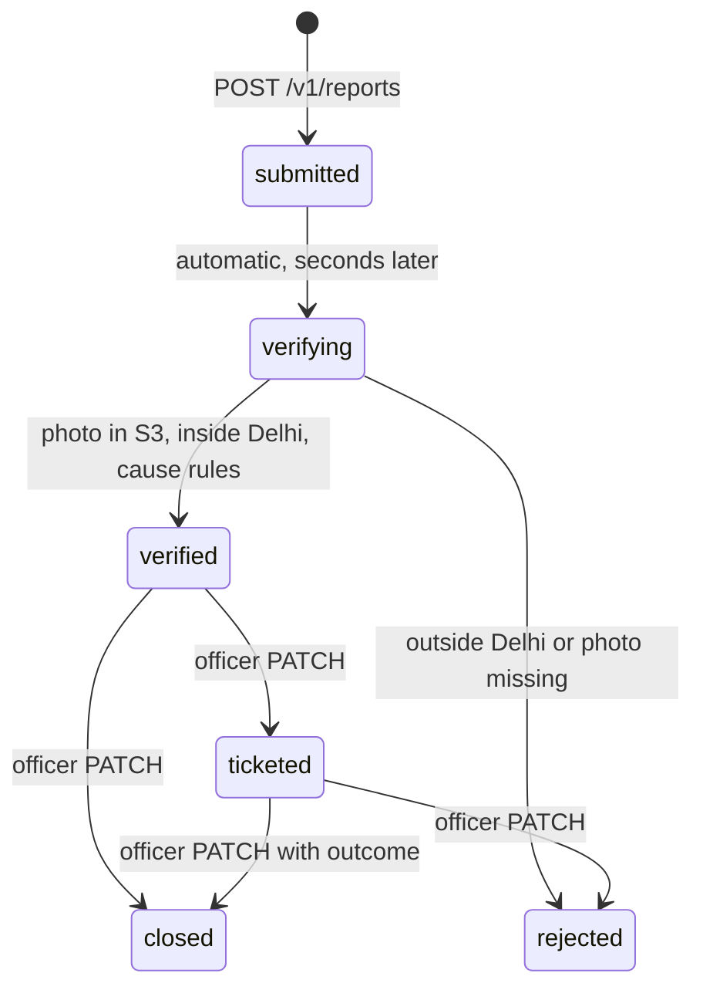
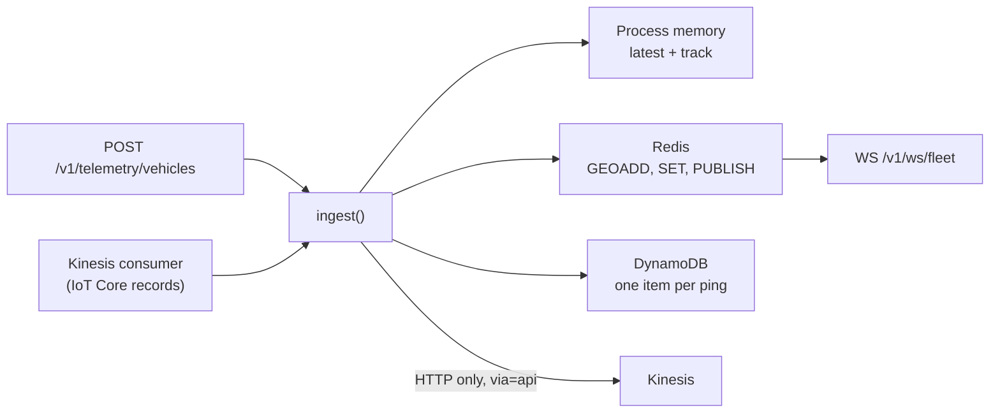

# Backend services

<!-- nav:start -->

**Navigate:** [Project](../../README.md) · [Docs hub](../README.md) · [Overview](../SYSTEM_OVERVIEW.md) · [AWS architecture](../AWS_ARCHITECTURE.md) · [AWS guide](../AWS_SETUP_GUIDE.md) · [API](API.md) · [Environment](../ENVIRONMENT_VARIABLES.md) · [Contracts](../CONTRACTS.md)

**Backend docs:** [Runbook](../../backend/README.md) · [Index](README.md) · [Architecture](ARCHITECTURE.md) · [API](API.md) · **Services** · [Data stores](DATA_STORES.md) · [Testing](TESTING.md) · [Deployment](DEPLOYMENT.md)

<!-- nav:end -->

The stateful features of the backend: what each service does, its lifecycle, where it stores data and what it does when a dependency is down.

- Code: `backend/src/hawa_backend/services/` (business logic), `api/routes/` (HTTP), `aws/` (AWS clients).
- Routes and payloads: [API reference](API.md). Storage layout: [data stores](DATA_STORES.md).

---

## Overview

| Service | Module | Routes | Stores |
|---|---|---|---|
| [Citizen reports](#citizen-reports) | `services/reports.py` | `/v1/reports*` | DynamoDB grievances, S3 |
| [Fleet telemetry](#fleet-telemetry) | `services/fleet.py` | `/v1/telemetry/vehicles`, `/v1/fleet/*`, `WS /v1/ws/fleet` | Redis, DynamoDB fleet, Kinesis |
| [Alerts](#alerts) | `services/alerts.py` | `/v1/alerts*`, `/v1/me/alert-subscription` | SNS, Redis |
| [Push](#push) | `services/push.py` | `/v1/me/push-token` | FCM, Redis |
| [Twin snapshot](#twin-snapshot) | `services/twin_cache.py` | `/v1/twin`, `/v1/hotspots`, `/v1/forecast` | Redis |
| [Location lookup](#location-lookup) | `services/geo.py` | used by reports and audits | twin in memory |
| [AI-ML bridge](#ai-ml-bridge) | `core/intel_client.py` | air, plans, impact routes | — |
| [Plans](#plans) | `api/routes/plans.py` | `/v1/plans*` | Redis, Step Functions, SNS |

---

## Citizen reports

- **Idempotent:** `report_id` = UUIDv5 of (caller, `client_report_id`); a retried submit returns the first report.
- **Verification:** HeadObject on the photo key, Delhi bounding box, nearest twin cell (ward, cell, PM2.5), fingerprint rules vs the citizen's category for the confidence.
- **SLA:** `sla_due_at` = created + `HAWA_REPORT_SLA_HOURS` (3 h); open reports past it show `sla_breach: true`.
- **Notifications:** an FCM push to the reporter at every status change (`hawa://reports/<id>`).
- **Identity:** the caller is the bearer token's `sub` (`core/identity.py`); officers use `X-Api-Key`.
- **Failure:** a configured but failing table returns `503`, so the app's outbox retries.

---

## Fleet telemetry

| Status | Rule |
|---|---|
| Spraying | pump flow ≥ 5 L/min |
| En route | speed ≥ 3 km/h |
| Idle | otherwise |
| Offline | no ping for `HAWA_FLEET_ACTIVE_MINUTES` (15) |

- **Live list:** `fleet:lastseen` sorted set; stale vehicles are pruned from the geo index on read.
- **Nearby:** `GEOSEARCH geo:fleet:active` (Redis) or a haversine filter (memory).
- **Track:** DynamoDB query by `asset_id` and time, oldest first.
- **Missed-machine audit:** at least 15 min within 500 m of the site with the pump on = `MACHINE_ACTIVE_VERIFIED`, else `SLA_BREACH_CONFIRMED` and a ₹25,000 penalty recommendation.
- **WebSocket:** subscription registered before the snapshot, so no ping is lost; heartbeat every 25 s.
- **Consumer:** per-shard polling, checkpoints in Redis, skips records the API already stored (`via=api`); runs in the API (`HAWA_AWS_KINESIS_CONSUMER=true`) or as `hawa consume-telemetry`.

---

## Alerts

- **Broadcast:** `POST /v1/alerts/broadcast` publishes once to SNS (attributes `type`, `ward`, `severity`, `audience`) and once to the FCM topic.
- **Subscribers:** `POST /v1/alerts/subscribers` subscribes an email or E.164 number with the filter `{"ward": [<ward>, "all"]}`.
- **Plan approval:** one SNS notice per approved plan (`HAWA_AWS_ALERT_ON_PLAN_APPROVAL`).
- **Log:** the last 200 sent alerts in Redis `alerts:sent`; `GET /v1/alerts` lists them before the fixtures.
- **Alert area:** `GET/PUT /v1/me/alert-subscription` stores each citizen's home, radius, kinds and quiet hours.

---

## Push

- **FCM HTTP v1:** OAuth token from the Firebase service account (RS256 JWT grant), cached until expiry.
- **Credentials:** `HAWA_FCM_SERVICE_ACCOUNT_JSON`, `HAWA_FCM_SERVICE_ACCOUNT_FILE`, or the Secrets Manager secret `HAWA_AWS_FCM_SECRET_ID`.
- **Messages are data-only:** the app shows its own localized notification, in the foreground and from its background handler.
- **Targets:** the topic `HAWA_FCM_TOPIC` for broadcasts; each user's registered tokens for report updates.
- **Cleanup:** tokens FCM reports as unregistered are removed on the next send.

---

## Twin snapshot

- The kriged twin takes seconds to fit; each process keeps it for 15 min.
- With Redis, the first process stores it as `grid:pm25:500m:<YYYYMMDDHH>` (TTL 900 s) and other processes load it instead of refitting.

---

## Location lookup

- `locate(lat, lon)`: nearest twin cell → `cell_id`, `ward_id`, PM2.5, PM10, locality name.
- `cell_center(cell_id)`: centre of a cell, used when a missed-machine report has no coordinates.
- `attribute(pm25, pm10, hour)`: fingerprint rules → app cause label and confidence.

---

## AI-ML bridge

- **Order:** AI-ML HTTP service (`HAWA_AIML_SERVICE_URL`) → in-process `hawa_ml` → fixtures.
- **Circuit breaker:** 5 failures open it for 15 s, then one probe.
- **Live stations:** WAQI, then OpenAQ, then 5 baseline stations, cached 15 min.
- Detail: [backend architecture](ARCHITECTURE.md).

---

## Plans

- Drafted by the Planner and checked by the Auditor ([AI-ML agents](../aiml/AGENTS.md)); seed plan `214` always exists.
- State in Redis `plans:active` (shared by processes) or memory.
- Approval can start a Step Functions dispatch execution and publish an SNS notice.

---

## Related

- [Backend architecture](ARCHITECTURE.md) · [API](API.md) · [Data stores](DATA_STORES.md) · [Testing](TESTING.md) · [AWS architecture](../AWS_ARCHITECTURE.md)

<!-- footer:start -->

---

[Back to top](#backend-services) · [Docs hub](../README.md) · [Project README](../../README.md)

<!-- footer:end -->
