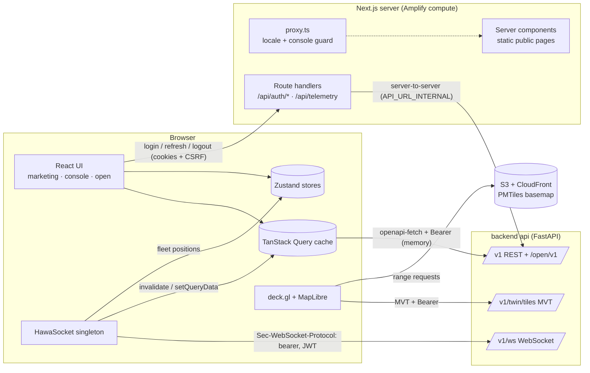
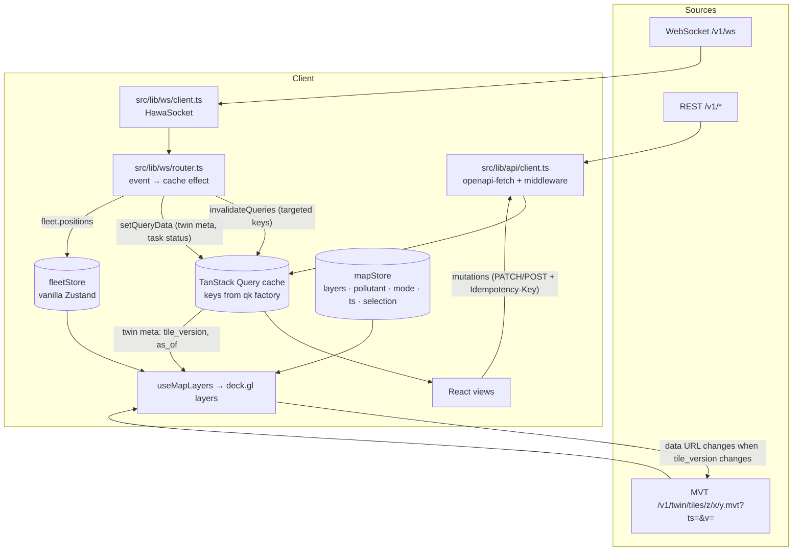
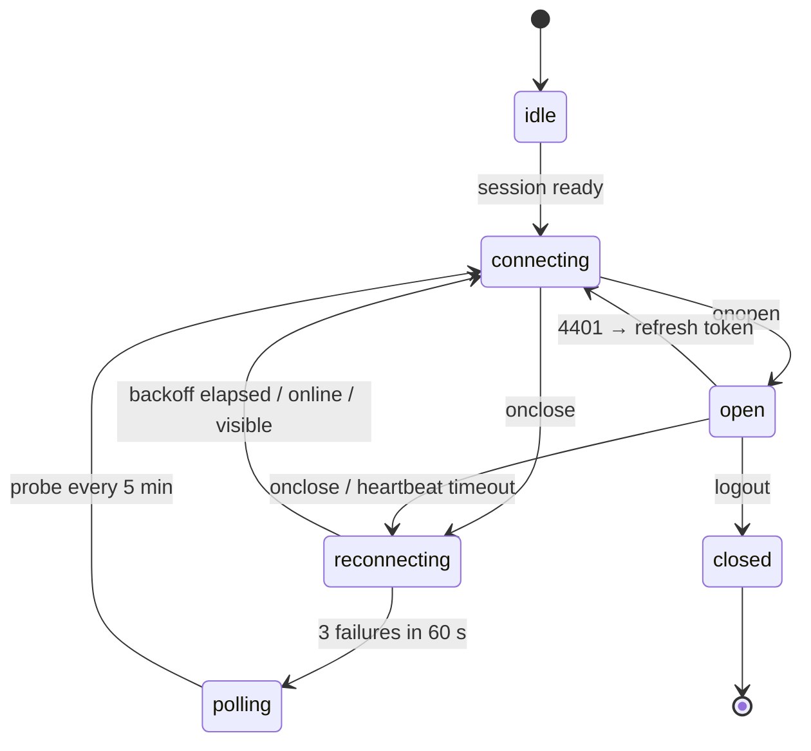

# Web Frontend Architecture

Purpose: how `frontend/` is built. Covers the stack, rendering, data flow, API and WebSocket clients, auth, the map, performance, errors, security, observability and hosting, plus the contract additions the web needs.

Related: [README](README.md) · [CONTEXT](CONTEXT.md) · [STRUCTURE](STRUCTURE.md) · [PAGES](PAGES.md) · [DESIGN_SYSTEM](DESIGN_SYSTEM.md) · [LINTING_AND_QUALITY](LINTING_AND_QUALITY.md) · [PLAN](PLAN.md) · [../CONTRACTS.md](../CONTRACTS.md) · [../SYSTEM_OVERVIEW.md](../SYSTEM_OVERVIEW.md) · [../backend/API.md](../backend/API.md)

---

## 1. Stack

Every version is the latest stable release, pinned in `pnpm-lock.yaml`. The sketches in these docs assume the current major APIs named below. If a pinned major differs, follow the library's docs and update the sketch.

| Concern | Choice | Why / notes |
|---|---|---|
| Framework | **Next.js 16 (App Router)**, Turbopack (default for dev and build) | Route groups per surface, static + dynamic in one app, route handlers for the cookie session, `proxy.ts` (formerly `middleware.ts`) |
| UI runtime | **React 19** with the React Compiler (`reactCompiler: true`) | Automatic memoisation keeps the map and task lists cheap to re-render. Opt out per file with `"use no memo"` if a library misbehaves |
| Language | **TypeScript strict** (+ `noUncheckedIndexedAccess`, `exactOptionalPropertyTypes`, `verbatimModuleSyntax`) | See [LINTING_AND_QUALITY §8](LINTING_AND_QUALITY.md#8-tsconfigjson) |
| Styling | **Tailwind CSS v4** (CSS-first `@theme`, `@tailwindcss/postcss`) + **shadcn/ui** (Radix primitives, `tw-animate-css`) | Tokens from [DESIGN_SYSTEM](DESIGN_SYSTEM.md). Components are copied into `src/components/ui` |
| Map | **deck.gl** (WebGL2, `@deck.gl/mapbox` `MapboxOverlay` interleaved) + **MapLibre GL JS** via **react-map-gl** (`react-map-gl/maplibre`) | GPU layers for 6k cells, trails and fleet. MapLibre renders the basemap. deck.gl 9+ requires WebGL2 |
| Basemap | **Protomaps PMTiles** Delhi-NCR extract on S3/CloudFront (`pmtiles` protocol + `@protomaps/basemaps` style); MapTiler as a keyed alternative | Free, self-hostable, no per-tile billing, works offline in local dev |
| Server state | **TanStack Query v5** | Cache, retries, optimistic updates, `scope`-serialised mutations |
| UI and map state | **Zustand** (React stores + vanilla stores for high-frequency fleet data) | Transient updates outside React for 1 Hz fleet and 30 fps trails |
| Forms | **react-hook-form** + **Zod** (`@hookform/resolvers`) | Plan edits, alert compose, login, admin |
| Charts | **Recharts** via the shadcn `chart` wrapper; **visx** allowed where Recharts cannot draw it | Fan chart and synthetic-control chart need range areas, reference lines and reference areas, all native in Recharts |
| i18n | **next-intl** (`en`, `hi`; `localePrefix: "as-needed"`) | Static per-locale public pages; ICU messages; global `timeZone: "Asia/Kolkata"` |
| API types + client | **openapi-typescript** + **openapi-fetch** from the backend `/openapi.json` (`pnpm gen:api`) | Types never drift. Only `src/lib/api` imports them (lint-enforced) |
| Mocking | **MSW** (browser worker, Node server, WebSocket links) + a standalone mock API (`@mswjs/http-middleware` + `ws`) | Mock-first. The web never waits on the backend ([PLAN §5](PLAN.md#5-mock-first-strategy)) |
| Theming | `next-themes` (class strategy) | Light/dark. The basemap flavour follows the theme |
| Command palette | `cmdk` via shadcn `Command` | Ctrl/Cmd+K |
| Tables | TanStack Table + shadcn `Table` | Sorting and filtering for hotspots, assets, alerts, devices |
| Testing | Vitest + React Testing Library + MSW; Playwright + `@axe-core/playwright` | [LINTING_AND_QUALITY §14](LINTING_AND_QUALITY.md#14-testing-strategy) |
| Quality | ESLint 9 flat config, Prettier (+ `prettier-plugin-tailwindcss`), Husky, lint-staged, commitlint, knip | Lint is a hard gate |
| Package manager | **pnpm** (via Corepack, `packageManager` field) | Matches the whole repo |
| Hosting | **AWS Amplify Hosting** (per §11); Vercel as an alternative; `output: "standalone"` container as a fallback | §17 |

## 2. System context



Two paths reach the backend:
1. **Browser → backend directly** for REST, tiles and WebSocket. It uses a short-lived access token held **in memory only**. This avoids a second hop for the hundreds of tile requests a map session makes. It needs CORS on the backend ([§18](#18-contract-additions-requested-by-the-web)).
2. **Browser → Next route handlers → backend** only for session operations (login, refresh, logout). These are the only endpoints that rely on cookies, so they are the only place CSRF protection applies.

## 3. Route groups and rendering strategy

All user-facing routes sit under `src/app/[locale]/`. English has no URL prefix and Hindi uses `/hi` (next-intl `localePrefix: "as-needed"`; `proxy.ts` rewrites `/x` → `/en/x` internally). The route groups are the ones in the brief (`(marketing)`, `(console)/console`, `(open)/open`), nested under `[locale]`. That nesting is what lets public pages be fully static in both languages. See [STRUCTURE](STRUCTURE.md) for the tree.

| Route group | URL examples | Rendering | Data | Caching | Auth |
|---|---|---|---|---|---|
| `(marketing)` | `/`, `/hi` | **Static (SSG)** per locale via `generateStaticParams` + `setRequestLocale`. No request-time APIs | Copy and numbers are static (messages JSON). The optional "Delhi now" teaser fetches `/open/v1/air` on the client after idle | CDN, immutable assets. Rebuild to change copy | none |
| `(open)/open` | `/open`, `/open/api`, `/open/methods`, `/hi/open` | **Static shell** per locale + client data (TanStack Query → `/open/v1/*`) | Map, stations, cell history, methods | Shell on CDN. Data cached by the backend (rate-limited). Client `staleTime` 15 min | none |
| `(open)/open/reports/[code]` | `/open/reports/7KQ2-M9` | **Dynamic** server component, `revalidate: 60` | `GET /open/v1/reports/{public_code}` (proposed) | 60 s ISR per code | none |
| `(console)/console/login` | `/console/login` | Static shell + client form | `POST /api/auth/login` | none | public |
| `(console)/console/(shell)/*` | `/console/map`, `/console/plans/[id]` | **Dynamic, client-heavy.** The layout (server) reads the session cookie and renders the shell. Pages are thin server components that render one client "workspace" component | TanStack Query on the client. WebSocket subscriptions per page | `Cache-Control: private, no-store` on HTML | `proxy.ts` guard + backend enforcement |
| `api/auth/*`, `api/telemetry/*` | `/api/auth/login` | Node route handlers | Backend server-to-server | `no-store` | cookie + CSRF |

Next.js 16 specifics we rely on:
- `proxy.ts` (renamed from `middleware.ts`) runs on the Node.js runtime and exports `proxy()` + `config.matcher`.
- `params`, `searchParams`, `cookies()` and `headers()` are async (`await`).
- `next lint` no longer exists. `pnpm lint` calls the ESLint CLI directly, and `next build` does not lint, so CI runs lint as its own step.
- Cache Components (`cacheComponents`) stay **off** for the hackathon. Classic segment config is enough: `dynamic = "force-static"` on public pages, `revalidate` on the report status page. Revisit after the hackathon.
- Server Actions are **not used** for API mutations. Mutations go through the typed client so optimistic updates, idempotency keys and problem+json handling stay in one place.

## 4. Data flow



Rules:
1. **REST is the source of truth.** A WebSocket message never creates entities in the cache that REST cannot fetch. It either patches a known field (a task's status, the twin meta) or invalidates a key so REST refetches.
2. **Targeted invalidation only.** `invalidateQueries({ queryKey: qk.plans.detail(id) })`. Never invalidate everything.
3. **Tile refresh by URL.** `twin.updated` → `setQueryData(qk.twin.meta(), {tile_version, as_of})` → `useMapLayers` builds the MVT URL template `…/{z}/{x}/{y}.mvt?ts=${as_of}&v=${tile_version}` → deck.gl sees a new `data` value and refetches visible tiles. Style-only changes (pollutant, palette) use `updateTriggers` and never refetch.
4. **High-frequency data bypasses React.** Fleet positions (1 Hz) and trail animation (≤ 30 fps) live in vanilla stores. The map subscribes and calls `overlay.setProps({ layers })`.
5. **URL holds shareable view state.** `?ward=&cell=&hotspot=&mode=&h=&ts=&layers=` on the map. `?plan=` on What-If.

## 5. API client and server state

### 5.1 Generated types and client

- `pnpm gen:api` runs `scripts/gen-api.mjs`. It fetches `$API_OPENAPI_URL`, writes `src/lib/api/openapi.snapshot.json`, runs `openapi-typescript` to produce `src/lib/api/generated/schema.d.ts`, and formats both. Both files are committed. CI `gen:api:check` fails on drift whenever the backend is reachable.
- `src/lib/api/types.ts` re-exports friendly aliases (`type Plan = components["schemas"]["PlanDetail"]`) so feature code never touches `components[...]` paths.
- `src/lib/api/enums.ts` holds runtime arrays and guards for enums (`CAUSE_LABELS`, `isCauseLabel`, `toKnownCause(x) → CauseLabel | "unknown"`). CONTRACTS §12.5 says "treat unknown enum values as unknown and render them neutrally".

```ts
// src/lib/api/client.ts (sketch)
import createClient, { type Middleware } from "openapi-fetch";
import type { paths } from "./generated/schema";
import { env } from "@/lib/env";
import { getAccessToken, refreshOnce } from "@/lib/auth/session";
import { currentCorrelationId } from "@/lib/api/correlation";
import { uuidv7 } from "@/lib/format/ids";

const retryable = new WeakMap<Request, Request>(); // clone kept for one 401 retry

const headersMw: Middleware = {
  async onRequest({ request }) {
    request.headers.set("X-Request-Id", uuidv7());
    const corr = currentCorrelationId();
    if (corr) request.headers.set("X-Correlation-Id", corr);
    const token = await getAccessToken();
    if (token) request.headers.set("Authorization", `Bearer ${token}`);
    retryable.set(request, request.clone());
    return request;
  },
  async onResponse({ request, response }) {
    const clone = retryable.get(request);
    if (response.status !== 401 || !clone) return response;
    retryable.delete(request);
    await refreshOnce();                             // single-flight, cross-tab locked (§7.4)
    const token = await getAccessToken();
    if (token) clone.headers.set("Authorization", `Bearer ${token}`);
    return fetch(clone);                             // POSTs are safe to retry: they carry Idempotency-Key
  },
};

export const api = createClient<paths>({ baseUrl: env.NEXT_PUBLIC_API_URL });
api.use(headersMw);
```

```ts
// src/lib/api/errors.ts (sketch)
export interface Problem { type: string; title: string; status: number; detail?: string; instance?: string; code?: string;
  errors?: { pointer?: string; field?: string; message: string; code?: string }[] }
export class ApiError extends Error {
  constructor(readonly status: number, readonly problem: Problem, readonly requestId: string | null) { super(problem.title); }
}
export function unwrap<T>(r: { data?: T; error?: unknown; response: Response }): T {
  if (r.data !== undefined) return r.data;
  throw new ApiError(r.response.status, toProblem(r.error, r.response), r.response.headers.get("X-Request-Id"));
}
```

### 5.2 Query keys and options

One key factory (`src/lib/api/keys.ts`) is the vocabulary shared by pages, mutations and the WebSocket router.

```ts
export const qk = {
  me: () => ["me"] as const,
  twin: { meta: () => ["twin", "meta"] as const, runs: (from: string, to: string) => ["twin", "runs", from, to] as const },
  cells: { all: ["cells"] as const, detail: (id: CellId) => ["cells", id] as const,
           history: (id: CellId, from: string, to: string) => ["cells", id, "history", from, to] as const },
  hotspots: { all: ["hotspots"] as const, list: (ward: WardId) => ["hotspots", "list", ward] as const,
              detail: (id: string) => ["hotspots", "detail", id] as const },
  forecast: { cell: (id: CellId) => ["forecast", "cell", id] as const, grid: (h: number, issuedAt: string | "latest") => ["forecast", "grid", h, issuedAt] as const },
  grap: { outlook: (ward: WardId, days: number) => ["grap", "outlook", ward, days] as const,
          checklist: (ward: WardId, stage: GrapStage) => ["grap", "checklist", ward, stage] as const },
  plans: { all: ["plans"] as const, list: (f: PlanFilters) => ["plans", "list", f] as const,
           detail: (id: string) => ["plans", "detail", id] as const, version: (id: string, v: number) => ["plans", "detail", id, "v", v] as const,
           simulation: (id: string, v: number) => ["plans", "simulation", id, v] as const },
  fleet: { live: () => ["fleet", "live"] as const, trails: (min: number) => ["fleet", "trails", min] as const },
  impact: { byIntervention: (id: string) => ["impact", "intervention", id] as const,
            summary: (ward: WardId, from: string, to: string) => ["impact", "summary", ward, from, to] as const,
            effectiveness: (cause?: CauseLabel, asset?: AssetType) => ["impact", "effectiveness", cause, asset] as const },
  // interventions, alerts, schools, reports, inspections, sites, devices, integrity, coverage, evidence, admin: same pattern
} as const;
```

```ts
// src/lib/api/queries/plans.ts (sketch)
export const planQueries = {
  detail: (id: string) => queryOptions({
    queryKey: qk.plans.detail(id),
    queryFn: async ({ signal }) => unwrap(await api.GET("/v1/plans/{id}", { params: { path: { id } }, signal })),
    staleTime: 30_000,
  }),
};
```

| Resource | `staleTime` | Refetch trigger | WS channel |
|---|---|---|---|
| `me` | 5 min | focus | — |
| twin meta | ∞ (WS-driven); 60 s poll in polling mode | `twin.updated` | `twin` |
| hotspots list | 5 min | `hotspot.updated` | `hotspots:{ward}` |
| cell detail / history | 60 s / 5 min | `twin.updated` invalidates `qk.cells.all` | `twin` |
| forecast cell / grid | 15 min | `forecast.issued` (proposed channel) or 15 min interval | `forecast` (proposed) |
| GRAP outlook / checklist | 15 min | as above | `forecast` (proposed) |
| plans list | 30 s + focus | plan lifecycle | `plans:{ward}` (proposed); poll 30 s fallback |
| plan detail | 30 s | `plan.*`, `task.*` | `plan:{id}` |
| plan simulation | ∞ per version | new version | — |
| fleet live / trails | WS primary; 5 s poll in polling mode | `fleet.positions` | `fleet` |
| assets / interventions | 60 s | `spray.*` via task events | `plan:{id}` |
| impact | 5 min | `impact.verified` | `impact` |
| alerts | 30 s | delivery events | `alerts` (proposed); poll fallback |
| devices | 60 s | `device.*` | `devices` |

Defaults: `retry: (n, e) => !(e instanceof ApiError && e.status < 500) && n < 2`, `refetchOnWindowFocus: false` (on for plans and alerts), `gcTime: 10 min`.

### 5.3 Mutations

| Convention | Rule |
|---|---|
| Idempotency | Every state-changing POST/PATCH sends `Idempotency-Key`. The key is derived from intent and stored in the mutation variables, so retries reuse it. Examples: approve = `approve:{plan_id}:v{version}`; alert compose = UUIDv7 created when the dialog opens |
| Concurrency | Plan edits send `If-Match: "{version}"` (proposed). A 409 `plan_version_conflict` opens the ConflictDialog |
| Ordering | Plan edit mutations share `scope: { id: \`plan:${id}\` }`, which TanStack Query v5 runs serially. Each reads the latest version from the cache when it executes |
| Optimistic | Edits: `onMutate` cancels `qk.plans.detail(id)`, snapshots it, applies the op, and marks the task `pending`. `onError` restores the snapshot and shows the problem. `onSettled` invalidates. **Approve and reject are not optimistic**: the button shows "Approving…" until the server confirms |
| Correlation | Acting on a plan sets `X-Correlation-Id` to the plan's `correlation_id` (proposed field), so approval joins the plan cycle's trace (CONTRACTS §2) |

## 6. WebSocket client

### 6.1 Design

- **Singleton** `HawaSocket` (`src/lib/ws/client.ts`), created by `<WsProvider>` in the console shell layout. There is one socket per tab and none on public pages.
- **Auth:** `new WebSocket(NEXT_PUBLIC_WS_URL, ["bearer", accessToken])` sends `Sec-WebSocket-Protocol: bearer, <JWT>` (CONTRACTS §6.1). JWT characters (base64url + `.`) are valid subprotocol tokens. **The server must echo `Sec-WebSocket-Protocol: bearer`**, or browsers abort the handshake ([§18](#18-contract-additions-requested-by-the-web)).
- **Subscriptions are reference-counted per channel.** The first `useChannel("plan:…")` sends `{"op":"subscribe","channels":[…]}`. The last unmount schedules `unsubscribe` after 2 s, so a route change does not cause churn.
- **Heartbeat:** send `{"op":"ping"}` every 25 s. Any inbound message (including the proposed `{"type":"pong"}`) resets a 10 s deadline. If the deadline passes, close and reconnect.
- **Reconnect:** full-jitter exponential backoff, `delay = random(0, min(30 s, 0.5 s × 2^attempt))`. The attempt counter resets after 60 s of stable connection. Reconnect immediately on `online` and when the tab becomes visible after being hidden. `4401` (token expired) → `refreshOnce()` → reconnect at once. `4403` → mark the channel forbidden and show an inline error, with no retry for that channel.
- **Resubscribe** all channels with a reference count > 0 on every `open`.
- **Resync on reconnect.** Messages sent during downtime are lost, because the backend does not replay. On any reconnect after the first connect, the router invalidates the keys mapped to each subscribed channel (table below) and refetches the twin meta. The map picks up the latest `tile_version`.
- **Polling fallback** (office proxies that block upgrades): after 3 failed connects within 60 s, status becomes `polling`. Queries switch to `refetchInterval` (twin meta 60 s, fleet 5 s, plan detail 10 s, hotspots 60 s, alerts 30 s). A WebSocket probe runs every 5 min and switches back when it succeeds.
- **Hidden tabs:** the `fleet` subscription is dropped while `document.hidden` has been true for more than 60 s, and restored on visible (with resync). This saves bandwidth on idle office tabs.
- **Status surface:** `useWsStatus()` → `<LiveStatusDot>` in the top bar: Live / Reconnecting / Polling / Offline.



```ts
// src/lib/ws/client.ts (sketch; full implementation is unit-tested with MSW ws links)
type Channel = "twin" | "fleet" | "devices" | "impact" | `hotspots:${string}` | `plan:${string}` | "forecast" | "alerts" | "reports" | "integrity" | `plans:${string}`;
export interface ServerMessage { channel: Channel; type: string; data: unknown; ts: string }

export class HawaSocket {
  private ws: WebSocket | null = null;
  private readonly subs = new Map<Channel, Set<(m: ServerMessage) => void>>();
  private attempt = 0;
  private hadOpened = false;
  private failures: number[] = [];
  private deadline: ReturnType<typeof setTimeout> | undefined;

  constructor(private readonly url: string, private readonly deps: {
    getToken: () => Promise<string | null>; refresh: () => Promise<void>;
    onStatus: (s: WsStatus) => void; onResync: (channels: Channel[]) => void; }) {}

  subscribe(channel: Channel, fn: (m: ServerMessage) => void): () => void {
    const set = this.subs.get(channel) ?? new Set();
    if (!this.subs.has(channel)) { this.subs.set(channel, set); this.send({ op: "subscribe", channels: [channel] }); }
    set.add(fn);
    return () => { set.delete(fn); if (set.size === 0) this.scheduleUnsubscribe(channel); };
  }

  async connect(): Promise<void> {
    const token = await this.deps.getToken();
    if (token === null) return;
    this.deps.onStatus(this.hadOpened ? "reconnecting" : "connecting");
    const ws = new WebSocket(this.url, ["bearer", token]);
    ws.onopen = () => {
      const resync = this.hadOpened;
      this.hadOpened = true; this.attempt = 0; this.deps.onStatus("open");
      const channels = [...this.subs.keys()];
      if (channels.length > 0) this.send({ op: "subscribe", channels });
      this.startHeartbeat();
      if (resync) this.deps.onResync(channels);
    };
    ws.onmessage = (e: MessageEvent<string>) => { this.bumpDeadline(); this.dispatch(e.data); };
    ws.onclose = (e) => { void this.onClose(e.code); };
    this.ws = ws;
  }

  private async onClose(code: number): Promise<void> {
    this.stopHeartbeat();
    if (code === 4401) { await this.deps.refresh(); return this.connect(); }
    if (this.recordFailureAndShouldPoll()) { this.deps.onStatus("polling"); return this.scheduleProbe(); }
    const delay = Math.random() * Math.min(30_000, 500 * 2 ** this.attempt++);
    setTimeout(() => { void this.connect(); }, delay);
  }
  // send(), dispatch() (JSON.parse → shape guard → handlers), heartbeat, probe, scheduleUnsubscribe(): omitted
}
```

### 6.2 Event → cache effects (`src/lib/ws/router.ts`)

| Channel | `type` | Effect |
|---|---|---|
| `twin` | `twin.updated` | `setQueryData(qk.twin.meta(), {tile_version, as_of, run_id})` → MVT URL changes. `invalidateQueries(qk.cells.all)`. If the scrubber is in historical mode, only show the "Newer twin available" chip |
| `hotspots:{ward}` | `hotspot.updated` | `invalidateQueries(qk.hotspots.list(ward))`. Invalidate `qk.hotspots.detail(id)` for ids in `data`. Polite live-region announcement "2 new hotspots" (throttled) |
| `fleet` | `fleet.positions` (proposed type) | `fleetStore.getState().apply(items)`: positions, headings and trail append. No React render |
| `plan:{id}` | `plan.drafted`, `plan.failed`, `plan.edited`, `plan.approved`, `plan.rejected`, `plan.expired`, `plan.dispatched`, `plan.in_progress`, `plan.completed` | `invalidateQueries(qk.plans.detail(id))` + `qk.plans.all`. `plan.drafted` → toast "Plan ready for review" + banner. `plan.edited` by another user → "Changed by {name}" chip |
| `plan:{id}` | `task.dispatched` … `task.verified`, `task.inconclusive`, `task.skipped`, `task.missed`, `task.cancelled` | `setQueryData(qk.plans.detail(id), patchTaskStatus(task_id, status, ts))`. On `task.verified` also invalidate `qk.impact.all` |
| `impact` | `impact.verified` | `invalidateQueries(qk.impact.byIntervention(intervention_id))`, `qk.impact.summary*` and `qk.impact.effectiveness*`. Toast "Effect verified: PM10 −18.2 % (95 % CI −26.0 to −9.9)" with a link |
| `devices` | `device.spike`, `device.tamper`, `device.health`, `device.calibrated`, `device.trust_changed` | Invalidate the device list/detail. `device.tamper` → danger toast (admin, analyst) |
| `forecast` (proposed) | `forecast.issued`, `grap.outlook_issued`, `school.safe_window_computed` | Invalidate `qk.forecast.*`, `qk.grap.*`, `qk.schools.*` |
| `alerts` (proposed) | `alert.requested`, `alert.sent`, `alert.delivered`, `alert.failed`, `alert.read` | Patch the delivery counts in `qk.alerts.detail(id)`, invalidate the list |
| `plans:{ward}` (proposed) | `plan.*` | Invalidate `qk.plans.list`. Drives the "Plan awaiting approval" banner |
| `reports`, `integrity` (proposed) | `report.*`, `integrity.flagged` | Invalidate the respective lists |
| any | unknown `type` | Ignore. Log at debug level in dev (CONTRACTS §12.5) |

The router is a `switch` over a union of known types plus a `default` branch for unknown values. The lint rule `switch-exhaustiveness-check` with `considerDefaultExhaustiveForUnions: false` forces every known type to be handled while still allowing the `default`.

## 7. Authentication and authorisation

### 7.1 Tokens and cookies

The backend issues a JWT access token (15 min) and a rotating refresh token ([../SYSTEM_OVERVIEW.md §6](../SYSTEM_OVERVIEW.md#6-technology-stack-whole-system)). The web never stores either in `localStorage` or `sessionStorage`.

| Cookie | Content | Flags | Read by |
|---|---|---|---|
| `hc_at` | access JWT | `HttpOnly; Secure; SameSite=Lax; Path=/; Max-Age=expires_in` | `proxy.ts` (guard), server components, `/api/auth/session` |
| `hc_rt` | refresh token | `HttpOnly; Secure; SameSite=Strict; Path=/api/auth; Max-Age=AUTH_REFRESH_MAX_AGE_S` | `/api/auth/refresh`, `/api/auth/logout` only |
| `hc_csrf` | random 32-byte token | `Secure; SameSite=Strict; Path=/` (readable by JS) | double-submit check on `/api/auth/*` POSTs |
| `NEXT_LOCALE` | `en` \| `hi` | `SameSite=Lax; Path=/` | next-intl |

The **access token is also held in memory** (`src/lib/auth/session.ts`) for direct REST calls, tile fetches and the WebSocket subprotocol. It is handed over in the login and refresh responses and by `GET /api/auth/session`. The refresh token never reaches JavaScript. `Lax` on `hc_at` lets a deep link from an email or WhatsApp alert open `/console/plans/{id}` without re-login while the token is still valid.

### 7.2 Flows

```mermaid
sequenceDiagram
  participant B as Browser
  participant N as Next route handler
  participant P as proxy.ts
  participant A as Backend
  B->>N: POST /api/auth/login {email, password} + X-CSRF-Token? (none yet: Origin check)
  N->>A: POST /v1/auth/login
  A-->>N: {access_token, refresh_token, expires_in, user}
  N-->>B: Set-Cookie hc_at, hc_rt, hc_csrf; body {user, access_token, expires_at}
  B->>B: session.ts stores token in memory; schedules refresh at expires_at − 60 s
  B->>P: GET /console/map (cookie hc_at)
  P-->>B: 200 (valid) or 307 → /console/login?next=/console/map
  Note over B: 60 s before expiry
  B->>N: POST /api/auth/refresh + X-CSRF-Token (Web Lock "hawa-refresh")
  N->>A: POST /v1/auth/refresh (hc_rt)
  A-->>N: new pair (rotated)
  N-->>B: Set-Cookie hc_at, hc_rt; body {access_token, expires_at}; BroadcastChannel → other tabs
```

- **Login** (`src/app/api/auth/login/route.ts`): checks `Origin` against the app origin, validates the body with Zod, and calls the backend (forwarding `X-Request-Id`). A backend 401 or 429 is passed through as problem+json. A role that is not a console role (`driver`, `inspector`, `school`, `site_manager`, `citizen`) gets 403 `use_mobile_app`, and the page explains that this account belongs in the HawaCommand app.
- **Session restore:** the login page tries `POST /api/auth/refresh` on mount. If that succeeds, it calls `router.replace(next)`, so an expired access token with a valid refresh cookie never shows a password form.
- **Silent refresh** (`session.ts`): a timer fires at `expires_at − 60 s ± 10 s jitter`. The work is single-flight within a tab and **serialised across tabs with the Web Locks API** (`navigator.locks.request("hawa-refresh", …)`). Without the lock, concurrent rotations could trip refresh-token reuse detection and revoke the session. After taking the lock, the tab checks whether another tab already refreshed (the new token arrives via the `BroadcastChannel("hawa-auth")` message) before it calls the handler.
- **Logout:** `POST /api/auth/logout` calls the backend `/v1/auth/logout`, clears the cookies, broadcasts `logout`, closes the socket, calls `queryClient.clear()`, and redirects to `/console/login`.
- **Refresh failure** → broadcast `logout` with reason `expired` → login page with "Your session ended. Please sign in again."

### 7.3 `proxy.ts`

```ts
// src/proxy.ts (sketch)
import createIntlMiddleware from "next-intl/middleware";
import { NextResponse, type NextRequest } from "next/server";
import { routing } from "@/lib/i18n/routing";
import { readAccessClaims } from "@/lib/auth/server";       // decode; verify with jose if AUTH_JWKS_URL set
import { canAccessRoute, CONSOLE_ROLES } from "@/lib/auth/roles";

const intl = createIntlMiddleware(routing);

export async function proxy(req: NextRequest) {
  const { pathname, search } = req.nextUrl;
  const locale = pathname.startsWith("/hi/") || pathname === "/hi" ? "hi" : "en";
  const path = locale === "hi" ? pathname.slice(3) || "/" : pathname;
  const prefix = locale === "hi" ? "/hi" : "";

  if (path.startsWith("/console") && !path.startsWith("/console/login")) {
    const claims = await readAccessClaims(req.cookies.get("hc_at")?.value);
    if (!claims || !CONSOLE_ROLES.includes(claims.role)) {
      const url = new URL(`${prefix}/console/login`, req.url);
      url.searchParams.set("next", path + search);
      return NextResponse.redirect(url);
    }
    if (!canAccessRoute(claims.role, path)) {
      return NextResponse.redirect(new URL(`${prefix}/console/map?denied=${encodeURIComponent(path)}`, req.url));
    }
  }
  const res = intl(req);
  if (path.startsWith("/console")) res.headers.set("Cache-Control", "private, no-store");
  return res;
}

export const config = { matcher: ["/((?!api|_next|_vercel|basemap|map|marketing|.*\\..*).*)"] };
```

The proxy is a **convenience guard**. It keeps unauthenticated users off console HTML and sends each role to pages it can use. **Authorisation is enforced by the backend on every request.** The web must treat 403 responses as normal, expected outcomes.

### 7.4 Roles and ward scoping in the UI

| Capability | officer | analyst | admin |
|---|---|---|---|
| View map, hotspots, forecast, GRAP, plans, What-If, fleet, interventions, impact, alerts, schools, reports, inspections, sites | ✔ | ✔ | ✔ |
| Draft, edit, simulate, approve or reject plans (CONTRACTS §6: `officer`) | ✔ | — (read-only) | — (read-only) |
| Compose alerts; close or assign inspections | ✔ | — | ✔ (alerts) |
| Devices, calibration, trust; integrity; coverage | view | ✔ | ✔ |
| Generate evidence reports | ✔ | ✔ | ✔ |
| Admin (users, roles, ward scopes, model versions) | — | — | ✔ |

- `src/lib/auth/roles.ts` defines `can(role, action)` and `canAccessRoute(role, path)`. `<RoleGate allow={[…]} fallback={…}>` hides or disables controls, and disabled controls explain why ("Only officers can approve plans").
- **Ward scope:** `ward_ids` comes from the JWT claims and `/v1/me` (proposed claim, [§18](#18-contract-additions-requested-by-the-web)). The `<WardSelect>` options are the user's wards (analyst and admin see all). The default is the first ward or the last choice stored in `localStorage` (non-sensitive preference). A backend 403 on a ward shows inline: "You do not have access to ward-084".

## 8. Client state

| Store | Kind | Holds | Persisted |
|---|---|---|---|
| `mapStore` | React Zustand | `viewState`, visible layers, pollutant (`pm25` \| `pm10` \| `aqi`), mode (`now` \| `forecast`), horizon, `ts` (historical) or live, selected cell/hotspot, palette (`cpcb` \| `cvd`), lite mode | URL (`useUrlState`) for shareable fields; `localStorage` for palette and lite mode |
| `fleetStore` | vanilla Zustand | `Map<id, FleetItem>` positions, headings, status; trails as ring buffers (30 min per vehicle) | no |
| `planEditStore` | React Zustand | edit mode on/off, pending op ids, drag state | no |
| `uiStore` | React Zustand | command palette open, drawers, dismissed banners (per session) | `sessionStorage` for dismissals |

Rule: server data never goes into Zustand (the exception is `fleetStore`, which is a high-frequency projection of WebSocket data). Everything else lives in TanStack Query.

## 9. Map architecture

### 9.1 Component tree

```
<MapWorkspace>                         client; reads URL state; owns queries for the page
├─ <MapToolbar/>                       ward, pollutant, mode, layers, search, lite, fullscreen
├─ <MapCanvas/>                        next/dynamic(() => import("./MapView"), { ssr: false, loading: <MapSkeleton/> })
│  └─ <Map mapLib=maplibre mapStyle={basemapStyle(theme)} …>        react-map-gl/maplibre
│     ├─ <DeckOverlay interleaved layers={layers} onClick onHover/>  useControl(() => new MapboxOverlay({ interleaved: true }))
│     ├─ <NavigationControl/> <ScaleControl/> <AttributionControl compact/>
├─ <MapLegend/>   <TimeScrubber/>   <HotspotRail/>   <CellDrawer/>   <MapTooltip/>
└─ <MapA11ySummary/>                   visually hidden polite live region + "cell cursor" keyboard mode
```

- **Interleaved rendering.** deck.gl draws into MapLibre's WebGL2 context. Data layers sit under the basemap labels (`beforeId` = the style's first symbol layer), so road and place names stay readable. There is one WebGL context per map, which matters on integrated GPUs and for the two maps on What-If.
- **Basemap:** `pmtiles://` protocol registered once. The style comes from `@protomaps/basemaps` (`light` / `dark` flavour, `lang: "en"`) with a desaturated palette so AQI fills dominate. Required attribution: "© OpenStreetMap contributors, Protomaps".
- **Layer builders are pure functions** (`src/components/map/layers/*.ts`): `(inputs) => Layer`. They are unit-tested without WebGL by asserting ids, props and accessor outputs on sample features.
- **Picking and tooltips:** `pickable` layers → `onHover` (rAF-throttled) → React `<MapTooltip>` positioned at `info.x/y`. We do not use deck's HTML `getTooltip`, because React escaping is needed for XSS safety and i18n. `onClick` selects a cell or hotspot → URL `?cell=` → `<CellDrawer>`.

### 9.2 Layers

Z-order is bottom → top. Layers 1–7 are inserted `beforeId` the first label layer. Layers 8–12 draw above labels.

| z | Layer id | deck.gl type | Data source / endpoint | Update trigger | Pickable | Default |
|---|---|---|---|---|---|---|
| 0 | basemap | MapLibre style (PMTiles) | `NEXT_PUBLIC_BASEMAP_PMTILES_URL` | theme change | — | on |
| 1 | `ward-boundaries` | `GeoJsonLayer` (stroke only, 1 px) | `GET /v1/wards?format=geojson` (proposed), `staleTime` 24 h | selected ward (width/colour via `updateTriggers`) | no | on |
| 2 | `forecast-grid` | `GeoJsonLayer` (1 km polygons, fill + "risk of worse" hatch sublayer) | `GET /v1/forecast/grid?horizon_h={h}&issued_at=latest` | horizon slider (prefetch h±3), `forecast.issued` | yes | off; replaces twin in Forecast mode |
| 3 | `twin-cells` | `MVTLayer` → `renderSubLayers`: fill `GeoJsonLayer` + hatch `GeoJsonLayer` (`FillStyleExtension` pattern + `DataFilterExtension` on `confidence < 0.4`) | `GET /v1/twin/tiles/{z}/{x}/{y}.mvt?ts={as_of}&v={tile_version}`. `GET /v1/twin?bbox=&ts=` (GeoJSON) as a fallback | `twin.updated` → new `data` URL; scrubber `ts`; pollutant/palette via `updateTriggers.getFillColor` | yes (`autoHighlight`) | on in Now mode |
| 4 | `blind-spots` | `GeoJsonLayer` (dashed outline, `PathStyleExtension`) + `PathLayer` suggested route | `GET /v1/coverage/blind-spots` | refetch on `twin.updated` | yes | off |
| 5 | `hotspot-outlines` | `GeoJsonLayer` (2–3 px stroke) + `TextLayer` rank numbers (Latin digits only) | `GET /v1/hotspots?ward=&limit=20` | `hotspot.updated` | yes | on |
| 6 | `trajectories` | `PathLayer` (dashed) + `ScatterplotLayer` hourly ticks | `GET /v1/hotspots/{id}` `back_trajectory` for the selected hotspot (top 3 when none is selected) | selection, `hotspot.updated` | no | on |
| 7 | `suspect-links` | `LineLayer` hotspot centroid → suspect pin | hotspots list | `hotspot.updated` | no | on |
| 8 | `pod-trails` | `TripsLayer` (`fadeTrail`, `trailLength` 600 s) | `GET /v1/fleet/trails?minutes=30&kind=vehicle` (proposed) + WS `fleet` appends | rAF `currentTime` outside React (≤ 30 fps; paused when hidden, reduced motion or lite mode) | no | on |
| 9 | `pois` | `IconLayer` (school, hospital, elder care; halo when in a forecast spike) | `GET /v1/pois?bbox=&kind=school,hospital,elder_care` (proposed) | static; halo on mode/horizon | yes | schools + hospitals on |
| 10 | `suspect-pins` | `IconLayer` (pin + cause glyph, size by `cause_conf`) | hotspots list `suspect` | `hotspot.updated` | yes | on |
| 11 | `fleet` | `IconLayer` (`billboard: false`, `getAngle: d => -d.heading_deg`, `transitions.getPosition` 1000 ms) + `ScatterplotLayer` status/simulated ring | `GET /v1/fleet/live` + WS `fleet` (1 Hz) | `fleetStore` subscription → `overlay.setProps` | yes | on |
| 12 | `selection` | `GeoJsonLayer` outline (3 px, ink/white) | local selection | selection | no | on |
| 13 | basemap labels | MapLibre symbol layers | style | — | — | on |

Twin tile properties expected in MVT layer `cells` (proposed, [§18](#18-contract-additions-requested-by-the-web)): `cell_id, ward_id, pm25_est, pm25_var, pm10_est, pm10_var, confidence, aqi, cause_label, cause_conf, exposure_ph, exposure_ph_p10, exposure_ph_p90, n_obs, sim_share, is_key_cell`. The tiles are fetched with `loadOptions.fetch` set to a **stable function** that reads the in-memory token at call time. A token change therefore never reloads the tileset.

```ts
// src/components/map/layers/twin.ts (sketch)
export function buildTwinLayer(i: { apiUrl: string; meta: TwinMeta; ts?: string; pollutant: Pollutant; palette: Palette; fetchWithAuth: typeof fetch }) {
  const asOf = i.ts ?? i.meta.as_of;
  return new MVTLayer<CellProps>({
    id: "twin-cells",
    data: `${i.apiUrl}/v1/twin/tiles/{z}/{x}/{y}.mvt?ts=${encodeURIComponent(asOf)}&v=${i.meta.tile_version}`,
    minZoom: 8, maxZoom: 13,                       // overzoom above 13 (≈ 4×4 cells per tile)
    loadOptions: { fetch: i.fetchWithAuth },
    beforeId: LABELS_LAYER_ID,
    pickable: true, autoHighlight: true, highlightColor: [255, 255, 255, 70],
    renderSubLayers: (p) => [
      new GeoJsonLayer({ ...p, id: `${p.id}-fill`, stroked: false,
        getFillColor: (f) => cellFill(f.properties, i.pollutant, i.palette),       // AQI band RGB + alpha from confidence
        updateTriggers: { getFillColor: [i.pollutant, i.palette] } }),
      new GeoJsonLayer({ ...p, id: `${p.id}-hatch`, stroked: false, pickable: false,
        extensions: [new FillStyleExtension({ pattern: true }), new DataFilterExtension({ filterSize: 1 })],
        fillPatternAtlas: "/map/hatch.png", fillPatternMapping: HATCH_MAPPING, fillPatternMask: true,
        getFillPattern: () => "diag", getFillPatternScale: 1, getFillColor: HATCH_INK_35,
        getFilterValue: (f) => f.properties.confidence, filterRange: [0, 0.4] }),
    ],
  });
}
```

### 9.3 Modes, scrubber and fallbacks

- **Now mode (live):** the twin follows `twin.updated`. The fleet and trails are live.
- **Historical:** the `TimeScrubber` sets `?ts=` (15-min steps over the last 24 h from `GET /v1/twin/runs`, proposed; until it exists, generated 15-min ticks with server-side snapping). Fleet and trails are hidden. A chip reads "Viewing 05:30 IST · Go live".
- **Forecast mode:** a horizon slider (+1…+72 h) swaps `twin-cells` for `forecast-grid`. The fill is the P50 category, and the "risk of worse" hatch marks cells whose P90 falls in a higher category. POI halos show the vulnerable places in the spike.
- **Lite map** (toggle; automatic when measured fps < 30 for 5 s): no trails, no hatch sublayer, no transitions.
- **No WebGL2** or context lost: `<WebGLFallback>` shows a static ward snapshot image (proposed optional endpoint) plus the hotspot table and cell search. `webglcontextlost` triggers one restore attempt.
- **Test hooks:** when `NEXT_PUBLIC_E2E=1`, `window.__hawa.map` exposes `{ layers(): {id, visible, featureCount}[], twinAsOf, selectCell(id) }` for Playwright. It is stripped from other builds.

## 10. Charts

- Recharts via the shadcn `chart` wrapper (`ChartContainer`, CSS-variable colours from tokens). Charts are lazy-loaded on chart routes.
- `FanChart` (forecast) and `SyntheticControlChart` (impact) are specified in [PAGES](PAGES.md#34-consoleforecast) and [PAGES](PAGES.md#310-consoleinterventions-and-consoleinterventionsid). Both use `Area` with range data (`[low, high]`) for bands, `Line` for P50/observed/synthetic, `ReferenceLine` for now, spray start/stop and thresholds, and `ReferenceArea` for school hours, the spray window and the verification window.
- Every chart is wrapped in `<ChartFigure title summary table>`. That gives a `<figure>`, `<figcaption>` with a generated text summary, and a "Show as table" toggle with the same data. The shared data transform is unit-tested.
- visx is permitted for a chart Recharts cannot draw cleanly (for example the effectiveness matrix with whiskers). Use one library per chart, never both.

## 11. Internationalisation

- `src/lib/i18n/routing.ts`: `defineRouting({ locales: ["en", "hi"], defaultLocale: "en", localePrefix: "as-needed" })`.
- `src/lib/i18n/request.ts`: `getRequestConfig`, with `requestLocale` falling back to `en`, messages loaded from `messages/{locale}.json`, `timeZone: "Asia/Kolkata"`, and shared `formats` (`dateTime.istTime` = `HH:mm` h23, `istDay` = `EEE d MMM`, `number.ph` = en-IN grouping). The same `timeZone` is passed to `NextIntlClientProvider` so server and client output match (no hydration mismatch).
- Public pages call `setRequestLocale(locale)` and export `generateStaticParams` → static HTML per locale.
- Formatting helpers in `src/lib/format/*` wrap `Intl` with fixed `timeZone: "Asia/Kolkata"`. Lint bans `toLocaleString` and related calls outside `src/lib/format`.
- Fonts: `next/font/google` Inter (`latin`) + Noto Sans Devanagari (`devanagari`), exposed as CSS variables. `<html lang>` follows the locale.
- WebGL text (TextLayer, MapLibre labels) is Latin only (see [CONTEXT §10](CONTEXT.md#10-bilingual-english-and-hindi)).

## 12. Performance budget

| Metric | Budget | How checked |
|---|---|---|
| Marketing first-load JS (gzip) | ≤ 130 KB | `next build` route table; bundle analyser in CI (advisory) |
| Console shell first-load JS, excluding lazy chunks | ≤ 220 KB | same |
| Map chunk (deck.gl core + layers + geo-layers + extensions + mapbox + MapLibre) | ≤ 750 KB gzip, lazy, prefetched on idle after login | same |
| Chart chunk (Recharts) | ≤ 120 KB gzip, lazy | same |
| Marketing LCP / CLS | ≤ 2.5 s / ≤ 0.05 (Lighthouse mobile, slow 4G, 4× CPU) | Lighthouse (manual or CI advisory) |
| Console INP | ≤ 200 ms p75 | web-vitals reporting |
| Map pan/zoom | **≥ 50 fps** with ~6,000 cells + 150 fleet + 100 trails on UHD 620-class GPU | dev fps meter (`?debug=fps`), Chrome Performance |
| First twin paint | ≤ 3 s after map route load at 10 Mbps / 150 ms RTT | Playwright with network throttling (advisory) |
| WS event → pixels | ≤ 2 s (twin tile refetch ≤ 1.5 s) | e2e timing assertions against the mock scenario |
| Memory | ≤ 600 MB tab after an 8 h session | manual soak test before the demo |

Techniques:
1. `next/dynamic` with `ssr: false` for `MapView` and every chart. Map libraries are importable only from `src/components/map/**` (lint rule), so they cannot leak into the shell chunk.
2. Binary MVT (deck.gl default) avoids per-feature JS objects. There is one tile fetch for both fill and hatch sublayers.
3. Stable `data` references and memoised layer builders. deck.gl diffs props shallowly, so a new array rebuilds GPU buffers.
4. The 1 Hz fleet data and 30 fps trails bypass React (§4 rule 4). Ring buffers bound trail memory.
5. `updateTriggers` for style changes. Neighbouring forecast horizons are prefetched.
6. Fonts: `next/font` subsets with `display: swap`. Only Devanagari glyphs actually used ship to `/hi` via subset loading.
7. Marketing images: `next/image` AVIF/WebP with explicit sizes. The hero has no autoplay video.
8. Lists over 100 rows (devices, alerts) use TanStack Virtual.
9. If fps < 50 with the full grid, fall back to a MapLibre-native `fill` layer for the twin, with data-driven styling from the same MVT source.

## 13. Error handling

All non-2xx responses are RFC 9457 `application/problem+json` (CONTRACTS §6) and are parsed into `ApiError`.

| Status / `code` | UI behaviour |
|---|---|
| 400 / 422 with `errors[]` | Inline field errors (`setError` from `errors[].field` or JSON-pointer mapping), plus a form-level `<ProblemAlert>` for errors that are not tied to a field |
| 401 | One silent refresh + retry (§5.1). If that fails: logout broadcast → login with `next` |
| 403 | Inline "You don't have access to …" in place of the content. Never a toast |
| 404 | Page-level `notFound()`: the page's `not-found.tsx` with a link back |
| 409 `plan_version_conflict` | `<ConflictDialog>`: shows the diff between your version and the server's, then "Reload plan" |
| 409 `plan_not_draft` / `unresolved_blocking_objections` | Refetch the plan. Disable the ApproveBar with the reason from `detail` |
| 429 | Toast "Too many requests; retry in {Retry-After}s". Queries back off by `Retry-After` |
| 5xx / network | Toast with the problem title + "Copy request id" (`X-Request-Id`) + Retry. Queries retry twice with backoff. Global offline banner on `navigator.onLine === false` |

- **Error boundaries:** `src/app/[locale]/(console)/console/(shell)/error.tsx` (section level) plus an `error.tsx` per heavy route (map, plans/[id], what-if, interventions/[id]). A component-level `<ErrorBoundary>` wraps the map canvas and each chart, so a WebGL or chart failure never takes down the plan task list or ApproveBar. `global-error.tsx` catches root failures.
- Every boundary renders the request id if one is available, a Retry that calls `reset()` and refetches, and a link to the list page.
- Toasts come from `sonner` (shadcn). Errors that block a task are never toast-only. They stay inline until resolved.

## 14. Loading, empty and stale states

| State | Pattern |
|---|---|
| Loading | Layout-matching `Skeleton` (no spinners for content). The map shows the basemap immediately and data layers fade in. Buttons show inline pending text ("Approving…") |
| Empty | `<EmptyState icon title body action>`: "No hotspots in ward-084 right now: all cells below threshold (twin 06:45 IST)". "Empty" must say why and when the data was last checked |
| Error | §13 |
| Stale | `<StaleDataBanner>` from `useStaleness(as_of, thresholds)`, driven by `useNow(30_000)` |
| Simulated | `<SimulatedBadge>` (see [CONTEXT §6](CONTEXT.md#6-honesty-rule-in-the-web)) |
| Live connection | `<LiveStatusDot>`: Live / Reconnecting / Polling / Offline |

| Data | Fresh | Amber warning | Red |
|---|---|---|---|
| Twin (`as_of`) | ≤ 20 min | > 20 min: "Twin is 22 min old" | > 60 min: "Twin is stale (1 h 12 min). Decisions may rely on old data." |
| Forecast (`issued_at`) | ≤ 75 min | > 75 min | > 3 h |
| Fleet position (per item `ts`) | ≤ 2 min | > 2 min: grey icon, "last seen 4 min ago" | > 15 min: dropped from the live layer, listed as offline |
| WebSocket | open | reconnecting > 10 s | polling / offline chip |
| Plan detail while drafting | WS events | no event for 3 min: "Still drafting (3 min)…" | `plan.failed`: error panel with the `detail` |

## 15. Security

| Area | Measure |
|---|---|
| Tokens | No tokens in `localStorage`/`sessionStorage` (lint `no-restricted-properties`). Access token in memory; refresh token in a path-scoped httpOnly cookie. `queryClient.clear()` on logout |
| CSRF | Only `/api/auth/*` uses cookies. Those handlers require `Origin` = the app origin, plus the `X-CSRF-Token` header equal to the `hc_csrf` cookie (double submit), plus `SameSite`. Backend calls use bearer tokens, which are not ambient credentials, so they are not CSRF-exposed |
| XSS | React escaping everywhere. `react/no-danger: error`. **LLM output (Planner reasons, Auditor objections, Communicator text) and citizen text are untrusted.** They render as plain text. If markdown is ever needed, use `react-markdown` without `rehype-raw`. Map tooltips are React, not HTML strings |
| CSP (hackathon) | Static header from `next.config.ts` `headers()`: `default-src 'self'; script-src 'self' 'unsafe-inline'` (Next's inline bootstrap without nonces; `'unsafe-eval'` in dev only); `style-src 'self' 'unsafe-inline'`; `img-src 'self' data: blob: {api} {s3-presigned-host}`; `connect-src 'self' {api} {ws} {basemap-cdn} {sentry}`; `worker-src 'self' blob:`; `font-src 'self'`; `frame-ancestors 'none'`; `base-uri 'self'`; `form-action 'self'`; `object-src 'none'` |
| CSP (post-hackathon) | Nonce-based `script-src 'nonce-…' 'strict-dynamic'` for console routes via `proxy.ts`. SRI (`experimental.sri`) for static public pages |
| Headers | `Strict-Transport-Security: max-age=63072000; includeSubDomains; preload`, `X-Content-Type-Options: nosniff`, `Referrer-Policy: strict-origin-when-cross-origin`, `Permissions-Policy: camera=(), microphone=(), geolocation=()`, `Cross-Origin-Opener-Policy: same-origin` |
| PII | Recipient phone numbers are masked in the UI (`+91 98xxxx1234`). Citizen photos load only through presigned URLs with short TTL. No PII in URLs, logs or analytics. Keep a DPDP Act 2023 review on the roadmap |
| Dependencies | `pnpm audit --prod` in CI (advisory). Renovate or Dependabot for weekly updates. Lockfile committed. `pnpm install --frozen-lockfile` in CI and Amplify |
| Env | Only `NEXT_PUBLIC_*` reaches the client. `src/lib/env.ts` validates with Zod at build and boot. Server-only modules import `server-only` |

## 16. Observability

- **Web Vitals:** `useReportWebVitals` (`next/web-vitals`) → `navigator.sendBeacon("/api/telemetry/vitals")` → the route handler writes structured JSON logs to stdout (Amplify compute → CloudWatch) with `route`, `metric`, `value`, `rating`, `app_env` and `release`. No user id.
- **Errors (optional):** `@sentry/nextjs` when `NEXT_PUBLIC_SENTRY_DSN` is set. Use `instrumentation.ts` + `instrumentation-client.ts`, a tunnel route to survive ad blockers, `beforeSend` that scrubs `Authorization`, cookies and query tokens, and source maps uploaded in CI with `SENTRY_AUTH_TOKEN`.
- **Correlation:** every request gets a UUIDv7 `X-Request-Id`. Plan actions send the plan's `correlation_id` as `X-Correlation-Id`, and other flows use a per-page-session UUIDv7. Error UIs show the request id so it can be matched to backend logifyx logs.
- **Client logs:** a `logger` wrapper (`debug` only in dev) is the only allowed console use (`no-console` rule).
- **Map debug:** `?debug=fps,layers` overlays fps, layer feature counts and the twin `as_of`/`tile_version`.

## 17. Hosting and environments

### 17.1 AWS Amplify Hosting (primary, per §11)

- Amplify Hosting compute (SSR) for the Next.js app, with the branch → stage mapping below. **Check at setup that Amplify supports the pinned Next.js 16 release for SSR.** If it does not, use Vercel or the container fallback (§17.3). The app has no Amplify-specific code.
- Monorepo: app root `frontend` (`AMPLIFY_MONOREPO_APP_ROOT=frontend`). The build spec is `frontend/amplify.yml`. Amplify reads a monorepo spec from the repository root, so the infra PR either references this file or copies it there. Amplify's pnpm guidance may require `node-linker=hoisted` in `frontend/.npmrc`; verify this when connecting the app.

```yaml
# frontend/amplify.yml (sketch)
version: 1
applications:
  - appRoot: frontend
    frontend:
      phases:
        preBuild:
          commands:
            - nvm use $(cat .nvmrc) || nvm install $(cat .nvmrc)
            - corepack enable
            - pnpm install --frozen-lockfile
        build:
          commands:
            - pnpm lint
            - pnpm typecheck
            - pnpm build
      artifacts:
        baseDirectory: .next
        files: ["**/*"]
      cache:
        paths: [".next/cache/**/*", "node_modules/**/*"]
```

### 17.2 Environments

`NEXT_PUBLIC_*` values are baked in at build time, so each stage is a separate Amplify branch/environment with its own variables.

| Variable | `local` | `demo` | `aws` (pilot) |
|---|---|---|---|
| `NEXT_PUBLIC_APP_ENV` | `local` | `demo` | `aws` |
| `NEXT_PUBLIC_API_URL` | `http://localhost:4010` (mock) or `:8000` | `https://api.demo.<domain>` | `https://api.<domain>` |
| `NEXT_PUBLIC_WS_URL` | `ws://localhost:4010/v1/ws` | `wss://api.demo.<domain>/v1/ws` | `wss://api.<domain>/v1/ws` |
| `API_URL_INTERNAL` | same as API URL | internal ALB URL or public API URL | internal ALB URL |
| `NEXT_PUBLIC_BASEMAP_PMTILES_URL` | `/basemap/delhi.pmtiles` (fetched by `pnpm basemap:fetch`, git-ignored) | CloudFront URL | CloudFront URL |
| `NEXT_PUBLIC_BASEMAP_ASSETS_URL` | `/basemap/assets` | CloudFront URL | CloudFront URL |
| `NEXT_PUBLIC_API_MOCKING` | `off` \| `browser` | `off` | `off` |
| `NEXT_PUBLIC_DEMO_BANNER` | `true` | `true` | `false` (while pilot devices are real) |
| `NEXT_PUBLIC_E2E` | `0` (`1` in e2e builds) | `0` | `0` |
| `NEXT_PUBLIC_SENTRY_DSN` | empty | optional | optional |
| `AUTH_COOKIE_SECURE` | `true` (localhost is a secure context) | `true` | `true` |
| `AUTH_JWKS_URL` | empty | optional | backend JWKS (or Cognito JWKS after the swap) |
| `AUTH_REFRESH_MAX_AGE_S` | `604800` | match backend | match backend |

### 17.3 Alternatives

- **Vercel:** zero-config Next.js 16 hosting. Same env table. Use it if Amplify lags on Next 16. The architecture and CSP are unchanged apart from `connect-src` hosts.
- **Container:** `NEXT_OUTPUT=standalone pnpm build` → `node .next/standalone/server.js` on ECS Fargate or App Runner behind CloudFront. It can join the root `docker-compose.yml` as a `web` service (`API_URL_INTERNAL=http://api:8000`).

## 18. Contract additions requested by the web

These are proposals for the backend and AI-ML leads. Each must land in [../CONTRACTS.md](../CONTRACTS.md) + `hawa_contracts` + [../backend/API.md](../backend/API.md) before the web depends on it (CONTRACTS change rule). Until then the mock API serves exactly these shapes.

### 18.1 REST additions

| # | Proposed endpoint / field | Needed by | Shape (summary) |
|---|---|---|---|
| R1 | `GET /v1/twin/latest` | Map initial load, polling fallback | `{run_id, as_of, tile_version, model_version, bbox, cells_updated, sim_share}` |
| R2 | `GET /v1/twin/runs?from=&to=` | Time scrubber | `{items:[{run_id, as_of, tile_version}]}` |
| R3 | Twin tiles: accept `v={tile_version}`; snap `ts` to latest run ≤ `ts`; `X-Twin-As-Of` response header; MVT layer `cells` with the property list in §9.2; zoom 8–13 | Twin layer | — |
| R4 | `sim_share` (0–1) on `cell_state`, tiles, `GET /v1/cells/{id}`, hotspots | Honesty rule for derived data | number |
| R5 | `exposure_ph_p10`, `exposure_ph_p90` on `cell_state`, tiles and hotspots | Uncertainty rule | numbers |
| R6 | `GET /v1/fleet/trails?minutes=30&kind=vehicle\|asset` | Pod trails (TripsLayer) | `{items:[{id, device_id, kind, is_simulated, path:[[lon,lat]], timestamps:[unix_s], pm25:[…]}]}` |
| R7 | `GET /v1/pois?bbox=&kind=school,hospital,elder_care,market,bus_stop` | POI layer, forecast "3 schools" | GeoJSON FeatureCollection, props `{poi_id, kind, name, name_hi, school_id?}` |
| R8 | `GET /v1/wards` (+ `?format=geojson`) | Ward selector, boundaries | `{items:[{ward_id, name, name_hi, bbox}]}` / FeatureCollection |
| R9 | `GET /v1/schools?ward=` (officer+) | Schools list | `{items:[{school_id, name, ward_id, sentinel_pair, today_safe_window, alert_status}]}` |
| R10 | `GET /v1/reports?status=&ward=` (officer+) | Citizen Eyes queue | paginated reports with verification + ticket |
| R11 | `POST /v1/inspections`, `POST /v1/inspections/{id}/assign` | Escalate from hotspot/report (Flow A "escalates inspections") | `{source: hotspot\|report\|cell, source_id, note}` / `{inspection_team_asset_id}` |
| R12 | Plan detail fields: `version`, `correlation_id`, `review {planner_rationale, auditor_verdict, objections[]}`; objection `{objection_id, severity, source, task_id?, rule?, text, suggested_change?, resolution {status, by, note, at}}` | Plan page | see [PAGES §3.7](PAGES.md#37-consoleplansid) |
| R13 | `PATCH /v1/plans/{id}` body `{base_version, ops:[…]}` + `If-Match` + `ETag`; ops `move`, `reassign`, `retime`, `remove`, `add`, `resolve_objection`, `lock`; response includes `violations[]` | Edit mode | see PAGES §3.7 |
| R14 | `GET /v1/plans/{id}/versions`, `GET /v1/plans/{id}?version=` | Plan diff | version list with author + ts |
| R15 | `POST /v1/plans/{id}/reoptimize` → new version | Re-optimise | `{locked_task_ids[]}` |
| R16 | `GET /v1/plans/{id}/simulation?version=` (cached What-If) | What-If without recompute | same as simulate response |
| R17 | Simulate response: `plan_ph`, `baseline_ph`, `delta_ph` each `{p10,p50,p90}`; `baseline_kind: "usual_routes"`; `per_cell[]`; `plan_routes`, `baseline_routes` (FeatureCollections); `vulnerable_protected {plan, baseline}`; `version` | What-If page | — |
| R18 | Approve body `{version, note?}`; reject body `{version, reason}`; 409 codes `plan_version_conflict`, `plan_not_draft`, `unresolved_blocking_objections` | ApproveBar | — |
| R19 | Impact response: `series[]{ts, treated, synthetic, synthetic_low, synthetic_high}`, `ci_level`, `spray {start_ts, end_ts}`, `pre_period {start_ts, end_ts, rmse}`, `donors[]{cell_id, weight}`, `placebo_p`, `is_simulated`, `injected_effect_pct` (simulated only) | Synthetic-control chart | — |
| R20 | `POST /v1/alerts/preview` → recipient counts per channel; optional `POST /v1/alerts/draft` (Communicator en + hi draft) | Compose alert | — |
| R21 | `GET /v1/users`, `POST /v1/users`, `PATCH /v1/users/{id}`, `PUT /v1/users/{id}/ward-scopes` (admin) | Admin | — |
| R22 | `GET /v1/models` (authenticated wrapper) | Admin / methods | active model versions + metrics |
| R23 | `GET /open/v1/reports/{public_code}` + `public_code` on `citizen_report` | Public report status | `{public_code, status, submitted_at, outcome_text_en, outcome_text_hi, closed_at}`, no PII |
| R24 | `GET /v1/coverage/summary` | Coverage KPI (≥ 70 % road-km) | `{observed_share, road_km_total, road_km_observed, period}` |
| R25 (optional) | `PUT /v1/grap/checklist/{ward_id}/{date}/items/{item_id}` | Persist GRAP checklist ticks | `{done: bool}` |
| R26 (optional) | `POST /v1/plans/{id}/review` → async Auditor re-review; lifecycle type `plan.reviewed` | Re-review after edits | — |

### 18.2 Auth and HTTP

| # | Proposal |
|---|---|
| H1 | JWT claims: `sub`, `role`, `ward_ids[]`, `lang`, `exp`, `iat`, `jti`. `/v1/me` returns `{user_id, name, email, role, ward_ids, lang}` |
| H2 | Login and refresh respond with a body `{access_token, refresh_token, expires_in, token_type, user}`. The web route handler sets the cookies, not the backend |
| H3 | CORS: allow the web origins; allow headers `Authorization, Content-Type, Idempotency-Key, If-Match, X-Request-Id, X-Correlation-Id`; expose `X-Request-Id, X-Correlation-Id, ETag, Retry-After, X-Twin-As-Of` |

### 18.3 WebSocket additions

| # | Proposal |
|---|---|
| W1 | The server must echo `Sec-WebSocket-Protocol: bearer` on the handshake |
| W2 | Server messages: `{"type":"pong","ts":…}`; `{"type":"subscribed","channels":[…]}`; `{"type":"error","code":"forbidden_channel"\|"bad_request","channel":…}` |
| W3 | Close codes: `4401` token invalid/expired, `4403` forbidden, `4408` heartbeat timeout, `4429` too many connections |
| W4 | `fleet` message type `fleet.positions`: `data.items[] = {id, kind: "asset"\|"vehicle", asset_type?, device_id?, position: [lon, lat], heading_deg, speed_kmh, status, spraying, ts, is_simulated}` (GeoJSON order per CONTRACTS §1) |
| W5 | New channels: `forecast` (`forecast.issued`, `grap.outlook_issued`, `school.safe_window_computed`), `plans:{ward_id}`, `alerts` (officer+, requested + delivery), `reports`, `integrity` |
| W6 (optional) | `plan.progress` event `{stage: exposure\|optimize\|planner\|auditor\|communicator, status}` for the drafting progress UI |

### 18.4 Conflicts found in the current contracts

| # | Conflict | Proposed resolution |
|---|---|---|
| C1 | `plan.drafted` carries bare `expected_exposure_avoided_ph` / `baseline_exposure_avoided_ph`, which contradicts CONTRACTS §1 "Never ship a bare point estimate" | Replace with `{p10,p50,p90}` objects (R17) |
| C2 | `cell_state.exposure_ph` and `aqi` are bare | Add R5. The web derives the AQI range from the PM range |
| C3 | CONTRACTS §7 lists "web admin" as a caller of `GET /internal/v1/models`, but internal endpoints are private-network only | Expose R22 |
| C4 | The `twin` channel says "refetch tiles with the new `tile_version`", but the tile URL only takes `ts` | R3 (`v=` cache-buster) |
| C5 | `fleet` channel has no message `type`/shape | W4 |
| C6 | `hawa.forecast.issued.v1`, `hawa.alert.delivery.v1`, `hawa.report.lifecycle.v1` and `hawa.integrity.flag.v1` feed `api-live`, but have no WebSocket channel | W5 |
| C7 | Demo script "GRAP outlook turns orange for Thursday": orange = `poor` = Stage I | The demo seed must produce Stage I, or the script changes |
| C8 | CONTRACTS §6: only `officer` may approve. SYSTEM_OVERVIEW "officer+" could be read as including admin | The web follows CONTRACTS: admin and analyst are read-only on plans |
