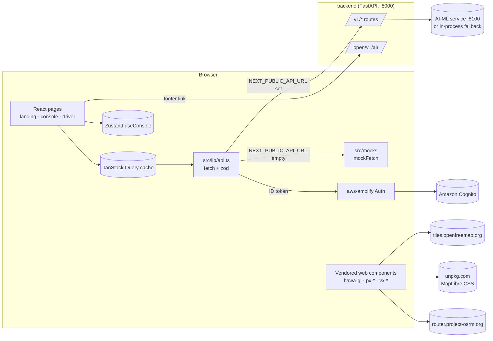

# Web Frontend Architecture

<!-- nav:start -->

**Navigate:** [Project](../../README.md) · [Docs hub](../README.md) · [Overview](../SYSTEM_OVERVIEW.md) · [AWS architecture](../AWS_ARCHITECTURE.md) · [AWS guide](../AWS_SETUP_GUIDE.md) · [API](../backend/API.md) · [Environment](../ENVIRONMENT_VARIABLES.md) · [Contracts](../CONTRACTS.md)

**Web docs:** [Runbook](../../frontend/README.md) · [Index](README.md) · **Architecture** · [Pages](PAGES.md) · [Design system](DESIGN_SYSTEM.md) · [Deployment](DEPLOYMENT.md)

<!-- nav:end -->

Purpose: how `frontend/` is built today: the stack, rendering, data flow, the API client and every endpoint it calls, mock mode, authentication, state, the map and visual components, error behaviour, performance, security and hosting. The last section keeps the original blueprint's target architecture, labelled Planned.

Related: [README](README.md) · [../SYSTEM_OVERVIEW.md](../SYSTEM_OVERVIEW.md) · [../backend/API.md](../backend/API.md)

---

## 1. Stack

Declared ranges are from `frontend/package.json`; resolved versions are what `pnpm install --frozen-lockfile` installed from `pnpm-lock.yaml` on 2026-10-10.

| Concern | Package | Declared | Resolved | Notes |
|---|---|---|---|---|
| Framework | `next` | `^15.1.0` | 15.5.26 | App Router, route groups. Dev server uses Turbopack (`next dev --turbopack`); `next build` uses the default bundler |
| UI runtime | `react`, `react-dom` | `^19.0.0` | 19.3.0 | No React Compiler |
| Language | `typescript` | `^5.7.0` | 5.9.3 | `strict: true`, `allowJs`, Bundler resolution |
| Styling | `tailwindcss`, `postcss`, `autoprefixer` | `^3.4.17`, `^8.4.49`, `^10.4.20` | 3.4.19, 8.5.28, 10.6.1 | Tailwind 3 with a JS config (`tailwind.config.ts`) and `@tailwind` directives in `globals.css`. No component library (no shadcn/Radix) |
| Server state | `@tanstack/react-query` | `^5.62.0` | 5.104.0 | One `QueryClient` in `src/app/providers.tsx` |
| UI state | `zustand` | `^5.0.2` | 5.0.15 | One store, `src/stores/console.ts` |
| Validation | `zod` | `^3.24.0` | 3.25.76 | Contracts in `src/contracts`; every response is parsed |
| Auth | `aws-amplify` | `^6.10.0` | 6.22.0 | Cognito user-pool sign-in (`aws-amplify/auth`) |
| Map | `maplibre-gl` | `4.7.1` (exact) | 4.7.1 | Used through the vendored `<hawa-gl>` element, not react-map-gl |
| Icons | `lucide-react`, `lucide` | `^0.460.0` | 0.460.0 | `lucide-react` in React code; plain `lucide` is handed to the vendored elements as `window.lucide` |
| Smooth scroll | `lenis` | `^1.3.26` | 1.3.26 | Landing page only |
| Class names | `clsx` | `^2.1.1` | 2.1.1 | |
| Fonts | `next/font/google` | n/a | n/a | Geist, Geist Mono, Silkscreen, Noto Sans Devanagari, self-hosted at build time |
| Charts | none | n/a | n/a | Two hand-written SVG charts (`ForecastChart`, `SyntheticControlChart`) |
| Package manager | pnpm | `packageManager: pnpm@11.17.0` | | Lockfile v9.0. `engines.node >= 20` |
| Hosting | AWS Amplify Hosting | `amplify.yml` | | §15 |

Not present (the blueprint named them; see §16): deck.gl, react-map-gl, PMTiles, shadcn/ui, next-intl, openapi-typescript/openapi-fetch, MSW, react-hook-form, Recharts, next-themes, cmdk, TanStack Table, Vitest, Playwright, ESLint, Prettier.

## 2. System context



There is no Next.js server logic: no route handlers, no middleware, no server actions, no server-side data fetching. The browser talks to the backend directly (the backend allows CORS from any origin, `backend/src/hawa_backend/api/app.py:37-38`).

## 3. Route groups and rendering

| Route group | URLs | File(s) | Rendering (from `next build`) | Data |
|---|---|---|---|---|
| `(marketing)` | `/` | `src/app/(marketing)/page.tsx` + `sections/*` | Static, prerendered. The page is a server component that composes client sections | Client-side hooks after hydration |
| `(auth)` | `/login` | `src/app/(auth)/login/page.tsx` | Static, client component | Cognito via aws-amplify |
| `(console)` | `/map`, `/forecast`, `/plans`, `/what-if`, `/impact`, `/fleet`, `/alerts` | `src/app/(console)/*/page.tsx` | Static HTML shell, client components | TanStack Query on the client |
| `(console)` | `/plans/[id]` | `src/app/(console)/plans/[id]/page.tsx` | Dynamic (server-rendered on demand) because of the `[id]` segment; the page itself is a client component that unwraps `params` with `use()` | TanStack Query on the client |
| `(driver)` | `/route` | `src/app/(driver)/route/page.tsx` | Static, client component inside `<Suspense>` (needed for `useSearchParams`) | TanStack Query on the client |
| root | 404 | `src/app/not-found.tsx` | Static | none |

The root layout (`src/app/layout.tsx`) sets fonts and metadata (`title.template: "%s · HawaCommand"`, `themeColor: #FAF9F6`), wraps everything in `<Providers>` (the `QueryClient`) and mounts `<VisualsLoader />`, which registers the vendored web components on every route. The `(console)` layout wraps pages in `<AuthGuard>` and `<ConsoleShell>`; the `(driver)` layout is a phone-width frame. Console pages cannot export metadata (they are client components), so their browser title is "HawaCommand".

## 4. Data flow and API client

```mermaid
flowchart TB
  P[Page or component] --> H[hook in src/hooks]
  H --> Q[(useQuery / useMutation)]
  Q --> A[api.* in src/lib/api.ts]
  A -->|USING_MOCKS| M[import('@/mocks/handlers').mockFetch]
  A -->|else| F[fetch NEXT_PUBLIC_API_URL + path<br/>content-type json, Bearer ID token if Cognito]
  M --> Z{schema.safeParse}
  F --> Z
  Z -->|ok| Q
  Z -->|fail| E[console.error + throw ApiError 500]
  F -->|!res.ok| E2[throw ApiError status]
```

### 4.1 The request pipeline (`src/lib/api.ts`)

1. `API_URL = process.env.NEXT_PUBLIC_API_URL ?? ""`; `USING_MOCKS = !API_URL`.
2. Mock mode: dynamically imports `@/mocks/handlers` and calls `mockFetch(method, path, body)`. The mock code is a separate chunk and is only downloaded in mock mode.
3. Real mode: gets the Cognito ID token (`getIdToken()`, undefined when Cognito is off), calls `fetch(API_URL + path)` with `content-type: application/json`, `authorization: Bearer <token>` when present, and a JSON body for POSTs. A non-2xx response throws `ApiError(status, "<METHOD> <path> failed with <status>", body)`.
4. Every response, mock or real, is parsed with the zod schema for that endpoint. A mismatch logs the flattened error and throws `ApiError(500, "<METHOD> <path>: response does not match @hawa/contracts")`. Defaults in the schemas are applied during parsing (for example `simulated` defaults to `false`, `actions` to `[]`).
5. Network failures (`TypeError: Failed to fetch`) are not wrapped; they surface as the query error.

There are no request ids, idempotency keys, retries on 401, or `If-Match` headers.

### 4.2 Endpoints the web calls

| `api` method | Request | Response schema | Hook (query key) | Used by | Backend handler |
|---|---|---|---|---|---|
| `hotspots(q)` | `GET /v1/hotspots?hour=&ward=` | `HotspotList` | `useHotspots(hour, ward)` `["hotspots", {hour, ward}]`; `useWardHotspots(hour)` | `/map`, header chip, rail indicator, command palette, `usePeakHour`, `useMapStations` (maps on `/forecast`, `/plans/[id]`, `/what-if`, `/fleet`, landing What-If), landing `useLandingAir`, `InterventionDetail` | `backend/src/hawa_backend/api/routes/hotspots.py` |
| `forecast(ward)` | `GET /v1/forecast?ward=` | `Forecast` | `useForecast(ward)` `["forecast", ward]` | `/forecast`, header (ward list, GRAP tooltip), landing | `routes/forecast.py` |
| `plans.list()` | `GET /v1/plans` | `listOf(Plan)` | `usePlans()` `["plans"]` | `/plans`, `/what-if`, rail badge, palette, `HotspotDetail`, landing What-If | `routes/plans.py` |
| `plans.get(id)` | `GET /v1/plans/{id}` | `Plan` | `usePlan(id)` `["plan", id]` (no retry on 404) | `/plans/[id]`, `/what-if`, landing What-If | `routes/plans.py` |
| `plans.draft(req)` | `POST /v1/plans/draft` `{ward}` | `Plan` | `useDraftPlan(onDone)` | `/plans` empty state, `HotspotDetail` primary button, palette "Draft plan for …" | `routes/plans.py` |
| `plans.compare(id)` | `GET /v1/plans/{id}/compare` | `PlanComparison` | `usePlanComparison(id)` `["plan", id, "compare"]` | `/what-if` | `routes/plans.py` |
| `plans.applySuggestion(id, commentId)` | `POST /v1/plans/{id}/suggestions/{commentId}/apply` | `Plan` | `usePlanActions(id).applySuggestion` | `AuditorComment` | `routes/plans.py` |
| `plans.approve(id, note?)` | `POST /v1/plans/{id}/approve` `{note}` | `Plan` | `usePlanActions(id).approve` | `ApproveBar` | `routes/plans.py` |
| `plans.requestChanges(id, note)` | `POST /v1/plans/{id}/request-changes` `{note}` | `Plan` | `usePlanActions(id).requestChanges` | `ApproveBar` (note is always "Officer requested changes") | `routes/plans.py` |
| `devices()` | `GET /v1/devices` | `AssetList` | `useFleet()` `["devices"]`, 5 s poll | `/fleet`, palette "Where is …", `InterventionDetail` | `routes/devices.py` |
| `impact.list()` | `GET /v1/impact` | `InterventionList` | `useInterventions()` `["impact"]` | `/impact`, landing Proof | `routes/impact.py` |
| `impact.library()` | `GET /v1/impact/library` | `listOf(EffectLibraryRow)` | `useEffectLibrary()` `["impact", "library"]` | `/impact` | `routes/impact.py` |
| `alerts()` | `GET /v1/alerts` | `AlertList` | `useAlerts()` `["alerts"]` | `/alerts` | `routes/alerts.py` |
| `driverRoute(asset)` | `GET /v1/driver/route?asset=` | `DriverRoute` | `useDriverRoute(asset)` `["driver", asset]` | `/route` | `routes/driver.py` |
| (plain link) | `GET /open/v1/air` | n/a | none | Landing footer, opens in a new tab, only when `NEXT_PUBLIC_API_URL` is set | `routes/open_data.py` |

Every one of these backend routes exists. `scripts/verify_backend_contracts.ts` validated all of them against the backend on 2026-10-10 (15 of 15 passed; see [README §6](README.md#6-verification-record)).

Backend routes the web does not call: `GET /v1/hotspots/{cell_id}`, `GET /v1/twin`, `GET /v1/forecast/{cell_id}`, `POST /v1/plans/{id}/simulate`, `GET|POST /v1/impact/{id}/verify`, `GET|POST /v1/interventions/{id}/verify`, `/v1/citizen/*`, and the health probes.

Known cross-component mismatch: `PlanComparison.deltaPct` is a positive "gain" in the backend (42.0) and a negative change in the mock (−31). Both pass the schema (it is just a number), but the What-If page reads it as a signed change ([README §8](README.md#8-known-issues), issue 4).

### 4.3 Relationship to docs/CONTRACTS.md

The contract that the web and the backend actually share is `frontend/src/contracts/*.ts`: camelCase JSON (`cellId`, `pm25`, `causeConf`, `peopleHours`), list envelopes `{asOf, simulated, items}`, and the paths in §4.2. [../CONTRACTS.md](../CONTRACTS.md) describes a broader, snake_case blueprint (for example `cell_id`, `/v1/fleet/live`, `/v1/grap/outlook`, WebSocket channels) that neither the web nor the current backend implements. When the two disagree, the zod schemas and the verifier are authoritative for the web.

### 4.4 Query options and polling

| Option | Value | Where |
|---|---|---|
| Default `staleTime` | 30 s | `src/app/providers.tsx` |
| `refetchOnWindowFocus` | false | `providers.tsx` |
| `retry` | 1 (default); `usePlan` retries up to 2 times except on 404 | `providers.tsx`, `src/hooks/usePlan.ts` |
| `placeholderData: keepPreviousData` | hotspots, forecast | `useHotspots.ts`, `useConsoleData.ts` |
| Polling (`liveQuery`) | `refetchInterval: 5000`, `refetchIntervalInBackground: false` | Hotspots at hour 0 and devices only (`src/lib/live.ts`) |
| `enabled` | plan and comparison queries are disabled while the id is empty | `usePlan.ts` |

### 4.5 Mutations

All plan mutations return the full `Plan`. On success they write it into `["plan", id]` with `setQueryData` and invalidate `["plans"]`. `useDraftPlan` also calls its `onDone(plan)` callback, which navigates to `/plans/{id}` and shows a toast ("Draft plan #… created"). The page shows a toast after approve ("Plan #… approved · N tasks queued for <window>"). There is no optimistic update and no confirmation dialog: Approve & dispatch is one click.

## 5. Client-side derivations

The web does not run models, but these helpers derive display values on the client:

| Helper | File | What it computes |
|---|---|---|
| `atHour(items, hour)` | `src/components/map/layers.ts` | For `hour > 0`, replaces each hotspot's `pm25` and `band` with its forecast P50 at that hour. Unchanged for hour ≤ 0 |
| `usePeakHour()` | `src/hooks/usePeakHour.ts` | The forecast hour (1–72) with the highest mean hotspot P50; 42 while loading |
| `applyPlan(stations, fraction, threshold)` + `planReduction(headline)` | `layers.ts` | "Plan" map: cuts each station's PM2.5 above the threshold by `1 − peopleHoursPlan / peopleHoursUsual`. Used on `/plans/[id]`, `/what-if` and the landing What-If slider. This is an illustration, not a model output |
| `centroid(stations)` | `layers.ts` | Map centre from the loaded stations |
| `toMapStations(items)` | `layers.ts` | Hotspots to the `{id, name, lon, lat, pm, cause}` shape the map element draws |
| Ward exposure shares | `/forecast` page | Each ward's share of total `peopleHours` |
| Alert stats | `AlertStats.tsx` | Count, people reached (parsed from `delivered`), median lead time, channels |
| Evidence report | `components/impact/report.ts` | Markdown table built from the interventions and library on screen |

## 6. Mock mode

Active when `NEXT_PUBLIC_API_URL` is empty (the default).

- `src/mocks/handlers.ts` routes `(method, path)` with regular expressions to fixtures, waits 120 ms, and returns a `structuredClone` so callers cannot mutate fixtures. Unknown paths throw `mock: no handler for …`.
- `src/mocks/fixtures.ts` holds 10 hotspots with 73-point forecasts, an East Delhi forecast with GRAP Stage II, Plan #214 (five asset groups, one open Auditor comment `aud-1`, five checks), its comparison, 8 fleet assets (one offline), 6 interventions with synthetic-control series, 7 library rows, 7 alerts and the T-12 driver route.
- Plan state is a module-level variable, so Apply suggestion, Approve (which also applies `aud-1` and sets a fake Step Functions ARN) and Request changes persist until the page reloads.
- The demo clock: `now()` in `src/lib/time.ts` returns `DEMO_NOW` (Tue 10 Nov 2026, 14:00 IST) in mock mode and the real time otherwise. Fixture times are relative to `DEMO_NOW` (`isoAt(h)`).
- Mock simplifications (also in [README §8](README.md#8-known-issues)): the hotspot handler ignores `ward`; plan detail ignores the id; draft returns Plan #214 with status `drafting`.

## 7. Authentication

Implemented in `src/lib/auth.ts`, `src/components/shell/AuthGuard.tsx` and `src/app/(auth)/login/page.tsx`. Status: **Partial**.

| Mode | When | Behaviour |
|---|---|---|
| Demo (default) | `NEXT_PUBLIC_COGNITO_USER_POOL_ID` or `NEXT_PUBLIC_COGNITO_CLIENT_ID` empty | `AUTH_ENABLED = false`. `AuthGuard` renders the console immediately. `/login` shows "Demo mode: Cognito is not configured" and an "Open console" button that goes to `/map`. `currentOfficer()` returns `{username: "demo-officer"}`. No `Authorization` header is sent |
| Cognito | Both variables set | `Amplify.configure({Auth: {Cognito: {userPoolId, userPoolClientId}}}, {ssr: false})` on first use. `/login` calls `signIn({username, password})`; on `isSignedIn` it goes to `/map`, otherwise it shows "Additional step required: <step>" (MFA, new-password and other challenges are not handled). `AuthGuard` calls `getCurrentUser()` and redirects to `/login` when it fails, rendering nothing meanwhile. `api.ts` sends the ID token as `Authorization: Bearer …` |

Limits: this is a client-side gate. No backend route verifies the token, so the `/v1` API is open to anyone who can reach it. Tokens use aws-amplify's default browser storage. `logout()` exists but no UI calls it. There are no roles, ward scopes or route-level permissions.

## 8. Map and visuals

### 8.1 Loading

`src/components/visuals/VisualsLoader.tsx` runs once per page load on the client. It dynamically imports `lucide` and `maplibre-gl`, sets `window.lucide` and `window.maplibregl`, then imports `src/lib/visuals/hawa.js`, `hawa-gl.js` and `pixel.js` in that order. Each script is an IIFE that registers custom elements (and returns early if already registered). Elements rendered before registration upgrade automatically. JSX typings live in `src/types/custom-elements.d.ts`.

### 8.2 `<hawa-gl>` and `HawaMap`

`src/components/map/HawaMap.tsx` is the only React entry point to the map. It renders `<hawa-gl>` absolutely positioned in its parent, maps props to attributes, pushes arrays as element properties once the element is defined, and turns the element's `hc-hotspot` event into `onHotspotClick(cellId)`.

| Prop | Element attribute / property | Meaning |
|---|---|---|
| `layers: MapLayer[]` | `layers` (comma list) | `hex` heat field, `stations` hotspot markers, `causes`, `suspect`, `buses`, `trucks`, `schools`, `buildings` (3D, with extrude), `anchors` |
| `mode` | `mode` | `live`, `plan`, `usual`, `donor` |
| `hour`, `mix`, `thresholdUgm3` | `hour`, `mix`, `threshold` | Hour offset; usual-to-plan blend for routes; markers below the threshold are greyed |
| `assets` | `assets` | Which built-in demo routes to draw |
| `selected`, `labels`, `maxLabels` | `selected`, `labels`, `maxlabels` | Label policy: `full`, `major`, `sel`, `none` |
| `center`, `zoom`, `extrude` | `center`, `zoom`, `extrude` + `pitch`, `bearing`, `hscale` | Camera; changes animate with `easeTo` |
| `interactive`, `attribution`, `attributionBottom` | `interactive="false"`, `attrib="none"`, `attrib-bottom` | |
| `stations` | `.data` property | API hotspots. When set, the heat field is interpolated from these points and markers show their values; when `undefined`, the element draws its built-in demo stations and field |
| `fleet` | `.fleet` property | Real asset positions (drawn only with the `trucks` layer) |
| `donors` | `.donors` property | Donor weights for `mode="donor"` |

What comes from the API and what is built into `hawa-gl.js`:

| Map content | Source |
|---|---|
| Heat field and hotspot markers | API hotspots when `stations` is passed; built-in demo data otherwise |
| Fleet markers on `/fleet` | API `at` positions |
| Truck routes (usual and plan), bus trails, schools, anchors, Ghazipur suspect pin, donor cell positions | Built into `hawa-gl.js` (Stub/Mock) |
| Basemap | `https://tiles.openfreemap.org/styles/positron` (light) or `.../dark`, hard-coded at `hawa-gl.js:107`; bounds clamped to Delhi |
| Route geometry | Fetched from `router.project-osrm.org` and cached in `sessionStorage` (`hawa-route:*`) |
| MapLibre CSS | `https://unpkg.com/maplibre-gl@4.7.1/dist/maplibre-gl.css`, linked inside the shadow root |

The heat field is drawn as a 200×200 canvas image source masked to the Delhi outline; the element pauses its animation loop when off screen or when the tab is hidden.

### 8.3 Pixel and voxel elements (`pixel.js`)

| Element | Used in | What it draws |
|---|---|---|
| `<px-sky scroll>` | Landing background (fixed) | Pixel sky with drifting clouds and birds |
| `<px-skyline stage seed>` | Hero (`stage=0.05`, smoggy), Footer (`stage=1`, clear) | Pixel skyline whose haze clears as `stage` goes 0 → 1 |
| `<px-scene kind stage>` | Problem (`smoggun`), Causes (`dust`, `traffic`, `burning`, `stubble`), Learned (`grid`, `taxi`, `alerts`, `opendata`, `tower`), Cost (`podtower`) | 96×56 animated pixel scenes |
| `<vx-city haze>` | Hero | Isometric voxel city with haze |
| `<vx-pod scrub>` | Hardware | HawaPod-M exploded view driven by scroll position |
| `<vx-model kind>` | Hardware (`pod-s`, `tag`) | Small rotating voxel models |
| `<vx-hexmap>` | not used | |

`hawa.js` registers `hc-icon`, `hawa-map`, `hc-chart`, `hc-count` and `hc-iso`; the app uses none of them (`CountUp` replaced `hc-count`).

## 9. Client state (`src/stores/console.ts`)

| Field | Default | Set by | Read by |
|---|---|---|---|
| `ward` | `"All wards"` (`ALL_WARDS`) | Header ward picker, forecast ward table | `useWardHotspots`, `useForecast`, `/plans`, draft actions |
| `hour` | 0 | Time scrubber, palette "Jump to peak", `/forecast` on mount (sets the peak if hour ≤ 0) | Maps, hotspot list, header chip |
| `thresholdUgm3` | 250 | nothing (constant) | Maps, list "Watch" tag, legend |
| `selectedHotspot` | null | Map marker click, hotspot list | `/map` aside |
| `layers` | all five on | Layer toggles, palette "Show hotspots near schools" | `/map`, `/fleet` |
| `railOpen` | null (follow the ≥ 1320 px media query) | Rail Collapse button | `ConsoleShell` |
| `paletteOpen`, `settingsOpen` | false | Cmd/Ctrl+K, search button, Escape; Settings button | Palette, settings popover |
| `dark` | false | Settings → Dark mode | `ConsoleShell` filter |
| `toast` | null | Draft and approve actions | `ConsoleShell` (dismissed manually) |

The store is not persisted; a reload resets it. The selected asset on `/fleet` comes from `?asset=` and local state.

## 10. Time and formatting

`src/lib/time.ts` formats every time in IST (`Asia/Kolkata`) with `en-GB` 24-hour formatters: `dayTime` ("Thu 08:00"), `clock`, `hourLabel` ("Now · Tue 14:00", "Thu 08:00 · +42 h"), `windowLabel` ("Sat 04:42 – 08:42"). `src/lib/format.ts` provides `en-IN` integer grouping, a true minus sign in `fmtPct`, confidence words (High ≥ 0.75, Medium ≥ 0.6, else Low), the cause-to-verb map and `wardLabel` ("ward-084" → "Ward 84").

## 11. Charts

Both charts are plain SVG sized with `useElementWidth` (ResizeObserver):
- `ForecastChart`: P10–P90 band, P50 line, faint Poor / Very Poor / Severe band shading, y from 100 to at least 500 µg/m³, x labelled "Now" and each 08:00 IST.
- `SyntheticControlChart`: observed (solid), synthetic control (dashed), 95% band, spray window shading (samples 12–15 by default), effect bracket and label, y fixed at 250–500.

## 12. Errors, loading and an unreachable backend

| Situation | What the user sees |
|---|---|
| Loading | `Skeleton` blocks, `PlanSkeleton`, or "Loading…" headlines. Maps draw the built-in demo field until stations arrive |
| Query error on `/map`, `/forecast`, `/fleet` | `QueryError` (red box with the error message) in the aside; the map keeps the demo field |
| Query error on `/plans/[id]` | `QueryError`; a 404 shows "Plan not found" with a link back to `/plans` |
| Query error on `/impact`, `/alerts` | `QueryError` in the main area |
| Query error on `/plans`, `/what-if`, `/route` | No error UI: "No draft plans" empty state, "—" values, or a permanent skeleton |
| Landing with no data | The nav chip and "Right now" card are hidden; Proof shows "Couldn't load the intervention"; What-If shows "Loading plan…" |
| Response does not match the contract | `ApiError` 500 with "response does not match @hawa/contracts"; details in the browser console |

There are no `error.tsx` or `loading.tsx` route files and no global error boundary. The app never falls back from the backend to mocks at runtime; mock mode is chosen at build time.

## 13. Performance

From `next build` on 2026-10-10: shared first-load JS 103 kB; route first-load JS from 147 kB (`/login`) to 188 kB (`/map`). MapLibre, lucide and the three vendored scripts are loaded after hydration by `VisualsLoader` on every route, including routes without a map. Polling is limited to two queries every 5 s and stops in background tabs. The vendored elements throttle their own animation loops (30–110 ms timers) and pause when off screen. No performance budget is enforced.

## 14. Security

- No security headers or Content-Security-Policy are configured (`next.config.ts` only sets `devIndicators: false`).
- React renders API text as text. The vendored `hawa-gl.js` builds marker HTML with `innerHTML` and interpolates API strings (hotspot `place` at `hawa-gl.js:178`, asset `id` at `:200`), which is an injection sink if the backend ever returns untrusted text.
- External links use `rel="noopener noreferrer"`. The driver "Navigate" button opens Google Maps directions with the stop name.
- Auth limits are in §7.
- `pnpm build` needs network access to Google Fonts (next/font downloads the font files at build time).

## 15. Hosting and environments

`frontend/amplify.yml` (Amplify Hosting, monorepo `appRoot: frontend`): `preBuild` runs `corepack enable` and `pnpm install --frozen-lockfile`; `build` runs `pnpm build`; artifacts come from `.next` (`**/*`); `node_modules` and `.next/cache` are cached. Because `/plans/[id]` is dynamic, the Amplify app needs the Next.js SSR (compute) platform. No infrastructure code in `infrastructure/` creates the Amplify app or its environment variables, and no deployment was verified.

| Environment | `NEXT_PUBLIC_API_URL` | Cognito vars | Notes |
|---|---|---|---|
| Local, mocks | empty | empty | Default. Demo clock |
| Local, full stack | `http://localhost:8000` | empty | Backend on 8000, AI-ML on 8100 (or in-process fallback) |
| Hosted | the backend's public origin | set to enable sign-in | Set in the Amplify console before the build; values are inlined |

Ports: `pnpm dev` and `pnpm start` use 3000 (`-p 3000` in the scripts).

## 16. Planned architecture (from the original blueprint)

> Status: Planned. None of this is in the code. It is kept as the target design where it still applies.

| Area | Target design | Notes for whoever builds it |
|---|---|---|
| Live updates | One WebSocket (`/v1/ws`) with channels for twin, hotspots per ward, fleet, plan and impact; events invalidate or patch TanStack Query keys; fall back to polling after repeated failures | Today: 5 s polling in `src/lib/live.ts`, which was written as the single place to swap |
| Map rendering | deck.gl layers over MapLibre (twin cells with confidence opacity and hatching, hotspot outlines, suspect pins, back-trajectories, fleet icons, pod trails) fed only from the API; self-hosted PMTiles basemap | Today: vendored `<hawa-gl>` with built-in demo overlays. `layers.ts` already names the layers |
| API types | Generate types from the backend's `/openapi.json` and check for drift in CI | Today: hand-written zod schemas plus the live verifier script |
| Auth | Server-verified sessions (httpOnly cookies or verified Cognito JWTs), roles (officer, analyst, admin) and ward scoping; sign-out | Requires backend token verification first |
| i18n | English and Hindi message catalogues with `/hi` routes, CPCB Hindi band names | Hindi strings are currently inline |
| Mutations | Idempotency keys on approve, version checks on edits, an approve confirmation dialog, plan editing | |
| Errors | Route `error.tsx`/`loading.tsx`, stale-data banners, a console-wide "Simulated" demo banner | |
| Security | CSP with an allow-list for the API, tiles and router; self-hosted MapLibre CSS | |
| Observability | Client error reporting and web-vitals | |
| Contract additions | Uncertainty on exposure and What-If delta, twin run metadata, fleet trails, POIs, impact `injected_effect_pct` | Raise with the backend lead before building the UI |

<!-- footer:start -->

---

**Related across the project:** [Backend API](../backend/API.md) · [Contracts](../CONTRACTS.md) · [Backend architecture](../backend/ARCHITECTURE.md)

[Back to top](#web-frontend-architecture) · [Docs hub](../README.md) · [Project README](../../README.md)

<!-- footer:end -->
