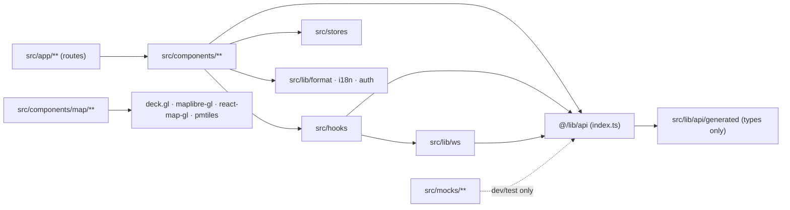

# Web Frontend Folder Structure

Purpose: the complete `frontend/` tree, with one line of responsibility per file. Put new files where this tree says they belong, and change this doc in the same PR if a new folder is needed.

Related: [README](README.md) · [CONTEXT](CONTEXT.md) · [ARCHITECTURE](ARCHITECTURE.md) · [PAGES](PAGES.md) · [DESIGN_SYSTEM](DESIGN_SYSTEM.md) · [LINTING_AND_QUALITY](LINTING_AND_QUALITY.md) · [PLAN](PLAN.md) · [../CONTRACTS.md](../CONTRACTS.md) · [../SYSTEM_OVERVIEW.md](../SYSTEM_OVERVIEW.md) · [../backend/API.md](../backend/API.md)

---

## 1. Conventions

| Rule | Detail |
|---|---|
| `src/` layout | App code lives in `src/`. `proxy.ts` and the `instrumentation*` files therefore sit in `src/`, next to `app/`, as Next requires |
| Locale segment | Every user-facing route is under `src/app/[locale]/`. English has no URL prefix and Hindi uses `/hi` ([ARCHITECTURE §3](ARCHITECTURE.md#3-route-groups-and-rendering-strategy)). Route groups `(marketing)`, `(console)` and `(open)` sit directly inside it |
| Thin pages | `page.tsx` files are server components. They await `params`/`searchParams`, call `setRequestLocale` on public pages, and render one client "workspace" component from `src/components/**` |
| File names | `kebab-case.ts(x)` for files. `PascalCase` component exports. Named exports only, except the files Next requires to default-export (lint override) |
| Colocation | Feature components go in `src/components/<feature>/`. Cross-feature primitives go in `common/`. shadcn output goes in `ui/`. Never import from another feature's internals. Promote the piece to `common/` instead |
| Generated code | Only `src/lib/api/generated/**` and `public/mockServiceWorker.js` are generated. Never edit them by hand |
| Tests | Unit and component tests go in `tests/unit/**`, mirroring `src/`. e2e goes in `tests/e2e/**`. The mock API server goes in `tests/mock-api/**` |
| Imports | Use the `@/` alias for `src/`. Relative imports only within the same folder |

## 2. Tree

```text
frontend/
├── .husky/
│   ├── pre-commit                      # cd frontend → lint-staged (eslint --fix + prettier on staged files)
│   ├── commit-msg                      # commitlint --edit (conventional commits)
│   └── pre-push                        # typecheck + unit tests when frontend/ changed vs upstream
├── .vscode/
│   ├── extensions.json                 # recommends ESLint, Prettier, Tailwind CSS IntelliSense, Playwright, i18n Ally
│   └── settings.json                   # format on save with Prettier, eslint.useFlatConfig, tailwind classFunctions (cn, cva)
├── messages/
│   ├── en.json                         # English UI strings, grouped by namespace (common, nav, aqi, cause, grap, map, plans, …)
│   └── hi.json                         # Hindi UI strings, same keys as en.json (CI parity check)
├── public/
│   ├── mockServiceWorker.js            # generated by `msw init public`; loaded only when NEXT_PUBLIC_API_MOCKING=browser
│   ├── basemap/                        # git-ignored; `pnpm basemap:fetch` downloads delhi.pmtiles + glyphs/sprites for local dev
│   ├── map/
│   │   ├── icons.png                   # IconLayer atlas (cause glyphs, suspect pin, fleet types, POIs), built by scripts/build-map-icons.mjs
│   │   ├── icons.json                  # atlas mapping {id: {x, y, width, height, anchorY, mask}}
│   │   └── hatch.png                   # FillStyleExtension pattern atlas (diagonal hatch for low confidence / "risk of worse")
│   ├── marketing/
│   │   ├── twin-snapshot.webp          # static 500 m twin render of the demo morning (Problem section, demo 0:00–0:20)
│   │   ├── architecture.svg            # AWS architecture diagram (HowItWorks, demo 2:45–3:00)
│   │   ├── hawapod-m.webp              # hardware renders / photos (Hardware section)
│   │   ├── hawapod-s.webp
│   │   ├── hawatag.webp
│   │   └── hawaeye.webp
│   └── og/
│       └── default.png                 # fallback Open Graph image
├── scripts/
│   ├── gen-api.mjs                     # fetch $API_OPENAPI_URL → openapi.snapshot.json → openapi-typescript → generated/schema.d.ts; --check mode for CI drift
│   ├── check-i18n.mjs                  # fails if messages/en.json and hi.json key sets differ or any hi value is empty
│   ├── build-map-icons.mjs             # renders lucide SVGs + custom pin to public/map/icons.png/json
│   └── fetch-basemap.mjs               # downloads the Delhi-NCR PMTiles extract + basemap assets into public/basemap (git-ignored)
├── src/
│   ├── proxy.ts                        # Next 16 proxy: next-intl locale negotiation + /console auth/role guard + no-store for console
│   ├── instrumentation.ts              # server instrumentation (optional Sentry init; logs release/app_env on boot)
│   ├── instrumentation-client.ts       # client instrumentation (optional Sentry browser init, web-vitals reporter)
│   ├── app/
│   │   ├── layout.tsx                  # pass-through root layout (required because of the root not-found)
│   │   ├── not-found.tsx               # minimal 404 for paths outside any locale (renders its own <html>)
│   │   ├── global-error.tsx            # last-resort error boundary with request id + reload
│   │   ├── robots.ts                   # allow public pages; disallow /console, /api
│   │   ├── sitemap.ts                  # /, /hi, /open, /open/api, /open/methods (+ /hi variants)
│   │   ├── icon.svg                    # favicon (Hawa leaf-wind mark in brand #0E7C66)
│   │   ├── globals.css                 # Tailwind v4 entry: @import "tailwindcss", @theme tokens, :root/.dark variables, base layer
│   │   ├── api/
│   │   │   ├── auth/
│   │   │   │   ├── login/route.ts      # POST: Origin check → backend /v1/auth/login → set hc_at, hc_rt, hc_csrf → {user, access_token, expires_at}
│   │   │   │   ├── refresh/route.ts    # POST: CSRF check → backend /v1/auth/refresh with hc_rt → rotate cookies → {access_token, expires_at}
│   │   │   │   ├── logout/route.ts     # POST: CSRF check → backend /v1/auth/logout → clear cookies
│   │   │   │   └── session/route.ts    # GET: reads hc_at → {user, access_token, expires_at} or 401 (page reload / new tab handoff)
│   │   │   ├── telemetry/
│   │   │   │   └── vitals/route.ts     # POST (sendBeacon): web-vitals → structured stdout log
│   │   │   └── healthz/route.ts        # GET: {status, release, app_env} for Amplify/ALB checks
│   │   └── [locale]/
│   │       ├── layout.tsx              # <html lang>, fonts (Inter + Noto Sans Devanagari), ThemeProvider, NextIntlClientProvider, QueryProvider, Toaster
│   │       ├── not-found.tsx           # localised 404
│   │       ├── [...rest]/page.tsx      # catch-all → notFound() so unknown localised paths use the localised 404
│   │       ├── (marketing)/
│   │       │   ├── layout.tsx          # SiteHeader + Footer, static; generateStaticParams for en/hi
│   │       │   ├── page.tsx            # "/" : Hero, Problem, Causes, HowItWorks, Proof, Hardware, Learned, Closing (force-static)
│   │       │   └── opengraph-image.tsx # static OG image with the one-line pitch
│   │       ├── (open)/
│   │       │   └── open/
│   │       │       ├── layout.tsx      # public portal chrome: nav (Map, API, Methods), "indicative" notice, attribution
│   │       │       ├── page.tsx        # "/open" : public map shell (client data from /open/v1/air, /open/v1/stations)
│   │       │       ├── api/page.tsx    # "/open/api" : static API docs (endpoints, params, examples, rate limits, licence)
│   │       │       ├── methods/page.tsx# "/open/methods" : methods narrative + model versions from /open/v1/methods
│   │       │       └── reports/
│   │       │           └── [code]/page.tsx # "/open/reports/[code]" : read-only public report status (revalidate 60)
│   │       └── (console)/
│   │           └── console/
│   │               ├── login/
│   │               │   └── page.tsx    # login form + session restore (no shell)
│   │               └── (shell)/
│   │                   ├── layout.tsx  # authenticated shell: reads session (server), ConsoleShell, WsProvider, CommandPalette, banners
│   │                   ├── page.tsx    # "/console" → redirect to /console/map (keeps ward param)
│   │                   ├── loading.tsx # shell-level skeleton
│   │                   ├── error.tsx   # section error boundary (request id, retry, back to map)
│   │                   ├── map/
│   │                   │   ├── page.tsx        # MapWorkspace (twin, hotspots, fleet, trails, scrubber, drawer)
│   │                   │   └── error.tsx       # map-specific boundary (WebGL fallback link to hotspot table)
│   │                   ├── hotspots/
│   │                   │   ├── page.tsx        # ranked hotspot table (by exposure)
│   │                   │   └── [id]/page.tsx   # hotspot detail: evidence, trajectory, suspect, actions
│   │                   ├── forecast/page.tsx   # fan chart per cell, forecast map by horizon, vulnerable places, GRAP strip
│   │                   ├── grap/page.tsx       # 3-day GRAP outlook + ward checklist (F6)
│   │                   ├── plans/
│   │                   │   ├── page.tsx        # plan list + "Draft plan" action
│   │                   │   └── [id]/
│   │                   │       ├── page.tsx    # plan detail: tasks, reasons, Auditor, What-If summary, edit, ApproveBar, live status
│   │                   │       └── error.tsx   # plan boundary (keeps ApproveBar hidden on error)
│   │                   ├── what-if/
│   │                   │   ├── page.tsx        # AI plan vs usual routes, side-by-side synced maps (?plan=)
│   │                   │   └── error.tsx
│   │                   ├── fleet/page.tsx      # assets, shifts, live positions, HawaTag status
│   │                   ├── interventions/
│   │                   │   ├── page.tsx        # logged sprays with verification status
│   │                   │   └── [id]/
│   │                   │       ├── page.tsx    # intervention + synthetic-control impact chart
│   │                   │       └── error.tsx
│   │                   ├── impact/page.tsx     # impact summary, effect table, effectiveness library explorer
│   │                   ├── alerts/page.tsx     # sent alerts, delivery status, compose dialog
│   │                   ├── schools/
│   │                   │   ├── page.tsx        # schools with today's safe window
│   │                   │   └── [id]/page.tsx   # safe-window timeline + indoor vs outdoor
│   │                   ├── reports/page.tsx    # Citizen Eyes queue
│   │                   ├── inspections/page.tsx# inspection tickets queue
│   │                   ├── sites/page.tsx      # site compliance A/B/C (STRETCH)
│   │                   ├── devices/
│   │                   │   ├── page.tsx        # device registry (admin, analyst)
│   │                   │   └── [id]/page.tsx   # calibration history, trust, health
│   │                   ├── integrity/page.tsx  # anti-gaming + device integrity flags (F15)
│   │                   ├── coverage/page.tsx   # blind spots + suggested routes (F11)
│   │                   ├── evidence/page.tsx   # weekly evidence reports (F22)
│   │                   └── admin/
│   │                       ├── page.tsx        # users, roles, ward scopes
│   │                       └── models/page.tsx # active model versions + metrics
│   ├── components/
│   │   ├── ui/                         # shadcn/ui output (do not hand-edit beyond token wiring)
│   │   │   ├── accordion.tsx  alert.tsx  alert-dialog.tsx  avatar.tsx  badge.tsx  breadcrumb.tsx  button.tsx
│   │   │   ├── calendar.tsx  card.tsx  chart.tsx  checkbox.tsx  collapsible.tsx  command.tsx  dialog.tsx
│   │   │   ├── dropdown-menu.tsx  form.tsx  hover-card.tsx  input.tsx  label.tsx  pagination.tsx  popover.tsx
│   │   │   ├── progress.tsx  radio-group.tsx  resizable.tsx  scroll-area.tsx  select.tsx  separator.tsx  sheet.tsx
│   │   │   ├── sidebar.tsx  skeleton.tsx  slider.tsx  sonner.tsx  switch.tsx  table.tsx  tabs.tsx  textarea.tsx
│   │   │   └── toggle.tsx  toggle-group.tsx  tooltip.tsx
│   │   ├── common/
│   │   │   ├── aqi-chip.tsx            # AqiChip: category fill + text-on colour + number + label + "indicative" marker
│   │   │   ├── confidence-meter.tsx    # ConfidenceMeter: 5-segment bar + word (High/Medium/Low) + value
│   │   │   ├── cause-badge.tsx         # CauseBadge: lucide glyph + label + confidence %
│   │   │   ├── simulated-badge.tsx     # SimulatedBadge: violet, flask icon, "Simulated"; also RealDeviceChip
│   │   │   ├── grap-stage-pill.tsx     # GrapStagePill: stage 0–IV + probability, AQI-band fill, pattern for IV
│   │   │   ├── uncertainty-value.tsx   # UncertaintyValue: value + required interval + level + unit
│   │   │   ├── indicative-note.tsx     # "Indicative" footnote with methods link
│   │   │   ├── ist-time.tsx            # <IstTime> absolute IST, with a <time dateTime> machine value
│   │   │   ├── relative-time.tsx       # "22 min ago", ticking via useNow
│   │   │   ├── person-hours.tsx        # person-hours formatting with en-IN grouping + range
│   │   │   ├── stale-data-banner.tsx   # amber/red staleness banner from useStaleness
│   │   │   ├── live-status-dot.tsx     # WS status: Live / Reconnecting / Polling / Offline
│   │   │   ├── empty-state.tsx         # icon + why + when last checked + action
│   │   │   ├── problem-alert.tsx       # renders ApiError (title, detail, request id, retry)
│   │   │   ├── error-boundary.tsx      # component-level boundary for map canvas and charts
│   │   │   ├── chart-figure.tsx        # <figure> + caption summary + "Show as table" toggle
│   │   │   ├── data-table.tsx          # TanStack Table wrapper (sort, filter, virtualise > 100 rows)
│   │   │   ├── role-gate.tsx           # RoleGate: hide/disable with an explanation by role
│   │   │   ├── ward-select.tsx         # ward combobox limited to the user's ward scope
│   │   │   ├── language-toggle.tsx     # en ↔ hi switch (next-intl navigation, sets NEXT_LOCALE)
│   │   │   ├── theme-toggle.tsx        # light / dark / system
│   │   │   ├── page-header.tsx         # title, subtitle, actions, as-of chip
│   │   │   ├── skip-link.tsx           # "Skip to main content"
│   │   │   └── keyboard-shortcuts.tsx  # "?" dialog listing shortcuts
│   │   ├── shell/
│   │   │   ├── console-shell.tsx       # sidebar + top bar + main region + banners
│   │   │   ├── app-sidebar.tsx         # nav groups (Operate, Verify, Protect, Data, Admin), role-filtered
│   │   │   ├── top-bar.tsx             # ward select, live status, language, theme, user menu, palette hint
│   │   │   ├── pending-plan-banner.tsx # "Plan awaiting approval" → one click to plan page
│   │   │   ├── demo-banner.tsx         # honesty banner ("Simulated fleet · real pipeline"; "Recorded scenario" in fallback)
│   │   │   ├── command-palette.tsx     # Ctrl/Cmd+K: navigate, id jump, actions
│   │   │   └── user-menu.tsx           # profile, language preference, logout
│   │   ├── map/
│   │   │   ├── map-workspace.tsx       # page-level client component: URL state, queries, layout of map + rails
│   │   │   ├── map-canvas.tsx          # next/dynamic boundary (ssr:false) + skeleton + ErrorBoundary
│   │   │   ├── map-view.tsx            # react-map-gl <Map> + DeckOverlay + controls (the only file that imports react-map-gl)
│   │   │   ├── deck-overlay.tsx        # useControl(MapboxOverlay interleaved) + setProps bridge for rAF updates
│   │   │   ├── synced-maps.tsx         # two MapViews sharing viewState (What-If)
│   │   │   ├── basemap/
│   │   │   │   ├── pmtiles.ts          # registers pmtiles:// protocol once
│   │   │   │   └── style.ts            # @protomaps/basemaps style (light/dark, lang en, desaturated) + LABELS_LAYER_ID
│   │   │   ├── layers/
│   │   │   │   ├── index.ts            # buildLayers(inputs) → ordered Layer[] (z-order from ARCHITECTURE §9.2)
│   │   │   │   ├── twin.ts             # MVTLayer twin-cells (fill + hatch sublayers)
│   │   │   │   ├── forecast.ts         # forecast-grid (P50 fill + "risk of worse" hatch)
│   │   │   │   ├── ward-boundaries.ts
│   │   │   │   ├── blind-spots.ts
│   │   │   │   ├── hotspots.ts         # outlines + rank TextLayer
│   │   │   │   ├── trajectories.ts     # dashed PathLayer + hourly ticks
│   │   │   │   ├── suspects.ts         # suspect-links LineLayer + suspect-pins IconLayer
│   │   │   │   ├── trails.ts           # TripsLayer pod trails
│   │   │   │   ├── pois.ts             # schools/hospitals IconLayer + spike halo
│   │   │   │   ├── fleet.ts            # IconLayer with heading + status/simulated ring
│   │   │   │   └── selection.ts        # selected cell/hotspot outline
│   │   │   ├── colors.ts               # token → RGBA arrays (AQI CPCB + CVD palettes), opacity-from-confidence
│   │   │   ├── icons.ts                # atlas mapping import + icon ids per cause/asset/POI
│   │   │   ├── use-map-layers.ts       # assembles inputs from stores + queries → buildLayers (memoised)
│   │   │   ├── use-trips-clock.ts      # rAF clock outside React (pauses on hidden / reduced motion / lite)
│   │   │   ├── map-toolbar.tsx         # ward, pollutant, mode, layers popover, search, lite, fullscreen
│   │   │   ├── layer-toggles.tsx       # layer visibility switches with counts
│   │   │   ├── map-legend.tsx          # AQI bands (label + range), confidence ramp + hatch, causes, symbols, simulated
│   │   │   ├── time-scrubber.tsx       # live / historical 15-min steps / forecast horizon; keyboard ← →
│   │   │   ├── cell-drawer.tsx         # values ± range, AQI range, confidence, cause, exposure, evidence, forecast mini-chart
│   │   │   ├── map-tooltip.tsx         # React hover card positioned from pick info
│   │   │   ├── map-a11y-summary.tsx    # live-region text summary + cell cursor keyboard mode
│   │   │   ├── webgl-fallback.tsx      # no WebGL2 / context lost → table + static image
│   │   │   └── map-test-hooks.ts       # window.__hawa.map when NEXT_PUBLIC_E2E=1
│   │   ├── hotspots/
│   │   │   ├── hotspot-rail.tsx        # map side list (top N, keyboard path to features)
│   │   │   ├── hotspot-card.tsx        # rank, cause, exposure range, AQI chip, confidence
│   │   │   ├── hotspot-table.tsx       # full ranked table
│   │   │   ├── hotspot-detail.tsx      # detail layout
│   │   │   └── evidence-list.tsx       # spikes, citizen reports, fire points, stations
│   │   ├── forecast/
│   │   │   ├── fan-chart.tsx           # P10–P90 band + P50 line + observed history + now line + AQI bands
│   │   │   ├── fan-chart-mini.tsx      # drawer sparkline variant (24 h)
│   │   │   ├── horizon-slider.tsx      # +1…+72 h, day ticks, keyboard
│   │   │   ├── grap-outlook-strip.tsx  # 3-day pills with probability
│   │   │   ├── grap-checklist.tsx      # ward checklist grouped by agency
│   │   │   └── vulnerable-places-list.tsx # schools/hospitals inside forecast spike
│   │   ├── plans/
│   │   │   ├── plan-list.tsx           # table with status, mode, window, exposure range, objections
│   │   │   ├── draft-plan-dialog.tsx   # ward(s), window, mode=manual → POST /v1/plans/draft
│   │   │   ├── plan-header.tsx         # status pill, mode, window, version, simulated count
│   │   │   ├── agent-progress.tsx      # drafting timeline (exposure → optimiser → Planner → Auditor → Communicator)
│   │   │   ├── plan-task-list.tsx      # grouped by asset route; edit affordances
│   │   │   ├── plan-task-card.tsx      # PlanTaskCard: asset, cell, window, cause, reason, expected effect, status
│   │   │   ├── task-editor.tsx         # retime / reassign / remove forms
│   │   │   ├── asset-picker.tsx        # cause-compatible, available-in-window assets
│   │   │   ├── planner-rationale.tsx   # Planner's plan-level explanation
│   │   │   ├── auditor-panel.tsx       # objections list with counts and filter
│   │   │   ├── auditor-comment.tsx     # AuditorComment: severity, text, suggestion, resolution, actions
│   │   │   ├── plan-diff.tsx           # vs AI draft: added/removed/changed + exposure delta
│   │   │   ├── what-if-summary-card.tsx# AI vs usual ranges + link to What-If
│   │   │   ├── approve-bar.tsx         # ApproveBar: sticky summary + Reject / Edit / Approve
│   │   │   ├── approve-dialog.tsx      # confirmation summarising impact
│   │   │   ├── reject-dialog.tsx       # reason required
│   │   │   ├── conflict-dialog.tsx     # 409 version conflict with diff
│   │   │   ├── live-task-status.tsx    # dispatched → verified progress, missed/skipped reasons
│   │   │   ├── what-if-compare.tsx     # What-If page body (KPIs, range chart, synced maps, per-hotspot table)
│   │   │   └── exposure-range-chart.tsx# range bars AI / usual / delta with zero line
│   │   ├── impact/
│   │   │   ├── intervention-table.tsx  # sprays with asset, litres, cells, verification status
│   │   │   ├── synthetic-control-chart.tsx # treated vs synthetic + CI band + spray/verification annotations
│   │   │   ├── gap-chart.tsx           # effect over time (observed − synthetic) with CI
│   │   │   ├── effect-summary.tsx      # effect ± CI, verdict, placebo p, method, injected effect
│   │   │   ├── verdict-badge.tsx       # effective / no_detectable_effect / inconclusive / adverse
│   │   │   ├── effect-table.tsx        # impacts with whiskers
│   │   │   ├── effect-whisker.tsx      # dot + CI whisker, zero line
│   │   │   ├── donor-table.tsx         # donor cells + weights
│   │   │   └── effectiveness-explorer.tsx # cause × asset matrix with medians, CIs, n
│   │   ├── fleet/
│   │   │   ├── asset-table.tsx         # assets with status, shift, HawaTag health, simulated
│   │   │   ├── asset-detail-sheet.tsx  # shift timeline, today's tasks, recent sprays
│   │   │   ├── shift-timeline.tsx
│   │   │   └── hawatag-status.tsx      # tag online, flow/pump state, last spray, tamper
│   │   ├── alerts/
│   │   │   ├── alert-table.tsx
│   │   │   ├── alert-detail-sheet.tsx  # bilingual text, per-channel delivery, masked recipients
│   │   │   ├── delivery-status.tsx     # requested → queued → sent → delivered | failed | read counts
│   │   │   ├── compose-alert-dialog.tsx# react-hook-form + Zod; en + hi required; preview counts
│   │   │   └── bilingual-preview.tsx   # WhatsApp-style bubbles en / hi
│   │   ├── schools/
│   │   │   ├── school-table.tsx
│   │   │   ├── safe-window-timeline.tsx
│   │   │   └── indoor-outdoor-chart.tsx
│   │   ├── reports/
│   │   │   ├── report-queue.tsx
│   │   │   └── report-detail-sheet.tsx # photo (presigned), vision verdict, matched spike, ticket
│   │   ├── inspections/
│   │   │   ├── inspection-table.tsx
│   │   │   └── close-inspection-dialog.tsx
│   │   ├── sites/
│   │   │   ├── site-table.tsx
│   │   │   └── site-grade-chip.tsx     # A/B/C with letter + colour + pattern
│   │   ├── devices/
│   │   │   ├── device-table.tsx
│   │   │   ├── calibration-history.tsx # coefficient versions + fit stats
│   │   │   ├── trust-chart.tsx
│   │   │   └── register-device-dialog.tsx
│   │   ├── integrity/
│   │   │   └── integrity-flag-list.tsx
│   │   ├── coverage/
│   │   │   └── blind-spot-list.tsx
│   │   ├── evidence/
│   │   │   └── evidence-report-table.tsx
│   │   ├── admin/
│   │   │   ├── user-table.tsx
│   │   │   ├── user-dialog.tsx         # role + ward scope multi-select
│   │   │   └── model-versions-table.tsx
│   │   ├── marketing/
│   │   │   ├── site-header.tsx         # logo, section links, language toggle, "Officer login", "Open data"
│   │   │   ├── hero.tsx
│   │   │   ├── problem.tsx
│   │   │   ├── one-number-vs-street-map.tsx # demo 0:00–0:20 visual
│   │   │   ├── fleet-stats.tsx         # 376 / 266 / 91 / ~2,000 counters (no count-up under reduced motion)
│   │   │   ├── causes.tsx
│   │   │   ├── how-it-works.tsx
│   │   │   ├── loop-diagram.tsx        # 7-step loop, SVG, accessible list fallback
│   │   │   ├── day-timeline.tsx        # 16:00 → nightly (§8)
│   │   │   ├── aws-architecture.tsx    # architecture diagram (demo 2:45–3:00)
│   │   │   ├── proof.tsx               # causal verification + What-If explainer with example chart
│   │   │   ├── hardware.tsx
│   │   │   ├── learned.tsx             # China / Japan lessons + what we refuse to copy
│   │   │   ├── closing.tsx             # closing line band
│   │   │   ├── footer.tsx              # sources, "indicative" disclaimer, links
│   │   │   └── source-note.tsx         # inline citation (§17 source)
│   │   └── open/
│   │       ├── open-map.tsx            # public map (coarse cells + stations), no fleet
│   │       ├── station-list.tsx
│   │       ├── open-cell-panel.tsx     # history chart with band
│   │       ├── api-docs.tsx            # endpoint cards with examples
│   │       ├── methods-content.tsx
│   │       └── report-status-card.tsx
│   ├── hooks/
│   │   ├── use-now.ts                  # ticking clock (default 30 s) for staleness and relative times
│   │   ├── use-staleness.ts            # as_of + thresholds → fresh | amber | red + label
│   │   ├── use-twin-meta.ts            # twin meta query (WS-driven, poll fallback)
│   │   ├── use-channel.ts              # subscribe to a WS channel for the component lifetime
│   │   ├── use-ws-status.ts            # socket status for LiveStatusDot
│   │   ├── use-session.ts              # user, role, ward_ids, can()
│   │   ├── use-ward.ts                 # selected ward (URL → preference → first scope)
│   │   ├── use-url-state.ts            # typed searchParams read/write (replace, shallow)
│   │   ├── use-keyboard-shortcut.ts    # scoped shortcuts (respect inputs, allow disabling)
│   │   ├── use-reduced-motion.ts
│   │   ├── use-media-query.ts
│   │   └── use-fleet-positions.ts      # selector over vanilla fleetStore for tables (throttled)
│   ├── stores/
│   │   ├── map-store.ts                # viewState, layers, pollutant, mode, horizon, ts, selection, palette, lite
│   │   ├── fleet-store.ts              # vanilla store: positions, headings, trail ring buffers
│   │   ├── plan-edit-store.ts          # edit mode, pending ops, drag state
│   │   └── ui-store.ts                 # palette open, drawers, dismissed banners
│   ├── lib/
│   │   ├── api/
│   │   │   ├── generated/
│   │   │   │   └── schema.d.ts         # openapi-typescript output (paths, components) (GENERATED)
│   │   │   ├── openapi.snapshot.json   # the backend OpenAPI document the types were generated from
│   │   │   ├── client.ts               # openapi-fetch client + middleware (auth, ids, retry-on-401)
│   │   │   ├── server-client.ts        # server-only client using API_URL_INTERNAL + hc_at (RSC prefetch, optional)
│   │   │   ├── errors.ts               # Problem, ApiError, unwrap, toProblem
│   │   │   ├── correlation.ts          # correlation id scope (plan correlation_id or page session id)
│   │   │   ├── types.ts                # friendly aliases over components["schemas"]
│   │   │   ├── enums.ts                # runtime enum arrays + guards + toKnown*()
│   │   │   ├── keys.ts                 # qk query-key factory
│   │   │   ├── queries/                # queryOptions per domain
│   │   │   │   ├── twin.ts  cells.ts  hotspots.ts  forecast.ts  grap.ts  plans.ts  fleet.ts  assets.ts
│   │   │   │   ├── interventions.ts  impact.ts  alerts.ts  schools.ts  reports.ts  inspections.ts  sites.ts
│   │   │   │   └── devices.ts  integrity.ts  coverage.ts  evidence.ts  admin.ts  pois.ts  wards.ts  open.ts
│   │   │   ├── mutations/              # useMutation hooks with idempotency, optimistic updates, scope
│   │   │   │   ├── plans.ts            # draft, patch ops, reoptimize, simulate, approve, reject
│   │   │   │   ├── alerts.ts  inspections.ts  devices.ts  evidence.ts  admin.ts
│   │   │   └── index.ts                # the only public surface of src/lib/api
│   │   ├── ws/
│   │   │   ├── client.ts               # HawaSocket singleton (auth subprotocol, heartbeat, backoff, resubscribe)
│   │   │   ├── backoff.ts              # full-jitter exponential backoff
│   │   │   ├── channels.ts             # Channel type, message types, shape guards
│   │   │   ├── router.ts               # event → invalidateQueries / setQueryData / fleetStore
│   │   │   ├── resync.ts               # channel → keys to invalidate after reconnect
│   │   │   ├── polling-fallback.ts     # refetchInterval map when WS is blocked
│   │   │   └── provider.tsx            # WsProvider (console shell) + context
│   │   ├── auth/
│   │   │   ├── cookies.ts              # cookie names + options (server-only)
│   │   │   ├── server.ts               # readAccessClaims (decode / jose verify) for proxy + RSC (server-only)
│   │   │   ├── session.ts              # client: in-memory token, scheduleRefresh, refreshOnce (Web Locks + BroadcastChannel)
│   │   │   ├── csrf.ts                 # issue/verify double-submit token, Origin check
│   │   │   ├── roles.ts                # CONSOLE_ROLES, can(role, action), canAccessRoute(role, path)
│   │   │   └── ward-scope.ts           # ward options + default ward resolution
│   │   ├── format/
│   │   │   ├── units.ts                # µg/m³, ppb, ppm, °C, %, km/h, L, L/min, person-hours
│   │   │   ├── time.ts                 # IST absolute/relative, durations, staleness labels
│   │   │   ├── aqi.ts                  # CPCB breakpoints, sub-index, category, AQI range from PM range, GRAP from AQI
│   │   │   ├── number.ts               # en-IN grouping, lakh/crore compact, ₹ from paise, percent
│   │   │   ├── uncertainty.ts          # σ from var, 80 % interval, format interval, overlap check
│   │   │   └── ids.ts                  # uuidv7, cell id parse, g500 → g1k parent, id pattern detection
│   │   ├── i18n/
│   │   │   ├── routing.ts              # defineRouting (en, hi, as-needed)
│   │   │   ├── request.ts              # getRequestConfig (messages, timeZone Asia/Kolkata, formats)
│   │   │   ├── navigation.ts           # createNavigation → Link, redirect, useRouter, usePathname
│   │   │   └── formats.ts              # shared dateTime/number formats
│   │   ├── env.ts                      # Zod-validated env (server + client schema)
│   │   ├── logger.ts                   # dev-only debug logger (the only console usage)
│   │   ├── telemetry.ts                # web-vitals beacon, optional Sentry helpers
│   │   ├── storage.ts                  # safe localStorage for non-sensitive prefs (ward, palette, lite)
│   │   └── utils.ts                    # cn() (clsx + tailwind-merge), assertNever, typed helpers
│   ├── mocks/
│   │   ├── handlers/                   # MSW http + ws handlers per area (shapes exactly as API.md / ARCHITECTURE §18)
│   │   │   ├── auth.ts  twin.ts  hotspots.ts  cells.ts  forecast.ts  grap.ts  plans.ts  fleet.ts  impact.ts
│   │   │   ├── alerts.ts  schools.ts  reports.ts  inspections.ts  sites.ts  devices.ts  integrity.ts  coverage.ts
│   │   │   ├── evidence.ts  admin.ts  open.ts  pois.ts  wards.ts  ws.ts
│   │   │   └── index.ts                # handler list; passthrough() for endpoints listed in MOCK_PASSTHROUGH
│   │   ├── fixtures/                   # JSON fixtures shared with backend contract tests and Flutter
│   │   │   ├── me.officer.json  twin.latest.json  twin.runs.json  hotspots.ward-084.json  hotspot.detail.json
│   │   │   ├── cell.g500-041-077.json  forecast.g1k-020-038.json  forecast.grid.h24.json  grap.outlook.json
│   │   │   ├── grap.checklist.stage1.json  plans.list.json  plan.draft.json  plan.draft.v2.json  plan.simulation.json
│   │   │   ├── fleet.live.json  fleet.trails.json  interventions.list.json  impact.intervention.json
│   │   │   ├── impact.summary.json  effectiveness.json  alerts.list.json  schools.list.json  devices.list.json
│   │   │   └── pois.ward-084.geojson  wards.geojson  open.air.json  open.stations.json  twin-tiles/ (sample .mvt)
│   │   ├── scenarios/
│   │   │   └── golden-path.json        # timed WS script: twin.updated, hotspot.updated, plan.drafted, task.*, impact.verified
│   │   ├── browser.ts                  # setupWorker(...handlers) for NEXT_PUBLIC_API_MOCKING=browser
│   │   ├── node.ts                     # setupServer(...handlers) for Vitest
│   │   └── enable.ts                   # dynamic import boundary so mocks never ship when mocking is off
│   └── styles/
│       ├── tokens.json                 # machine-readable design tokens (source for globals.css, colors.ts, Flutter theme)
│       └── patterns.css                # CSS hatch/stripe patterns for chips (GRAP IV, site grade C, low confidence)
├── tests/
│   ├── unit/
│   │   ├── setup.ts                    # RTL + jest-dom matchers, MSW server lifecycle, next-intl test provider
│   │   ├── utils/render.tsx            # render with QueryClient, intl (en/hi), theme
│   │   ├── format/                     # aqi.test.ts, uncertainty.test.ts, time.test.ts, number.test.ts, ids.test.ts
│   │   ├── api/                        # errors.test.ts, client-retry.test.ts, keys.test.ts
│   │   ├── ws/                         # client.test.ts (backoff, heartbeat, resubscribe, 4401), router.test.ts
│   │   ├── auth/                       # session.test.ts (single-flight, lock), roles.test.ts, csrf.test.ts
│   │   ├── map/                        # layers.test.ts (pure builders), colors.test.ts
│   │   ├── components/                 # aqi-chip, uncertainty-value, approve-bar, auditor-comment, fan-chart data, synthetic-control data
│   │   ├── fixtures.contract.test.ts   # every fixture validates against openapi.snapshot.json (Ajv)
│   │   └── i18n.parity.test.ts         # en/hi key parity + ICU syntax check
│   ├── e2e/
│   │   ├── fixtures.ts                 # test.extend: login helper, axe helper, scenario control
│   │   ├── flow-a.spec.ts              # golden path: login → map → forecast → plan → what-if → approve → impact
│   │   ├── map.spec.ts                 # layers, drawer, scrubber, keyboard cell cursor, stale banner
│   │   ├── plan-edit.spec.ts           # optimistic edit, conflict dialog, blocking objection
│   │   ├── ws-resilience.spec.ts       # reconnect + resync; polling fallback
│   │   ├── marketing.spec.ts           # sections render, numbers present, /hi renders
│   │   ├── open.spec.ts                # public map, 429 handling, indicative labels
│   │   ├── a11y.spec.ts                # axe on every route (en + hi)
│   │   └── visual/                     # optional toHaveScreenshot baselines (marketing, charts)
│   └── mock-api/
│       ├── server.ts                   # HTTP (@mswjs/http-middleware) + WS (ws) on :4010, same handlers as src/mocks
│       ├── ws.ts                       # channel subscriptions + scenario playback
│       └── control.ts                  # POST /__mock/scenario/{name}/{step}, /__mock/reset for e2e
├── .env.example                        # every variable from ARCHITECTURE §17.2 with local defaults and comments
├── .gitattributes                      # * text=auto eol=lf (Prettier endOfLine lf on Windows machines)
├── .gitignore                          # .next, node_modules, coverage, playwright-report, test-results, public/basemap, .env*.local
├── .npmrc                              # engine-strict=true; node-linker per Amplify guidance (verify)
├── .nvmrc                              # Node LTS major (22)
├── .prettierignore                     # generated, lockfile, .next, public/mockServiceWorker.js, fixtures/twin-tiles
├── amplify.yml                         # Amplify Hosting build spec (appRoot frontend) (ARCHITECTURE §17.1)
├── commitlint.config.mjs               # conventional commits + scopes
├── components.json                     # shadcn/ui config (style, aliases @/components/ui, css src/app/globals.css)
├── eslint.config.mjs                   # ESLint 9 flat config (LINTING_AND_QUALITY §4)
├── knip.json                           # dead code config (optional gate)
├── lint-staged.config.mjs              # staged-file tasks
├── next.config.ts                      # reactCompiler, typedRoutes, security headers/CSP, next-intl plugin, optional standalone
├── next-env.d.ts                       # Next-managed type references (git-ignored per Next default)
├── package.json                        # scripts, packageManager (pnpm), engines, deps
├── playwright.config.ts                # projects, webServer (mock API + next start), axe, traces
├── pnpm-lock.yaml                      # lockfile (committed)
├── postcss.config.mjs                  # { plugins: { "@tailwindcss/postcss": {} } }
├── prettier.config.mjs                 # Prettier + prettier-plugin-tailwindcss (tailwindStylesheet)
├── README.md                           # short: how to run + link to docs/frontend/README.md
├── tsconfig.json                       # strict set (LINTING_AND_QUALITY §8), paths @/* → src/*
└── vitest.config.mts                   # jsdom, setup, coverage thresholds
```

The CI workflow lives at the repository root: `.github/workflows/frontend.yml`, path-filtered to `frontend/**` ([LINTING_AND_QUALITY §13](LINTING_AND_QUALITY.md#13-ci-github-actions)).

## 3. Dependency direction



Lint enforces these rules ([LINTING_AND_QUALITY §6](LINTING_AND_QUALITY.md#6-architecture-boundaries-restricted-imports)):
- Only `src/lib/api/**` may import `openapi-fetch` or `src/lib/api/generated/**`. Everything else imports from `@/lib/api`.
- Only `src/components/map/**` may import `deck.gl`, `@deck.gl/*`, `maplibre-gl`, `react-map-gl/*` and `pmtiles`. This keeps them in the lazy chunk.
- Only `src/mocks/**`, `tests/**` and `src/mocks/enable.ts` callers import mocks, and only through the dynamic `enable.ts` boundary.
- `src/lib/**` never imports from `src/components/**`.
- Server-only modules (`src/lib/auth/server.ts`, `cookies.ts`, `src/lib/api/server-client.ts`) `import "server-only"`.

## 4. Where things go (quick decisions)

| I am adding… | Put it in |
|---|---|
| A new console page | `src/app/[locale]/(console)/console/(shell)/<route>/page.tsx` (thin) + `src/components/<feature>/<route>-workspace.tsx` + route access in `src/lib/auth/roles.ts` + nav in `app-sidebar.tsx` + strings in both `messages/*.json` |
| A new API call | Regenerate types (`pnpm gen:api`) → `src/lib/api/queries/<domain>.ts` or `mutations/<domain>.ts` → key in `keys.ts` → MSW handler + fixture |
| A new WebSocket event | `src/lib/ws/channels.ts` (type) → `router.ts` (effect) → `resync.ts` (keys) → mock scenario step |
| A new map layer | `src/components/map/layers/<name>.ts` (pure builder) → `layers/index.ts` (z-order) → toggle in `layer-toggles.tsx` → legend entry → ARCHITECTURE §9.2 row |
| A new colour | `src/styles/tokens.json` + DESIGN_SYSTEM §2 (and tell the Flutter lead) |
| A new user-facing string | `messages/en.json` and `messages/hi.json` together (CI parity) |
| A formatting rule | `src/lib/format/*.ts` + unit test (≥ 95 % coverage target) |
